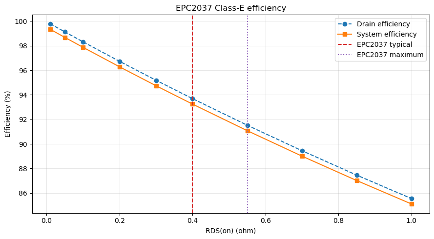
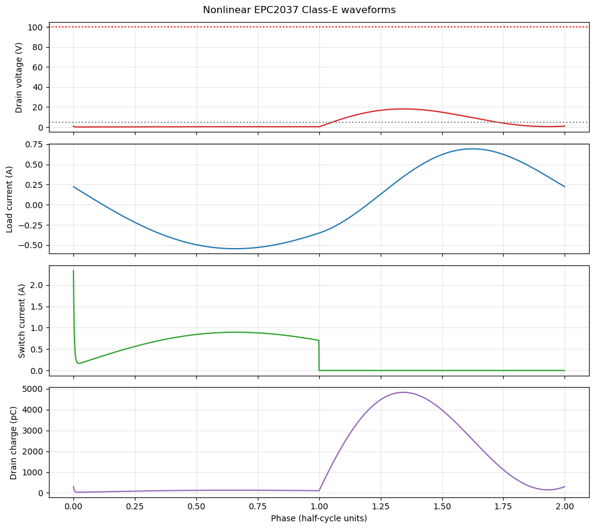

```python

# ================================================================
# GaN CLASS-E AMPLIFIER — EPC2037
# Nonlinear Coss / charge-based switching / energy accounting
# ================================================================

import numpy as np
import matplotlib.pyplot as plt
from scipy.integrate import solve_ivp
from scipy.optimize import brentq

# 1. SPECIFICATIONS
VDD, P_OUT, F0 = 4.85, 1.65, 14e6
W0 = 2*np.pi*F0
T, TH = 1/F0, 1/(2*F0)
VDS_MAX, ID_MAX = 100.0, 1.7
RON_TYP, RON_MAX = 0.400, 0.550
VG, QG = 5.0, 115e-12
P_GATE = QG*VG*F0

# EPC2037 datasheet parameters
COSS_50 = 6.5e-12
COSS_TR = 12e-12
QOSS_50 = 600e-12

# 2. ANALYTICAL CLASS-E COEFFICIENTS
a = 2/np.sqrt(np.pi**2+4)
phi = np.pi-np.arctan(2/np.pi)
KR = 2*a**2
KC = 2*a**2/np.pi

Ropt = KR*VDD**2/P_OUT
Csh_ideal = KC/(W0*Ropt)

IR_norm = np.sqrt(2/KR)
IDC_norm = a*IR_norm
C_norm = KC/KR

th = np.linspace(0, 2*np.pi, 200001)
vd = np.zeros_like(th)
off = th >= np.pi
x = th[off]

vd[off] = (
    IDC_norm*(x-np.pi)
    + IR_norm*(np.cos(x+phi)-np.cos(np.pi+phi))
)/C_norm

V1 = np.trapezoid(vd*np.exp(-1j*th), th)/np.pi
I1 = IR_norm*np.exp(1j*(phi-np.pi/2))
Z1 = V1/I1
KL = Z1.imag/Z1.real

L1 = KL*Ropt/W0

# 3. NONLINEAR OUTPUT CHARGE MODEL
# Qoss(V) = Q50*(V/50)**M
# Coss(50V) = M*Q50/50

M = COSS_50*50/QOSS_50

def qoss(v):
    v = abs(float(v))
    return QOSS_50*(v/50)**M

def coss(v):
    v = max(abs(float(v)), 1e-12)
    return M*QOSS_50/50*(v/50)**(M-1)

def eoss(v):
    v = abs(float(v))
    return M/(M+1)*QOSS_50*50*(v/50)**(M+1)

# External capacitance: 50 V differential-capacitance
# reference approximation. COSS_TR is not interchangeable
# with COSS_50 and is retained as a datasheet reference.
C_external = Csh_ideal-COSS_50

if C_external <= 0:
    raise ValueError("External shunt capacitance is non-positive.")

def q_total(v):
    v = float(v)
    return C_external*v+np.sign(v)*qoss(v)

def e_total(v):
    v = float(v)
    return 0.5*C_external*v**2+eoss(v)

# Invert the nonlinear charge relation.
def voltage_from_charge(q):
    q = float(q)
    if abs(q) < 1e-30:
        return 0.0
    sign = np.sign(q)
    target = abs(q)
    upper = max(100.0, target/C_external+50.0)
    while q_total(upper) < target:
        upper *= 2
    return sign*brentq(
        lambda v: q_total(v)-target,
        0.0, upper, xtol=1e-12
    )

# 4. OUTPUT TANK
QL = 3.0
L2 = QL*Ropt/W0
C2 = 1/(W0**2*L2)
LT = L1+L2

# 5. SWITCHING DIFFERENTIAL EQUATIONS
# State: [Q_D, iL, v2]
#
# ON:  dQ/dt = IDC-iL-vD/RON
# OFF: dQ/dt = IDC-iL
#
# The switch current and capacitor current are
# therefore explicitly separated by KCL.

def make_on(IDC, RON):
    def f(t, y):
        q, iL, v2 = y
        vD = voltage_from_charge(q)
        iSW = vD/RON
        return [
            IDC-iL-iSW,
            (vD-v2-Ropt*iL)/LT,
            iL/C2
        ]
    return f

def make_off(IDC):
    def f(t, y):
        q, iL, v2 = y
        vD = voltage_from_charge(q)
        return [
            IDC-iL,
            (vD-v2-Ropt*iL)/LT,
            iL/C2
        ]
    return f

def cycle(IDC, RON=RON_TYP, warmup=300, samples=1200):
    if RON <= 0:
        raise ValueError("RON must be positive in the finite-resistance model.")

    fon, foff = make_on(IDC, RON), make_off(IDC)
    y = np.zeros(3)
    rtol, atol = 2e-8, 1e-12

    # Converge to periodic steady state.
    for k in range(warmup):
        s1 = solve_ivp(
            fon, (0, TH), y, method="LSODA",
            rtol=rtol, atol=atol
        )
        s2 = solve_ivp(
            foff, (0, TH), s1.y[:, -1],
            method="LSODA", rtol=rtol, atol=atol
        )
        yn = s2.y[:, -1]

        if np.max(np.abs(yn-y)) < 1e-10:
            y = yn
            break
        y = yn

    # Final complete cycle with dense output.
    s1 = solve_ivp(
        fon, (0, TH), y, method="LSODA",
        rtol=rtol, atol=atol, dense_output=True
    )
    s2 = solve_ivp(
        foff, (0, TH), s1.y[:, -1],
        method="LSODA", rtol=rtol,
        atol=atol, dense_output=True
    )

    t1 = np.linspace(0, TH, samples, endpoint=False)
    t2 = np.linspace(0, TH, samples, endpoint=False)
    y1, y2 = s1.sol(t1), s2.sol(t2)

    q = np.r_[y1[0], y2[0]]
    iL = np.r_[y1[1], y2[1]]
    v2 = np.r_[y1[2], y2[2]]
    t = np.r_[t1, TH+t2]

    vD = np.array([voltage_from_charge(z) for z in q])
    iSW = np.r_[vD[:samples]/RON, np.zeros(samples)]

    return {
        "t": t, "q": q, "v_D": vD,
        "i_L": iL, "i_sw": iSW, "v2": v2,
        "v_avg": np.trapezoid(vD, t)/T,
        "v_peak": np.max(vD),
        "v_turnon": voltage_from_charge(s2.y[0, -1]),
        "i_turnon": s2.y[1, -1],
        "periodic_error": np.max(np.abs(s2.y[:, -1]-y))
    }

# 6. SELF-CONSISTENT OPERATING POINT
def solve_operating_point(RON):
    cache = {}

    def residual(IDC):
        h = cycle(IDC, RON)
        cache[IDC] = h
        return h["v_avg"]-VDD

    lo, hi = 0.05*P_OUT/VDD, 3.0*P_OUT/VDD
    flo, fhi = residual(lo), residual(hi)

    if flo*fhi > 0:
        raise RuntimeError(
            f"No operating-point bracket for RON={RON:.3f} ohm: "
            f"residuals {flo:.4g}, {fhi:.4g}"
        )

    IDC = brentq(residual, lo, hi, xtol=1e-9)
    h = cycle(IDC, RON, warmup=500)
    return h, IDC, h["v_avg"]-VDD

# 7. POWER AND ENERGY ACCOUNTING
def power_report(h, IDC, RON):
    t, iL = h["t"], h["i_L"]
    iSW, vD = h["i_sw"], h["v_D"]

    P_IN = VDD*IDC
    P_LOAD = np.trapezoid(Ropt*iL**2, t)/T
    P_RON = np.trapezoid(RON*iSW**2, t)/T

    # Stored capacitor energy: diagnostic only.
    E_CAP = np.array([e_total(v) for v in vD])
    E_CAP_AVG = np.trapezoid(E_CAP, t)/T
    E_CAP_DELTA = E_CAP[-1]-E_CAP[0]

    # Instantaneous power balance:
    # source -> load + switch + capacitor + tank storage.
    P_SOURCE_ACTUAL = np.trapezoid(vD*IDC, t)/T

    # Switch dissipation is integrated directly.
    P_SWITCH = P_RON

    BALANCE = P_SOURCE_ACTUAL-P_LOAD-P_RON

    ETA_DRAIN = P_LOAD/P_IN
    ETA_SYSTEM = P_LOAD/(P_IN+P_GATE)

    return {
        "P_in": P_IN,
        "P_source_actual": P_SOURCE_ACTUAL,
        "P_load": P_LOAD,
        "P_Ron": P_RON,
        "P_Coss": 0.0,
        "P_ext": 0.0,
        "P_switch": P_SWITCH,
        "P_gate": P_GATE,
        "P_total": P_IN+P_GATE,
        "E_cap_avg": E_CAP_AVG,
        "E_cap_delta": E_CAP_DELTA,
        "balance": BALANCE,
        "eta_drain": ETA_DRAIN,
        "eta_system": ETA_SYSTEM
    }

# 8. MAIN OPERATING POINT
h, IDC, residual = solve_operating_point(RON_TYP)
p = power_report(h, IDC, RON_TYP)

print("\nCLASS-E / EPC2037 RESULTS")
print("="*55)
print(f"KR                 : {KR:.6f}")
print(f"KC                 : {KC:.6f}")
print(f"KL                 : {KL:.6f}")
print(f"\nRopt               : {Ropt:.3f} ohm")
print(f"Csh ideal          : {Csh_ideal*1e12:.3f} pF")
print(f"C external         : {C_external*1e12:.3f} pF")
print(f"L1                 : {L1*1e9:.3f} nH")
print(f"L2                 : {L2*1e9:.3f} nH")
print(f"C2                 : {C2*1e12:.3f} pF")

print("\nNONLINEAR COSS MODEL")
print("-"*55)
print(f"Qoss(50V)          : {qoss(50)*1e12:.3f} pC")
print(f"Coss(50V)          : {coss(50)*1e12:.3f} pF")
print(f"Coss(TR) datasheet : {COSS_TR*1e12:.3f} pF")
print(f"Model exponent     : {M:.6f}")

print("\nOPERATING POINT")
print("-"*55)
print(f"IDC                : {IDC*1e3:.3f} mA")
print(f"Drain voltage peak : {h['v_peak']:.3f} V")
print(f"Turn-on voltage    : {h['v_turnon']:.5f} V")
print(f"Load current peak  : {np.max(h['i_L']):.4f} A")
print(f"Switch current peak: {np.max(h['i_sw']):.4f} A")
print(f"DC voltage residual: {residual*1e3:+.6f} mV")
print(f"Periodic state error: {h['periodic_error']:.3e}")

print("\nPOWER BALANCE")
print("-"*55)
for key in [
    "P_in", "P_source_actual", "P_load",
    "P_Ron", "P_switch", "P_gate",
    "P_total", "balance"
]:
    print(f"{key:20s}: {p[key]*1e3:10.4f} mW")

print(f"\nDrain efficiency : {p['eta_drain']*100:.3f} %")
print(f"System efficiency: {p['eta_system']*100:.3f} %")
print(f"Average C energy : {p['E_cap_avg']*1e9:.4f} nJ")

# 9. DEVICE LIMITS
print("\nDEVICE LIMITS")
print("-"*55)
print(f"VDS peak : {h['v_peak']:.3f} / {VDS_MAX:.1f} V")
print(f"ID peak  : {np.max(h['i_L']):.3f} / {ID_MAX:.2f} A")
print(f"ISW peak : {np.max(h['i_sw']):.3f} A")

# 10. RON SWEEP
ron_values = np.array([
    0.01, 0.05, 0.10, 0.20, 0.30,
    0.40, 0.55, 0.70, 0.85, 1.00
])

sweep = []
print("\nRON SWEEP")
print("="*95)
print(
    f"{'RON':>6} {'IDC(mA)':>9} {'Vpk(V)':>9} "
    f"{'Pload(mW)':>11} {'PRon(mW)':>11} "
    f"{'Balance(mW)':>13} {'Drain(%)':>10} {'System(%)':>10}"
)

for ron in ron_values:
    hs, ids, res = solve_operating_point(ron)
    ps = power_report(hs, ids, ron)
    sweep.append([
        ron, ids, hs["v_peak"], ps["P_load"],
        ps["P_Ron"], ps["balance"],
        ps["eta_drain"], ps["eta_system"]
    ])
    print(
        f"{ron:6.2f} {ids*1e3:9.2f} "
        f"{hs['v_peak']:9.2f} "
        f"{ps['P_load']*1e3:11.3f} "
        f"{ps['P_Ron']*1e3:11.3f} "
        f"{ps['balance']*1e3:13.3f} "
        f"{ps['eta_drain']*100:10.2f} "
        f"{ps['eta_system']*100:10.2f}"
    )

sweep = np.asarray(sweep)

# 11. EFFICIENCY PLOT
fig, ax = plt.subplots(figsize=(9, 5))
ax.plot(sweep[:, 0], 100*sweep[:, 6], "o--", label="Drain efficiency")
ax.plot(sweep[:, 0], 100*sweep[:, 7], "s-", label="System efficiency")
ax.axvline(RON_TYP, color="C3", ls="--", label="EPC2037 typical")
ax.axvline(RON_MAX, color="C4", ls=":", label="EPC2037 maximum")
ax.set(
    xlabel="RDS(on) (ohm)",
    ylabel="Efficiency (%)",
    title="EPC2037 Class-E efficiency"
)
ax.grid(alpha=0.3)
ax.legend()
plt.tight_layout()

# 12. WAVEFORMS
phase = h["t"]/TH
fig, ax = plt.subplots(4, 1, figsize=(10, 9), sharex=True)

ax[0].plot(phase, h["v_D"], color="C3")
ax[0].axhline(VDD, color="gray", ls=":")
ax[0].axhline(VDS_MAX, color="red", ls=":")
ax[0].set_ylabel("Drain voltage (V)")
ax[0].grid(alpha=0.3)

ax[1].plot(phase, h["i_L"], color="C0")
ax[1].set_ylabel("Load current (A)")
ax[1].grid(alpha=0.3)

ax[2].plot(phase, h["i_sw"], color="C2")
ax[2].set_ylabel("Switch current (A)")
ax[2].grid(alpha=0.3)

ax[3].plot(phase, h["q"]*1e12, color="C4")
ax[3].set_ylabel("Drain charge (pC)")
ax[3].set_xlabel("Phase (half-cycle units)")
ax[3].grid(alpha=0.3)

fig.suptitle("Nonlinear EPC2037 Class-E waveforms")
plt.tight_layout()
plt.show()

```

    
    CLASS-E / EPC2037 RESULTS
    =======================================================
    KR                 : 0.576801
    KC                 : 0.183601
    KL                 : 1.152494
    
    Ropt               : 8.223 ohm
    Csh ideal          : 253.830 pF
    C external         : 247.330 pF
    L1                 : 107.735 nH
    L2                 : 280.439 nH
    C2                 : 460.835 pF
    
    NONLINEAR COSS MODEL
    -------------------------------------------------------
    Qoss(50V)          : 600.000 pC
    Coss(50V)          : 6.500 pF
    Coss(TR) datasheet : 12.000 pF
    Model exponent     : 0.541667
    
    OPERATING POINT
    -------------------------------------------------------
    IDC                : 348.016 mA
    Drain voltage peak : 18.135 V
    Turn-on voltage    : 0.93382 V
    Load current peak  : 0.6935 A
    Switch current peak: 2.3345 A
    DC voltage residual: +0.000000 mV
    Periodic state error: 9.997e-12
    
    POWER BALANCE
    -------------------------------------------------------
    P_in                :  1687.8790 mW
    P_source_actual     :  1687.8790 mW
    P_load              :  1581.3024 mW
    P_Ron               :   106.5332 mW
    P_switch            :   106.5332 mW
    P_gate              :     8.0500 mW
    P_total             :  1695.9290 mW
    balance             :     0.0434 mW
    
    Drain efficiency : 93.686 %
    System efficiency: 93.241 %
    Average C energy : 8.5092 nJ
    
    DEVICE LIMITS
    -------------------------------------------------------
    VDS peak : 18.135 / 100.0 V
    ID peak  : 0.694 / 1.70 A
    ISW peak : 2.335 A
    
    RON SWEEP
    ===============================================================================================
       RON   IDC(mA)    Vpk(V)   Pload(mW)    PRon(mW)   Balance(mW)   Drain(%)  System(%)
      0.01    367.75     18.98    1779.720      10.471        -6.606      99.78      99.33
      0.05    365.64     18.89    1757.822      16.293        -0.784      99.13      98.68
      0.10    363.02     18.78    1730.954      29.893        -0.196      98.31      97.87
      0.20    357.89     18.56    1678.916      56.854        -0.005      96.72      96.28
      0.30    352.89     18.34    1629.066      82.413         0.032      95.18      94.74
      0.40    348.02     18.13    1581.302     106.533         0.043      93.69      93.24
      0.55    340.94     17.83    1513.346     140.176         0.047      91.52      91.08
      0.70    334.14     17.55    1449.521     171.007         0.046      89.44      89.00
      0.85    327.59     17.27    1389.518     199.271         0.042      87.46      87.01
      1.00    321.29     17.00    1333.050     225.191         0.038      85.55      85.11


    

    


    

    

