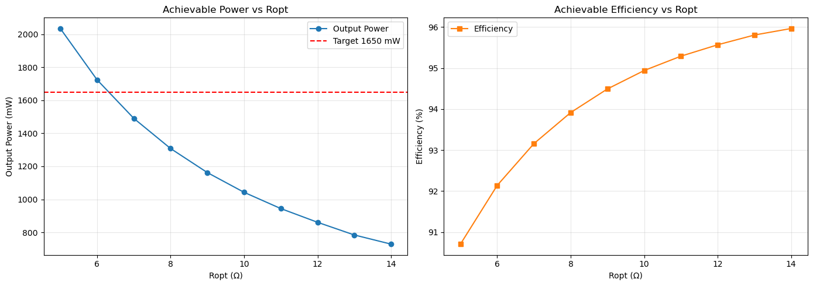

```python
# =============================================================================
# CONSOLIDATED EPC2037 GaN CLASS-E AMPLIFIER NOTEBOOK
# Trade-off Sweep: Ropt vs Achievable Power and Efficiency
# =============================================================================
import numpy as np
import matplotlib.pyplot as plt
from scipy.integrate import solve_ivp, cumulative_trapezoid
from scipy.optimize import brentq, minimize
from scipy.interpolate import PchipInterpolator
import pandas as pd
import warnings

warnings.filterwarnings('ignore')
pd.set_option('display.max_rows', None)
pd.set_option('display.max_columns', None)
pd.set_option('display.width', 1000)

# --- Specs ---
VDD, POUT_TARGET, F0 = 4.85, 1.65, 14.0e6
W0, T, TH = 2*np.pi*F0, 1/F0, 1/(2*F0)
VDS_MAX, ID_MAX = 100.0, 1.7
RON_25 = 0.400
QG, VG = 115e-12, 5.0
PGATE = QG*VG*F0
COSS_50, QOSS_50, COSS_TR = 6.5e-12, 600e-12, 12e-12

# Analytical starting point
a = 2/np.sqrt(np.pi**2 + 4)
Ropt_ana = 2*a**2*VDD**2/POUT_TARGET
phi = np.pi - np.arctan(2/np.pi)
IR_norm = np.sqrt(2/(2*a**2))
IDC_norm = a*IR_norm
C_norm = (2*a**2/np.pi)/(2*a**2)
th = np.linspace(0, 2*np.pi, 200001)
vd_norm = np.zeros_like(th)
off = th >= np.pi
vd_norm[off] = (IDC_norm*(th[off]-np.pi) + IR_norm*(np.cos(th[off]+phi)-np.cos(np.pi+phi)))/C_norm
V1 = np.trapezoid(vd_norm*np.exp(-1j*th), th)/np.pi
I1 = IR_norm*np.exp(1j*(phi-np.pi/2))
KL = (V1/I1).imag/(V1/I1).real
L1_ana = KL*Ropt_ana/W0
L2_ana = 3.0*Ropt_ana/W0
C2_ana = 1/(W0**2*L2_ana)

# =============================================================================
# Datasheet & Coss Models
# =============================================================================
DS_FIG5_VDS = np.array([0, 5, 10, 15, 20, 25, 30, 40, 50, 60, 75, 100.])
DS_FIG5_COSS = 1e-12*np.array([22.0, 15.5, 11.5, 9.8, 8.5, 7.5, 7.0, 6.7, 6.5, 5.8, 5.1, 4.5])
_coss_dig = PchipInterpolator(DS_FIG5_VDS, DS_FIG5_COSS, extrapolate=False)
V_GRID = np.linspace(0, 150, 150001)
C_GRID_RAW = _coss_dig(np.clip(V_GRID, 0, 100))
Q_GRID_RAW = cumulative_trapezoid(C_GRID_RAW, V_GRID, initial=0)
Q_RAW_50 = Q_GRID_RAW[np.argmin(np.abs(V_GRID-50))]
CAL_A = (QOSS_50-Q_RAW_50)/25.0
C_GRID = C_GRID_RAW.copy()
C_GRID[V_GRID <= 50] += CAL_A*(1-V_GRID[V_GRID <= 50]/50)
Q_GRID = cumulative_trapezoid(C_GRID, V_GRID, initial=0)
E_GRID = cumulative_trapezoid(V_GRID*C_GRID, V_GRID, initial=0)
_coss_tab, _qoss_tab, _eoss_tab = PchipInterpolator(V_GRID, C_GRID), PchipInterpolator(V_GRID, Q_GRID), PchipInterpolator(V_GRID, E_GRID)

def coss_tab(v): return _coss_tab(np.clip(np.abs(v), 0, 150))
def qoss_tab(v): return np.sign(v)*_qoss_tab(np.abs(v))
def eoss_tab(v): return _eoss_tab(np.abs(v))

# =============================================================================
# Simulation Engine
# =============================================================================
class DeviceModel:
    def __init__(self, coss_f, qoss_f, eoss_f, Cext, Ron):
        self.coss_f, self.qoss_f, self.eoss_f = coss_f, qoss_f, eoss_f
        self.Cext, self.Ron = float(Cext), float(Ron)
        self._vg = np.linspace(0, 150, 150001)
        self._qg = self.Cext*self._vg + np.asarray(self.qoss_f(self._vg), float)
    def v_from_q(self, q):
        q = float(q)
        if abs(q) < 1e-30: return 0.0
        return np.sign(q)*float(np.interp(abs(q), self._qg, self._vg))

def cycle_nonlin(IDC, dev, LT_val, C2_val, Ropt_val, warmup=100, samples=400):
    def f_on(t, y):
        q, iL, v2 = y
        vD = dev.v_from_q(q)
        return [IDC-iL-vD/dev.Ron, (vD-v2-Ropt_val*iL)/LT_val, iL/C2_val]
    def f_off(t, y):
        q, iL, v2 = y
        vD = dev.v_from_q(q)
        return [IDC-iL, (vD-v2-Ropt_val*iL)/LT_val, iL/C2_val]
    y = np.zeros(3)
    for _ in range(warmup):
        s1 = solve_ivp(f_on, (0, TH), y, method="LSODA", rtol=2e-8, atol=1e-12)
        s2 = solve_ivp(f_off, (0, TH), s1.y[:, -1], method="LSODA", rtol=2e-8, atol=1e-12)
        y = s2.y[:, -1]
    s1 = solve_ivp(f_on, (0, TH), y, method="LSODA", rtol=2e-8, atol=1e-12, dense_output=True)
    s2 = solve_ivp(f_off, (0, TH), s1.y[:, -1], method="LSODA", rtol=2e-8, atol=1e-12, dense_output=True)
    t1, t2 = np.linspace(0, TH, samples, endpoint=False), np.linspace(0, TH, samples, endpoint=False)
    y1, y2 = s1.sol(t1), s2.sol(t2)
    q = np.r_[y1[0], y2[0]]; iL = np.r_[y1[1], y2[1]]
    t = np.r_[t1, TH+t2]; vD = np.array([dev.v_from_q(z) for z in q]); iSW = np.r_[vD[:samples]/dev.Ron, np.zeros(samples)]
    return {"t": t, "v_D": vD, "i_L": iL, "i_sw": iSW, "v_avg": np.trapezoid(vD, t)/T,
            "v_turnon": float(dev.v_from_q(s2.y[0, -1])), "i_turnon": float(s2.y[1, -1])}

def solve_nonlin(dev, LT_val, C2_val, Ropt_val, warmup=50, samples=200):
    def resid(I): return cycle_nonlin(I, dev, LT_val, C2_val, Ropt_val, warmup=warmup, samples=samples)["v_avg"] - VDD
    I = brentq(resid, 0.05*POUT_TARGET/VDD, 3.0*POUT_TARGET/VDD, xtol=1e-8)
    return cycle_nonlin(I, dev, LT_val, C2_val, Ropt_val, warmup=warmup*2, samples=samples*2), I

# =============================================================================
# Optimization Function for a Given Ropt
# =============================================================================
def optimize_for_Ropt(Ropt_val):
    x0_scaled = [247.33, 107.73, 280.44, 460.83]
    bounds_scaled = [(100, 500), (50, 250), (150, 450), (200, 900)]
    
    cache = {}
    def eval_design(x):
        key = tuple(np.round(x, 5))
        if key in cache: return cache[key]
        
        Cext, L1_val, L2_val, C2_val = x[0]*1e-12, x[1]*1e-9, x[2]*1e-9, x[3]*1e-12
        LT_val = L1_val + L2_val
        dev = DeviceModel(coss_tab, qoss_tab, eoss_tab, Cext, RON_25)
        
        try:
            h, I = solve_nonlin(dev, LT_val, C2_val, Ropt_val, warmup=20, samples=100)
            P_load = np.trapezoid(Ropt_val*h["i_L"]**2, h["t"])/T
            P_in = VDD * I
            eta = P_load / (P_in + PGATE)
            C_sh_tot = Cext + dev.coss_f(h["v_turnon"])
            dVdt = (I - h["i_turnon"]) / C_sh_tot
            res = (h["v_turnon"], dVdt, P_load, eta, P_in, np.max(h["i_sw"]), np.max(h["v_D"]))
        except Exception:
            res = (10.0, 10.0, 0.0, 0.0, 10.0, 10.0, 10.0)
            
        cache[key] = res
        return res

    def obj(x): return -eval_design(x)[3]
    def con_zvs(x): return eval_design(x)[0]
    def con_zds(x): return eval_design(x)[1] * 1e-8
    
    cons = [{'type': 'eq', 'fun': con_zvs}, {'type': 'eq', 'fun': con_zds}]
    res_opt = minimize(obj, x0_scaled, method='SLSQP', bounds=bounds_scaled, constraints=cons,
                       options={'maxiter': 150, 'eps': 1e-4})
    
    Cext_t, L1_t, L2_t, C2_t = res_opt.x[0]*1e-12, res_opt.x[1]*1e-9, res_opt.x[2]*1e-9, res_opt.x[3]*1e-12
    LT_t = L1_t + L2_t
    dev_tuned = DeviceModel(coss_tab, qoss_tab, eoss_tab, Cext_t, RON_25)
    h_tuned, I_tuned = solve_nonlin(dev_tuned, LT_t, C2_t, Ropt_val, warmup=500, samples=1600)
    
    P_load_final = np.trapezoid(Ropt_val*h_tuned["i_L"]**2, h_tuned["t"])/T
    P_in_final = VDD * I_tuned
    eta_final = P_load_final / (P_in_final + PGATE)
    
    return {
        "Ropt": Ropt_val,
        "Pout (mW)": P_load_final*1e3,
        "Efficiency (%)": eta_final*100,
        "Peak i_sw (A)": np.max(h_tuned["i_sw"]),
        "DC Current (mA)": I_tuned*1e3,
        "Cext (pF)": Cext_t*1e12,
        "L1 (nH)": L1_t*1e9,
        "L2 (nH)": L2_t*1e9,
        "C2 (pF)": C2_t*1e12,
        "V_turnon (mV)": h_tuned["v_turnon"]*1e3,
    }

# =============================================================================
# Sweep Ropt
# =============================================================================
print("Sweeping Ropt to reveal the physical trade-off...")
Ropt_values = np.linspace(5.0, 14.0, 10)
results = []

for r in Ropt_values:
    res = optimize_for_Ropt(r)
    results.append(res)
    print(f"Ropt={r:.2f} Ω: Pout={res['Pout (mW)']:.1f} mW, η={res['Efficiency (%)']:.2f}%, I_dc={res['DC Current (mA)']:.1f} mA")

df = pd.DataFrame(results)
print("\n### ROPT TRADE-OFF SUMMARY\n")
print(df.to_string(index=False))

# =============================================================================
# Plotting the Trade-off
# =============================================================================
fig, ax = plt.subplots(1, 2, figsize=(14, 5))

ax[0].plot(df["Ropt"], df["Pout (mW)"], "o-", label="Output Power")
ax[0].axhline(1650, color="red", ls="--", label="Target 1650 mW")
ax[0].set_xlabel("Ropt (Ω)")
ax[0].set_ylabel("Output Power (mW)")
ax[0].set_title("Achievable Power vs Ropt")
ax[0].grid(alpha=0.3)
ax[0].legend()

ax[1].plot(df["Ropt"], df["Efficiency (%)"], "s-", color="C1", label="Efficiency")
ax[1].set_xlabel("Ropt (Ω)")
ax[1].set_ylabel("Efficiency (%)")
ax[1].set_title("Achievable Efficiency vs Ropt")
ax[1].grid(alpha=0.3)
ax[1].legend()

plt.tight_layout()
plt.show()
```

    Sweeping Ropt to reveal the physical trade-off...
    Ropt=5.00 Ω: Pout=2034.9 mW, η=90.71%, I_dc=460.9 mA
    Ropt=6.00 Ω: Pout=1724.2 mW, η=92.14%, I_dc=384.2 mA
    Ropt=7.00 Ω: Pout=1490.5 mW, η=93.16%, I_dc=328.2 mA
    Ropt=8.00 Ω: Pout=1308.1 mW, η=93.92%, I_dc=285.5 mA
    Ropt=9.00 Ω: Pout=1162.3 mW, η=94.49%, I_dc=252.0 mA
    Ropt=10.00 Ω: Pout=1042.7 mW, η=94.94%, I_dc=224.8 mA
    Ropt=11.00 Ω: Pout=944.2 mW, η=95.29%, I_dc=202.6 mA
    Ropt=12.00 Ω: Pout=861.1 mW, η=95.57%, I_dc=184.1 mA
    Ropt=13.00 Ω: Pout=784.4 mW, η=95.81%, I_dc=167.1 mA
    Ropt=14.00 Ω: Pout=728.9 mW, η=95.96%, I_dc=154.9 mA
    
    ### ROPT TRADE-OFF SUMMARY
    
     Ropt   Pout (mW)  Efficiency (%)  Peak i_sw (A)  DC Current (mA)  Cext (pF)    L1 (nH)    L2 (nH)    C2 (pF)  V_turnon (mV)
      5.0 2034.860345       90.708541       1.290520       460.875297 426.074657  99.112988 271.819382 436.899255       0.005937
      6.0 1724.196673       92.139584       1.071326       384.172716 360.117152 102.340423 275.050153 451.219614       0.006981
      7.0 1490.522751       93.158835       0.912529       328.232995 311.313749 108.357309 281.067260 457.931160       0.007455
      8.0 1308.052815       93.916064       0.791835       285.513242 273.821935 114.852785 287.562888 463.986195       0.008711
      9.0 1162.349695       94.491640       0.697601       251.970826 244.007500 121.990250 294.815197 468.455397       0.009383
     10.0 1042.723993       94.940496       0.621636       224.792192 219.792156 125.966174 304.375495 475.329539       0.010483
     11.0  944.226785       95.290119       0.559889       202.648834 199.574802 136.588800 309.570114 478.726306       0.011760
     12.0  861.085805       95.567717       0.508495       184.117863 182.512064 144.490542 317.307125 483.154862       0.011218
     13.0  784.368289       95.805495       0.461707       167.146203 168.282077 141.673882 323.119632 515.920258       0.012301
     14.0  728.906922       95.964982       0.428066       154.949506 155.247077 160.217107 332.896402 494.068379       0.013691


    

    

