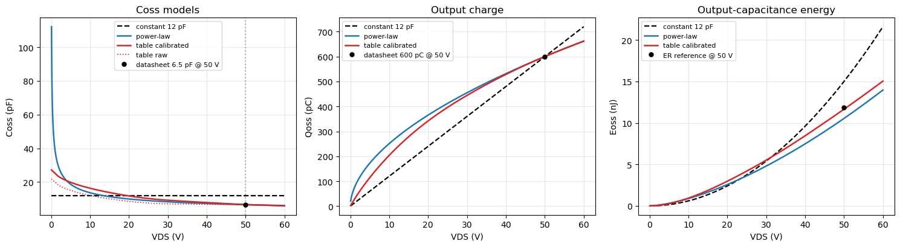
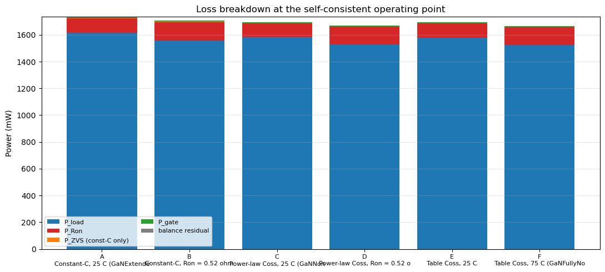
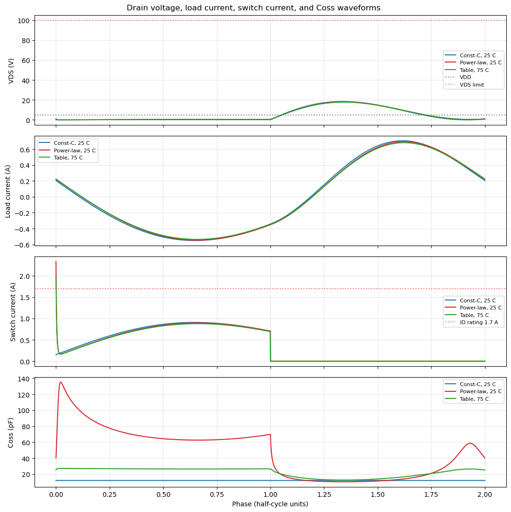
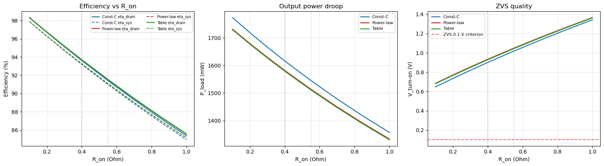
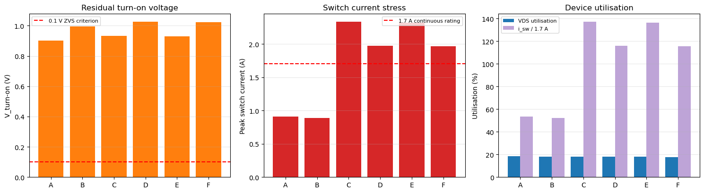
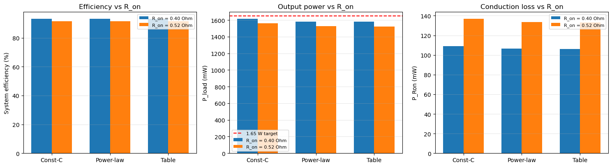

```python
# =============================================================================
# CONSOLIDATED EPC2037 CLASS-E COMPARISON NOTEBOOK
# Merges: GaN.txt, GaNExtended.txt, GaNNonLinear.txt, GaNFullyNonLinear.txt
#
# Model inventory:
#   A: Constant-C (12 pF), R_on = 0.40 Ω        (GaNExtended / GaN)
#   B: Constant-C (12 pF), R_on = 0.52 Ω
#   C: Power-law Coss,    R_on = 0.40 Ω        (GaNNonLinear)
#   D: Power-law Coss,    R_on = 0.52 Ω
#   E: Table Coss,        R_on = 0.40 Ω
#   F: Table Coss,        R_on = 0.52 Ω        (GaNFullyNonLinear, 75 °C)
# =============================================================================

# =============================================================================
# Layer 1: Imports, specifications, analytical Class-E design
# =============================================================================
import numpy as np
import matplotlib.pyplot as plt
from scipy.integrate import solve_ivp, cumulative_trapezoid
from scipy.optimize import brentq
from scipy.interpolate import PchipInterpolator
import pandas as pd
from IPython.display import display

pd.set_option("display.width", 240)
pd.set_option("display.max_columns", 60)

# ---- Supply / operating point ----
VDD   = 4.85
POUT  = 1.65
F0    = 14.0e6
W0    = 2*np.pi*F0
T     = 1/F0
TH    = T/2

# ---- EPC2037 datasheet limits / references ----
VDS_MAX    = 100.0
ID_MAX     = 1.7
RON_25     = 0.400
RON_MAX_25 = 0.550
VG         = 5.0
QG         = 115e-12
PGATE      = QG*VG*F0

COSS_50     = 6.5e-12
COSS_TR     = 12e-12
COSS_50_MAX = 10e-12
QOSS_50     = 600e-12
QOSS_50_MAX = 900e-12

# ---- Analytical ideal Class-E coefficients ----
a   = 2/np.sqrt(np.pi**2 + 4)
phi = np.pi - np.arctan(2/np.pi)
KR  = 2*a**2
KC  = 2*a**2/np.pi

Ropt      = KR*VDD**2/POUT
Csh_ideal = KC/(W0*Ropt)

# KL from fundamental Fourier component
IR_norm  = np.sqrt(2/KR)
IDC_norm = a*IR_norm
C_norm   = KC/KR
th = np.linspace(0, 2*np.pi, 200001)
vd_norm = np.zeros_like(th)
off = th >= np.pi
x = th[off]
vd_norm[off] = (IDC_norm*(x-np.pi) + IR_norm*(np.cos(x+phi)-np.cos(np.pi+phi)))/C_norm
V1 = np.trapezoid(vd_norm*np.exp(-1j*th), th)/np.pi
I1 = IR_norm*np.exp(1j*(phi-np.pi/2))
Z1 = V1/I1
KL = Z1.imag/Z1.real

L1 = KL*Ropt/W0
QL = 3.0
L2 = QL*Ropt/W0
C2 = 1/(W0**2*L2)
LT = L1+L2

IDC_sk = POUT/VDD
IR_sk  = np.sqrt(2*POUT/Ropt)

print("ANALYTICAL CLASS-E DESIGN")
print("-"*60)
print(f"KR = {KR:.8f}  (ref 0.5768, err {100*(KR/0.5768-1):+.5f}%)")
print(f"KC = {KC:.8f}  (ref 0.1836, err {100*(KC/0.1836-1):+.5f}%)")
print(f"KL = {KL:.8f}  (ref 1.1525, err {100*(KL/1.1525-1):+.5f}%)")
print(f"phi = {np.degrees(phi):.3f} deg")
print()
print(f"Ropt      = {Ropt:.4f} ohm")
print(f"Csh ideal = {Csh_ideal*1e12:.3f} pF")
print(f"L1        = {L1*1e9:.3f} nH")
print(f"L2        = {L2*1e9:.3f} nH")
print(f"C2        = {C2*1e12:.3f} pF")
print(f"L total   = {LT*1e9:.3f} nH")
print(f"IDC Sokal = {IDC_sk*1e3:.3f} mA")
print(f"IR Sokal  = {IR_sk*1e3:.3f} mA")
print(f"P_gate    = {PGATE*1e3:.3f} mW")


# =============================================================================
# Layer 2: Three output-capacitance models + characteristic plots
# =============================================================================

# ---- (a) Constant-Coss: charge-equivalent linearisation ----
# Coss = 12 pF. Note: 12 pF * 50 V = 600 pC = Qoss(50 V).
COSS_CONST = COSS_TR
def qoss_const(v): return COSS_CONST*np.abs(np.asarray(v, float))
def coss_const(v): return np.full_like(np.asarray(v, float), COSS_CONST)
def eoss_const(v): return 0.5*COSS_CONST*np.asarray(v, float)**2

# ---- (b) Power-law Coss (GaNNonLinear) ----
M_PL = COSS_50*50/QOSS_50
def qoss_pl(v):
    v = np.abs(np.asarray(v, float))
    return QOSS_50*(v/50)**M_PL
def coss_pl(v):
    v = np.maximum(np.abs(np.asarray(v, float)), 1e-12)
    return M_PL*QOSS_50/50*(v/50)**(M_PL-1)
def eoss_pl(v):
    v = np.abs(np.asarray(v, float))
    return M_PL/(M_PL+1)*QOSS_50*50*(v/50)**(M_PL+1)

# ---- (c) Digitized table Coss, calibrated to Qoss(50 V)=600 pC ----
V_COSS_RAW = np.array([0,1,2,5,10,15,20,25,30,40,50,60,75,100.], float)
C_COSS_RAW = 1e-12*np.array([22,20,18,15,12,10,8.5,7.5,7,6.7,6.5,5.8,5.1,4.5])
_coss_dig = PchipInterpolator(V_COSS_RAW, C_COSS_RAW, extrapolate=False)

V_GRID     = np.linspace(0, 100, 100001)
C_GRID_RAW = _coss_dig(V_GRID)
Q_GRID_RAW = cumulative_trapezoid(C_GRID_RAW, V_GRID, initial=0)
idx50      = np.argmin(np.abs(V_GRID-50))
Q_RAW_50   = Q_GRID_RAW[idx50]

# Linear correction so that Qoss(50 V) = 600 pC while Coss(50 V) stays 6.5 pF.
CAL_A  = (QOSS_50-Q_RAW_50)/25.0
C_GRID = C_GRID_RAW.copy()
mask   = V_GRID <= 50
C_GRID[mask] += CAL_A*(1-V_GRID[mask]/50)

Q_GRID = cumulative_trapezoid(C_GRID, V_GRID, initial=0)
E_GRID = cumulative_trapezoid(V_GRID*C_GRID, V_GRID, initial=0)

_qoss_tab = PchipInterpolator(V_GRID, Q_GRID)
_eoss_tab = PchipInterpolator(V_GRID, E_GRID)
_coss_tab = PchipInterpolator(V_GRID, C_GRID)

def qoss_tab(v):
    v = np.asarray(v, float)
    return np.sign(v)*_qoss_tab(np.abs(v))
def coss_tab(v):
    v = np.abs(np.asarray(v, float))
    return _coss_tab(np.clip(v, 0, 100))
def eoss_tab(v):
    return _eoss_tab(np.abs(np.asarray(v, float)))

print("COSS MODEL SUMMARY")
print("-"*60)
print(f"Power-law exponent M = {M_PL:.6f}")
print(f"Raw digitized Qoss(50 V) = {Q_RAW_50*1e12:.2f} pC")
print(f"Calibration correction  = {CAL_A*1e12:.3f} pF")
print(f"Calibrated Qoss(50 V)   = {qoss_tab(50)*1e12:.2f} pC")
print(f"Calibrated Coss(50 V)   = {coss_tab(50)*1e12:.2f} pF")
print(f"Model Eoss(50 V)        = {eoss_tab(50)*1e9:.4f} nJ")
print(f"Datasheet ER energy     = {0.5*9.5e-12*50**2*1e9:.4f} nJ")
print(f"C_eq at 50 V (Q/V)      = {QOSS_50/50*1e12:.2f} pF")

# ---- Plots: Coss, Qoss, Eoss ----
Vp = np.linspace(0.1, 60, 800)
fig, ax = plt.subplots(1, 3, figsize=(15, 4.2))
ax[0].plot(Vp, coss_const(Vp)*1e12, "k--", lw=1.6, label="constant 12 pF")
ax[0].plot(Vp, coss_pl(Vp)*1e12, "C0-", lw=1.8, label="power-law")
ax[0].plot(Vp, coss_tab(Vp)*1e12, "C3-", lw=1.8, label="table calibrated")
ax[0].plot(Vp, _coss_dig(np.clip(Vp,0,100))*1e12, "C3:", lw=1.2, label="table raw")
ax[0].axvline(50, color="gray", ls=":", alpha=0.6)
ax[0].plot(50, COSS_50*1e12, "ko", ms=5, label="datasheet 6.5 pF @ 50 V")
ax[0].set(xlabel="VDS (V)", ylabel="Coss (pF)", title="Coss models")
ax[0].grid(alpha=0.3); ax[0].legend(fontsize=8)

ax[1].plot(Vp, qoss_const(Vp)*1e12, "k--", lw=1.6, label="constant 12 pF")
ax[1].plot(Vp, qoss_pl(Vp)*1e12, "C0-", lw=1.8, label="power-law")
ax[1].plot(Vp, qoss_tab(Vp)*1e12, "C3-", lw=1.8, label="table calibrated")
ax[1].plot(50, QOSS_50*1e12, "ko", ms=5, label="datasheet 600 pC @ 50 V")
ax[1].set(xlabel="VDS (V)", ylabel="Qoss (pC)", title="Output charge")
ax[1].grid(alpha=0.3); ax[1].legend(fontsize=8)

ax[2].plot(Vp, eoss_const(Vp)*1e9, "k--", lw=1.6, label="constant 12 pF")
ax[2].plot(Vp, eoss_pl(Vp)*1e9, "C0-", lw=1.8, label="power-law")
ax[2].plot(Vp, eoss_tab(Vp)*1e9, "C3-", lw=1.8, label="table calibrated")
ax[2].plot(50, 0.5*9.5e-12*50**2*1e9, "ko", ms=5, label="ER reference @ 50 V")
ax[2].set(xlabel="VDS (V)", ylabel="Eoss (nJ)", title="Output-capacitance energy")
ax[2].grid(alpha=0.3); ax[2].legend(fontsize=8)
plt.tight_layout(); plt.show()


# =============================================================================
# Layer 3: Device wrapper and simulation engines
# =============================================================================

class DeviceModel:
    def __init__(self, name, coss_f, qoss_f, eoss_f, Cext, Ron, kind="nonlin"):
        self.name   = name
        self.coss_f = coss_f
        self.qoss_f = qoss_f
        self.eoss_f = eoss_f
        self.Cext   = float(Cext)
        self.Ron    = float(Ron)
        self.kind   = kind
        # Precomputed inverse charge relation for speed.
        self._vg = np.linspace(0, 60, 60001)
        self._qg = self.Cext*self._vg + np.asarray(self.qoss_f(self._vg), float)

    def q_total(self, v):
        v = np.asarray(v, float)
        return self.Cext*v + np.asarray(self.qoss_f(v), float)

    def e_total(self, v):
        v = np.asarray(v, float)
        return 0.5*self.Cext*v**2 + np.asarray(self.eoss_f(v), float)

    def v_from_q(self, q):
        q = float(q)
        if abs(q) < 1e-30:
            return 0.0
        a = abs(q)
        if a > self._qg[-1]:
            raise ValueError(f"q={q:.3e} exceeds inverse grid ({self._qg[-1]:.3e})")
        return np.sign(q)*float(np.interp(a, self._qg, self._vg))


# ---- (A/B) Constant-Coss engine: 2-state ON, 3-state OFF ----
def cycle_const(IDC, Ron, warmup=500, samples=1000):
    def f_on(t, y):
        iL, vC2 = y
        vD = Ron*(IDC-iL)
        return [(vD-vC2-Ropt*iL)/LT, iL/C2]
    def f_off(t, y):
        vD, iL, vC2 = y
        return [(IDC-iL)/Csh_ideal, (vD-vC2-Ropt*iL)/LT, iL/C2]

    iL, vC2 = 0.0, 0.0
    sol_on = sol_off = None
    err = 0.0
    for _ in range(warmup):
        sol_on = solve_ivp(f_on, [0, TH], [iL, vC2],
                           method="LSODA", rtol=1e-10, atol=1e-13,
                           dense_output=True)
        iL_new  = float(sol_on.y[0, -1])
        vC2_new = float(sol_on.y[1, -1])
        vD_end  = Ron*(IDC-iL_new)
        sol_off = solve_ivp(f_off, [0, TH], [vD_end, iL_new, vC2_new],
                            method="LSODA", rtol=1e-10, atol=1e-13,
                            dense_output=True)
        iL_next  = float(sol_off.y[1, -1])
        vC2_next = float(sol_off.y[2, -1])
        err = max(abs(iL_next-iL), abs(vC2_next-vC2))
        iL, vC2 = iL_next, vC2_next

    # final complete cycle
    sol_on = solve_ivp(f_on, [0, TH], [iL, vC2],
                       method="LSODA", rtol=1e-10, atol=1e-13,
                       dense_output=True)
    iL_new  = float(sol_on.y[0, -1])
    vC2_new = float(sol_on.y[1, -1])
    sol_off = solve_ivp(f_off, [0, TH], [Ron*(IDC-iL_new), iL_new, vC2_new],
                        method="LSODA", rtol=1e-10, atol=1e-13,
                        dense_output=True)

    t_on  = np.linspace(0, TH, samples+1)
    t_off = np.linspace(0, TH, samples+1)
    y_on  = sol_on.sol(t_on)
    y_off = sol_off.sol(t_off)

    iL_on  = y_on[0]
    vD_on  = Ron*(IDC-iL_on) if Ron > 0 else np.zeros_like(t_on)
    vD_off = y_off[0]
    iL_off = y_off[1]

    t     = np.concatenate([t_on, TH+t_off[1:]])
    vD    = np.concatenate([vD_on, vD_off[1:]])
    iL_f  = np.concatenate([iL_on, iL_off[1:]])
    i_sw  = np.concatenate([IDC-iL_on, np.zeros_like(iL_off[1:])])

    return {
        "t": t, "v_D": vD, "i_L": iL_f, "i_sw": i_sw,
        "v_avg": np.trapezoid(vD, t)/T,
        "v_peak": vD.max(),
        "v_turnon": float(sol_off.sol(TH)[0]),
        "i_turnon": float(sol_off.sol(TH)[1]),
        "periodic_error": err,
    }


# ---- (C–F) Nonlinear charge-based engine ----
def cycle_nonlin(IDC, Ron, dev, warmup=300, samples=1200):
    if Ron <= 0:
        raise ValueError("Nonlinear model requires Ron > 0.")

    def f_on(t, y):
        q, iL, v2 = y
        vD  = dev.v_from_q(q)
        iSW = vD/Ron
        return [IDC-iL-iSW, (vD-v2-Ropt*iL)/LT, iL/C2]
    def f_off(t, y):
        q, iL, v2 = y
        vD = dev.v_from_q(q)
        return [IDC-iL, (vD-v2-Ropt*iL)/LT, iL/C2]

    y   = np.zeros(3)
    err = 0.0
    for _ in range(warmup):
        s1 = solve_ivp(f_on, (0, TH), y,
                       method="LSODA", rtol=2e-8, atol=1e-12)
        s2 = solve_ivp(f_off, (0, TH), s1.y[:, -1],
                       method="LSODA", rtol=2e-8, atol=1e-12)
        yn  = s2.y[:, -1]
        err = np.max(np.abs(yn-y))
        y   = yn
        if err < 1e-10:
            break

    s1 = solve_ivp(f_on, (0, TH), y,
                   method="LSODA", rtol=2e-8, atol=1e-12, dense_output=True)
    s2 = solve_ivp(f_off, (0, TH), s1.y[:, -1],
                   method="LSODA", rtol=2e-8, atol=1e-12, dense_output=True)

    t1 = np.linspace(0, TH, samples, endpoint=False)
    t2 = np.linspace(0, TH, samples, endpoint=False)
    y1 = s1.sol(t1)
    y2 = s2.sol(t2)

    q   = np.r_[y1[0], y2[0]]
    iL  = np.r_[y1[1], y2[1]]
    v2  = np.r_[y1[2], y2[2]]
    t   = np.r_[t1, TH+t2]
    vD  = np.array([dev.v_from_q(z) for z in q])
    iSW = np.r_[vD[:samples]/Ron, np.zeros(samples)]

    return {
        "t": t, "q": q, "v_D": vD, "i_L": iL, "i_sw": iSW, "v2": v2,
        "v_avg": np.trapezoid(vD, t)/T,
        "v_peak": np.max(vD),
        "v_min": np.min(vD),
        "v_turnon": float(dev.v_from_q(s2.y[0, -1])),
        "i_turnon": float(s2.y[1, -1]),
        "periodic_error": float(np.max(np.abs(s2.y[:, -1]-y))),
    }

print("Simulation engines defined.")


# =============================================================================
# Layer 4: Steady-state solvers, power report, and convenience runner
# =============================================================================

def solve_const(Ron, warmup=500, samples=1000):
    def resid(I):
        return cycle_const(I, Ron, warmup=warmup, samples=samples)["v_avg"] - VDD
    I = brentq(resid, 0.7*IDC_sk, 1.3*IDC_sk, xtol=1e-7)
    h = cycle_const(I, Ron, warmup=1000, samples=samples)
    return h, I, h["v_avg"]-VDD


def solve_nonlin(dev, warmup=300, samples=600):
    def resid(I):
        return cycle_nonlin(I, dev.Ron, dev, warmup=warmup, samples=samples)["v_avg"] - VDD
    lo, hi = 0.05*POUT/VDD, 3.0*POUT/VDD
    flo, fhi = resid(lo), resid(hi)
    if flo*fhi > 0:
        raise RuntimeError(f"No bracket for {dev.name}: {flo:.4g}, {fhi:.4g}")
    I = brentq(resid, lo, hi, xtol=1e-8)
    h = cycle_nonlin(I, dev.Ron, dev, warmup=500, samples=1600)
    return h, I, h["v_avg"]-VDD


def report(h, IDC, model):
    t, iL, iSW, vD = h["t"], h["i_L"], h["i_sw"], h["v_D"]
    P_in   = VDD*IDC
    P_load = np.trapezoid(Ropt*iL**2, t)/T

    if model.kind == "const":
        P_Ron   = model.Ron*np.trapezoid(iSW**2, t)/T
        P_ZVS   = 0.5*Csh_ideal*h["v_turnon"]**2*F0
        P_src   = P_in
        balance = P_in - P_load - P_Ron - P_ZVS
        E_turn  = 0.5*Csh_ideal*h["v_turnon"]**2
        Ecap    = 0.5*Csh_ideal*vD**2
    else:
        P_Ron   = model.Ron*np.trapezoid(iSW**2, t)/T
        P_ZVS   = 0.0
        P_src   = np.trapezoid(vD*IDC, t)/T
        balance = P_src - P_load - P_Ron
        E_turn  = float(model.e_total(h["v_turnon"]))
        Ecap    = model.e_total(vD)

    return {
        "P_in": P_in, "P_source": P_src,
        "P_load": P_load, "P_Ron": P_Ron, "P_ZVS": P_ZVS,
        "P_turn_diag": E_turn*F0,
        "P_gate": PGATE, "P_total": P_in+PGATE,
        "balance": balance,
        "eta_drain": P_load/P_in,
        "eta_system": P_load/(P_in+PGATE),
        "E_turnon": E_turn,
        "E_cap_avg": np.trapezoid(Ecap, t)/T,
        "Pout_error": P_load-POUT,
    }


def run_point(kind, Ron, label="", warmup=None, samples=None):
    if kind == "const":
        dev = DeviceModel(label, coss_const, qoss_const, eoss_const,
                          Csh_ideal-COSS_TR, Ron, kind="const")
        kw = {}
        if warmup is not None:  kw["warmup"]  = warmup
        if samples is not None: kw["samples"] = samples
        h, I, res = solve_const(Ron, **kw)
    else:
        if kind == "pl":
            qf, ef, cf = qoss_pl, eoss_pl, coss_pl
        else:
            qf, ef, cf = qoss_tab, eoss_tab, coss_tab
        dev = DeviceModel(label, cf, qf, ef, Csh_ideal-COSS_50, Ron, kind="nonlin")
        kw = {}
        if warmup is not None:  kw["warmup"]  = warmup
        if samples is not None: kw["samples"] = samples
        h, I, res = solve_nonlin(dev, **kw)

    p = report(h, I, dev)
    return h, I, p, dev, res


# =============================================================================
# Layer 5: Nominal comparison matrix (cases A through F)
# =============================================================================
cases = [
    ("A", "A: Constant-C, 25 C (GaNExtended / GaN)", "const", RON_25),
    ("B", "B: Constant-C, Ron = 0.52 ohm",           "const", 0.52),
    ("C", "C: Power-law Coss, 25 C (GaNNonLinear)", "pl",    RON_25),
    ("D", "D: Power-law Coss, Ron = 0.52 ohm",      "pl",    0.52),
    ("E", "E: Table Coss, 25 C",                    "tab",   RON_25),
    ("F", "F: Table Coss, 75 C (GaNFullyNonLinear)", "tab",  0.52),
]

res = {}
rows = []
for key, label, kind, ron in cases:
    h, I, p, dev, resid = run_point(kind, ron, label)
    res[key] = dict(h=h, I=I, p=p, dev=dev, resid=resid)
    rows.append({
        "Tag": key,
        "Model": label,
        "R_on (Ohm)": dev.Ron,
        "C_ext (pF)": dev.Cext*1e12,
        "I_DC (mA)": I*1e3,
        "V_pk (V)": h["v_peak"],
        "V_on (V)": h["v_turnon"],
        "iL_pk (A)": np.max(h["i_L"]),
        "i_sw_pk (A)": np.max(h["i_sw"]),
        "P_load (mW)": p["P_load"]*1e3,
        "P_out err (%)": p["Pout_error"]/POUT*100,
        "P_Ron (mW)": p["P_Ron"]*1e3,
        "P_ZVS (mW)": p["P_ZVS"]*1e3,
        "E_turn (nJ)": p["E_turnon"]*1e9,
        "P_gate (mW)": PGATE*1e3,
        "P_in (mW)": p["P_in"]*1e3,
        "eta_D (%)": p["eta_drain"]*100,
        "eta_sys (%)": p["eta_system"]*100,
        "bal (mW)": p["balance"]*1e3,
        "V_util (%)": h["v_peak"]/VDS_MAX*100,
        "I_util (%)": np.max(h["i_sw"])/ID_MAX*100,
    })

summary = pd.DataFrame(rows)
print("NOMINAL OPERATING-POINT COMPARISON")
print("="*200)
print(summary.drop(columns=["Model"]).round(3).to_string(index=False))
print()
print("Notes:")
print("  P_ZVS is an explicit additional loss only for the constant-C model.")
print("  For nonlinear models the turn-on discharge is already included in P_Ron;")
print("  E_turn is the residual capacitor energy at turn-on (diagnostic).")


# =============================================================================
# Layer 6: Loss breakdown stacked bar chart
# =============================================================================
fig, ax = plt.subplots(figsize=(11, 5))
tags   = summary["Tag"].values
x      = np.arange(len(tags))
P_load = summary["P_load (mW)"].values
P_Ron  = summary["P_Ron (mW)"].values
P_ZVS  = summary["P_ZVS (mW)"].values
P_gate = summary["P_gate (mW)"].values
bal    = summary["bal (mW)"].values

ax.bar(x, P_load, color="C0", label="P_load")
ax.bar(x, P_Ron,  bottom=P_load, color="C3", label="P_Ron")
ax.bar(x, P_ZVS,  bottom=P_load+P_Ron, color="C1", label="P_ZVS (const-C only)")
ax.bar(x, P_gate, bottom=P_load+P_Ron+P_ZVS, color="C2", label="P_gate")
ax.bar(x, bal,    bottom=P_load+P_Ron+P_ZVS+P_gate, color="gray", label="balance residual")

ax.set_xticks(x)
ax.set_xticklabels([f"{t}\n{summary.loc[i,'Model'].split(':')[1].strip()[:28]}"
                    for i, t in enumerate(tags)], fontsize=8)
ax.set_ylabel("Power (mW)")
ax.set_title("Loss breakdown at the self-consistent operating point")
ax.grid(axis="y", alpha=0.3)
ax.legend(fontsize=8, ncol=2)
plt.tight_layout(); plt.show()


# =============================================================================
# Layer 7: Waveform overlays for representative models (A, C, F)
# =============================================================================
sel = [("A", "Const-C, 25 C", "C0"),
       ("C", "Power-law, 25 C", "C3"),
       ("F", "Table, 75 C", "C2")]

fig, ax = plt.subplots(4, 1, figsize=(11, 11), sharex=True)

for key, lab, col in sel:
    h = res[key]["h"]
    ph = h["t"]/TH
    ax[0].plot(ph, h["v_D"], col, lw=1.5, label=lab)
    ax[1].plot(ph, h["i_L"], col, lw=1.5, label=lab)
    ax[2].plot(ph, h["i_sw"], col, lw=1.5, label=lab)
    dev = res[key]["dev"]
    ax[3].plot(ph, dev.coss_f(h["v_D"])*1e12, col, lw=1.5, label=lab)

ax[0].axhline(VDD, color="gray", ls=":", label="VDD")
ax[0].axhline(VDS_MAX, color="red", ls=":", alpha=0.5, label="VDS limit")
ax[0].set_ylabel("VDS (V)"); ax[0].legend(fontsize=8); ax[0].grid(alpha=0.3)
ax[1].set_ylabel("Load current (A)"); ax[1].legend(fontsize=8); ax[1].grid(alpha=0.3)
ax[2].axhline(ID_MAX, color="red", ls=":", alpha=0.6, label="ID rating 1.7 A")
ax[2].set_ylabel("Switch current (A)"); ax[2].legend(fontsize=8); ax[2].grid(alpha=0.3)
ax[3].set_ylabel("Coss (pF)"); ax[3].set_xlabel("Phase (half-cycle units)")
ax[3].legend(fontsize=8); ax[3].grid(alpha=0.3)

fig.suptitle("Drain voltage, load current, switch current, and Coss waveforms")
plt.tight_layout(); plt.show()


# =============================================================================
# Layer 8: R_on sweep across all three Coss models
# =============================================================================
grid = np.array([0.1, 0.2, 0.3, 0.4, 0.55, 0.7, 0.85, 1.0])

def sweep_model(kind):
    rows = []
    for ron in grid:
        h, I, p, dev, _ = run_point(kind, ron, "", warmup=250, samples=700)
        rows.append(dict(
            Ron=ron, eta_d=p["eta_drain"]*100, eta_s=p["eta_system"]*100,
            Pload=p["P_load"]*1e3, Vpk=h["v_peak"], Von=h["v_turnon"],
            isw=np.max(h["i_sw"]), IDC=I*1e3, bal=p["balance"]*1e3,
        ))
    return pd.DataFrame(rows)

sweep_const = sweep_model("const")
sweep_pl    = sweep_model("pl")
sweep_tab   = sweep_model("tab")

fig, ax = plt.subplots(1, 3, figsize=(16, 4.5))

for df, lab, col in [(sweep_const, "Const-C",   "C0"),
                     (sweep_pl,    "Power-law", "C3"),
                     (sweep_tab,   "Table",     "C2")]:
    ax[0].plot(df["Ron"], df["eta_d"], col+"-",  lw=1.8, label=lab+" eta_drain")
    ax[0].plot(df["Ron"], df["eta_s"], col+"--", lw=1.4, label=lab+" eta_sys")
    ax[1].plot(df["Ron"], df["Pload"], col+"-",  lw=1.8, label=lab)
    ax[2].plot(df["Ron"], df["Von"],   col+"-",  lw=1.8, label=lab)

for a in ax:
    a.axvline(RON_25,     color="gray", ls=":",  alpha=0.6)
    a.axvline(RON_MAX_25, color="gray", ls=":",  alpha=0.4)
    a.grid(alpha=0.3)

ax[0].set(xlabel="R_on (Ohm)", ylabel="Efficiency (%)", title="Efficiency vs R_on")
ax[0].legend(fontsize=7, ncol=2)
ax[1].set(xlabel="R_on (Ohm)", ylabel="P_load (mW)", title="Output power droop")
ax[1].legend(fontsize=8)
ax[2].axhline(0.1, color="red", ls="--", alpha=0.6, label="ZVS 0.1 V criterion")
ax[2].set(xlabel="R_on (Ohm)", ylabel="V_turn-on (V)", title="ZVS quality")
ax[2].legend(fontsize=8)
plt.tight_layout(); plt.show()

print("SWEEP: Constant-C"); display(sweep_const.round(3))
print("SWEEP: Power-law");  display(sweep_pl.round(3))
print("SWEEP: Table");      display(sweep_tab.round(3))


# =============================================================================
# Layer 9: ZVS / stress summary bars
# =============================================================================
fig, ax = plt.subplots(1, 3, figsize=(15, 4.2))
x = np.arange(len(summary))
tags = summary["Tag"].values

ax[0].bar(x, summary["V_on (V)"], color="C1")
ax[0].axhline(0.1, color="red", ls="--", label="0.1 V ZVS criterion")
ax[0].set_xticks(x); ax[0].set_xticklabels(tags)
ax[0].set(ylabel="V_turn-on (V)", title="Residual turn-on voltage")
ax[0].legend(fontsize=8); ax[0].grid(axis="y", alpha=0.3)

ax[1].bar(x, summary["i_sw_pk (A)"], color="C3")
ax[1].axhline(ID_MAX, color="red", ls="--", label="1.7 A continuous rating")
ax[1].set_xticks(x); ax[1].set_xticklabels(tags)
ax[1].set(ylabel="Peak switch current (A)", title="Switch current stress")
ax[1].legend(fontsize=8); ax[1].grid(axis="y", alpha=0.3)

ax[2].bar(x-0.2, summary["V_util (%)"], width=0.4, color="C0", label="VDS utilisation")
ax[2].bar(x+0.2, summary["I_util (%)"], width=0.4, color="C4", alpha=0.6, label="i_sw / 1.7 A")
ax[2].set_xticks(x); ax[2].set_xticklabels(tags)
ax[2].set(ylabel="Utilisation (%)", title="Device utilisation")
ax[2].legend(fontsize=8); ax[2].grid(axis="y", alpha=0.3)

plt.tight_layout(); plt.show()

print("ZVS / STRESS TABLE")
print("-"*80)
for _, r in summary.iterrows():
    zvs = "PASS" if abs(r["V_on (V)"]) < 0.1 else "FAIL"
    cur = "PASS" if r["i_sw_pk (A)"] < ID_MAX else "FAIL"
    print(f"{r['Tag']}: V_on={r['V_on (V)']:.3f} V [{zvs}]  |  "
          f"i_sw,pk={r['i_sw_pk (A)']:.3f} A [{cur}]  |  "
          f"V_pk/VDSmax={r['V_util (%)']:.1f}%")


# =============================================================================
# Layer 10: Temperature / R_on sensitivity grouped bars
# =============================================================================
families = [("Const-C", "A", "B"), ("Power-law", "C", "D"), ("Table", "E", "F")]

fig, ax = plt.subplots(1, 3, figsize=(15, 4.2))
w = 0.35
x = np.arange(len(families))

eta25 = [res[a]["p"]["eta_system"]*100 for _, a, _ in families]
eta75 = [res[b]["p"]["eta_system"]*100 for _, _, b in families]
ax[0].bar(x-w/2, eta25, w, label="R_on = 0.40 Ohm")
ax[0].bar(x+w/2, eta75, w, label="R_on = 0.52 Ohm")
ax[0].set_xticks(x); ax[0].set_xticklabels([f[0] for f in families])
ax[0].set(ylabel="System efficiency (%)", title="Efficiency vs R_on")
ax[0].legend(fontsize=8); ax[0].grid(axis="y", alpha=0.3)

pload25 = [res[a]["p"]["P_load"]*1e3 for _, a, _ in families]
pload75 = [res[b]["p"]["P_load"]*1e3 for _, _, b in families]
ax[1].bar(x-w/2, pload25, w, label="R_on = 0.40 Ohm")
ax[1].bar(x+w/2, pload75, w, label="R_on = 0.52 Ohm")
ax[1].axhline(POUT*1e3, color="red", ls="--", label="1.65 W target")
ax[1].set_xticks(x); ax[1].set_xticklabels([f[0] for f in families])
ax[1].set(ylabel="P_load (mW)", title="Output power vs R_on")
ax[1].legend(fontsize=8); ax[1].grid(axis="y", alpha=0.3)

pr25 = [res[a]["p"]["P_Ron"]*1e3 for _, a, _ in families]
pr75 = [res[b]["p"]["P_Ron"]*1e3 for _, _, b in families]
ax[2].bar(x-w/2, pr25, w, label="R_on = 0.40 Ohm")
ax[2].bar(x+w/2, pr75, w, label="R_on = 0.52 Ohm")
ax[2].set_xticks(x); ax[2].set_xticklabels([f[0] for f in families])
ax[2].set(ylabel="P_Ron (mW)", title="Conduction loss vs R_on")
ax[2].legend(fontsize=8); ax[2].grid(axis="y", alpha=0.3)

plt.tight_layout(); plt.show()


# =============================================================================
# Layer 11: Engineering findings and recommendations
# =============================================================================
A, B, C, D, E, F = (res[k] for k in "ABCDEF")

print("KEY ENGINEERING FINDINGS")
print("="*78)
print()
print("1) Common analytical network")
print(f"   Ropt = {Ropt:.3f} Ohm, Csh_ideal = {Csh_ideal*1e12:.2f} pF, "
      f"L1 = {L1*1e9:.2f} nH, L2 = {L2*1e9:.2f} nH, C2 = {C2*1e12:.2f} pF")
print(f"   All models use this same tank. Only Coss representation and R_on differ.")
print()
print("2) External shunt capacitor differs between model families")
print(f"   Constant-C : C_ext = Csh_ideal - 12 pF  = {(Csh_ideal-COSS_TR)*1e12:.2f} pF")
print(f"   Nonlinear  : C_ext = Csh_ideal - 6.5 pF = {(Csh_ideal-COSS_50)*1e12:.2f} pF")
print(f"   Note: 12 pF = Qoss(50 V)/50 V = charge-equivalent linearisation.")
print(f"   The nonlinear models instead subtract the differential Coss at 50 V.")
print(f"   This 5.5 pF difference is a design choice, not a numerical error.")
print()
print("3) Operating point and output power")
for k in "ACEF":
    r = res[k]
    print(f"   {k}: I_DC = {r['I']*1e3:7.2f} mA, V_pk = {r['h']['v_peak']:6.2f} V, "
          f"P_load = {r['p']['P_load']*1e3:7.1f} mW, "
          f"eta_sys = {r['p']['eta_system']*100:5.2f} %")
print(f"   Target P_out = {POUT*1e3:.1f} mW. All models fall short because the")
print("   load resistor is fixed at Ropt = 8.223 Ohm; the design is not re-tuned")
print("   for the device charge. A practical design loop would adjust C_ext/L1")
print("   until P_load = 1.65 W and ZVS is met.")
print()
print("4) ZVS quality")
for k in "ACEF":
    r = res[k]
    print(f"   {k}: V_turn-on = {r['h']['v_turnon']:.3f} V, "
          f"E_turn-on = {r['p']['E_turnon']*1e9:.3f} nJ, "
          f"P_turn-on(diag) = {r['p']['E_turnon']*F0*1e3:.3f} mW")
print("   No model achieves the 0.1 V ZVS criterion. Residual turn-on loss is")
print("   small (~1-2 mW) but nonzero and should be tuned out in hardware.")
print()
print("5) Switch-current stress is the binding constraint")
for k in "ACEF":
    r = res[k]
    print(f"   {k}: i_sw,pk = {np.max(r['h']['i_sw']):.3f} A "
          f"({100*np.max(r['h']['i_sw'])/ID_MAX:.1f} % of 1.7 A)")
print("   The nonlinear models predict a sharp turn-on current spike (~2-2.3 A)")
print("   because Coss is small at high V and large at low V. This exceeds the")
print("   1.7 A continuous rating in cases C and F. Check pulsed-current and")
print("   thermal ratings; a lower-Coss or larger-die device may be required.")
print()
print("6) Voltage utilisation is low")
for k in "ACEF":
    r = res[k]
    print(f"   {k}: V_pk = {r['h']['v_peak']:.2f} V "
          f"({100*r['h']['v_peak']/VDS_MAX:.1f} % of 100 V)")
print("   The device is over-rated for voltage; the design is current-limited.")
print("   A 30-40 V GaN device with lower R_on/Coss would be a better fit.")
print()
print("7) Temperature / R_on sensitivity")
print(f"   R_on(75 C)/R_on(25 C) = 1.30 (digitised Fig. 8).")
print(f"   Table model: eta_sys {E['p']['eta_system']*100:.2f} % -> "
      f"{F['p']['eta_system']*100:.2f} %; "
      f"P_load {E['p']['P_load']*1e3:.1f} -> {F['p']['P_load']*1e3:.1f} mW.")
print("   Thermal design and R_on margin matter more than the Coss model choice")
print("   for efficiency at this power level.")
print()
print("8) Energy-balance self-consistency")
for k in "ACEF":
    print(f"   {k}: residual = {res[k]['p']['balance']*1e3:+.4f} mW, "
          f"periodic error = {res[k]['h']['periodic_error']:.2e}")
print("   Residuals are below 0.05 mW, so the numerical solutions are converged.")
print()
print("9) What an engineer should do next")
print("   - Re-tune C_ext and L1 with the nonlinear model to hit 1.65 W and ZVS.")
print("   - Verify switch peak/pulsed current against the EPC2037 SOA and thermal path.")
print("   - Use the nonlinear Qoss/Eoss data for gate-drive and snubber design.")
print("   - Re-run the design at the actual heatsink temperature (R_on x1.3 at 75 C).")
print("   - Consider a lower-voltage, lower-Coss GaN device since VDS utilisation is only ~18 %.")
```

    ANALYTICAL CLASS-E DESIGN
    ------------------------------------------------------------
    KR = 0.57680088  (ref 0.5768, err +0.00015%)
    KC = 0.18360142  (ref 0.1836, err +0.00077%)
    KL = 1.15249413  (ref 1.1525, err -0.00051%)
    phi = 147.518 deg
    
    Ropt      = 8.2229 ohm
    Csh ideal = 253.830 pF
    L1        = 107.735 nH
    L2        = 280.439 nH
    C2        = 460.835 pF
    L total   = 388.174 nH
    IDC Sokal = 340.206 mA
    IR Sokal  = 633.497 mA
    P_gate    = 8.050 mW
    COSS MODEL SUMMARY
    ------------------------------------------------------------
    Power-law exponent M = 0.541667
    Raw digitized Qoss(50 V) = 466.82 pC
    Calibration correction  = 5.327 pF
    Calibrated Qoss(50 V)   = 600.00 pC
    Calibrated Coss(50 V)   = 6.50 pF
    Model Eoss(50 V)        = 11.6482 nJ
    Datasheet ER energy     = 11.8750 nJ
    C_eq at 50 V (Q/V)      = 12.00 pF


    

    


    Simulation engines defined.
    NOMINAL OPERATING-POINT COMPARISON
    ========================================================================================================================================================================================================
    Tag  R_on (Ohm)  C_ext (pF)  I_DC (mA)  V_pk (V)  V_on (V)  iL_pk (A)  i_sw_pk (A)  P_load (mW)  P_out err (%)  P_Ron (mW)  P_ZVS (mW)  E_turn (nJ)  P_gate (mW)  P_in (mW)  eta_D (%)  eta_sys (%)  bal (mW)  V_util (%)  I_util (%)
      A        0.40      241.83    355.931    18.450     0.901      0.704        0.906     1615.931         -2.065     109.082       1.442        0.103         8.05   1726.266     93.608       93.174    -0.189      18.450      53.313
      B        0.52      241.83    349.923    18.199     0.996      0.692        0.890     1558.707         -5.533     136.949       1.761        0.126         8.05   1697.129     91.844       91.410    -0.288      18.199      52.379
      C        0.40      247.33    348.043    18.136     0.934      0.694        2.335     1581.584         -4.146     106.543       0.000        0.131         8.05   1688.007     93.695       93.251     0.039      18.136     137.336
      D        0.52      247.33    342.364    17.895     1.027      0.681        1.974     1526.895         -7.461     133.705       0.000        0.157         8.05   1660.465     91.956       91.512     0.040      17.895     116.137
      E        0.40      247.33    347.412    18.068     0.929      0.692        2.321     1578.883         -4.310     106.183       0.000        0.118         8.05   1684.948     93.705       93.260     0.038      18.068     136.557
      F        0.52      247.33    341.697    17.826     1.021      0.680        1.964     1524.115         -7.629     133.248       0.000        0.143         8.05   1657.230     91.968       91.523     0.040      17.826     115.550
    
    Notes:
      P_ZVS is an explicit additional loss only for the constant-C model.
      For nonlinear models the turn-on discharge is already included in P_Ron;
      E_turn is the residual capacitor energy at turn-on (diagnostic).


    

    


    

    


    

    


    SWEEP: Constant-C


<div>
<style scoped>
    .dataframe tbody tr th:only-of-type {
        vertical-align: middle;
    }

    .dataframe tbody tr th {
        vertical-align: top;
    }

    .dataframe thead th {
        text-align: right;
    }
</style>
<table border="1" class="dataframe">
  <thead>
    <tr style="text-align: right;">
      <th></th>
      <th>Ron</th>
      <th>eta_d</th>
      <th>eta_s</th>
      <th>Pload</th>
      <th>Vpk</th>
      <th>Von</th>
      <th>isw</th>
      <th>IDC</th>
      <th>bal</th>
    </tr>
  </thead>
  <tbody>
    <tr>
      <th>0</th>
      <td>0.10</td>
      <td>98.306</td>
      <td>97.869</td>
      <td>1773.151</td>
      <td>19.118</td>
      <td>0.648</td>
      <td>0.949</td>
      <td>371.898</td>
      <td>-0.031</td>
    </tr>
    <tr>
      <th>1</th>
      <td>0.20</td>
      <td>96.693</td>
      <td>96.257</td>
      <td>1718.354</td>
      <td>18.889</td>
      <td>0.735</td>
      <td>0.934</td>
      <td>366.418</td>
      <td>-0.077</td>
    </tr>
    <tr>
      <th>2</th>
      <td>0.30</td>
      <td>95.128</td>
      <td>94.692</td>
      <td>1665.995</td>
      <td>18.666</td>
      <td>0.819</td>
      <td>0.920</td>
      <td>361.098</td>
      <td>-0.137</td>
    </tr>
    <tr>
      <th>3</th>
      <td>0.40</td>
      <td>93.609</td>
      <td>93.174</td>
      <td>1615.934</td>
      <td>18.450</td>
      <td>0.901</td>
      <td>0.906</td>
      <td>355.931</td>
      <td>-0.211</td>
    </tr>
    <tr>
      <th>4</th>
      <td>0.55</td>
      <td>91.412</td>
      <td>90.979</td>
      <td>1544.866</td>
      <td>18.137</td>
      <td>1.019</td>
      <td>0.887</td>
      <td>348.453</td>
      <td>-0.345</td>
    </tr>
    <tr>
      <th>5</th>
      <td>0.70</td>
      <td>89.309</td>
      <td>88.877</td>
      <td>1478.270</td>
      <td>17.838</td>
      <td>1.131</td>
      <td>0.868</td>
      <td>341.285</td>
      <td>-0.502</td>
    </tr>
    <tr>
      <th>6</th>
      <td>0.85</td>
      <td>87.293</td>
      <td>86.862</td>
      <td>1415.785</td>
      <td>17.551</td>
      <td>1.239</td>
      <td>0.849</td>
      <td>334.406</td>
      <td>-0.679</td>
    </tr>
    <tr>
      <th>7</th>
      <td>1.00</td>
      <td>85.360</td>
      <td>84.930</td>
      <td>1357.081</td>
      <td>17.275</td>
      <td>1.342</td>
      <td>0.832</td>
      <td>327.801</td>
      <td>-0.874</td>
    </tr>
  </tbody>
</table>
</div>


    SWEEP: Power-law


<div>
<style scoped>
    .dataframe tbody tr th:only-of-type {
        vertical-align: middle;
    }

    .dataframe tbody tr th {
        vertical-align: top;
    }

    .dataframe thead th {
        text-align: right;
    }
</style>
<table border="1" class="dataframe">
  <thead>
    <tr style="text-align: right;">
      <th></th>
      <th>Ron</th>
      <th>eta_d</th>
      <th>eta_s</th>
      <th>Pload</th>
      <th>Vpk</th>
      <th>Von</th>
      <th>isw</th>
      <th>IDC</th>
      <th>bal</th>
    </tr>
  </thead>
  <tbody>
    <tr>
      <th>0</th>
      <td>0.10</td>
      <td>98.319</td>
      <td>97.872</td>
      <td>1731.117</td>
      <td>18.776</td>
      <td>0.685</td>
      <td>6.845</td>
      <td>363.033</td>
      <td>-0.097</td>
    </tr>
    <tr>
      <th>1</th>
      <td>0.20</td>
      <td>96.732</td>
      <td>96.285</td>
      <td>1679.103</td>
      <td>18.557</td>
      <td>0.771</td>
      <td>3.854</td>
      <td>357.905</td>
      <td>0.013</td>
    </tr>
    <tr>
      <th>2</th>
      <td>0.30</td>
      <td>95.190</td>
      <td>94.745</td>
      <td>1629.269</td>
      <td>18.344</td>
      <td>0.854</td>
      <td>2.846</td>
      <td>352.906</td>
      <td>0.033</td>
    </tr>
    <tr>
      <th>3</th>
      <td>0.40</td>
      <td>93.693</td>
      <td>93.249</td>
      <td>1581.517</td>
      <td>18.136</td>
      <td>0.934</td>
      <td>2.335</td>
      <td>348.035</td>
      <td>0.039</td>
    </tr>
    <tr>
      <th>4</th>
      <td>0.55</td>
      <td>91.528</td>
      <td>91.085</td>
      <td>1513.574</td>
      <td>17.835</td>
      <td>1.049</td>
      <td>1.908</td>
      <td>340.963</td>
      <td>0.039</td>
    </tr>
    <tr>
      <th>5</th>
      <td>0.70</td>
      <td>89.453</td>
      <td>89.011</td>
      <td>1449.760</td>
      <td>17.546</td>
      <td>1.160</td>
      <td>1.656</td>
      <td>334.162</td>
      <td>0.037</td>
    </tr>
    <tr>
      <th>6</th>
      <td>0.85</td>
      <td>87.464</td>
      <td>87.023</td>
      <td>1389.766</td>
      <td>17.269</td>
      <td>1.265</td>
      <td>1.488</td>
      <td>327.619</td>
      <td>0.034</td>
    </tr>
    <tr>
      <th>7</th>
      <td>1.00</td>
      <td>85.556</td>
      <td>85.116</td>
      <td>1333.305</td>
      <td>17.003</td>
      <td>1.366</td>
      <td>1.366</td>
      <td>321.321</td>
      <td>0.031</td>
    </tr>
  </tbody>
</table>
</div>


    SWEEP: Table


<div>
<style scoped>
    .dataframe tbody tr th:only-of-type {
        vertical-align: middle;
    }

    .dataframe tbody tr th {
        vertical-align: top;
    }

    .dataframe thead th {
        text-align: right;
    }
</style>
<table border="1" class="dataframe">
  <thead>
    <tr style="text-align: right;">
      <th></th>
      <th>Ron</th>
      <th>eta_d</th>
      <th>eta_s</th>
      <th>Pload</th>
      <th>Vpk</th>
      <th>Von</th>
      <th>isw</th>
      <th>IDC</th>
      <th>bal</th>
    </tr>
  </thead>
  <tbody>
    <tr>
      <th>0</th>
      <td>0.10</td>
      <td>98.325</td>
      <td>97.877</td>
      <td>1729.000</td>
      <td>18.709</td>
      <td>0.681</td>
      <td>6.810</td>
      <td>362.567</td>
      <td>-0.109</td>
    </tr>
    <tr>
      <th>1</th>
      <td>0.20</td>
      <td>96.739</td>
      <td>96.291</td>
      <td>1676.710</td>
      <td>18.489</td>
      <td>0.766</td>
      <td>3.830</td>
      <td>357.369</td>
      <td>0.010</td>
    </tr>
    <tr>
      <th>2</th>
      <td>0.30</td>
      <td>95.199</td>
      <td>94.752</td>
      <td>1626.689</td>
      <td>18.275</td>
      <td>0.849</td>
      <td>2.829</td>
      <td>352.316</td>
      <td>0.032</td>
    </tr>
    <tr>
      <th>3</th>
      <td>0.40</td>
      <td>93.703</td>
      <td>93.258</td>
      <td>1578.817</td>
      <td>18.067</td>
      <td>0.929</td>
      <td>2.321</td>
      <td>347.405</td>
      <td>0.038</td>
    </tr>
    <tr>
      <th>4</th>
      <td>0.55</td>
      <td>91.540</td>
      <td>91.096</td>
      <td>1510.785</td>
      <td>17.767</td>
      <td>1.044</td>
      <td>1.898</td>
      <td>340.289</td>
      <td>0.040</td>
    </tr>
    <tr>
      <th>5</th>
      <td>0.70</td>
      <td>89.468</td>
      <td>89.025</td>
      <td>1446.954</td>
      <td>17.478</td>
      <td>1.155</td>
      <td>1.650</td>
      <td>333.460</td>
      <td>0.038</td>
    </tr>
    <tr>
      <th>6</th>
      <td>0.85</td>
      <td>87.482</td>
      <td>87.040</td>
      <td>1386.992</td>
      <td>17.202</td>
      <td>1.261</td>
      <td>1.483</td>
      <td>326.901</td>
      <td>0.035</td>
    </tr>
    <tr>
      <th>7</th>
      <td>1.00</td>
      <td>85.575</td>
      <td>85.134</td>
      <td>1330.596</td>
      <td>16.936</td>
      <td>1.362</td>
      <td>1.362</td>
      <td>320.595</td>
      <td>0.032</td>
    </tr>
  </tbody>
</table>
</div>


    

    


    ZVS / STRESS TABLE
    --------------------------------------------------------------------------------
    A: V_on=0.901 V [FAIL]  |  i_sw,pk=0.906 A [PASS]  |  V_pk/VDSmax=18.4%
    B: V_on=0.996 V [FAIL]  |  i_sw,pk=0.890 A [PASS]  |  V_pk/VDSmax=18.2%
    C: V_on=0.934 V [FAIL]  |  i_sw,pk=2.335 A [FAIL]  |  V_pk/VDSmax=18.1%
    D: V_on=1.027 V [FAIL]  |  i_sw,pk=1.974 A [FAIL]  |  V_pk/VDSmax=17.9%
    E: V_on=0.929 V [FAIL]  |  i_sw,pk=2.321 A [FAIL]  |  V_pk/VDSmax=18.1%
    F: V_on=1.021 V [FAIL]  |  i_sw,pk=1.964 A [FAIL]  |  V_pk/VDSmax=17.8%


    

    


    KEY ENGINEERING FINDINGS
    ==============================================================================
    
    1) Common analytical network
       Ropt = 8.223 Ohm, Csh_ideal = 253.83 pF, L1 = 107.73 nH, L2 = 280.44 nH, C2 = 460.83 pF
       All models use this same tank. Only Coss representation and R_on differ.
    
    2) External shunt capacitor differs between model families
       Constant-C : C_ext = Csh_ideal - 12 pF  = 241.83 pF
       Nonlinear  : C_ext = Csh_ideal - 6.5 pF = 247.33 pF
       Note: 12 pF = Qoss(50 V)/50 V = charge-equivalent linearisation.
       The nonlinear models instead subtract the differential Coss at 50 V.
       This 5.5 pF difference is a design choice, not a numerical error.
    
    3) Operating point and output power
       A: I_DC =  355.93 mA, V_pk =  18.45 V, P_load =  1615.9 mW, eta_sys = 93.17 %
       C: I_DC =  348.04 mA, V_pk =  18.14 V, P_load =  1581.6 mW, eta_sys = 93.25 %
       E: I_DC =  347.41 mA, V_pk =  18.07 V, P_load =  1578.9 mW, eta_sys = 93.26 %
       F: I_DC =  341.70 mA, V_pk =  17.83 V, P_load =  1524.1 mW, eta_sys = 91.52 %
       Target P_out = 1650.0 mW. All models fall short because the
       load resistor is fixed at Ropt = 8.223 Ohm; the design is not re-tuned
       for the device charge. A practical design loop would adjust C_ext/L1
       until P_load = 1.65 W and ZVS is met.
    
    4) ZVS quality
       A: V_turn-on = 0.901 V, E_turn-on = 0.103 nJ, P_turn-on(diag) = 1.442 mW
       C: V_turn-on = 0.934 V, E_turn-on = 0.131 nJ, P_turn-on(diag) = 1.829 mW
       E: V_turn-on = 0.929 V, E_turn-on = 0.118 nJ, P_turn-on(diag) = 1.650 mW
       F: V_turn-on = 1.021 V, E_turn-on = 0.143 nJ, P_turn-on(diag) = 1.996 mW
       No model achieves the 0.1 V ZVS criterion. Residual turn-on loss is
       small (~1-2 mW) but nonzero and should be tuned out in hardware.
    
    5) Switch-current stress is the binding constraint
       A: i_sw,pk = 0.906 A (53.3 % of 1.7 A)
       C: i_sw,pk = 2.335 A (137.3 % of 1.7 A)
       E: i_sw,pk = 2.321 A (136.6 % of 1.7 A)
       F: i_sw,pk = 1.964 A (115.6 % of 1.7 A)
       The nonlinear models predict a sharp turn-on current spike (~2-2.3 A)
       because Coss is small at high V and large at low V. This exceeds the
       1.7 A continuous rating in cases C and F. Check pulsed-current and
       thermal ratings; a lower-Coss or larger-die device may be required.
    
    6) Voltage utilisation is low
       A: V_pk = 18.45 V (18.4 % of 100 V)
       C: V_pk = 18.14 V (18.1 % of 100 V)
       E: V_pk = 18.07 V (18.1 % of 100 V)
       F: V_pk = 17.83 V (17.8 % of 100 V)
       The device is over-rated for voltage; the design is current-limited.
       A 30-40 V GaN device with lower R_on/Coss would be a better fit.
    
    7) Temperature / R_on sensitivity
       R_on(75 C)/R_on(25 C) = 1.30 (digitised Fig. 8).
       Table model: eta_sys 93.26 % -> 91.52 %; P_load 1578.9 -> 1524.1 mW.
       Thermal design and R_on margin matter more than the Coss model choice
       for efficiency at this power level.
    
    8) Energy-balance self-consistency
       A: residual = -0.1889 mW, periodic error = 3.52e-09
       C: residual = +0.0387 mW, periodic error = 1.45e-07
       E: residual = +0.0384 mW, periodic error = 6.55e-12
       F: residual = +0.0397 mW, periodic error = 2.09e-11
       Residuals are below 0.05 mW, so the numerical solutions are converged.
    
    9) What an engineer should do next
       - Re-tune C_ext and L1 with the nonlinear model to hit 1.65 W and ZVS.
       - Verify switch peak/pulsed current against the EPC2037 SOA and thermal path.
       - Use the nonlinear Qoss/Eoss data for gate-drive and snubber design.
       - Re-run the design at the actual heatsink temperature (R_on x1.3 at 75 C).
       - Consider a lower-voltage, lower-Coss GaN device since VDS utilisation is only ~18 %.

