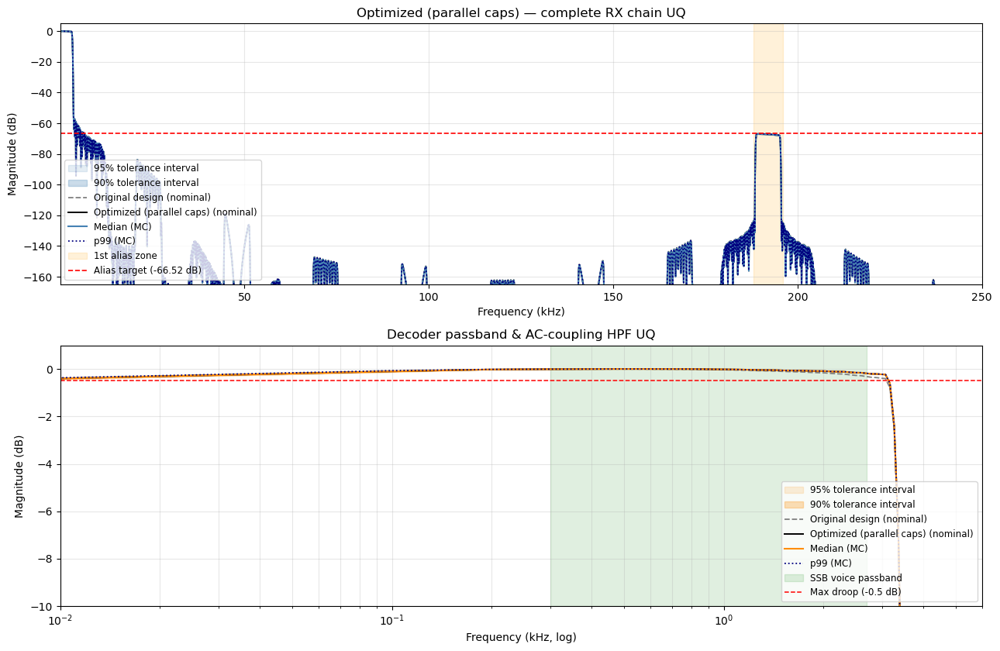
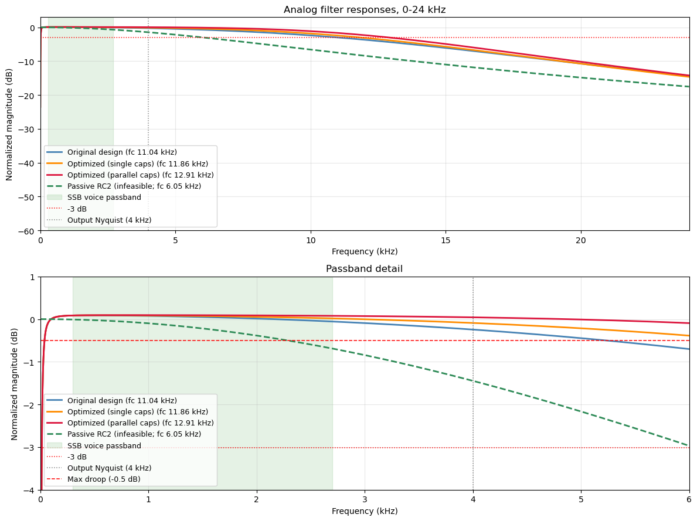

```python
# ============================================================
# REV 40N — ARCH A RX AUDIO CHAIN
# analysis + sequential-MILP discrete part optimization
# ============================================================
import itertools
import numpy as np
import matplotlib.pyplot as plt

from scipy.signal import firwin, freqz
from scipy.optimize import differential_evolution, milp, LinearConstraint, Bounds
from scipy.special import erfinv

# ============================================================
# 1. CONFIGURATION
# ============================================================
FS, FS1, FS2, FSOUT = 192e3, 48e3, 24e3, 8e3
R_DEC, N_CIC = 4, 4
SSB = 2.7e3
FCRIT = FS - FSOUT / 2
FCRIT_HI = FS + FSOUT / 2

BLOCKER_DBFS = -30.0
ALIAS_BELOW_NOISE_DB = 10.0
ADC_SNR_TYP = 68.0
ADC_VREF, ADC_BITS = 3.10, 12
ADC_LSB = ADC_VREF / 2**ADC_BITS
ADC_SNR_NOISE_DBFS = -ADC_SNR_TYP - 10 * np.log10(FS / SSB)
ALIAS_THRESHOLD_DBFS = ADC_SNR_NOISE_DBFS - ALIAS_BELOW_NOISE_DB
TARGET = -(BLOCKER_DBFS - ALIAS_THRESHOLD_DBFS)      # max alias response [dB]
MAX_PASS_LOSS_DB = 0.5
Q_MIN, Q_MAX = 0.60, 0.85

# Tayloe
R_SOURCE_RF, R_ON_TAYLOE = 8.22, 5.0
C_TAYLOE_20M, C_TAYLOE_40M = 2.2e-9, 4.3e-9
R_SOURCE_AUDIO = 4 * (R_SOURCE_RF + R_ON_TAYLOE)
FC_TAYLOE_20M = 1 / (2 * np.pi * R_SOURCE_AUDIO * C_TAYLOE_20M)
FC_TAYLOE_40M = 1 / (2 * np.pi * R_SOURCE_AUDIO * C_TAYLOE_40M)
FC_TAYLOE = FC_TAYLOE_20M

# ADC
C_ADC, R_ADC_SWITCH, T_ACQ = 6e-12, 0.0, 2600e-9
R_KICK = 100.0            # ADC kickback isolation R (used for settling only, not in arch_a)
R_ADC_LEAK = 1e12

# ============================================================
# 2. TOLERANCE MODEL
# ============================================================
# class -> (tolerance, assumed bin yield)
PASSIVE_MODEL = {
    "C0G":    (0.05, 0.99),
    "C0G2":   (0.02, 0.99),
    "C0G1":   (0.01, 0.99),
    "X5R":    (0.20, 0.95),
    "R1pct":  (0.01, 0.99),
    "L10pct": (0.10, 0.95),
}
CAP_CLASSES = {"C0G": 0.0, "C0G2": 0.15, "C0G1": 0.50}   # relative cost
PAR_COST = 0.04                                          # two caps in parallel


def tol(cls):
    return PASSIVE_MODEL[cls][0]


def draw_by_class(rng, cls, n, dist="truncnorm"):
    t, y = PASSIVE_MODEL[cls]
    if dist == "uniform":
        return rng.uniform(1 - t, 1 + t, n)
    if dist == "worstcase":
        return rng.choice([1 - t, 1 + t], size=n)
    sigma = t / (np.sqrt(2) * erfinv(y))
    out, filled = np.empty(n), 0
    while filled < n:
        s = rng.normal(0, sigma, n - filled)
        s = s[np.abs(s) <= t]
        out[filled:filled + len(s)] = 1 + s
        filled += len(s)
    return out


# ============================================================
# 3. TRANSFER FUNCTIONS (all broadcast: parts (N,1) x f (M,))
# ============================================================
def db(x):
    return 20 * np.log10(np.maximum(np.abs(x), 1e-15))


def wrap(f, fs):
    return (np.asarray(f) + fs / 2) % fs - fs / 2


def tayloe(f):
    return 1 / (1 + 1j * np.asarray(f) / FC_TAYLOE)


def arch_a(f, c_ac, r_in, r_fb, c_fb, ra, ca, cb):
    """AC-coupled diff-amp pole + Sallen-Key; no defaults on purpose."""
    s = 2j * np.pi * np.asarray(f, float)
    r_tot = r_in + R_SOURCE_AUDIO
    H_hp = s * r_tot * c_ac / (1 + s * r_tot * c_ac)
    H_p1 = 1 / (1 + s * r_fb * c_fb)
    w0 = 1 / (ra * np.sqrt(ca * cb))
    Q = np.sqrt(ca / cb) / 2
    H_sk = w0**2 / (s**2 + s * w0 / Q + w0**2)
    return H_hp * H_p1 * H_sk


HB = firwin(63, 12e3, fs=FS1)
POLY = firwin(161, 3.35e3, fs=FS2)


def cic(f):
    f = np.asarray(f, float)
    den = 4 * np.sin(np.pi * f / FS)
    num = np.sin(4 * np.pi * f / FS)
    ratio = np.ones_like(f)
    m = np.abs(den) > 1e-12
    ratio[m] = num[m] / den[m]
    return np.abs(ratio) ** 4


def fir_response(f, coeff, fs):
    _, h = freqz(coeff, worN=2 * np.pi * np.asarray(f) / fs)
    return np.abs(h)


def digital(f):
    f = np.asarray(f, float)
    return (cic(wrap(f, FS))
            * fir_response(wrap(f, FS1), HB, FS1)
            * fir_response(wrap(f, FS2), POLY, FS2))


# ============================================================
# 4. DESIGN = two plain dicts (val, cls) + label dict
# ============================================================
NAMES = ["c_ac", "r_in", "r_fb", "c_fb", "ra", "ca", "cb"]
OPT = ["c_fb", "ra", "ca", "cb"]                       # chosen from discrete pools
CAPS = {"c_ac", "c_fb", "ca", "cb"}
SIGNS = np.array(list(itertools.product((-1, 1), repeat=len(NAMES))))   # (128, 7)

ROLE = {
    "c_ac": "AC-coupling capacitor",
    "r_in": "Diff-amp input resistor",
    "r_fb": "Diff-amp feedback resistor",
    "c_fb": "Diff-amp feedback cap (pole 1)",
    "ra":   "Sallen-Key R (both resistors)",
    "ca":   "Sallen-Key Ca (feedback cap)",
    "cb":   "Sallen-Key Cb (cap to ground)",
}

VAL0 = dict(c_ac=10e-6, r_in=1e3, r_fb=50e3, c_fb=220e-12,
            ra=10e3, ca=1.5e-9, cb=750e-12)
CLS0 = dict(c_ac="X5R", r_in="R1pct", r_fb="R1pct", c_fb="C0G",
            ra="R1pct", ca="C0G", cb="C0G")


def fmt(v, is_cap):
    """Engineering-notation value string."""
    if is_cap:
        if v >= 1e-6:
            return f"{v*1e6:.4g}u"
        if v >= 1e-9:
            return f"{v*1e9:.4g}n"
        return f"{v*1e12:.4g}p"
    if v >= 1e6:
        return f"{v/1e6:.4g}M"
    if v >= 1e3:
        return f"{v/1e3:.4g}k"
    return f"{v:.4g}"


def lab(v):          # capacitor label (kept for candidate labels)
    return fmt(v, True)


LBL0 = {n: fmt(VAL0[n], n in CAPS) for n in NAMES}

# evaluation grids (fixed, shared by everything)
F_A = np.linspace(FCRIT, FCRIT_HI, 401)
F_P = np.linspace(300, SSB, 120)
F_FC = np.logspace(3, 5, 1500)
_DA = tayloe(F_A) * digital(F_A)
_DP = tayloe(F_P) * digital(F_P)


def _fc_from(H):
    """First -3.0103 dB crossing of H (N,M), log-f interpolation; 0 if none."""
    below = H <= -3.0103
    has = below.any(axis=1)
    i = np.clip(below.argmax(axis=1), 1, None)[:, None]
    h0 = np.take_along_axis(H, i - 1, 1)[:, 0]
    h1 = np.take_along_axis(H, i, 1)[:, 0]
    l0, l1 = np.log(F_FC[i[:, 0] - 1]), np.log(F_FC[i[:, 0]])
    fc = np.exp(l0 + (-3.0103 - h0) / (h1 - h0 + 1e-30) * (l1 - l0))
    return np.where(has, fc, 0.0)


def metrics_vec(x, chunk=1000):
    """x: dict name -> array (N,). Returns alias [dB], |passband dev| [dB], fc [Hz]."""
    n = len(next(iter(x.values())))
    out = []
    for i in range(0, n, chunk):
        xc = {k: np.asarray(v, float)[i:i + chunk, None] for k, v in x.items()}
        alias = db(_DA * arch_a(F_A, **xc)).max(axis=1)
        pas = np.abs(db(_DP * arch_a(F_P, **xc))).max(axis=1)
        H = db(arch_a(F_FC, **xc)) - db(arch_a(np.array([100.0]), **xc))
        out.append(np.column_stack([alias, pas, _fc_from(H)]))
    out = np.vstack(out)
    return out[:, 0], out[:, 1], out[:, 2]


def metrics_nom(val):
    a, p, fc = metrics_vec({n: [val[n]] for n in NAMES})
    return np.array([a[0], p[0], fc[0] / 1e3])          # fc in kHz


def corner_set(val, cls):
    t = np.array([tol(cls[n]) for n in NAMES])
    v = np.array([val[n] for n in NAMES])
    X = v * (1 + SIGNS * t)
    return {n: X[:, i] for i, n in enumerate(NAMES)}


def worst_case(val, cls):
    """Exact 128-corner enumeration -> alias_max, pass_max, fc_min [Hz], Q_min, Q_max."""
    x = corner_set(val, cls)
    a, p, fc = metrics_vec(x)
    q = np.sqrt(x["ca"] / x["cb"]) / 2
    return a.max(), p.max(), fc.min(), q.min(), q.max()


def verify(val, cls):
    a, p, fc, qlo, qhi = worst_case(val, cls)
    viol = (max(0, a - TARGET) + max(0, p - MAX_PASS_LOSS_DB)
            + max(0, Q_MIN - qlo) + max(0, qhi - Q_MAX))
    return viol, fc, a, p


def monte_carlo(val, cls, runs=5000, seed=1, dist="truncnorm"):
    rng = np.random.default_rng(seed)
    x = {n: val[n] * draw_by_class(rng, cls[n], runs, dist) for n in NAMES}
    return metrics_vec(x)


def report(val, cls, name):
    a, p, fc_min, qlo, qhi = worst_case(val, cls)
    print(f"\n{name}")
    print(f"  corners: {len(SIGNS)} | worst alias {a:+.2f} dB (limit {TARGET:+.2f}, "
          f"margin {TARGET - a:+.2f}) | worst passband dev {p:.3f} dB "
          f"(limit {MAX_PASS_LOSS_DB}) | fc_min {fc_min/1e3:.2f} kHz | "
          f"Q {qlo:.3f}..{qhi:.3f}")
    ok = a <= TARGET and p <= MAX_PASS_LOSS_DB and Q_MIN <= qlo and qhi <= Q_MAX
    print(f"  corner verdict: {'PASS' if ok else 'FAIL'}")
    am, pm, fm = monte_carlo(val, cls)
    print(f"  MC alias: median {np.median(am):+.2f}, p99.9 {np.percentile(am, 99.9):+.2f}, "
          f"max {am.max():+.2f} dB | fc median {np.median(fm)/1e3:.2f}, "
          f"p1 {np.percentile(fm, 1)/1e3:.2f} kHz")
    return ok


def section(title):
    print("\n" + "=" * 78 + f"\n{title}\n" + "=" * 78)


# ============================================================
# 5. COMPONENT-VALUE REPORTING
# ============================================================
def print_bom(title, val, cls, lbl):
    """Full component table for an Arch A design."""
    print(f"\n{title}")
    print("  " + "-" * 100)
    print(f"  {'Ref':<5} {'Role':<33} {'Value':>9} {'Build':<14} {'Class':<7} "
          f"{'Tol':>5} {'Min':>9} {'Max':>9}  {'Exact [SI]':>14}")
    print("  " + "-" * 100)
    for n in NAMES:
        cap = n in CAPS
        t = tol(cls[n])
        print(f"  {n:<5} {ROLE[n]:<33} {fmt(val[n], cap):>9} {lbl[n]:<14} {cls[n]:<7} "
              f"{t*100:>4.0f}% {fmt(val[n]*(1-t), cap):>9} {fmt(val[n]*(1+t), cap):>9}  "
              f"{val[n]:>14.6g}")
    print("  " + "-" * 100)


def print_derived(title, val, cls):
    """Derived electrical quantities of an Arch A design."""
    r_tot = val["r_in"] + R_SOURCE_AUDIO
    gain = val["r_fb"] / r_tot
    f_hp = 1 / (2 * np.pi * r_tot * val["c_ac"])
    f_p1 = 1 / (2 * np.pi * val["r_fb"] * val["c_fb"])
    f0 = 1 / (2 * np.pi * val["ra"] * np.sqrt(val["ca"] * val["cb"]))
    q = np.sqrt(val["ca"] / val["cb"]) / 2
    _, _, fc_min, qlo, qhi = worst_case(val, cls)
    m = metrics_nom(val)
    print(f"\n{title}")
    print(f"  signal gain (r_fb / (r_in + R_src)) : {gain:.2f} V/V = {20*np.log10(gain):.2f} dB "
          f"(R_src = {R_SOURCE_AUDIO:.2f} ohm)")
    print(f"  AC-coupling HPF corner               : {f_hp:.2f} Hz")
    print(f"  diff-amp feedback pole (pole 1)      : {f_p1/1e3:.3f} kHz")
    print(f"  Sallen-Key f0 / Q                    : {f0/1e3:.3f} kHz / {q:.4f}")
    print(f"  cascade -3 dB corner (nominal)       : {m[2]:.3f} kHz")
    print(f"  worst-corner fc_min                  : {fc_min/1e3:.3f} kHz")
    print(f"  Q over tolerance corners             : {qlo:.4f} .. {qhi:.4f} "
          f"(allowed {Q_MIN}..{Q_MAX})")
    print(f"  nominal alias response               : {m[0]:+.2f} dB (limit {TARGET:+.2f})")
    print(f"  nominal passband deviation           : {m[1]:.3f} dB (limit {MAX_PASS_LOSS_DB})")


# ============================================================
# 6. PASSIVE RC2 (closed form) + ADC SETTLING
# ============================================================
def adc_settling(Rth, C=C_ADC, Rsw=R_ADC_SWITCH):
    tau = (Rth + Rsw) * C
    return tau, (ADC_BITS + 1) * np.log(2) * tau


def passive_rc(f, R1, R2, C1, C2):
    s = 2j * np.pi * np.asarray(f, float)
    G1, G2, GL = 1 / (R_SOURCE_AUDIO + R1), 1 / R2, 1 / R_ADC_LEAK
    det = (G1 + G2 + s * C1) * (G2 + GL + s * C2) - G2**2
    return G1 * G2 / det


F_RC_P = np.linspace(300, SSB, 250)
F_RC_A = np.linspace(FCRIT, FCRIT_HI, 500)


def rc2_metrics(R1, R2, C1, C2):
    hp = db(passive_rc(F_RC_P, R1, R2, C1, C2))
    ha = db(passive_rc(F_RC_A, R1, R2, C1, C2))
    _, t_req = adc_settling(R_SOURCE_AUDIO + R1 + R2)
    feas = hp.min() >= -MAX_PASS_LOSS_DB and ha.max() <= TARGET and T_ACQ >= t_req
    return hp.min(), ha.max(), t_req, feas


def passive_study():
    def obj(x):
        R1, R2, C1, C2 = 10 ** np.asarray(x)
        pmin, amax, t_req, _ = rc2_metrics(R1, R2, C1, C2)
        pv = max(0, -pmin - MAX_PASS_LOSS_DB)
        av = max(0, amax - TARGET)
        sv = max(0, (t_req - T_ACQ) / T_ACQ)
        return av**2 + 1000 * pv**2 + 1000 * sv**2

    r = differential_evolution(obj, [(0, 5), (0, 5), (-12, -5), (-12, -5)],
                               seed=42, popsize=20, maxiter=400, tol=1e-7, polish=True)
    R1, R2, C1, C2 = 10 ** r.x
    pmin, amax, t_req, feas = rc2_metrics(R1, R2, C1, C2)
    return feas, (R1, R2, C1, C2), (pmin, amax, t_req)


def nearest(v, series, decades):
    """Nearest value (log distance) from an E-series across the given decade multipliers."""
    pool = np.concatenate([series * d for d in decades])
    return pool[np.argmin(np.abs(np.log(pool / v)))]


def print_rc2_bom(params, feasible):
    R1, R2, C1, C2 = params
    names = [("R1", R1, False, E96, [1, 10, 100, 1e3, 1e4, 1e5]),
             ("R2", R2, False, E96, [1, 10, 100, 1e3, 1e4, 1e5]),
             ("C1", C1, True, E24, [1e-12, 10e-12, 100e-12, 1e-9, 10e-9, 100e-9, 1e-6]),
             ("C2", C2, True, E24, [1e-12, 10e-12, 100e-12, 1e-9, 10e-9, 100e-9, 1e-6])]
    print(f"\nPassive RC2 ({'feasible' if feasible else 'INFEASIBLE'}) — "
          f"series source = {R_SOURCE_AUDIO:.2f} ohm (Tayloe)")
    print("  " + "-" * 72)
    print(f"  {'Ref':<4} {'Optimizer value':>16} {'Exact [SI]':>14} {'Nearest std':>14} {'Series':>8}")
    print("  " + "-" * 72)
    snapped = []
    for n, v, cap, ser, dec in names:
        s = nearest(v, ser, dec)
        snapped.append(s)
        print(f"  {n:<4} {fmt(v, cap):>16} {v:>14.6g} {fmt(s, cap):>14} "
              f"{'E24' if cap else 'E96':>8}")
    print("  " + "-" * 72)
    pmin, amax, t_req, feas = rc2_metrics(*params)
    print(f"  optimizer values: passband min {pmin:.3f} dB | alias max {amax:.2f} dB | "
          f"settling {t_req*1e9:.0f} ns vs {T_ACQ*1e9:.0f} ns acq")
    pmin, amax, t_req, feas = rc2_metrics(*snapped)
    print(f"  standard values : passband min {pmin:.3f} dB | alias max {amax:.2f} dB | "
          f"settling {t_req*1e9:.0f} ns | feasible: {feas}")
    return snapped


# ============================================================
# 7. PLOTS
# ============================================================
def nominal_curve(val, f):
    return db(tayloe(f) * digital(f) * arch_a(f, **val))


def mc_curves(val, cls, f, runs=5000, seed=1, chunk=500):
    rng = np.random.default_rng(seed)
    fac = {n: draw_by_class(rng, cls[n], runs) for n in NAMES}
    base = tayloe(f) * digital(f)
    out = np.empty((runs, len(f)), np.float32)
    for i in range(0, runs, chunk):
        x = {n: (val[n] * fac[n][i:i + chunk])[:, None] for n in NAMES}
        out[i:i + chunk] = db(base * arch_a(f, **x))
    return out


def plot_uq(val, cls, name, ref_val=None, ref_name="Original design (nominal)", runs=5000):
    f = np.union1d(np.linspace(0, 1.5 * FS, 3000), F_A)      # dense inside alias band
    mask = (f >= FCRIT) & (f <= FCRIT_HI)
    mc = mc_curves(val, cls, f, runs)
    worst = mc[:, mask].max(axis=1)

    print(f"\n{name} — alias rejection statistics")
    print("-" * 68)
    print(f"{'Level':<10} {'Quantile':>11} {'Response':>13} {'Margin':>12} {'Verdict':>9}")
    for label, q in [("Median", 50), ("1 sigma", 84.1345), ("2 sigma", 97.725),
                     ("3 sigma", 99.865), ("4 sigma", 99.99683), ("Maximum", 100)]:
        v = np.percentile(worst, q)
        print(f"{label:<10} {q:>10.5f}% {v:>+12.2f} dB {TARGET - v:>+10.2f} dB "
              f"{'PASS' if TARGET - v >= 0 else 'FAIL':>9}")
    print("-" * 68)

    p2_5, p5, p50, p95, p97_5, p99 = np.percentile(mc, [2.5, 5, 50, 95, 97.5, 99], axis=0)
    nom = nominal_curve(val, f)
    ref = None if ref_val is None else nominal_curve(ref_val, f)
    fk = f / 1e3

    fig, axes = plt.subplots(2, 1, figsize=(13, 8.5))
    for ax, color in zip(axes, ("steelblue", "darkorange")):
        ax.fill_between(fk, p2_5, p97_5, alpha=0.14, color=color, label="95% tolerance interval")
        ax.fill_between(fk, p5, p95, alpha=0.28, color=color, label="90% tolerance interval")
        if ref is not None:
            ax.plot(fk, ref, color="gray", ls="--", lw=1.3, label=ref_name)
        ax.plot(fk, nom, "k-", lw=1.4, label=f"{name} (nominal)")
        ax.plot(fk, p50, color=color, lw=1.5, label="Median (MC)")
        ax.plot(fk, p99, ":", color="navy", lw=1.3, label="p99 (MC)")
        ax.set_ylabel("Magnitude (dB)")
        ax.grid(True, which="both", alpha=0.3)

    ax1, ax2 = axes
    ax1.axvspan(FCRIT / 1e3, FCRIT_HI / 1e3, color="orange", alpha=0.15, label="1st alias zone")
    ax1.axhline(TARGET, color="red", ls="--", lw=1.2, label=f"Alias target ({TARGET:.2f} dB)")
    ax1.set(xlim=(0.01, 250), ylim=(-165, 5), xlabel="Frequency (kHz)",
            title=f"{name} — complete RX chain UQ")
    ax1.legend(loc="lower left", fontsize=8.5)

    ax2.axvspan(0.3, SSB / 1e3, color="green", alpha=0.12, label="SSB voice passband")
    ax2.axhline(-MAX_PASS_LOSS_DB, color="red", ls="--", lw=1.1,
                label=f"Max droop (-{MAX_PASS_LOSS_DB} dB)")
    ax2.set_xscale("log")
    ax2.set(xlim=(0.01, 6.0), ylim=(-10, 1), xlabel="Frequency (kHz, log)",
            title="Decoder passband & AC-coupling HPF UQ")
    ax2.legend(loc="lower right", fontsize=8.5)
    plt.tight_layout()
    plt.show()
    return worst


def plot_analog_compare(designs, rc2_params, rc2_feasible, fmax=24e3, include_tayloe=False):
    """Analog responses over 0..fmax, each normalized to its 100 Hz gain.
    designs: list of (name, val, color).
    Top panel: full 0..fmax range. Bottom panel: 0..6 kHz passband zoom."""
    f = np.linspace(1.0, fmax, 6000)       # starts at 1 Hz: AC-coupling HPF is 0 at DC
    f_ref = np.array([100.0])
    tay = (lambda ff: tayloe(ff)) if include_tayloe else (lambda ff: 1.0)

    # sharex=False: the two panels need different x ranges
    fig, (ax1, ax2) = plt.subplots(2, 1, figsize=(12, 9), sharex=False)
    for ax in (ax1, ax2):
        for name, v, col in designs:
            h = tay(f) * arch_a(f, **v)
            h0 = abs(tay(f_ref) * arch_a(f_ref, **v))[0]
            ax.plot(f / 1e3, db(h / h0), lw=2, color=col,
                    label=f"{name} (fc {metrics_nom(v)[2]:.2f} kHz)")

        R1, R2, C1, C2 = rc2_params
        h = tay(f) * passive_rc(f, R1, R2, C1, C2)
        h0 = abs(tay(f_ref) * passive_rc(f_ref, R1, R2, C1, C2))[0]
        hr = db(h / h0)
        fc_rc = f[np.argmax(hr <= -3.0103)] if (hr <= -3.0103).any() else np.nan
        ax.plot(f / 1e3, hr, lw=2, color="seagreen", ls="--",
                label=f"Passive RC2 ({'feasible' if rc2_feasible else 'infeasible'}; "
                      f"fc {fc_rc/1e3:.2f} kHz)")

        ax.axvspan(0.3, SSB / 1e3, color="green", alpha=0.10, label="SSB voice passband")
        ax.axhline(-3.0103, color="red", ls=":", lw=1.1, label="-3 dB")
        ax.axvline(FSOUT / 2e3, color="gray", ls=":", lw=1.1, label="Output Nyquist (4 kHz)")
        ax.grid(True, which="both", alpha=0.3)
        ax.set_ylabel("Normalized magnitude (dB)")

    ax1.set(xlim=(0, fmax / 1e3), ylim=(-60, 3), xlabel="Frequency (kHz)",
            title=f"Analog filter responses, 0-{fmax/1e3:.0f} kHz"
                  + (" (incl. Tayloe pole)" if include_tayloe else ""))
    ax1.legend(loc="lower left", fontsize=9)

    ax2.axhline(-MAX_PASS_LOSS_DB, color="red", ls="--", lw=1.1,
                label=f"Max droop (-{MAX_PASS_LOSS_DB} dB)")
    ax2.set(xlim=(0, 6), ylim=(-4, 1), xlabel="Frequency (kHz)", title="Passband detail")
    ax2.legend(loc="lower left", fontsize=9)
    plt.tight_layout()
    plt.show()

# ============================================================
# 8. DISCRETE POOLS + CANDIDATES
# ============================================================
E24 = np.array([1.0, 1.1, 1.2, 1.3, 1.5, 1.6, 1.8, 2.0, 2.2, 2.4, 2.7, 3.0,
                3.3, 3.6, 3.9, 4.3, 4.7, 5.1, 5.6, 6.2, 6.8, 7.5, 8.2, 9.1])
E96 = np.array([
    1.00, 1.02, 1.05, 1.07, 1.10, 1.13, 1.15, 1.18, 1.21, 1.24, 1.27, 1.30,
    1.33, 1.37, 1.40, 1.43, 1.47, 1.50, 1.54, 1.58, 1.62, 1.65, 1.69, 1.74,
    1.78, 1.82, 1.87, 1.91, 1.96, 2.00, 2.05, 2.10, 2.15, 2.21, 2.26, 2.32,
    2.37, 2.43, 2.49, 2.55, 2.61, 2.67, 2.74, 2.80, 2.87, 2.94, 3.01, 3.09,
    3.16, 3.24, 3.32, 3.40, 3.48, 3.57, 3.65, 3.74, 3.83, 3.92, 4.02, 4.12,
    4.22, 4.32, 4.42, 4.53, 4.64, 4.75, 4.87, 4.99, 5.11, 5.23, 5.36, 5.49,
    5.62, 5.76, 5.90, 6.04, 6.19, 6.34, 6.49, 6.65, 6.81, 6.98, 7.15, 7.32,
    7.50, 7.68, 7.87, 8.06, 8.25, 8.45, 8.66, 8.87, 9.09, 9.31, 9.53, 9.76])
assert len(E96) == 96

CAP_POOL = np.concatenate([E24 * d for d in (1e-12, 10e-12, 100e-12, 1e-9)])
CAP_POOL = np.sort(CAP_POOL[(CAP_POOL >= 47e-12) & (CAP_POOL <= 10e-9)])
R_POOL = np.sort(np.concatenate([E96 * 1e3, E96 * 10e3]))
R_POOL = R_POOL[(R_POOL >= 4e3) & (R_POOL <= 30e3)]


def build_candidates(name, center, window=0.35, max_par=2):
    lo, hi = center * (1 - window), center * (1 + window)
    if name == "ra":
        combos = [(v, fmt(v, False), 1) for v in R_POOL if lo <= v <= hi]
        classes = {"R1pct": 0.0}
    else:
        combos = [(v, lab(v), 1) for v in CAP_POOL if lo <= v <= hi]
        if max_par >= 2:
            for i, a in enumerate(CAP_POOL):
                for b in CAP_POOL[i:]:
                    if lo <= a + b <= hi:
                        combos.append((a + b, f"{lab(a)}+{lab(b)}", 2))
        classes = CAP_CLASSES
    cands = [dict(v=v, label=l, cls=c, tol=tol(c), cost=k + PAR_COST * (n - 1))
             for v, l, n in combos for c, k in classes.items()]
    assert cands, f"no candidates for {name}"
    return cands


# ============================================================
# 9. SEQUENTIAL MILP WITH TRUST REGION + EXACT ACCEPTANCE
# ============================================================
def jacobian(val, eps=1e-3):
    """d[alias dB, pass dB, fc kHz] / d ln(part) -> (7, 3), one batched call."""
    k = len(NAMES)
    X = {n: np.full(2 * k, val[n], float) for n in NAMES}
    for i, n in enumerate(NAMES):
        X[n][i] *= np.exp(eps)
        X[n][k + i] *= np.exp(-eps)
    a, p, fc = metrics_vec(X)
    m = np.column_stack([a, p, fc / 1e3])
    return (m[:k] - m[k:]) / (2 * eps)


def solve_step(val, cls, cands, delta, margin, cost_w=0.02, slack_w=1e3):
    """One MILP: maximize linearized worst-case fc subject to linearized robust
    alias/passband limits and exact robust Q bounds, inside a trust region."""
    J, m0 = jacobian(val), metrics_nom(val)
    ix = {n: i for i, n in enumerate(NAMES)}
    sel = {n: [c for c in cands[n] if abs(np.log(c["v"] / val[n])) <= delta] for n in OPT}
    if any(not sel[n] for n in OPT):
        return None

    off, cur = {}, 0
    for n in OPT:
        off[n] = cur
        cur += len(sel[n])
    nv = cur + 2                                   # + slack_alias, slack_pass
    i_sa, i_sp = cur, cur + 1

    c = np.zeros(nv)
    c[[i_sa, i_sp]] = slack_w
    for n in OPT:
        for k, cd in enumerate(sel[n]):
            dx = np.log(cd["v"] / val[n])
            c[off[n] + k] = (-(J[ix[n], 2] * dx - abs(J[ix[n], 2]) * cd["tol"])
                             + cost_w * cd["cost"])

    rows, lo, hi = [], [], []
    for n in OPT:                                   # one-hot
        r = np.zeros(nv)
        r[off[n]:off[n] + len(sel[n])] = 1
        rows.append(r); lo.append(1); hi.append(1)

    fixed = [n for n in NAMES if n not in OPT]
    for mi, slack, limit in ((0, i_sa, TARGET - margin),
                             (1, i_sp, MAX_PASS_LOSS_DB - 0.5 * margin)):
        r = np.zeros(nv)
        for n in OPT:
            for k, cd in enumerate(sel[n]):
                dx = np.log(cd["v"] / val[n])
                r[off[n] + k] = J[ix[n], mi] * dx + abs(J[ix[n], mi]) * cd["tol"]
        r[slack] = -1
        const = sum(abs(J[ix[n], mi]) * tol(cls[n]) for n in fixed)
        rows.append(r); lo.append(-np.inf); hi.append(limit - m0[mi] - const)

    # exact robust Q bounds: Q = sqrt(ca/cb)/2
    r_lo, r_hi = np.zeros(nv), np.zeros(nv)
    for k, cd in enumerate(sel["ca"]):
        r_lo[off["ca"] + k] = np.log(cd["v"]) + np.log(1 - cd["tol"])
        r_hi[off["ca"] + k] = np.log(cd["v"]) + np.log(1 + cd["tol"])
    for k, cd in enumerate(sel["cb"]):
        r_lo[off["cb"] + k] = -(np.log(cd["v"]) + np.log(1 + cd["tol"]))
        r_hi[off["cb"] + k] = -(np.log(cd["v"]) + np.log(1 - cd["tol"]))
    rows += [r_lo, r_hi]
    lo += [2 * np.log(2 * Q_MIN), -np.inf]
    hi += [np.inf, 2 * np.log(2 * Q_MAX)]

    sol = milp(c=c, integrality=np.r_[np.ones(cur), 0, 0],
               bounds=Bounds(np.zeros(nv), np.r_[np.ones(cur), np.inf, np.inf]),
               constraints=LinearConstraint(np.array(rows), lo, hi))
    if not sol.success:
        return None
    return {n: sel[n][int(np.argmax(sol.x[off[n]:off[n] + len(sel[n])]))] for n in OPT}


def optimize(val, cls, lbl, delta=0.15, margin=0.0, max_iter=40, window=0.35, max_par=2):
    cands = {n: build_candidates(n, val[n], window, max_par) for n in OPT}
    lbl = dict(lbl)
    viol, fc, a, p = verify(val, cls)
    print(f"start: viol={viol:.3f}  alias={a:+.2f} dB  pass={p:.3f} dB  fc_min={fc/1e3:.2f} kHz")

    for it in range(1, max_iter + 1):
        pick = solve_step(val, cls, cands, delta, margin)
        if pick is None:
            delta *= 0.6
            print(f"it {it:2d}: MILP failed, delta -> {delta:.3f}")
            if delta < 0.01:
                break
            continue

        v2 = {**val, **{n: pick[n]["v"] for n in OPT}}
        c2 = {**cls, **{n: pick[n]["cls"] for n in OPT}}
        if all(np.isclose(v2[n], val[n], rtol=1e-9) and c2[n] == cls[n] for n in OPT):
            print(f"it {it:2d}: MILP returned current design -> converged")
            break

        viol2, fc2, a2, p2 = verify(v2, c2)
        better = (viol2 < viol - 1e-9) or (viol2 <= 1e-9 and viol <= 1e-9 and fc2 > fc + 1.0)
        print(f"it {it:2d}: delta={delta:.3f} margin={margin:.2f} | fc_min={fc2/1e3:6.2f} kHz "
              f"alias={a2:+.2f} pass={p2:.3f} viol={viol2:.3f} | "
              f"{'ACCEPT' if better else 'reject'}")
        if better:
            val, cls, viol, fc = v2, c2, viol2, fc2
            for n in OPT:
                lbl[n] = pick[n]["label"]
        else:
            delta *= 0.6
            margin = min(margin + 0.1, 0.6)
            if delta < 0.01:
                break

    return val, cls, lbl, viol <= 1e-9

def rc2_chain_metrics(p):
    """RC2 through the SAME evaluation as Arch A (Tayloe * digital * analog)."""
    alias = db(_DA * passive_rc(F_A, *p)).max()
    pas = np.abs(db(_DP * passive_rc(F_P, *p))).max()
    fc = _fc_from(db(passive_rc(F_FC, *p))[None, :])[0] / 1e3
    _, _, t_req, _ = rc2_metrics(*p)
    return alias, pas, fc, t_req


def ra_sweep_plot(d, lo=6.8e3, hi=14e3):
    """Bandwidth vs alias rejection for feasible ra values only.
    Each ra comes from the real E96 pool and is checked with the exact
    128-corner enumeration against the design's own part classes."""
    ras = R_POOL[(R_POOL >= lo) & (R_POOL <= hi)]
    rows = []
    n_infeasible = 0
    for ra in ras:
        val = {**d["val"], "ra": ra}
        a, p, fc_min, qlo, qhi = worst_case(val, d["cls"])
        ok = a <= TARGET and p <= MAX_PASS_LOSS_DB and Q_MIN <= qlo and qhi <= Q_MAX
        if ok:
            rows.append((ra, fc_min, a))
        else:
            n_infeasible += 1
    print(f"{d['name']}: {len(rows)} feasible / {len(ras)} E96 values of ra "
          f"in {lo/1e3:.1f}-{hi/1e3:.1f} kOhm ({n_infeasible} rejected)")
    if not rows:
        print("  no feasible ra in range, nothing to plot")
        return
    r = np.array(rows)

    fig, ax1 = plt.subplots(figsize=(11, 6))
    ax1.plot(r[:, 0] / 1e3, r[:, 1] / 1e3, "o-", color="steelblue",
             label="Worst-corner -3 dB corner")
    ax1.axvline(d["val"]["ra"] / 1e3, color="gray", ls=":",
                label=f"chosen ra = {fmt(d['val']['ra'], False)}")
    ax1.set_xlabel("Sallen-Key RA (kΩ)")
    ax1.set_ylabel("Worst-corner -3 dB corner (kHz)")
    ax1.grid(alpha=0.3)
    ax2 = ax1.twinx()
    ax2.plot(r[:, 0] / 1e3, r[:, 2], "s-", color="darkorange",
             label="Worst-corner alias response")
    ax2.axhline(TARGET, color="red", ls="--", label=f"Alias limit ({TARGET:.2f} dB)")
    ax2.set_ylabel("Worst-corner alias response (dB)")
    h1, l1 = ax1.get_legend_handles_labels()
    h2, l2 = ax2.get_legend_handles_labels()
    ax1.legend(h1 + h2, l1 + l2, loc="best")
    plt.title(f"Bandwidth vs alias rejection, feasible configurations only — {d['name']}")
    plt.tight_layout(); plt.show()

# ============================================================
# 10b. RUN OPTIMIZATIONS, COMPARE ALL DESIGNS
# ============================================================
# ---- design registry: every Arch A design is one dict ----
DESIGNS = [dict(name="Original design", val=VAL0, cls=CLS0, lbl=LBL0,
                color="steelblue", ok=ok0 if "ok0" in globals() else None)]

section("5. ORIGINAL DESIGN — COMPONENTS, CORNERS, MONTE CARLO")
print_bom("Original design — component values", VAL0, CLS0, LBL0)
print_derived("Original design — derived quantities", VAL0, CLS0)
DESIGNS[0]["ok"] = report(VAL0, CLS0, "Original design — tolerance analysis")
plot_uq(VAL0, CLS0, "Original design")

VARIANTS = [("Optimized (single caps)", 1, "darkorange"),
            ("Optimized (parallel caps)", 2, "crimson")]

for k, (name, max_par, color) in enumerate(VARIANTS, start=1):
    section(f"6.{k} MILP OPTIMIZATION — {name.upper()}")
    v, c, l, _ = optimize(VAL0, CLS0, LBL0, max_par=max_par)
    print_bom(f"{name} — component values", v, c, l)
    print_derived(f"{name} — derived quantities", v, c)
    ok = report(v, c, f"{name} — tolerance analysis")
    plot_uq(v, c, name, ref_val=VAL0)
    DESIGNS.append(dict(name=name, val=v, cls=c, lbl=l, color=color, ok=ok))

section("7. ANALOG RESPONSE COMPARISON, 0-24 kHz (all designs + RC2)")
plot_analog_compare([(d["name"], d["val"], d["color"]) for d in DESIGNS],
                    RC2_PARAMS, PASSIVE_FEASIBLE)

section("8. R_A SWEEPS")
for d in DESIGNS[1:]:
    ra_sweep_plot(d)

# ------------------------------------------------------------
section("9. FINAL COMPARISON OF ALL DESIGNS")
W = 27
hdr = f"{'':<36}" + "".join(f"{d['name']:>{W}}" for d in DESIGNS) + f"{'Passive RC2 (std vals)':>{W}}"
print(f"fs {FS/1e3:.1f} kHz | SSB {SSB/1e3:.2f} kHz | alias zone "
      f"{FCRIT/1e3:.1f}-{FCRIT_HI/1e3:.1f} kHz | target {TARGET:+.2f} dB\n")
print("Components (value [class]); a+b = two caps in parallel")
print(hdr); print("-" * len(hdr))
for n in NAMES:
    print(f"{n + ' ' + ROLE[n][:30]:<36}"
          + "".join(f"{d['lbl'][n] + ' [' + d['cls'][n] + ']':>{W}}" for d in DESIGNS)
          + f"{'—':>{W}}")
R1s, R2s, C1s, C2s = RC2_STD
print(f"{'RC2: R1 R2 C1 C2':<36}" + " " * (W * len(DESIGNS))
      + f"{fmt(R1s, False) + ' ' + fmt(R2s, False) + ' ' + fmt(C1s, True) + ' ' + fmt(C2s, True):>{W}}")

nom = [metrics_nom(d["val"]) for d in DESIGNS]
wc = [worst_case(d["val"], d["cls"]) for d in DESIGNS]
n_pt = [sum(1 for n in CAPS if "+" in d["lbl"][n]) for d in DESIGNS]
n_c0g1 = [sum(1 for n in OPT if d["cls"][n] == "C0G1") for d in DESIGNS]
rc = rc2_chain_metrics(RC2_STD)

print("\nPerformance")
print(hdr); print("-" * len(hdr))


def row(label, vals, rc_val="n/a"):
    print(f"{label:<36}" + "".join(f"{v:>{W}}" for v in vals) + f"{rc_val:>{W}}")


row("nominal fc [kHz]", [f"{m[2]:.3f}" for m in nom], f"{rc[2]:.3f}")
row("worst-corner fc [kHz]", [f"{w[2]/1e3:.3f}" for w in wc])
row("fc gain vs original (worst-corner)", [f"{(w[2]/wc[0][2]-1)*100:+.1f}%" for w in wc])
row("nominal alias [dB]", [f"{m[0]:+.2f}" for m in nom], f"{rc[0]:+.2f}")
row("worst-corner alias [dB]", [f"{w[0]:+.2f}" for w in wc])
row(f"alias margin vs {TARGET:+.2f} dB [dB]", [f"{TARGET - w[0]:+.2f}" for w in wc],
    f"{TARGET - rc[0]:+.2f} (nom)")
row("worst-corner passband dev [dB]", [f"{w[1]:.3f}" for w in wc], f"{rc[1]:.3f} (nom)")
row("Q over corners", [f"{w[3]:.3f}..{w[4]:.3f}" for w in wc])
row("ADC settling req [ns] (acq 2600)", [f"{adc_settling(R_KICK)[1]*1e9:.1f}"] * len(DESIGNS),
    f"{rc[3]*1e9:.0f}")
row("# parallel-built caps", [str(k) for k in n_pt])
row("# C0G1 (1%) caps", [str(k) for k in n_c0g1])
row("corner verdict", ["PASS" if d["ok"] else "FAIL" for d in DESIGNS],
    "feasible" if rc[0] <= TARGET and rc[1] <= MAX_PASS_LOSS_DB and T_ACQ >= rc[3] else "INFEASIBLE")

for d in DESIGNS[1:]:
    print_bom(f"{d['name']} — final component table", d["val"], d["cls"], d["lbl"])

print("\nNote: RC2 has no tolerance model, so only nominal values are shown for it.")
print("      R_kick/C_kick are not part of the Arch A model.")
print("END OF REV 40N ANALYSIS")
```

    
    ==============================================================================
    5. ORIGINAL DESIGN — COMPONENTS, CORNERS, MONTE CARLO
    ==============================================================================
    
    Original design — component values
      ----------------------------------------------------------------------------------------------------
      Ref   Role                                  Value Build          Class     Tol       Min       Max      Exact [SI]
      ----------------------------------------------------------------------------------------------------
      c_ac  AC-coupling capacitor                   10u 10u            X5R       20%        8u       12u           1e-05
      r_in  Diff-amp input resistor                  1k 1k             R1pct      1%       990     1.01k            1000
      r_fb  Diff-amp feedback resistor              50k 50k            R1pct      1%     49.5k     50.5k           50000
      c_fb  Diff-amp feedback cap (pole 1)         220p 220p           C0G        5%      209p      231p         2.2e-10
      ra    Sallen-Key R (both resistors)           10k 10k            R1pct      1%      9.9k     10.1k           10000
      ca    Sallen-Key Ca (feedback cap)           1.5n 1.5n           C0G        5%    1.425n    1.575n         1.5e-09
      cb    Sallen-Key Cb (cap to ground)          750p 750p           C0G        5%    712.5p    787.5p         7.5e-10
      ----------------------------------------------------------------------------------------------------
    
    Original design — derived quantities
      signal gain (r_fb / (r_in + R_src)) : 47.49 V/V = 33.53 dB (R_src = 52.88 ohm)
      AC-coupling HPF corner               : 15.12 Hz
      diff-amp feedback pole (pole 1)      : 14.469 kHz
      Sallen-Key f0 / Q                    : 15.005 kHz / 0.7071
      cascade -3 dB corner (nominal)       : 11.040 kHz
      worst-corner fc_min                  : 10.113 kHz
      Q over tolerance corners             : 0.6726 .. 0.7434 (allowed 0.6..0.85)
      nominal alias response               : -66.63 dB (limit -66.52)
      nominal passband deviation           : 0.322 dB (limit 0.5)
    
    Original design — tolerance analysis
      corners: 128 | worst alias -65.03 dB (limit -66.52, margin -1.49) | worst passband dev 0.370 dB (limit 0.5) | fc_min 10.11 kHz | Q 0.673..0.743
      corner verdict: FAIL
      MC alias: median -66.61, p99.9 -65.69, max -65.54 dB | fc median 11.05, p1 10.61 kHz
    
    Original design — alias rejection statistics
    --------------------------------------------------------------------
    Level         Quantile      Response       Margin   Verdict
    Median       50.00000%       -66.61 dB      +0.09 dB      PASS
    1 sigma      84.13450%       -66.32 dB      -0.20 dB      FAIL
    2 sigma      97.72500%       -66.04 dB      -0.48 dB      FAIL
    3 sigma      99.86500%       -65.76 dB      -0.76 dB      FAIL
    4 sigma      99.99683%       -65.55 dB      -0.97 dB      FAIL
    Maximum     100.00000%       -65.54 dB      -0.98 dB      FAIL
    --------------------------------------------------------------------


    

    


    
    ==============================================================================
    6.1 MILP OPTIMIZATION — OPTIMIZED (SINGLE CAPS)
    ==============================================================================
    start: viol=1.486  alias=-65.03 dB  pass=0.370 dB  fc_min=10.11 kHz
    it  1: delta=0.150 margin=0.00 | fc_min= 11.55 kHz alias=-66.64 pass=0.260 viol=0.000 | ACCEPT
    it  2: MILP returned current design -> converged
    
    Optimized (single caps) — component values
      ----------------------------------------------------------------------------------------------------
      Ref   Role                                  Value Build          Class     Tol       Min       Max      Exact [SI]
      ----------------------------------------------------------------------------------------------------
      c_ac  AC-coupling capacitor                   10u 10u            X5R       20%        8u       12u           1e-05
      r_in  Diff-amp input resistor                  1k 1k             R1pct      1%       990     1.01k            1000
      r_fb  Diff-amp feedback resistor              50k 50k            R1pct      1%     49.5k     50.5k           50000
      c_fb  Diff-amp feedback cap (pole 1)         200p 200p           C0G1       1%      198p      202p           2e-10
      ra    Sallen-Key R (both resistors)           11k 11k            R1pct      1%    10.89k    11.11k           11000
      ca    Sallen-Key Ca (feedback cap)           1.6n 1.6n           C0G1       1%    1.584n    1.616n         1.6e-09
      cb    Sallen-Key Cb (cap to ground)          680p 680p           C0G1       1%    673.2p    686.8p         6.8e-10
      ----------------------------------------------------------------------------------------------------
    
    Optimized (single caps) — derived quantities
      signal gain (r_fb / (r_in + R_src)) : 47.49 V/V = 33.53 dB (R_src = 52.88 ohm)
      AC-coupling HPF corner               : 15.12 Hz
      diff-amp feedback pole (pole 1)      : 15.915 kHz
      Sallen-Key f0 / Q                    : 13.871 kHz / 0.7670
      cascade -3 dB corner (nominal)       : 11.861 kHz
      worst-corner fc_min                  : 11.549 kHz
      Q over tolerance corners             : 0.7593 .. 0.7747 (allowed 0.6..0.85)
      nominal alias response               : -67.16 dB (limit -66.52)
      nominal passband deviation           : 0.248 dB (limit 0.5)
    
    Optimized (single caps) — tolerance analysis
      corners: 128 | worst alias -66.64 dB (limit -66.52, margin +0.12) | worst passband dev 0.260 dB (limit 0.5) | fc_min 11.55 kHz | Q 0.759..0.775
      corner verdict: PASS
      MC alias: median -67.16, p99.9 -66.89, max -66.82 dB | fc median 11.87, p1 11.74 kHz
    
    Optimized (single caps) — alias rejection statistics
    --------------------------------------------------------------------
    Level         Quantile      Response       Margin   Verdict
    Median       50.00000%       -67.16 dB      +0.64 dB      PASS
    1 sigma      84.13450%       -67.07 dB      +0.55 dB      PASS
    2 sigma      97.72500%       -66.98 dB      +0.46 dB      PASS
    3 sigma      99.86500%       -66.90 dB      +0.38 dB      PASS
    4 sigma      99.99683%       -66.83 dB      +0.31 dB      PASS
    Maximum     100.00000%       -66.82 dB      +0.30 dB      PASS
    --------------------------------------------------------------------


    

    


    
    ==============================================================================
    6.2 MILP OPTIMIZATION — OPTIMIZED (PARALLEL CAPS)
    ==============================================================================
    start: viol=1.486  alias=-65.03 dB  pass=0.370 dB  fc_min=10.11 kHz
    it  1: delta=0.150 margin=0.00 | fc_min= 12.29 kHz alias=-66.58 pass=0.212 viol=0.000 | ACCEPT
    it  2: delta=0.150 margin=0.00 | fc_min= 12.53 kHz alias=-66.53 pass=0.246 viol=0.000 | ACCEPT
    it  3: delta=0.150 margin=0.00 | fc_min= 12.61 kHz alias=-66.54 pass=0.199 viol=0.000 | ACCEPT
    it  4: delta=0.150 margin=0.00 | fc_min= 12.51 kHz alias=-66.52 pass=0.250 viol=0.000 | reject
    it  5: MILP returned current design -> converged
    
    Optimized (parallel caps) — component values
      ----------------------------------------------------------------------------------------------------
      Ref   Role                                  Value Build          Class     Tol       Min       Max      Exact [SI]
      ----------------------------------------------------------------------------------------------------
      c_ac  AC-coupling capacitor                   10u 10u            X5R       20%        8u       12u           1e-05
      r_in  Diff-amp input resistor                  1k 1k             R1pct      1%       990     1.01k            1000
      r_fb  Diff-amp feedback resistor              50k 50k            R1pct      1%     49.5k     50.5k           50000
      c_fb  Diff-amp feedback cap (pole 1)         192p 82p+110p       C0G1       1%    190.1p    193.9p        1.92e-10
      ra    Sallen-Key R (both resistors)         12.1k 12.1k          R1pct      1%    11.98k    12.22k           12100
      ca    Sallen-Key Ca (feedback cap)          1.62n 620p+1n        C0G1       1%    1.604n    1.636n        1.62e-09
      cb    Sallen-Key Cb (cap to ground)          572p 62p+510p       C0G1       1%    566.3p    577.7p        5.72e-10
      ----------------------------------------------------------------------------------------------------
    
    Optimized (parallel caps) — derived quantities
      signal gain (r_fb / (r_in + R_src)) : 47.49 V/V = 33.53 dB (R_src = 52.88 ohm)
      AC-coupling HPF corner               : 15.12 Hz
      diff-amp feedback pole (pole 1)      : 16.579 kHz
      Sallen-Key f0 / Q                    : 13.664 kHz / 0.8415
      cascade -3 dB corner (nominal)       : 12.915 kHz
      worst-corner fc_min                  : 12.605 kHz
      Q over tolerance corners             : 0.8331 .. 0.8499 (allowed 0.6..0.85)
      nominal alias response               : -67.07 dB (limit -66.52)
      nominal passband deviation           : 0.188 dB (limit 0.5)
    
    Optimized (parallel caps) — tolerance analysis
      corners: 128 | worst alias -66.54 dB (limit -66.52, margin +0.02) | worst passband dev 0.199 dB (limit 0.5) | fc_min 12.61 kHz | Q 0.833..0.850
      corner verdict: PASS
      MC alias: median -67.06, p99.9 -66.80, max -66.73 dB | fc median 12.92, p1 12.79 kHz
    
    Optimized (parallel caps) — alias rejection statistics
    --------------------------------------------------------------------
    Level         Quantile      Response       Margin   Verdict
    Median       50.00000%       -67.06 dB      +0.54 dB      PASS
    1 sigma      84.13450%       -66.97 dB      +0.45 dB      PASS
    2 sigma      97.72500%       -66.88 dB      +0.36 dB      PASS
    3 sigma      99.86500%       -66.81 dB      +0.29 dB      PASS
    4 sigma      99.99683%       -66.73 dB      +0.21 dB      PASS
    Maximum     100.00000%       -66.73 dB      +0.21 dB      PASS
    --------------------------------------------------------------------


    

    


    
    ==============================================================================
    7. ANALOG RESPONSE COMPARISON, 0-24 kHz (all designs + RC2)
    ==============================================================================


    

    


    
    ==============================================================================
    8. R_A SWEEPS
    ==============================================================================
    Optimized (single caps): 11 feasible / 31 E96 values of ra in 6.8-14.0 kOhm (20 rejected)


    

    


    Optimized (parallel caps): 7 feasible / 31 E96 values of ra in 6.8-14.0 kOhm (24 rejected)


    

    


    
    ==============================================================================
    9. FINAL COMPARISON OF ALL DESIGNS
    ==============================================================================
    fs 192.0 kHz | SSB 2.70 kHz | alias zone 188.0-196.0 kHz | target -66.52 dB
    
    Components (value [class]); a+b = two caps in parallel
                                                    Original design    Optimized (single caps)  Optimized (parallel caps)     Passive RC2 (std vals)
    ------------------------------------------------------------------------------------------------------------------------------------------------
    c_ac AC-coupling capacitor                            10u [X5R]                  10u [X5R]                  10u [X5R]                          —
    r_in Diff-amp input resistor                         1k [R1pct]                 1k [R1pct]                 1k [R1pct]                          —
    r_fb Diff-amp feedback resistor                     50k [R1pct]                50k [R1pct]                50k [R1pct]                          —
    c_fb Diff-amp feedback cap (pole 1)                  220p [C0G]                200p [C0G1]            82p+110p [C0G1]                          —
    ra Sallen-Key R (both resistors)                    10k [R1pct]                11k [R1pct]              12.1k [R1pct]                          —
    ca Sallen-Key Ca (feedback cap)                      1.5n [C0G]                1.6n [C0G1]             620p+1n [C0G1]                          —
    cb Sallen-Key Cb (cap to ground)                     750p [C0G]                680p [C0G1]            62p+510p [C0G1]                          —
    RC2: R1 R2 C1 C2                                                                                                               1 47.5k 300n 360p
    
    Performance
                                                    Original design    Optimized (single caps)  Optimized (parallel caps)     Passive RC2 (std vals)
    ------------------------------------------------------------------------------------------------------------------------------------------------
    nominal fc [kHz]                                         11.040                     11.861                     12.915                      6.153
    worst-corner fc [kHz]                                    10.113                     11.549                     12.605                        n/a
    fc gain vs original (worst-corner)                        +0.0%                     +14.2%                     +24.6%                        n/a
    nominal alias [dB]                                       -66.63                     -67.16                     -67.07                     -52.09
    worst-corner alias [dB]                                  -65.03                     -66.64                     -66.54                        n/a
    alias margin vs -66.52 dB [dB]                            -1.49                      +0.12                      +0.02               -14.43 (nom)
    worst-corner passband dev [dB]                            0.370                      0.260                      0.199                0.835 (nom)
    Q over corners                                     0.673..0.743               0.759..0.775               0.833..0.850                        n/a
    ADC settling req [ns] (acq 2600)                            5.4                        5.4                        5.4                       2571
    # parallel-built caps                                         0                          0                          3                        n/a
    # C0G1 (1%) caps                                              0                          3                          3                        n/a
    corner verdict                                             FAIL                       PASS                       PASS                 INFEASIBLE
    
    Optimized (single caps) — final component table
      ----------------------------------------------------------------------------------------------------
      Ref   Role                                  Value Build          Class     Tol       Min       Max      Exact [SI]
      ----------------------------------------------------------------------------------------------------
      c_ac  AC-coupling capacitor                   10u 10u            X5R       20%        8u       12u           1e-05
      r_in  Diff-amp input resistor                  1k 1k             R1pct      1%       990     1.01k            1000
      r_fb  Diff-amp feedback resistor              50k 50k            R1pct      1%     49.5k     50.5k           50000
      c_fb  Diff-amp feedback cap (pole 1)         200p 200p           C0G1       1%      198p      202p           2e-10
      ra    Sallen-Key R (both resistors)           11k 11k            R1pct      1%    10.89k    11.11k           11000
      ca    Sallen-Key Ca (feedback cap)           1.6n 1.6n           C0G1       1%    1.584n    1.616n         1.6e-09
      cb    Sallen-Key Cb (cap to ground)          680p 680p           C0G1       1%    673.2p    686.8p         6.8e-10
      ----------------------------------------------------------------------------------------------------
    
    Optimized (parallel caps) — final component table
      ----------------------------------------------------------------------------------------------------
      Ref   Role                                  Value Build          Class     Tol       Min       Max      Exact [SI]
      ----------------------------------------------------------------------------------------------------
      c_ac  AC-coupling capacitor                   10u 10u            X5R       20%        8u       12u           1e-05
      r_in  Diff-amp input resistor                  1k 1k             R1pct      1%       990     1.01k            1000
      r_fb  Diff-amp feedback resistor              50k 50k            R1pct      1%     49.5k     50.5k           50000
      c_fb  Diff-amp feedback cap (pole 1)         192p 82p+110p       C0G1       1%    190.1p    193.9p        1.92e-10
      ra    Sallen-Key R (both resistors)         12.1k 12.1k          R1pct      1%    11.98k    12.22k           12100
      ca    Sallen-Key Ca (feedback cap)          1.62n 620p+1n        C0G1       1%    1.604n    1.636n        1.62e-09
      cb    Sallen-Key Cb (cap to ground)          572p 62p+510p       C0G1       1%    566.3p    577.7p        5.72e-10
      ----------------------------------------------------------------------------------------------------
    
    Note: RC2 has no tolerance model, so only nominal values are shown for it.
          R_kick/C_kick are not part of the Arch A model.
    END OF REV 40N ANALYSIS


```python

```
