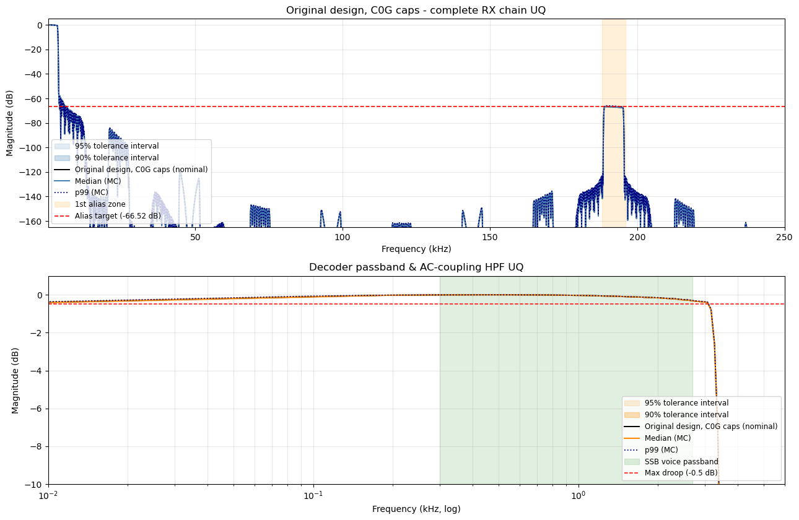
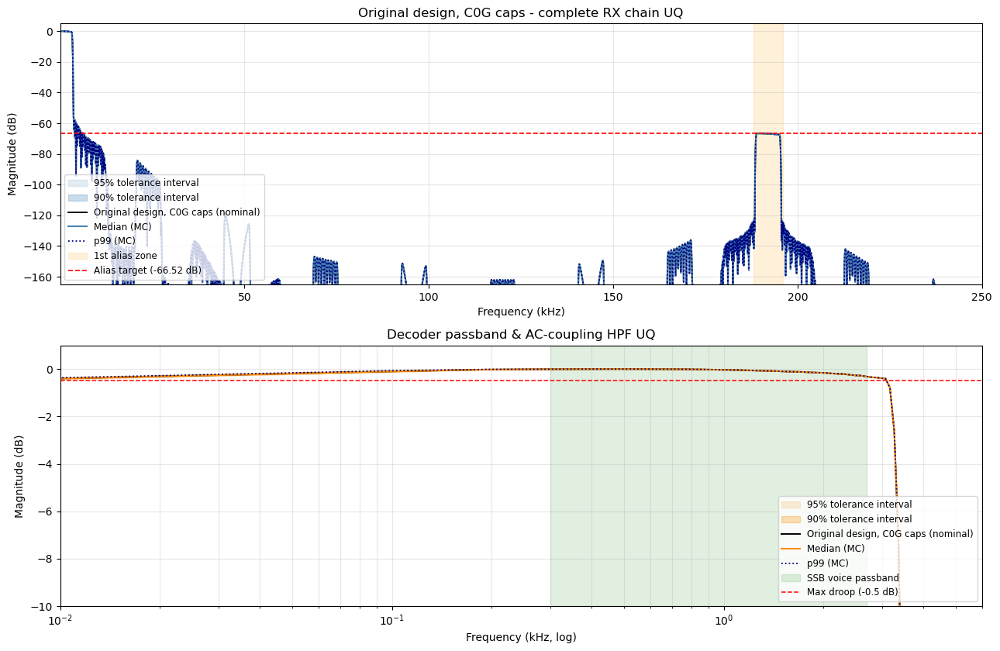
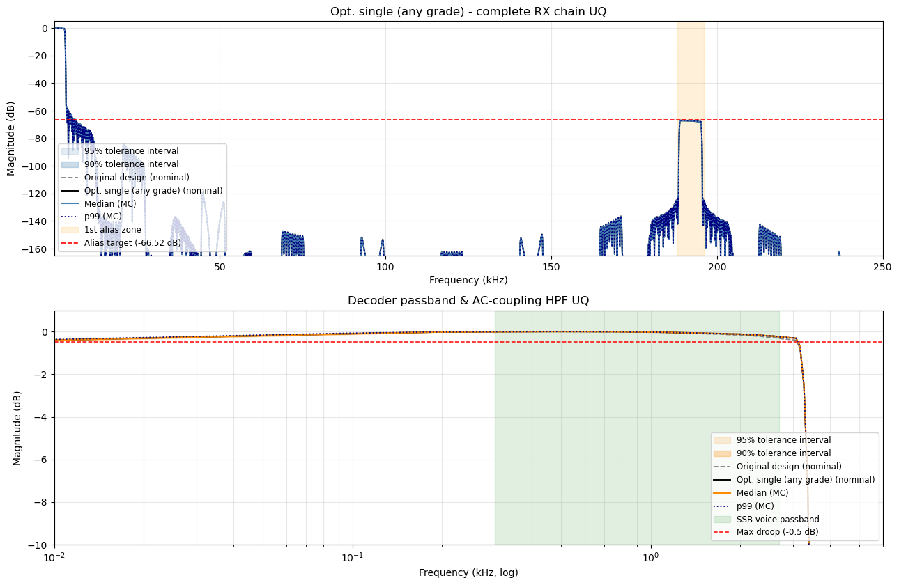
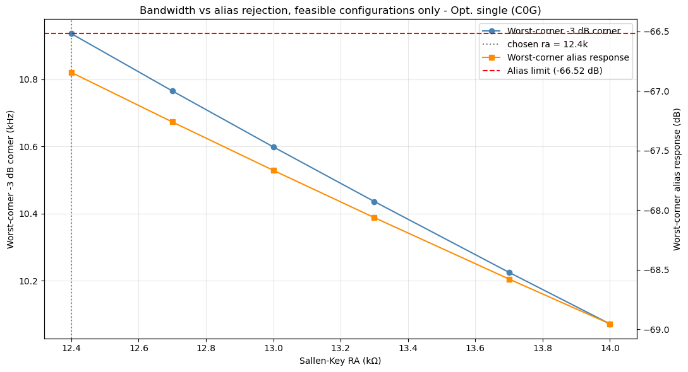
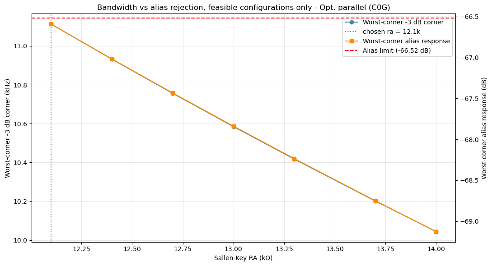
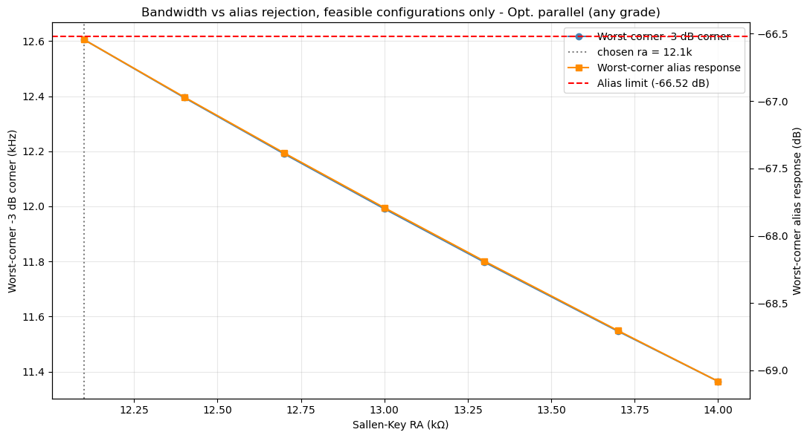

```python
# ============================================================
# REV 40N - ARCH A RX AUDIO CHAIN
# analysis + sequential-MILP discrete part optimization
# ============================================================
import itertools
import numpy as np
import matplotlib.pyplot as plt

from scipy.signal import firwin, freqz
from scipy.optimize import differential_evolution, milp, LinearConstraint, Bounds
from scipy.special import erfinv

# ============================================================
# 1. CONFIGURATION
# ============================================================
FS, FS1, FS2, FSOUT = 192e3, 48e3, 24e3, 8e3
R_DEC, N_CIC = 4, 4
SSB = 2.7e3
FCRIT = FS - FSOUT / 2
FCRIT_HI = FS + FSOUT / 2

BLOCKER_DBFS = -30.0
ALIAS_BELOW_NOISE_DB = 10.0
ADC_SNR_TYP = 68.0
ADC_VREF, ADC_BITS = 3.10, 12
ADC_LSB = ADC_VREF / 2**ADC_BITS
ADC_SNR_NOISE_DBFS = -ADC_SNR_TYP - 10 * np.log10(FS / SSB)
ALIAS_THRESHOLD_DBFS = ADC_SNR_NOISE_DBFS - ALIAS_BELOW_NOISE_DB
TARGET = -(BLOCKER_DBFS - ALIAS_THRESHOLD_DBFS)  # max alias response [dB]
MAX_PASS_LOSS_DB = 0.5
Q_MIN, Q_MAX = 0.60, 0.85

# Tayloe
R_SOURCE_RF, R_ON_TAYLOE = 8.22, 5.0
C_TAYLOE_20M, C_TAYLOE_40M = 2.2e-9, 4.3e-9
R_SOURCE_AUDIO = 4 * (R_SOURCE_RF + R_ON_TAYLOE)
FC_TAYLOE_20M = 1 / (2 * np.pi * R_SOURCE_AUDIO * C_TAYLOE_20M)
FC_TAYLOE_40M = 1 / (2 * np.pi * R_SOURCE_AUDIO * C_TAYLOE_40M)
FC_TAYLOE = FC_TAYLOE_20M

# ADC
C_ADC, R_ADC_SWITCH, T_ACQ = 6e-12, 0.0, 2600e-9
R_KICK = 100.0  # ADC kickback isolation R (used for settling only, not in arch_a)
R_ADC_LEAK = 1e12
C_KICK = 1e-9  # ADC-pin kickback cap, driven by the op-amp through R_KICK
SETTLE_LIMIT = 0.5 / 2**ADC_BITS  # residual error budget: 1/2 LSB of full scale
RC_CMAX = 100e-9  # largest C0G capacitor assumed available (assumption)

# ============================================================
# 2. TOLERANCE MODEL
# ============================================================
# class -> (tolerance, assumed bin yield)
PASSIVE_MODEL = {
    "C0G": (0.05, 0.99),
    "C0G2": (0.02, 0.99),
    "C0G1": (0.01, 0.99),
    "X5R": (0.20, 0.95),
    "R1pct": (0.01, 0.99),
    "L10pct": (0.10, 0.95),
}
CAP_CLASSES = {"C0G": 0.0, "C0G2": 0.15, "C0G1": 0.50}  # relative cost
PAR_COST = 0.04  # two caps in parallel


def tol(cls):
    return PASSIVE_MODEL[cls][0]


def draw_by_class(rng, cls, n, dist="truncnorm"):
    t, y = PASSIVE_MODEL[cls]
    if dist == "uniform":
        return rng.uniform(1 - t, 1 + t, n)
    if dist == "worstcase":
        return rng.choice([1 - t, 1 + t], size=n)
    sigma = t / (np.sqrt(2) * erfinv(y))
    out, filled = np.empty(n), 0
    while filled < n:
        s = rng.normal(0, sigma, n - filled)
        s = s[np.abs(s) <= t]
        out[filled : filled + len(s)] = 1 + s
        filled += len(s)
    return out


# ============================================================
# 3. TRANSFER FUNCTIONS (all broadcast: parts (N,1) x f (M,))
# ============================================================
def db(x):
    return 20 * np.log10(np.maximum(np.abs(x), 1e-15))


def wrap(f, fs):
    return (np.asarray(f) + fs / 2) % fs - fs / 2


def tayloe(f):
    return 1 / (1 + 1j * np.asarray(f) / FC_TAYLOE)


def arch_a(f, c_ac, r_in, r_fb, c_fb, ra, ca, cb):
    """AC-coupled diff-amp pole + Sallen-Key; no defaults on purpose."""
    s = 2j * np.pi * np.asarray(f, float)
    r_tot = r_in + R_SOURCE_AUDIO
    H_hp = s * r_tot * c_ac / (1 + s * r_tot * c_ac)
    H_p1 = 1 / (1 + s * r_fb * c_fb)
    w0 = 1 / (ra * np.sqrt(ca * cb))
    Q = np.sqrt(ca / cb) / 2
    H_sk = w0**2 / (s**2 + s * w0 / Q + w0**2)
    return H_hp * H_p1 * H_sk


HB = firwin(63, 12e3, fs=FS1)
POLY = firwin(161, 3.35e3, fs=FS2)


def cic(f):
    f = np.asarray(f, float)
    den = 4 * np.sin(np.pi * f / FS)
    num = np.sin(4 * np.pi * f / FS)
    ratio = np.ones_like(f)
    m = np.abs(den) > 1e-12
    ratio[m] = num[m] / den[m]
    return np.abs(ratio) ** 4


def fir_response(f, coeff, fs):
    _, h = freqz(coeff, worN=2 * np.pi * np.asarray(f) / fs)
    return np.abs(h)


def digital(f):
    f = np.asarray(f, float)
    return (
        cic(wrap(f, FS))
        * fir_response(wrap(f, FS1), HB, FS1)
        * fir_response(wrap(f, FS2), POLY, FS2)
    )


# ============================================================
# 4. DESIGN = two plain dicts (val, cls) + label dict
# ============================================================
NAMES = ["c_ac", "r_in", "r_fb", "c_fb", "ra", "ca", "cb"]
OPT = ["c_fb", "ra", "ca", "cb"]  # chosen from discrete pools
CAPS = {"c_ac", "c_fb", "ca", "cb"}
SIGNS = np.array(list(itertools.product((-1, 1), repeat=len(NAMES))))  # (128, 7)

ROLE = {
    "c_ac": "AC-coupling capacitor",
    "r_in": "Diff-amp input resistor",
    "r_fb": "Diff-amp feedback resistor",
    "c_fb": "Diff-amp feedback cap (pole 1)",
    "ra": "Sallen-Key R (both resistors)",
    "ca": "Sallen-Key Ca (feedback cap)",
    "cb": "Sallen-Key Cb (cap to ground)",
}

VAL0 = dict(
    c_ac=10e-6, r_in=1e3, r_fb=50e3, c_fb=220e-12, ra=10e3, ca=1.5e-9, cb=750e-12
)
CLS0 = dict(
    c_ac="X5R", r_in="R1pct", r_fb="R1pct", c_fb="C0G", ra="R1pct", ca="C0G", cb="C0G"
)


def fmt(v, is_cap):
    """Engineering-notation value string."""
    if is_cap:
        if v >= 1e-6:
            return f"{v*1e6:.4g}u"
        if v >= 1e-9:
            return f"{v*1e9:.4g}n"
        return f"{v*1e12:.4g}p"
    if v >= 1e6:
        return f"{v/1e6:.4g}M"
    if v >= 1e3:
        return f"{v/1e3:.4g}k"
    return f"{v:.4g}"


def lab(v):  # capacitor label (kept for candidate labels)
    return fmt(v, True)


LBL0 = {n: fmt(VAL0[n], n in CAPS) for n in NAMES}

# evaluation grids (fixed, shared by everything)
F_A = np.linspace(FCRIT, FCRIT_HI, 401)
F_P = np.linspace(300, SSB, 120)
F_FC = np.logspace(3, 5, 1500)
_DA = tayloe(F_A) * digital(F_A)
_DP = tayloe(F_P) * digital(F_P)


def _fc_from(H):
    """First -3.0103 dB crossing of H (N,M), log-f interpolation; 0 if none."""
    below = H <= -3.0103
    has = below.any(axis=1)
    i = np.clip(below.argmax(axis=1), 1, None)[:, None]
    h0 = np.take_along_axis(H, i - 1, 1)[:, 0]
    h1 = np.take_along_axis(H, i, 1)[:, 0]
    l0, l1 = np.log(F_FC[i[:, 0] - 1]), np.log(F_FC[i[:, 0]])
    fc = np.exp(l0 + (-3.0103 - h0) / (h1 - h0 + 1e-30) * (l1 - l0))
    return np.where(has, fc, 0.0)


def metrics_vec(x, chunk=1000):
    """x: dict name -> array (N,). Returns alias [dB], |passband dev| [dB], fc [Hz]."""
    n = len(next(iter(x.values())))
    out = []
    for i in range(0, n, chunk):
        xc = {k: np.asarray(v, float)[i : i + chunk, None] for k, v in x.items()}
        alias = db(_DA * arch_a(F_A, **xc)).max(axis=1)
        pas = np.abs(db(_DP * arch_a(F_P, **xc))).max(axis=1)
        H = db(arch_a(F_FC, **xc)) - db(arch_a(np.array([100.0]), **xc))
        out.append(np.column_stack([alias, pas, _fc_from(H)]))
    out = np.vstack(out)
    return out[:, 0], out[:, 1], out[:, 2]


def metrics_nom(val):
    a, p, fc = metrics_vec({n: [val[n]] for n in NAMES})
    return np.array([a[0], p[0], fc[0] / 1e3])  # fc in kHz


def corner_set(val, cls):
    t = np.array([tol(cls[n]) for n in NAMES])
    v = np.array([val[n] for n in NAMES])
    X = v * (1 + SIGNS * t)
    return {n: X[:, i] for i, n in enumerate(NAMES)}


def worst_case(val, cls):
    """Exact 128-corner enumeration -> alias_max, pass_max, fc_min [Hz], Q_min, Q_max."""
    x = corner_set(val, cls)
    a, p, fc = metrics_vec(x)
    q = np.sqrt(x["ca"] / x["cb"]) / 2
    return a.max(), p.max(), fc.min(), q.min(), q.max()


def verify(val, cls):
    a, p, fc, qlo, qhi = worst_case(val, cls)
    viol = (
        max(0, a - TARGET)
        + max(0, p - MAX_PASS_LOSS_DB)
        + max(0, Q_MIN - qlo)
        + max(0, qhi - Q_MAX)
    )
    return viol, fc, a, p


def monte_carlo(val, cls, runs=5000, seed=1, dist="truncnorm"):
    rng = np.random.default_rng(seed)
    x = {n: val[n] * draw_by_class(rng, cls[n], runs, dist) for n in NAMES}
    return metrics_vec(x)


def report(val, cls, name):
    a, p, fc_min, qlo, qhi = worst_case(val, cls)
    print(f"\n{name}")
    print(
        f"  corners: {len(SIGNS)} | worst alias {a:+.2f} dB (limit {TARGET:+.2f}, "
        f"margin {TARGET - a:+.2f}) | worst passband dev {p:.3f} dB "
        f"(limit {MAX_PASS_LOSS_DB}) | fc_min {fc_min/1e3:.2f} kHz | "
        f"Q {qlo:.3f}..{qhi:.3f}"
    )
    ok = a <= TARGET and p <= MAX_PASS_LOSS_DB and Q_MIN <= qlo and qhi <= Q_MAX
    print(f"  corner verdict: {'PASS' if ok else 'FAIL'}")
    am, pm, fm = monte_carlo(val, cls)
    print(
        f"  MC alias: median {np.median(am):+.2f}, p99.9 {np.percentile(am, 99.9):+.2f}, "
        f"max {am.max():+.2f} dB | fc median {np.median(fm)/1e3:.2f}, "
        f"p1 {np.percentile(fm, 1)/1e3:.2f} kHz"
    )
    return ok


def section(title):
    print("\n" + "=" * 78 + f"\n{title}\n" + "=" * 78)


# ============================================================
# 5. COMPONENT-VALUE REPORTING
# ============================================================
def print_bom(title, val, cls, lbl):
    """Full component table for an Arch A design."""
    print(f"\n{title}")
    print("  " + "-" * 100)
    print(
        f"  {'Ref':<5} {'Role':<33} {'Value':>9} {'Build':<14} {'Class':<7} "
        f"{'Tol':>5} {'Min':>9} {'Max':>9}  {'Exact [SI]':>14}"
    )
    print("  " + "-" * 100)
    for n in NAMES:
        cap = n in CAPS
        t = tol(cls[n])
        print(
            f"  {n:<5} {ROLE[n]:<33} {fmt(val[n], cap):>9} {lbl[n]:<14} {cls[n]:<7} "
            f"{t*100:>4.0f}% {fmt(val[n]*(1-t), cap):>9} {fmt(val[n]*(1+t), cap):>9}  "
            f"{val[n]:>14.6g}"
        )
    print("  " + "-" * 100)


def print_derived(title, val, cls):
    """Derived electrical quantities of an Arch A design."""
    r_tot = val["r_in"] + R_SOURCE_AUDIO
    gain = val["r_fb"] / r_tot
    f_hp = 1 / (2 * np.pi * r_tot * val["c_ac"])
    f_p1 = 1 / (2 * np.pi * val["r_fb"] * val["c_fb"])
    f0 = 1 / (2 * np.pi * val["ra"] * np.sqrt(val["ca"] * val["cb"]))
    q = np.sqrt(val["ca"] / val["cb"]) / 2
    _, _, fc_min, qlo, qhi = worst_case(val, cls)
    m = metrics_nom(val)
    print(f"\n{title}")
    print(
        f"  signal gain (r_fb / (r_in + R_src)) : {gain:.2f} V/V = {20*np.log10(gain):.2f} dB "
        f"(R_src = {R_SOURCE_AUDIO:.2f} ohm)"
    )
    print(f"  AC-coupling HPF corner               : {f_hp:.2f} Hz")
    print(f"  diff-amp feedback pole (pole 1)      : {f_p1/1e3:.3f} kHz")
    print(f"  Sallen-Key f0 / Q                    : {f0/1e3:.3f} kHz / {q:.4f}")
    print(f"  cascade -3 dB corner (nominal)       : {m[2]:.3f} kHz")
    print(f"  worst-corner fc_min                  : {fc_min/1e3:.3f} kHz")
    print(
        f"  Q over tolerance corners             : {qlo:.4f} .. {qhi:.4f} "
        f"(allowed {Q_MIN}..{Q_MAX})"
    )
    print(
        f"  nominal alias response               : {m[0]:+.2f} dB (limit {TARGET:+.2f})"
    )
    print(
        f"  nominal passband deviation           : {m[1]:.3f} dB (limit {MAX_PASS_LOSS_DB})"
    )


# ============================================================
# 6. PASSIVE RC2 (closed form) + ADC SETTLING
# ============================================================
def passive_rc(f, R1, R2, C1, C2):
    s = 2j * np.pi * np.asarray(f, float)
    G1, G2, GL = 1 / (R_SOURCE_AUDIO + R1), 1 / R2, 1 / R_ADC_LEAK
    det = (G1 + G2 + s * C1) * (G2 + GL + s * C2) - G2**2
    return G1 * G2 / det


def adc_settle_error(r_rec, c_hold, t_acq=T_ACQ, c_adc=C_ADC):
    """Worst-case residual (fraction of a full-scale step) at the end of acquisition.
    Charge sharing of c_adc with the hold cap leaves e0; the rest is restored
    through r_rec with tau = r_rec * (c_hold + c_adc)."""
    e0 = c_adc / (c_hold + c_adc)
    tau = (r_rec + R_ADC_SWITCH) * (c_hold + c_adc)
    return e0 * np.exp(-t_acq / tau), e0, tau


# ============================================================
# 7. PLOTS
# ============================================================
def nominal_curve(val, f):
    return db(tayloe(f) * digital(f) * arch_a(f, **val))


def mc_curves(val, cls, f, runs=5000, seed=1, chunk=500):
    rng = np.random.default_rng(seed)
    fac = {n: draw_by_class(rng, cls[n], runs) for n in NAMES}
    base = tayloe(f) * digital(f)
    out = np.empty((runs, len(f)), np.float32)
    for i in range(0, runs, chunk):
        x = {n: (val[n] * fac[n][i : i + chunk])[:, None] for n in NAMES}
        out[i : i + chunk] = db(base * arch_a(f, **x))
    return out


def plot_uq(
    val, cls, name, ref_val=None, ref_name="Original design (nominal)", runs=5000
):
    f = np.union1d(np.linspace(0, 1.5 * FS, 3000), F_A)  # dense inside alias band
    mask = (f >= FCRIT) & (f <= FCRIT_HI)
    mc = mc_curves(val, cls, f, runs)
    worst = mc[:, mask].max(axis=1)

    print(f"\n{name} - alias rejection statistics")
    print("-" * 68)
    print(
        f"{'Level':<10} {'Quantile':>11} {'Response':>13} {'Margin':>12} {'Verdict':>9}"
    )
    for label, q in [
        ("Median", 50),
        ("1 sigma", 84.1345),
        ("2 sigma", 97.725),
        ("3 sigma", 99.865),
        ("4 sigma", 99.99683),
        ("Maximum", 100),
    ]:
        v = np.percentile(worst, q)
        print(
            f"{label:<10} {q:>10.5f}% {v:>+12.2f} dB {TARGET - v:>+10.2f} dB "
            f"{'PASS' if TARGET - v >= 0 else 'FAIL':>9}"
        )
    print("-" * 68)

    p2_5, p5, p50, p95, p97_5, p99 = np.percentile(
        mc, [2.5, 5, 50, 95, 97.5, 99], axis=0
    )
    nom = nominal_curve(val, f)
    ref = None if ref_val is None else nominal_curve(ref_val, f)
    fk = f / 1e3

    fig, axes = plt.subplots(2, 1, figsize=(13, 8.5))
    for ax, color in zip(axes, ("steelblue", "darkorange")):
        ax.fill_between(
            fk, p2_5, p97_5, alpha=0.14, color=color, label="95% tolerance interval"
        )
        ax.fill_between(
            fk, p5, p95, alpha=0.28, color=color, label="90% tolerance interval"
        )
        if ref is not None:
            ax.plot(fk, ref, color="gray", ls="--", lw=1.3, label=ref_name)
        ax.plot(fk, nom, "k-", lw=1.4, label=f"{name} (nominal)")
        ax.plot(fk, p50, color=color, lw=1.5, label="Median (MC)")
        ax.plot(fk, p99, ":", color="navy", lw=1.3, label="p99 (MC)")
        ax.set_ylabel("Magnitude (dB)")
        ax.grid(True, which="both", alpha=0.3)

    ax1, ax2 = axes
    ax1.axvspan(
        FCRIT / 1e3, FCRIT_HI / 1e3, color="orange", alpha=0.15, label="1st alias zone"
    )
    ax1.axhline(
        TARGET, color="red", ls="--", lw=1.2, label=f"Alias target ({TARGET:.2f} dB)"
    )
    ax1.set(
        xlim=(0.01, 250),
        ylim=(-165, 5),
        xlabel="Frequency (kHz)",
        title=f"{name} - complete RX chain UQ",
    )
    ax1.legend(loc="lower left", fontsize=8.5)

    ax2.axvspan(0.3, SSB / 1e3, color="green", alpha=0.12, label="SSB voice passband")
    ax2.axhline(
        -MAX_PASS_LOSS_DB,
        color="red",
        ls="--",
        lw=1.1,
        label=f"Max droop (-{MAX_PASS_LOSS_DB} dB)",
    )
    ax2.set_xscale("log")
    ax2.set(
        xlim=(0.01, 6.0),
        ylim=(-10, 1),
        xlabel="Frequency (kHz, log)",
        title="Decoder passband & AC-coupling HPF UQ",
    )
    ax2.legend(loc="lower right", fontsize=8.5)
    plt.tight_layout()
    plt.show()
    return worst


def plot_analog_compare(designs, rc2_designs, fmax=24e3, include_tayloe=False):
    """designs: [(name, val, color)]; rc2_designs: [(name, val, color, ok)].
    Each curve normalized to its 100 Hz gain. Top: 0..fmax, bottom: 0..6 kHz."""
    f = np.linspace(1.0, fmax, 6000)
    f_ref = np.array([100.0])
    tay = (lambda ff: tayloe(ff)) if include_tayloe else (lambda ff: 1.0)
    fig, (ax1, ax2) = plt.subplots(2, 1, figsize=(12, 9), sharex=False)
    for ax in (ax1, ax2):
        for name, v, col in designs:
            h = tay(f) * arch_a(f, **v)
            h0 = abs(tay(f_ref) * arch_a(f_ref, **v))[0]
            ax.plot(
                f / 1e3,
                db(h / h0),
                lw=2,
                color=col,
                label=f"{name} (fc {metrics_nom(v)[2]:.2f} kHz)",
            )
        for name, v, col, ok in rc2_designs:
            h = tay(f) * passive_rc(f, **v)
            h0 = abs(tay(f_ref) * passive_rc(f_ref, **v))[0]
            hr = db(h / h0)
            fc = f[np.argmax(hr <= -3.0103)] if (hr <= -3.0103).any() else np.nan
            ax.plot(
                f / 1e3,
                hr,
                lw=2,
                ls="--",
                color=col,
                label=f"{name} ({'feasible' if ok else 'infeasible'}; fc {fc/1e3:.2f} kHz)",
            )
        ax.axvspan(
            0.3, SSB / 1e3, color="green", alpha=0.10, label="SSB voice passband"
        )
        ax.axhline(-3.0103, color="red", ls=":", lw=1.1, label="-3 dB")
        ax.axvline(
            FSOUT / 2e3, color="gray", ls=":", lw=1.1, label="Output Nyquist (4 kHz)"
        )
        ax.grid(True, which="both", alpha=0.3)
        ax.set_ylabel("Normalized magnitude (dB)")
    ax1.set(
        xlim=(0, fmax / 1e3),
        ylim=(-60, 3),
        xlabel="Frequency (kHz)",
        title=f"Analog filter responses, 0-{fmax/1e3:.0f} kHz",
    )
    ax1.legend(loc="lower left", fontsize=8)
    ax2.axhline(
        -MAX_PASS_LOSS_DB,
        color="red",
        ls="--",
        lw=1.1,
        label=f"Max droop (-{MAX_PASS_LOSS_DB} dB)",
    )
    ax2.set(
        xlim=(0, 6), ylim=(-4, 1), xlabel="Frequency (kHz)", title="Passband detail"
    )
    ax2.legend(loc="lower left", fontsize=8)
    plt.tight_layout()
    plt.show()


def ra_sweep_plot(d, lo=6.8e3, hi=14e3):
    """Bandwidth vs alias rejection for feasible ra values only.
    Each ra comes from the real E96 pool and is checked with the exact
    128-corner enumeration against the design's own part classes."""
    ras = R_POOL[(R_POOL >= lo) & (R_POOL <= hi)]
    rows = []
    n_infeasible = 0
    for ra in ras:
        val = {**d["val"], "ra": ra}
        a, p, fc_min, qlo, qhi = worst_case(val, d["cls"])
        ok = a <= TARGET and p <= MAX_PASS_LOSS_DB and Q_MIN <= qlo and qhi <= Q_MAX
        if ok:
            rows.append((ra, fc_min, a))
        else:
            n_infeasible += 1
    print(
        f"{d['name']}: {len(rows)} feasible / {len(ras)} E96 values of ra "
        f"in {lo/1e3:.1f}-{hi/1e3:.1f} kOhm ({n_infeasible} rejected)"
    )
    if not rows:
        print("  no feasible ra in range, nothing to plot")
        return
    r = np.array(rows)

    fig, ax1 = plt.subplots(figsize=(11, 6))
    ax1.plot(
        r[:, 0] / 1e3,
        r[:, 1] / 1e3,
        "o-",
        color="steelblue",
        label="Worst-corner -3 dB corner",
    )
    ax1.axvline(
        d["val"]["ra"] / 1e3,
        color="gray",
        ls=":",
        label=f"chosen ra = {fmt(d['val']['ra'], False)}",
    )
    ax1.set_xlabel("Sallen-Key RA (kΩ)")
    ax1.set_ylabel("Worst-corner -3 dB corner (kHz)")
    ax1.grid(alpha=0.3)
    ax2 = ax1.twinx()
    ax2.plot(
        r[:, 0] / 1e3,
        r[:, 2],
        "s-",
        color="darkorange",
        label="Worst-corner alias response",
    )
    ax2.axhline(TARGET, color="red", ls="--", label=f"Alias limit ({TARGET:.2f} dB)")
    ax2.set_ylabel("Worst-corner alias response (dB)")
    h1, l1 = ax1.get_legend_handles_labels()
    h2, l2 = ax2.get_legend_handles_labels()
    ax1.legend(h1 + h2, l1 + l2, loc="best")
    plt.title(
        f"Bandwidth vs alias rejection, feasible configurations only - {d['name']}"
    )
    plt.tight_layout()
    plt.show()


# ============================================================
# 8. E-SERIES (computed) + DISCRETE POOLS
# ============================================================
# E3..E24 are defined by table (hand-adjusted), E48/E96/E192 by rounding 10**(k/N).
E24 = [ 1.0, 1.1, 1.2, 1.3, 1.5, 1.6, 1.8, 2.0, 2.2, 2.4, 2.7, 3.0, 3.3, 3.6, 3.9, 4.3, 4.7, 5.1, 5.6, 6.2, 6.8, 7.5, 8.2, 9.1, ]
E24 = np.array(E24)
E12 = E24[::2]
E6 = E24[::4]
E3 = E24[::8]
E96 = np.round(10 ** (np.arange(96) / 96), 2)
E48 = E96[::2]
E192 = np.round(10 ** (np.arange(192) / 192), 2)

assert len(E24) == 24 and len(E12) == 12 and len(E6) == 6
assert len(E48) == 48 and len(E96) == 96 and len(E192) == 192
assert set(E12) <= set(E24) and set(E48) <= set(E96) and set(E96) <= set(E192)
assert 10.0 not in E96 and E96[0] == 1.0 and E96[-1] < 10.0

SERIES = {
    "E3": E3,
    "E6": E6,
    "E12": E12,
    "E24": E24,
    "E48": E48,
    "E96": E96,
    "E192": E192,
}

# choose which series are allowed for each part type
CAP_SERIES = "E24"  # try "E12" (cheaper/common) or "E48"/"E96" (finer)
R_SERIES = "E96"  # 1% resistors


def expand(series, decade_mults):
    return np.sort(np.concatenate([SERIES[series] * d for d in decade_mults]))


CAP_POOL = expand(CAP_SERIES, (1e-12, 10e-12, 100e-12, 1e-9))
CAP_POOL = CAP_POOL[(CAP_POOL >= 47e-12) & (CAP_POOL <= 10e-9)]
R_POOL = expand(R_SERIES, (1e3, 10e3))
R_POOL = R_POOL[(R_POOL >= 4e3) & (R_POOL <= 30e3)]


def build_candidates(name, center, window=0.35, max_par=2, cap_classes=None):
    lo, hi = center * (1 - window), center * (1 + window)
    if name == "ra":
        combos = [(v, fmt(v, False), 1) for v in R_POOL if lo <= v <= hi]
        classes = {"R1pct": 0.0}
    else:
        combos = [(v, lab(v), 1) for v in CAP_POOL if lo <= v <= hi]
        if max_par >= 2:
            for i, a in enumerate(CAP_POOL):
                for b in CAP_POOL[i:]:
                    if lo <= a + b <= hi:
                        combos.append((a + b, f"{lab(a)}+{lab(b)}", 2))
        classes = cap_classes or CAP_CLASSES
    cands = [
        dict(v=v, label=l, cls=c, tol=tol(c), cost=k + PAR_COST * (n - 1))
        for v, l, n in combos
        for c, k in classes.items()
    ]
    assert cands, f"no candidates for {name}"
    return cands


# ============================================================
# 8b. PASSIVE RC2 - same chain, tolerance model, pools, settling model
# ============================================================
RC_NAMES = ["R1", "R2", "C1", "C2"]
RC_SIGNS = np.array(list(itertools.product((-1, 1), repeat=4)))  # 16 corners
RC_R_POOL = expand("E96", (1, 10, 100, 1e3, 1e4, 1e5))
RC_R_POOL = RC_R_POOL[(RC_R_POOL >= 10) & (RC_R_POOL <= 100e3)]
RC_C_POOL = expand("E24", (1e-12, 10e-12, 100e-12, 1e-9, 10e-9, 100e-9))
RC_C_POOL = RC_C_POOL[(RC_C_POOL >= 100e-12) & (RC_C_POOL <= RC_CMAX)]


def rc2_metrics_vec(x):
    P = {k: np.asarray(v, float)[:, None] for k, v in x.items()}
    alias = db(_DA * passive_rc(F_A, **P)).max(axis=1)
    pas = np.abs(db(_DP * passive_rc(F_P, **P))).max(axis=1)
    H = db(passive_rc(F_FC, **P)) - db(passive_rc(np.array([100.0]), **P))
    return alias, pas, _fc_from(H)


def rc2_worst(val, cls):
    """Exact 16-corner enumeration, same metrics as Arch A plus settling."""
    t = np.array([tol(cls[n]) for n in RC_NAMES])
    v = np.array([val[n] for n in RC_NAMES])
    X = v * (1 + RC_SIGNS * t)
    x = {n: X[:, i] for i, n in enumerate(RC_NAMES)}
    a, p, fc = rc2_metrics_vec(x)
    serr = adc_settle_error(x["R2"], x["C2"])[0]  # assumes C1 >> C2 (checked below)
    return dict(
        alias=a.max(),
        pas=p.max(),
        fc_min=fc.min(),
        settle=serr.max(),
        c_ratio=(x["C1"] / x["C2"]).min(),
    )


def rc2_violation(w):
    return (
        max(0, w["alias"] - TARGET)
        + max(0, w["pas"] - MAX_PASS_LOSS_DB)
        + max(0, np.log10(max(w["settle"], 1e-300) / SETTLE_LIMIT))
        + max(0, np.log10(5 / w["c_ratio"]))
    )  # require C1 >= 5*C2


def design_rc2(cap_cls, seed=0):
    """Best-effort RC2: minimize violation, then maximize worst-corner fc.
    Discrete search over the same E-series pools (needs scipy >= 1.9)."""
    cls = dict(R1="R1pct", R2="R1pct", C1=cap_cls, C2=cap_cls)

    def decode(ix):
        i = np.round(ix).astype(int)
        return dict(
            R1=RC_R_POOL[i[0]],
            R2=RC_R_POOL[i[1]],
            C1=RC_C_POOL[i[2]],
            C2=RC_C_POOL[i[3]],
        )

    def obj(ix):
        w = rc2_worst(decode(ix), cls)
        return 1e3 * rc2_violation(w) - w["fc_min"] / 1e3

    bounds = [(0, len(RC_R_POOL) - 1)] * 2 + [(0, len(RC_C_POOL) - 1)] * 2
    r = differential_evolution(
        obj,
        bounds,
        integrality=[True] * 4,
        seed=seed,
        popsize=40,
        maxiter=300,
        tol=1e-9,
        polish=False,
    )
    val = decode(r.x)
    w = rc2_worst(val, cls)
    return val, cls, w, rc2_violation(w) <= 1e-9


def print_rc2(name, val, cls, w, ok):
    print(f"\n{name} - {'FEASIBLE' if ok else 'INFEASIBLE (closest design found)'}")
    for n in RC_NAMES:
        cap = n.startswith("C")
        print(
            f"  {n:<3} {fmt(val[n], cap):>8} [{cls[n]}] ±{tol(cls[n])*100:.0f}%   exact {val[n]:.6g}"
        )
    print(
        f"  16 corners: alias {w['alias']:+.2f} dB (limit {TARGET:+.2f}) | "
        f"passband dev {w['pas']:.3f} dB (limit {MAX_PASS_LOSS_DB}) | fc_min {w['fc_min']/1e3:.2f} kHz"
    )
    print(
        f"  ADC residual {w['settle']*2**ADC_BITS:.3g} LSB (limit 0.5) | min C1/C2 {w['c_ratio']:.1f} (need >= 5)"
    )


# ============================================================
# 9. SEQUENTIAL MILP WITH TRUST REGION + EXACT ACCEPTANCE
# ============================================================
def jacobian(val, eps=1e-3):
    """d[alias dB, pass dB, fc kHz] / d ln(part) -> (7, 3), one batched call."""
    k = len(NAMES)
    X = {n: np.full(2 * k, val[n], float) for n in NAMES}
    for i, n in enumerate(NAMES):
        X[n][i] *= np.exp(eps)
        X[n][k + i] *= np.exp(-eps)
    a, p, fc = metrics_vec(X)
    m = np.column_stack([a, p, fc / 1e3])
    return (m[:k] - m[k:]) / (2 * eps)


def solve_step(val, cls, cands, delta, margin, cost_w=0.02, slack_w=1e3):
    """One MILP: maximize linearized worst-case fc subject to linearized robust
    alias/passband limits and exact robust Q bounds, inside a trust region."""
    J, m0 = jacobian(val), metrics_nom(val)
    ix = {n: i for i, n in enumerate(NAMES)}
    sel = {
        n: [c for c in cands[n] if abs(np.log(c["v"] / val[n])) <= delta] for n in OPT
    }
    if any(not sel[n] for n in OPT):
        return None

    off, cur = {}, 0
    for n in OPT:
        off[n] = cur
        cur += len(sel[n])
    nv = cur + 2  # + slack_alias, slack_pass
    i_sa, i_sp = cur, cur + 1

    c = np.zeros(nv)
    c[[i_sa, i_sp]] = slack_w
    for n in OPT:
        for k, cd in enumerate(sel[n]):
            dx = np.log(cd["v"] / val[n])
            c[off[n] + k] = (
                -(J[ix[n], 2] * dx - abs(J[ix[n], 2]) * cd["tol"]) + cost_w * cd["cost"]
            )

    rows, lo, hi = [], [], []
    for n in OPT:  # one-hot
        r = np.zeros(nv)
        r[off[n] : off[n] + len(sel[n])] = 1
        rows.append(r)
        lo.append(1)
        hi.append(1)

    fixed = [n for n in NAMES if n not in OPT]
    for mi, slack, limit in (
        (0, i_sa, TARGET - margin),
        (1, i_sp, MAX_PASS_LOSS_DB - 0.5 * margin),
    ):
        r = np.zeros(nv)
        for n in OPT:
            for k, cd in enumerate(sel[n]):
                dx = np.log(cd["v"] / val[n])
                r[off[n] + k] = J[ix[n], mi] * dx + abs(J[ix[n], mi]) * cd["tol"]
        r[slack] = -1
        const = sum(abs(J[ix[n], mi]) * tol(cls[n]) for n in fixed)
        rows.append(r)
        lo.append(-np.inf)
        hi.append(limit - m0[mi] - const)

    # exact robust Q bounds: Q = sqrt(ca/cb)/2
    r_lo, r_hi = np.zeros(nv), np.zeros(nv)
    for k, cd in enumerate(sel["ca"]):
        r_lo[off["ca"] + k] = np.log(cd["v"]) + np.log(1 - cd["tol"])
        r_hi[off["ca"] + k] = np.log(cd["v"]) + np.log(1 + cd["tol"])
    for k, cd in enumerate(sel["cb"]):
        r_lo[off["cb"] + k] = -(np.log(cd["v"]) + np.log(1 + cd["tol"]))
        r_hi[off["cb"] + k] = -(np.log(cd["v"]) + np.log(1 - cd["tol"]))
    rows += [r_lo, r_hi]
    lo += [2 * np.log(2 * Q_MIN), -np.inf]
    hi += [np.inf, 2 * np.log(2 * Q_MAX)]

    sol = milp(
        c=c,
        integrality=np.r_[np.ones(cur), 0, 0],
        bounds=Bounds(np.zeros(nv), np.r_[np.ones(cur), np.inf, np.inf]),
        constraints=LinearConstraint(np.array(rows), lo, hi),
    )
    if not sol.success:
        return None
    return {
        n: sel[n][int(np.argmax(sol.x[off[n] : off[n] + len(sel[n])]))] for n in OPT
    }


def optimize(
    val,
    cls,
    lbl,
    delta=0.15,
    margin=0.0,
    max_iter=40,
    window=0.35,
    max_par=2,
    cap_classes=None,
):
    cands = {n: build_candidates(n, val[n], window, max_par, cap_classes) for n in OPT}
    lbl = dict(lbl)
    viol, fc, a, p = verify(val, cls)
    print(
        f"start: viol={viol:.3f}  alias={a:+.2f} dB  pass={p:.3f} dB  fc_min={fc/1e3:.2f} kHz"
    )

    for it in range(1, max_iter + 1):
        pick = solve_step(val, cls, cands, delta, margin)
        if pick is None:
            delta *= 0.6
            print(f"it {it:2d}: MILP failed, delta -> {delta:.3f}")
            if delta < 0.01:
                break
            continue

        v2 = {**val, **{n: pick[n]["v"] for n in OPT}}
        c2 = {**cls, **{n: pick[n]["cls"] for n in OPT}}
        if all(np.isclose(v2[n], val[n], rtol=1e-9) and c2[n] == cls[n] for n in OPT):
            print(f"it {it:2d}: MILP returned current design -> converged")
            break

        viol2, fc2, a2, p2 = verify(v2, c2)
        better = (viol2 < viol - 1e-9) or (
            viol2 <= 1e-9 and viol <= 1e-9 and fc2 > fc + 1.0
        )
        print(
            f"it {it:2d}: delta={delta:.3f} margin={margin:.2f} | fc_min={fc2/1e3:6.2f} kHz "
            f"alias={a2:+.2f} pass={p2:.3f} viol={viol2:.3f} | "
            f"{'ACCEPT' if better else 'reject'}"
        )
        if better:
            val, cls, viol, fc = v2, c2, viol2, fc2
            for n in OPT:
                lbl[n] = pick[n]["label"]
        else:
            delta *= 0.6
            margin = min(margin + 0.1, 0.6)
            if delta < 0.01:
                break

    return val, cls, lbl, viol <= 1e-9


# ============================================================
# 10. RUN
# ============================================================
section("1. FIXED PARAMETERS")
print(
    f"Tayloe: R_src_RF {R_SOURCE_RF} ohm | Ron {R_ON_TAYLOE} ohm | "
    f"four-phase audio source {R_SOURCE_AUDIO:.2f} ohm"
)
print(
    f"Tayloe C: 20m {C_TAYLOE_20M*1e9:.2f} nF (fc {FC_TAYLOE_20M/1e6:.3f} MHz) | "
    f"40m {C_TAYLOE_40M*1e9:.2f} nF (fc {FC_TAYLOE_40M/1e6:.3f} MHz)"
)
print(
    f"ADC: {ADC_BITS} bit, Vref {ADC_VREF:.2f} V, LSB {ADC_LSB*1e3:.4f} mV, "
    f"C_sample {C_ADC*1e12:.0f} pF, t_acq {T_ACQ*1e9:.0f} ns, "
    f"R_kick {R_KICK:.0f} ohm, C_kick {C_KICK*1e9:.1f} nF"
)
print(
    f"Alias zone {FCRIT/1e3:.1f}-{FCRIT_HI/1e3:.1f} kHz | alias target {TARGET:+.2f} dB | "
    f"max passband droop {MAX_PASS_LOSS_DB} dB | Q window {Q_MIN}-{Q_MAX}"
)

section("2. ADC SETTLING MODEL (one model for every design)")
err, e0, tau = adc_settle_error(R_KICK, C_KICK)
SETTLE_A_LSB = err * 2**ADC_BITS
print(
    f"Arch A (R_kick {R_KICK:.0f} ohm, C_kick {C_KICK*1e9:.1f} nF): charge-share {e0*100:.3f}% "
    f"({e0*2**ADC_BITS:.1f} LSB), tau {tau*1e9:.1f} ns, residual {SETTLE_A_LSB:.3g} LSB "
    f"(limit 0.5) -> {'PASS' if err <= SETTLE_LIMIT else 'FAIL'}"
)

section("3. ORIGINAL DESIGN - COMPONENTS, CORNERS, MONTE CARLO")
print_bom("Original design - component values", VAL0, CLS0, LBL0)
print_derived("Original design - derived quantities", VAL0, CLS0)
ok0 = report(VAL0, CLS0, "Original design - tolerance analysis")
plot_uq(VAL0, CLS0, "Original design, C0G caps")

section("4. ORIGINAL DESIGN WITH C0G1 CAPS (grade effect only)")
CLS0_C0G1 = {**CLS0, "c_fb": "C0G1", "ca": "C0G1", "cb": "C0G1"}
print_derived("Original design, C0G caps - derived quantities", VAL0, CLS0_C0G1)
ok0b = report(VAL0, CLS0_C0G1, "Original values, C0G1 caps - tolerance analysis")
plot_uq(VAL0, CLS0_C0G1, "Original design, C0G caps")

DESIGNS = [
    dict(
        name="Original design", val=VAL0, cls=CLS0, lbl=LBL0, color="steelblue", ok=ok0
    ),
    dict(
        name="Original values, C0G1",
        val=VAL0,
        cls=CLS0_C0G1,
        lbl=LBL0,
        color="gray",
        ok=ok0b,
    ),
]
VARIANTS = [  # name, max_par, color, allowed cap classes (None = all)
    ("Opt. single (C0G)", 1, "seagreen", {"C0G": 0.0}),
    ("Opt. parallel (C0G)", 2, "olive", {"C0G": 0.0}),
    ("Opt. single (any grade)", 1, "darkorange", None),
    ("Opt. parallel (any grade)", 2, "crimson", None),
]

section("5. PASSIVE RC2 - SAME RULES AS ARCH A")
RC2_DESIGNS = []
for name, ccls, color in [
    ("RC2 (C0G caps)", "C0G", "seagreen"),
    ("RC2 (C0G1 caps)", "C0G1", "teal"),
]:
    val, cls, w, ok = design_rc2(ccls)
    print_rc2(name, val, cls, w, ok)
    RC2_DESIGNS.append(dict(name=name, val=val, cls=cls, w=w, ok=ok, color=color))

section("6. MILP OPTIMIZATION")
for k, (name, max_par, color, ccls) in enumerate(VARIANTS, start=1):
    section(f"6.{k} MILP OPTIMIZATION - {name.upper()}")
    v, c, l, _ = optimize(VAL0, CLS0, LBL0, max_par=max_par, cap_classes=ccls)
    print_bom(f"{name} - component values", v, c, l)
    print_derived(f"{name} - derived quantities", v, c)
    ok = report(v, c, f"{name} - tolerance analysis")
    plot_uq(v, c, name, ref_val=VAL0)
    DESIGNS.append(dict(name=name, val=v, cls=c, lbl=l, color=color, ok=ok))

section("7. ANALOG RESPONSE COMPARISON, 0-24 kHz")
plot_analog_compare(
    [(d["name"], d["val"], d["color"]) for d in DESIGNS],
    [(d["name"], d["val"], d["color"], d["ok"]) for d in RC2_DESIGNS],
)

section("8. R_A SWEEPS (feasible configurations only)")
for d in DESIGNS[2:]:
    ra_sweep_plot(d)

# ------------------------------------------------------------
section("9. FINAL COMPARISON - ARCH A DESIGNS")
W = 26
hdr = f"{'':<36}" + "".join(f"{d['name']:>{W}}" for d in DESIGNS)
print(f"alias zone {FCRIT/1e3:.1f}-{FCRIT_HI/1e3:.1f} kHz | target {TARGET:+.2f} dB\n")
print("Components (value [class]); a+b = two caps in parallel")
print(hdr)
print("-" * len(hdr))
for n in NAMES:
    print(
        f"{n + ' ' + ROLE[n][:30]:<36}"
        + "".join(f"{d['lbl'][n] + ' [' + d['cls'][n] + ']':>{W}}" for d in DESIGNS)
    )


def row(label, vals):
    print(f"{label:<36}" + "".join(f"{v:>{W}}" for v in vals))


def row2(label, vals):
    print(f"{label:<36}" + "".join(f"{v:>{W2}}" for v in vals))


def row3(label, values):
    print(f"{label:<38}" + "".join(f"{v:>{W}}" for v in values))


def design_cost(d):
    return sum(
        CAP_CLASSES.get(d["cls"][n], 0.0) + PAR_COST * ("+" in d["lbl"][n])
        for n in OPT
        if n in CAPS
    )


nom = [metrics_nom(d["val"]) for d in DESIGNS]
wc = [worst_case(d["val"], d["cls"]) for d in DESIGNS]
gain_db = 20 * np.log10(VAL0["r_fb"] / (VAL0["r_in"] + R_SOURCE_AUDIO))
settle_ok = SETTLE_A_LSB <= 0.5

print("\nPerformance")
print(hdr)
print("-" * len(hdr))
row("nominal fc [kHz]", [f"{m[2]:.3f}" for m in nom])
row("worst-corner fc [kHz]", [f"{w[2]/1e3:.3f}" for w in wc])
row("worst-corner fc vs original", [f"{(w[2]/wc[0][2]-1)*100:+.1f}%" for w in wc])
row("nominal alias [dB]", [f"{m[0]:+.2f}" for m in nom])
row("worst-corner alias [dB]", [f"{w[0]:+.2f}" for w in wc])
row(f"alias margin vs {TARGET:+.2f} dB", [f"{TARGET - w[0]:+.2f}" for w in wc])
row("worst-corner passband dev [dB]", [f"{w[1]:.3f}" for w in wc])
row("Q over corners", [f"{w[3]:.3f}..{w[4]:.3f}" for w in wc])
row("ADC residual [LSB] (limit 0.5)", [f"{SETTLE_A_LSB:.3g}"] * len(DESIGNS))
row("signal gain [dB]", [f"{gain_db:.1f}"] * len(DESIGNS))
row(
    "# parallel-built caps",
    [str(sum(1 for n in CAPS if "+" in d["lbl"][n])) for d in DESIGNS],
)
row(
    "# C0G1 (1%) caps",
    [str(sum(1 for n in OPT if d["cls"][n] == "C0G1")) for d in DESIGNS],
)
row("relative cap cost (model units)", [f"{design_cost(d):.2f}" for d in DESIGNS])
row(
    "verdict (corners + settling)",
    ["PASS" if (d["ok"] and settle_ok) else "FAIL" for d in DESIGNS],
)

section("9b. FINAL COMPARISON - PASSIVE RC2 (same chain, corners, pools, settling)")
W2 = 26
hdr2 = f"{'':<36}" + "".join(f"{d['name']:>{W2}}" for d in RC2_DESIGNS)
print(hdr2)
print("-" * len(hdr2))
for n in RC_NAMES:
    print(
        f"{n:<36}"
        + "".join(
            f"{fmt(d['val'][n], n.startswith('C')) + ' [' + d['cls'][n] + ']':>{W2}}"
            for d in RC2_DESIGNS
        )
    )


row2("worst-corner alias [dB]", [f"{d['w']['alias']:+.2f}" for d in RC2_DESIGNS])
row2(
    f"alias margin vs {TARGET:+.2f} dB",
    [f"{TARGET - d['w']['alias']:+.2f}" for d in RC2_DESIGNS],
)
row2("worst-corner passband dev [dB]", [f"{d['w']['pas']:.3f}" for d in RC2_DESIGNS])
row2("worst-corner fc [kHz]", [f"{d['w']['fc_min']/1e3:.3f}" for d in RC2_DESIGNS])
row2(
    "ADC residual [LSB] (limit 0.5)",
    [f"{d['w']['settle']*2**ADC_BITS:.3g}" for d in RC2_DESIGNS],
)
row2("min C1/C2 (need >= 5)", [f"{d['w']['c_ratio']:.1f}" for d in RC2_DESIGNS])
row2("signal gain [dB]", ["0.0"] * len(RC2_DESIGNS))
row2(
    "relative cap cost (model units)",
    [f"{sum(CAP_CLASSES[d['cls'][n]] for n in ('C1', 'C2')):.2f}" for d in RC2_DESIGNS],
)
row2("verdict", ["FEASIBLE" if d["ok"] else "INFEASIBLE" for d in RC2_DESIGNS])

for d in DESIGNS[2:]:
    print_bom(f"{d['name']} - final component table", d["val"], d["cls"], d["lbl"])

# ============================================================
# 9. CONSOLIDATED 2x2 EXPERIMENTAL RESULTS
# ============================================================

# Select the four optimized designs (exclude original references)
EXP = DESIGNS[2:]

W = 27
hdr = f"{'Metric':<38}" + "".join(f"{d['name']:>{W}}" for d in EXP)

print("\n" + "=" * (38 + W * len(EXP)))
print("CONSOLIDATED 2x2 OPTIMIZATION EXPERIMENT")
print("=" * (38 + W * len(EXP)))
print(hdr)
print("-" * (38 + W * len(EXP)))

# Metrics
nom = [metrics_nom(d["val"]) for d in EXP]
wc = [worst_case(d["val"], d["cls"]) for d in EXP]

row3("Nominal fc [kHz]", [f"{m[2]:.3f}" for m in nom])
row3("Worst-corner fc [kHz]", [f"{w[2]/1e3:.3f}" for w in wc])
row3("Worst-corner alias [dB]", [f"{w[0]:+.2f}" for w in wc])
row3("Alias margin [dB]", [f"{TARGET-w[0]:+.2f}" for w in wc])
row3("Worst-corner passband deviation [dB]", [f"{w[1]:.3f}" for w in wc])
row3("Worst-case Q range", [f"{w[3]:.3f}..{w[4]:.3f}" for w in wc])
row3(
    "Parallel capacitor combinations",
    [str(sum("+" in d["lbl"][n] for n in CAPS)) for d in EXP],
)
row3(
    "C0G capacitors",
    [str(sum(d["cls"][n] == "C0G" for n in OPT if n in CAPS)) for d in EXP],
)
row3(
    "C0G1 capacitors",
    [str(sum(d["cls"][n] == "C0G1" for n in OPT if n in CAPS)) for d in EXP],
)
row3("Relative capacitor cost", [f"{design_cost(d):.2f}" for d in EXP])
row3("Robust feasibility", ["PASS" if d["ok"] else "FAIL" for d in EXP])

print("=" * (38 + W * len(EXP)))
print("\nNotes:")

print(
    f" - RC2 caps are limited to {RC_CMAX*1e9:.0f} nF C0G (RC_CMAX); settling assumes C1 >> C2."
)
print(
    " - R_kick/C_kick are in the settling model only, not in the Arch A transfer function."
)

```

    
    ==============================================================================
    1. FIXED PARAMETERS
    ==============================================================================
    Tayloe: R_src_RF 8.22 ohm | Ron 5.0 ohm | four-phase audio source 52.88 ohm
    Tayloe C: 20m 2.20 nF (fc 1.368 MHz) | 40m 4.30 nF (fc 0.700 MHz)
    ADC: 12 bit, Vref 3.10 V, LSB 0.7568 mV, C_sample 6 pF, t_acq 2600 ns, R_kick 100 ohm, C_kick 1.0 nF
    Alias zone 188.0-196.0 kHz | alias target -66.52 dB | max passband droop 0.5 dB | Q window 0.6-0.85
    
    ==============================================================================
    2. ADC SETTLING MODEL (one model for every design)
    ==============================================================================
    Arch A (R_kick 100 ohm, C_kick 1.0 nF): charge-share 0.596% (24.4 LSB), tau 100.6 ns, residual 1.46e-10 LSB (limit 0.5) -> PASS
    
    ==============================================================================
    3. ORIGINAL DESIGN - COMPONENTS, CORNERS, MONTE CARLO
    ==============================================================================
    
    Original design - component values
      ----------------------------------------------------------------------------------------------------
      Ref   Role                                  Value Build          Class     Tol       Min       Max      Exact [SI]
      ----------------------------------------------------------------------------------------------------
      c_ac  AC-coupling capacitor                   10u 10u            X5R       20%        8u       12u           1e-05
      r_in  Diff-amp input resistor                  1k 1k             R1pct      1%       990     1.01k            1000
      r_fb  Diff-amp feedback resistor              50k 50k            R1pct      1%     49.5k     50.5k           50000
      c_fb  Diff-amp feedback cap (pole 1)         220p 220p           C0G        5%      209p      231p         2.2e-10
      ra    Sallen-Key R (both resistors)           10k 10k            R1pct      1%      9.9k     10.1k           10000
      ca    Sallen-Key Ca (feedback cap)           1.5n 1.5n           C0G        5%    1.425n    1.575n         1.5e-09
      cb    Sallen-Key Cb (cap to ground)          750p 750p           C0G        5%    712.5p    787.5p         7.5e-10
      ----------------------------------------------------------------------------------------------------
    
    Original design - derived quantities
      signal gain (r_fb / (r_in + R_src)) : 47.49 V/V = 33.53 dB (R_src = 52.88 ohm)
      AC-coupling HPF corner               : 15.12 Hz
      diff-amp feedback pole (pole 1)      : 14.469 kHz
      Sallen-Key f0 / Q                    : 15.005 kHz / 0.7071
      cascade -3 dB corner (nominal)       : 11.040 kHz
      worst-corner fc_min                  : 10.113 kHz
      Q over tolerance corners             : 0.6726 .. 0.7434 (allowed 0.6..0.85)
      nominal alias response               : -66.63 dB (limit -66.52)
      nominal passband deviation           : 0.322 dB (limit 0.5)
    
    Original design - tolerance analysis
      corners: 128 | worst alias -65.03 dB (limit -66.52, margin -1.49) | worst passband dev 0.370 dB (limit 0.5) | fc_min 10.11 kHz | Q 0.673..0.743
      corner verdict: FAIL
      MC alias: median -66.61, p99.9 -65.69, max -65.54 dB | fc median 11.05, p1 10.61 kHz
    
    Original design, C0G caps - alias rejection statistics
    --------------------------------------------------------------------
    Level         Quantile      Response       Margin   Verdict
    Median       50.00000%       -66.61 dB      +0.09 dB      PASS
    1 sigma      84.13450%       -66.32 dB      -0.20 dB      FAIL
    2 sigma      97.72500%       -66.04 dB      -0.48 dB      FAIL
    3 sigma      99.86500%       -65.76 dB      -0.76 dB      FAIL
    4 sigma      99.99683%       -65.55 dB      -0.97 dB      FAIL
    Maximum     100.00000%       -65.54 dB      -0.98 dB      FAIL
    --------------------------------------------------------------------


    

    


    
    ==============================================================================
    4. ORIGINAL DESIGN WITH C0G1 CAPS (grade effect only)
    ==============================================================================
    
    Original design, C0G caps - derived quantities
      signal gain (r_fb / (r_in + R_src)) : 47.49 V/V = 33.53 dB (R_src = 52.88 ohm)
      AC-coupling HPF corner               : 15.12 Hz
      diff-amp feedback pole (pole 1)      : 14.469 kHz
      Sallen-Key f0 / Q                    : 15.005 kHz / 0.7071
      cascade -3 dB corner (nominal)       : 11.040 kHz
      worst-corner fc_min                  : 10.724 kHz
      Q over tolerance corners             : 0.7001 .. 0.7142 (allowed 0.6..0.85)
      nominal alias response               : -66.63 dB (limit -66.52)
      nominal passband deviation           : 0.322 dB (limit 0.5)
    
    Original values, C0G1 caps - tolerance analysis
      corners: 128 | worst alias -66.11 dB (limit -66.52, margin -0.41) | worst passband dev 0.334 dB (limit 0.5) | fc_min 10.72 kHz | Q 0.700..0.714
      corner verdict: FAIL
      MC alias: median -66.63, p99.9 -66.36, max -66.29 dB | fc median 11.05, p1 10.92 kHz
    
    Original design, C0G caps - alias rejection statistics
    --------------------------------------------------------------------
    Level         Quantile      Response       Margin   Verdict
    Median       50.00000%       -66.63 dB      +0.11 dB      PASS
    1 sigma      84.13450%       -66.53 dB      +0.02 dB      PASS
    2 sigma      97.72500%       -66.45 dB      -0.07 dB      FAIL
    3 sigma      99.86500%       -66.37 dB      -0.15 dB      FAIL
    4 sigma      99.99683%       -66.29 dB      -0.23 dB      FAIL
    Maximum     100.00000%       -66.29 dB      -0.23 dB      FAIL
    --------------------------------------------------------------------


    

    


    
    ==============================================================================
    5. PASSIVE RC2 - SAME RULES AS ARCH A
    ==============================================================================


    /tmp/ipykernel_17046/395899888.py:203: RuntimeWarning: overflow encountered in exp
      fc = np.exp(l0 + (-3.0103 - h0) / (h1 - h0 + 1e-30) * (l1 - l0))


    
    RC2 (C0G caps) - INFEASIBLE (closest design found)
      R1       332 [R1pct] ±1%   exact 332
      R2     3.57k [R1pct] ±1%   exact 3570
      C1      100n [C0G] ±5%   exact 1e-07
      C2       12n [C0G] ±5%   exact 1.2e-08
      16 corners: alias -66.53 dB (limit -66.52) | passband dev 4.328 dB (limit 0.5) | fc_min 2.20 kHz
      ADC residual 2.02 LSB (limit 0.5) | min C1/C2 7.5 (need >= 5)
    
    RC2 (C0G1 caps) - INFEASIBLE (closest design found)
      R1       316 [R1pct] ±1%   exact 316
      R2     3.16k [R1pct] ±1%   exact 3160
      C1      100n [C0G1] ±1%   exact 1e-07
      C2       13n [C0G1] ±1%   exact 1.3e-08
      16 corners: alias -66.51 dB (limit -66.52) | passband dev 3.874 dB (limit 0.5) | fc_min 2.37 kHz
      ADC residual 1.79 LSB (limit 0.5) | min C1/C2 7.5 (need >= 5)
    
    ==============================================================================
    6. MILP OPTIMIZATION
    ==============================================================================
    
    ==============================================================================
    6.1 MILP OPTIMIZATION - OPT. SINGLE (C0G)
    ==============================================================================
    start: viol=1.486  alias=-65.03 dB  pass=0.370 dB  fc_min=10.11 kHz
    it  1: delta=0.150 margin=0.00 | fc_min= 10.37 kHz alias=-66.86 pass=0.321 viol=0.000 | ACCEPT
    it  2: delta=0.150 margin=0.00 | fc_min= 10.94 kHz alias=-66.84 pass=0.261 viol=0.000 | ACCEPT
    it  3: delta=0.150 margin=0.00 | fc_min= 10.87 kHz alias=-66.80 pass=0.293 viol=0.000 | reject
    it  4: MILP returned current design -> converged
    
    Opt. single (C0G) - component values
      ----------------------------------------------------------------------------------------------------
      Ref   Role                                  Value Build          Class     Tol       Min       Max      Exact [SI]
      ----------------------------------------------------------------------------------------------------
      c_ac  AC-coupling capacitor                   10u 10u            X5R       20%        8u       12u           1e-05
      r_in  Diff-amp input resistor                  1k 1k             R1pct      1%       990     1.01k            1000
      r_fb  Diff-amp feedback resistor              50k 50k            R1pct      1%     49.5k     50.5k           50000
      c_fb  Diff-amp feedback cap (pole 1)         200p 200p           C0G        5%      190p      210p           2e-10
      ra    Sallen-Key R (both resistors)         12.4k 12.4k          R1pct      1%    12.28k    12.52k           12400
      ca    Sallen-Key Ca (feedback cap)           1.6n 1.6n           C0G        5%     1.52n     1.68n         1.6e-09
      cb    Sallen-Key Cb (cap to ground)          620p 620p           C0G        5%      589p      651p         6.2e-10
      ----------------------------------------------------------------------------------------------------
    
    Opt. single (C0G) - derived quantities
      signal gain (r_fb / (r_in + R_src)) : 47.49 V/V = 33.53 dB (R_src = 52.88 ohm)
      AC-coupling HPF corner               : 15.12 Hz
      diff-amp feedback pole (pole 1)      : 15.915 kHz
      Sallen-Key f0 / Q                    : 12.887 kHz / 0.8032
      cascade -3 dB corner (nominal)       : 11.778 kHz
      worst-corner fc_min                  : 10.936 kHz
      Q over tolerance corners             : 0.7640 .. 0.8444 (allowed 0.6..0.85)
      nominal alias response               : -68.44 dB (limit -66.52)
      nominal passband deviation           : 0.214 dB (limit 0.5)
    
    Opt. single (C0G) - tolerance analysis
      corners: 128 | worst alias -66.84 dB (limit -66.52, margin +0.33) | worst passband dev 0.261 dB (limit 0.5) | fc_min 10.94 kHz | Q 0.764..0.844
      corner verdict: PASS
      MC alias: median -68.42, p99.9 -67.51, max -67.35 dB | fc median 11.79, p1 11.37 kHz
    
    Opt. single (C0G) - alias rejection statistics
    --------------------------------------------------------------------
    Level         Quantile      Response       Margin   Verdict
    Median       50.00000%       -68.42 dB      +1.90 dB      PASS
    1 sigma      84.13450%       -68.13 dB      +1.61 dB      PASS
    2 sigma      97.72500%       -67.85 dB      +1.33 dB      PASS
    3 sigma      99.86500%       -67.57 dB      +1.05 dB      PASS
    4 sigma      99.99683%       -67.36 dB      +0.84 dB      PASS
    Maximum     100.00000%       -67.35 dB      +0.83 dB      PASS
    --------------------------------------------------------------------


    

    


    
    ==============================================================================
    6.2 MILP OPTIMIZATION - OPT. PARALLEL (C0G)
    ==============================================================================
    start: viol=1.486  alias=-65.03 dB  pass=0.370 dB  fc_min=10.11 kHz
    it  1: delta=0.150 margin=0.00 | fc_min= 11.14 kHz alias=-66.50 pass=0.245 viol=0.017 | ACCEPT
    it  2: delta=0.150 margin=0.00 | fc_min= 11.06 kHz alias=-66.49 pass=0.291 viol=0.027 | reject
    it  3: delta=0.090 margin=0.10 | fc_min= 11.10 kHz alias=-66.59 pass=0.266 viol=0.000 | ACCEPT
    it  4: delta=0.090 margin=0.10 | fc_min= 11.11 kHz alias=-66.59 pass=0.250 viol=0.000 | ACCEPT
    it  5: delta=0.090 margin=0.10 | fc_min= 11.06 kHz alias=-66.59 pass=0.278 viol=0.000 | reject
    it  6: delta=0.054 margin=0.20 | fc_min= 11.05 kHz alias=-66.70 pass=0.266 viol=0.000 | reject
    it  7: MILP returned current design -> converged
    
    Opt. parallel (C0G) - component values
      ----------------------------------------------------------------------------------------------------
      Ref   Role                                  Value Build          Class     Tol       Min       Max      Exact [SI]
      ----------------------------------------------------------------------------------------------------
      c_ac  AC-coupling capacitor                   10u 10u            X5R       20%        8u       12u           1e-05
      r_in  Diff-amp input resistor                  1k 1k             R1pct      1%       990     1.01k            1000
      r_fb  Diff-amp feedback resistor              50k 50k            R1pct      1%     49.5k     50.5k           50000
      c_fb  Diff-amp feedback cap (pole 1)         195p 75p+120p       C0G        5%    185.2p    204.8p        1.95e-10
      ra    Sallen-Key R (both resistors)         12.1k 12.1k          R1pct      1%    11.98k    12.22k           12100
      ca    Sallen-Key Ca (feedback cap)         1.647n 47p+1.6n       C0G        5%    1.565n    1.729n       1.647e-09
      cb    Sallen-Key Cb (cap to ground)          630p 300p+330p      C0G        5%    598.5p    661.5p         6.3e-10
      ----------------------------------------------------------------------------------------------------
    
    Opt. parallel (C0G) - derived quantities
      signal gain (r_fb / (r_in + R_src)) : 47.49 V/V = 33.53 dB (R_src = 52.88 ohm)
      AC-coupling HPF corner               : 15.12 Hz
      diff-amp feedback pole (pole 1)      : 16.324 kHz
      Sallen-Key f0 / Q                    : 12.913 kHz / 0.8084
      cascade -3 dB corner (nominal)       : 11.953 kHz
      worst-corner fc_min                  : 11.113 kHz
      Q over tolerance corners             : 0.7690 .. 0.8499 (allowed 0.6..0.85)
      nominal alias response               : -68.19 dB (limit -66.52)
      nominal passband deviation           : 0.204 dB (limit 0.5)
    
    Opt. parallel (C0G) - tolerance analysis
      corners: 128 | worst alias -66.59 dB (limit -66.52, margin +0.07) | worst passband dev 0.250 dB (limit 0.5) | fc_min 11.11 kHz | Q 0.769..0.850
      corner verdict: PASS
      MC alias: median -68.17, p99.9 -67.25, max -67.09 dB | fc median 11.96, p1 11.54 kHz
    
    Opt. parallel (C0G) - alias rejection statistics
    --------------------------------------------------------------------
    Level         Quantile      Response       Margin   Verdict
    Median       50.00000%       -68.17 dB      +1.65 dB      PASS
    1 sigma      84.13450%       -67.88 dB      +1.36 dB      PASS
    2 sigma      97.72500%       -67.60 dB      +1.08 dB      PASS
    3 sigma      99.86500%       -67.32 dB      +0.80 dB      PASS
    4 sigma      99.99683%       -67.11 dB      +0.59 dB      PASS
    Maximum     100.00000%       -67.09 dB      +0.57 dB      PASS
    --------------------------------------------------------------------


    

    


    
    ==============================================================================
    6.3 MILP OPTIMIZATION - OPT. SINGLE (ANY GRADE)
    ==============================================================================
    start: viol=1.486  alias=-65.03 dB  pass=0.370 dB  fc_min=10.11 kHz
    it  1: delta=0.150 margin=0.00 | fc_min= 11.55 kHz alias=-66.64 pass=0.260 viol=0.000 | ACCEPT
    it  2: MILP returned current design -> converged
    
    Opt. single (any grade) - component values
      ----------------------------------------------------------------------------------------------------
      Ref   Role                                  Value Build          Class     Tol       Min       Max      Exact [SI]
      ----------------------------------------------------------------------------------------------------
      c_ac  AC-coupling capacitor                   10u 10u            X5R       20%        8u       12u           1e-05
      r_in  Diff-amp input resistor                  1k 1k             R1pct      1%       990     1.01k            1000
      r_fb  Diff-amp feedback resistor              50k 50k            R1pct      1%     49.5k     50.5k           50000
      c_fb  Diff-amp feedback cap (pole 1)         200p 200p           C0G1       1%      198p      202p           2e-10
      ra    Sallen-Key R (both resistors)           11k 11k            R1pct      1%    10.89k    11.11k           11000
      ca    Sallen-Key Ca (feedback cap)           1.6n 1.6n           C0G1       1%    1.584n    1.616n         1.6e-09
      cb    Sallen-Key Cb (cap to ground)          680p 680p           C0G1       1%    673.2p    686.8p         6.8e-10
      ----------------------------------------------------------------------------------------------------
    
    Opt. single (any grade) - derived quantities
      signal gain (r_fb / (r_in + R_src)) : 47.49 V/V = 33.53 dB (R_src = 52.88 ohm)
      AC-coupling HPF corner               : 15.12 Hz
      diff-amp feedback pole (pole 1)      : 15.915 kHz
      Sallen-Key f0 / Q                    : 13.871 kHz / 0.7670
      cascade -3 dB corner (nominal)       : 11.861 kHz
      worst-corner fc_min                  : 11.549 kHz
      Q over tolerance corners             : 0.7593 .. 0.7747 (allowed 0.6..0.85)
      nominal alias response               : -67.16 dB (limit -66.52)
      nominal passband deviation           : 0.248 dB (limit 0.5)
    
    Opt. single (any grade) - tolerance analysis
      corners: 128 | worst alias -66.64 dB (limit -66.52, margin +0.12) | worst passband dev 0.260 dB (limit 0.5) | fc_min 11.55 kHz | Q 0.759..0.775
      corner verdict: PASS
      MC alias: median -67.16, p99.9 -66.89, max -66.82 dB | fc median 11.87, p1 11.74 kHz
    
    Opt. single (any grade) - alias rejection statistics
    --------------------------------------------------------------------
    Level         Quantile      Response       Margin   Verdict
    Median       50.00000%       -67.16 dB      +0.64 dB      PASS
    1 sigma      84.13450%       -67.07 dB      +0.55 dB      PASS
    2 sigma      97.72500%       -66.98 dB      +0.46 dB      PASS
    3 sigma      99.86500%       -66.90 dB      +0.38 dB      PASS
    4 sigma      99.99683%       -66.83 dB      +0.31 dB      PASS
    Maximum     100.00000%       -66.82 dB      +0.30 dB      PASS
    --------------------------------------------------------------------


    

    


    
    ==============================================================================
    6.4 MILP OPTIMIZATION - OPT. PARALLEL (ANY GRADE)
    ==============================================================================
    start: viol=1.486  alias=-65.03 dB  pass=0.370 dB  fc_min=10.11 kHz
    it  1: delta=0.150 margin=0.00 | fc_min= 12.29 kHz alias=-66.58 pass=0.212 viol=0.000 | ACCEPT
    it  2: delta=0.150 margin=0.00 | fc_min= 12.53 kHz alias=-66.53 pass=0.246 viol=0.000 | ACCEPT
    it  3: delta=0.150 margin=0.00 | fc_min= 12.61 kHz alias=-66.54 pass=0.199 viol=0.000 | ACCEPT
    it  4: delta=0.150 margin=0.00 | fc_min= 12.51 kHz alias=-66.52 pass=0.250 viol=0.000 | reject
    it  5: MILP returned current design -> converged
    
    Opt. parallel (any grade) - component values
      ----------------------------------------------------------------------------------------------------
      Ref   Role                                  Value Build          Class     Tol       Min       Max      Exact [SI]
      ----------------------------------------------------------------------------------------------------
      c_ac  AC-coupling capacitor                   10u 10u            X5R       20%        8u       12u           1e-05
      r_in  Diff-amp input resistor                  1k 1k             R1pct      1%       990     1.01k            1000
      r_fb  Diff-amp feedback resistor              50k 50k            R1pct      1%     49.5k     50.5k           50000
      c_fb  Diff-amp feedback cap (pole 1)         192p 82p+110p       C0G1       1%    190.1p    193.9p        1.92e-10
      ra    Sallen-Key R (both resistors)         12.1k 12.1k          R1pct      1%    11.98k    12.22k           12100
      ca    Sallen-Key Ca (feedback cap)          1.62n 620p+1n        C0G1       1%    1.604n    1.636n        1.62e-09
      cb    Sallen-Key Cb (cap to ground)          572p 62p+510p       C0G1       1%    566.3p    577.7p        5.72e-10
      ----------------------------------------------------------------------------------------------------
    
    Opt. parallel (any grade) - derived quantities
      signal gain (r_fb / (r_in + R_src)) : 47.49 V/V = 33.53 dB (R_src = 52.88 ohm)
      AC-coupling HPF corner               : 15.12 Hz
      diff-amp feedback pole (pole 1)      : 16.579 kHz
      Sallen-Key f0 / Q                    : 13.664 kHz / 0.8415
      cascade -3 dB corner (nominal)       : 12.915 kHz
      worst-corner fc_min                  : 12.605 kHz
      Q over tolerance corners             : 0.8331 .. 0.8499 (allowed 0.6..0.85)
      nominal alias response               : -67.07 dB (limit -66.52)
      nominal passband deviation           : 0.188 dB (limit 0.5)
    
    Opt. parallel (any grade) - tolerance analysis
      corners: 128 | worst alias -66.54 dB (limit -66.52, margin +0.02) | worst passband dev 0.199 dB (limit 0.5) | fc_min 12.61 kHz | Q 0.833..0.850
      corner verdict: PASS
      MC alias: median -67.06, p99.9 -66.80, max -66.73 dB | fc median 12.92, p1 12.79 kHz
    
    Opt. parallel (any grade) - alias rejection statistics
    --------------------------------------------------------------------
    Level         Quantile      Response       Margin   Verdict
    Median       50.00000%       -67.06 dB      +0.54 dB      PASS
    1 sigma      84.13450%       -66.97 dB      +0.45 dB      PASS
    2 sigma      97.72500%       -66.88 dB      +0.36 dB      PASS
    3 sigma      99.86500%       -66.81 dB      +0.29 dB      PASS
    4 sigma      99.99683%       -66.73 dB      +0.21 dB      PASS
    Maximum     100.00000%       -66.73 dB      +0.21 dB      PASS
    --------------------------------------------------------------------


    

    


    
    ==============================================================================
    7. ANALOG RESPONSE COMPARISON, 0-24 kHz
    ==============================================================================


    

    


    
    ==============================================================================
    8. R_A SWEEPS (feasible configurations only)
    ==============================================================================
    Opt. single (C0G): 6 feasible / 31 E96 values of ra in 6.8-14.0 kOhm (25 rejected)


    

    


    Opt. parallel (C0G): 7 feasible / 31 E96 values of ra in 6.8-14.0 kOhm (24 rejected)


    

    


    Opt. single (any grade): 11 feasible / 31 E96 values of ra in 6.8-14.0 kOhm (20 rejected)


    

    


    Opt. parallel (any grade): 7 feasible / 31 E96 values of ra in 6.8-14.0 kOhm (24 rejected)


    

    


    
    ==============================================================================
    9. FINAL COMPARISON - ARCH A DESIGNS
    ==============================================================================
    alias zone 188.0-196.0 kHz | target -66.52 dB
    
    Components (value [class]); a+b = two caps in parallel
                                                   Original design     Original values, C0G1         Opt. single (C0G)       Opt. parallel (C0G)   Opt. single (any grade) Opt. parallel (any grade)
    ------------------------------------------------------------------------------------------------------------------------------------------------------------------------------------------------
    c_ac AC-coupling capacitor                           10u [X5R]                 10u [X5R]                 10u [X5R]                 10u [X5R]                 10u [X5R]                 10u [X5R]
    r_in Diff-amp input resistor                        1k [R1pct]                1k [R1pct]                1k [R1pct]                1k [R1pct]                1k [R1pct]                1k [R1pct]
    r_fb Diff-amp feedback resistor                    50k [R1pct]               50k [R1pct]               50k [R1pct]               50k [R1pct]               50k [R1pct]               50k [R1pct]
    c_fb Diff-amp feedback cap (pole 1)                 220p [C0G]               220p [C0G1]                200p [C0G]            75p+120p [C0G]               200p [C0G1]           82p+110p [C0G1]
    ra Sallen-Key R (both resistors)                   10k [R1pct]               10k [R1pct]             12.4k [R1pct]             12.1k [R1pct]               11k [R1pct]             12.1k [R1pct]
    ca Sallen-Key Ca (feedback cap)                     1.5n [C0G]               1.5n [C0G1]                1.6n [C0G]            47p+1.6n [C0G]               1.6n [C0G1]            620p+1n [C0G1]
    cb Sallen-Key Cb (cap to ground)                    750p [C0G]               750p [C0G1]                620p [C0G]           300p+330p [C0G]               680p [C0G1]           62p+510p [C0G1]
    
    Performance
                                                   Original design     Original values, C0G1         Opt. single (C0G)       Opt. parallel (C0G)   Opt. single (any grade) Opt. parallel (any grade)
    ------------------------------------------------------------------------------------------------------------------------------------------------------------------------------------------------
    nominal fc [kHz]                                        11.040                    11.040                    11.778                    11.953                    11.861                    12.915
    worst-corner fc [kHz]                                   10.113                    10.724                    10.936                    11.113                    11.549                    12.605
    worst-corner fc vs original                              +0.0%                     +6.0%                     +8.1%                     +9.9%                    +14.2%                    +24.6%
    nominal alias [dB]                                      -66.63                    -66.63                    -68.44                    -68.19                    -67.16                    -67.07
    worst-corner alias [dB]                                 -65.03                    -66.11                    -66.84                    -66.59                    -66.64                    -66.54
    alias margin vs -66.52 dB                                -1.49                     -0.41                     +0.33                     +0.07                     +0.12                     +0.02
    worst-corner passband dev [dB]                           0.370                     0.334                     0.261                     0.250                     0.260                     0.199
    Q over corners                                    0.673..0.743              0.700..0.714              0.764..0.844              0.769..0.850              0.759..0.775              0.833..0.850
    ADC residual [LSB] (limit 0.5)                        1.46e-10                  1.46e-10                  1.46e-10                  1.46e-10                  1.46e-10                  1.46e-10
    signal gain [dB]                                          33.5                      33.5                      33.5                      33.5                      33.5                      33.5
    # parallel-built caps                                        0                         0                         0                         3                         0                         3
    # C0G1 (1%) caps                                             0                         3                         0                         0                         3                         3
    relative cap cost (model units)                           0.00                      1.50                      0.00                      0.12                      1.50                      1.62
    verdict (corners + settling)                              FAIL                      FAIL                      PASS                      PASS                      PASS                      PASS
    
    ==============================================================================
    9b. FINAL COMPARISON - PASSIVE RC2 (same chain, corners, pools, settling)
    ==============================================================================
                                                    RC2 (C0G caps)           RC2 (C0G1 caps)
    ----------------------------------------------------------------------------------------
    R1                                                 332 [R1pct]               316 [R1pct]
    R2                                               3.57k [R1pct]             3.16k [R1pct]
    C1                                                  100n [C0G]               100n [C0G1]
    C2                                                   12n [C0G]                13n [C0G1]
    worst-corner alias [dB]                                 -66.53                    -66.51
    alias margin vs -66.52 dB                                +0.01                     -0.01
    worst-corner passband dev [dB]                           4.328                     3.874
    worst-corner fc [kHz]                                    2.201                     2.371
    ADC residual [LSB] (limit 0.5)                            2.02                      1.79
    min C1/C2 (need >= 5)                                      7.5                       7.5
    signal gain [dB]                                           0.0                       0.0
    relative cap cost (model units)                           0.00                      1.00
    verdict                                             INFEASIBLE                INFEASIBLE
    
    Opt. single (C0G) - final component table
      ----------------------------------------------------------------------------------------------------
      Ref   Role                                  Value Build          Class     Tol       Min       Max      Exact [SI]
      ----------------------------------------------------------------------------------------------------
      c_ac  AC-coupling capacitor                   10u 10u            X5R       20%        8u       12u           1e-05
      r_in  Diff-amp input resistor                  1k 1k             R1pct      1%       990     1.01k            1000
      r_fb  Diff-amp feedback resistor              50k 50k            R1pct      1%     49.5k     50.5k           50000
      c_fb  Diff-amp feedback cap (pole 1)         200p 200p           C0G        5%      190p      210p           2e-10
      ra    Sallen-Key R (both resistors)         12.4k 12.4k          R1pct      1%    12.28k    12.52k           12400
      ca    Sallen-Key Ca (feedback cap)           1.6n 1.6n           C0G        5%     1.52n     1.68n         1.6e-09
      cb    Sallen-Key Cb (cap to ground)          620p 620p           C0G        5%      589p      651p         6.2e-10
      ----------------------------------------------------------------------------------------------------
    
    Opt. parallel (C0G) - final component table
      ----------------------------------------------------------------------------------------------------
      Ref   Role                                  Value Build          Class     Tol       Min       Max      Exact [SI]
      ----------------------------------------------------------------------------------------------------
      c_ac  AC-coupling capacitor                   10u 10u            X5R       20%        8u       12u           1e-05
      r_in  Diff-amp input resistor                  1k 1k             R1pct      1%       990     1.01k            1000
      r_fb  Diff-amp feedback resistor              50k 50k            R1pct      1%     49.5k     50.5k           50000
      c_fb  Diff-amp feedback cap (pole 1)         195p 75p+120p       C0G        5%    185.2p    204.8p        1.95e-10
      ra    Sallen-Key R (both resistors)         12.1k 12.1k          R1pct      1%    11.98k    12.22k           12100
      ca    Sallen-Key Ca (feedback cap)         1.647n 47p+1.6n       C0G        5%    1.565n    1.729n       1.647e-09
      cb    Sallen-Key Cb (cap to ground)          630p 300p+330p      C0G        5%    598.5p    661.5p         6.3e-10
      ----------------------------------------------------------------------------------------------------
    
    Opt. single (any grade) - final component table
      ----------------------------------------------------------------------------------------------------
      Ref   Role                                  Value Build          Class     Tol       Min       Max      Exact [SI]
      ----------------------------------------------------------------------------------------------------
      c_ac  AC-coupling capacitor                   10u 10u            X5R       20%        8u       12u           1e-05
      r_in  Diff-amp input resistor                  1k 1k             R1pct      1%       990     1.01k            1000
      r_fb  Diff-amp feedback resistor              50k 50k            R1pct      1%     49.5k     50.5k           50000
      c_fb  Diff-amp feedback cap (pole 1)         200p 200p           C0G1       1%      198p      202p           2e-10
      ra    Sallen-Key R (both resistors)           11k 11k            R1pct      1%    10.89k    11.11k           11000
      ca    Sallen-Key Ca (feedback cap)           1.6n 1.6n           C0G1       1%    1.584n    1.616n         1.6e-09
      cb    Sallen-Key Cb (cap to ground)          680p 680p           C0G1       1%    673.2p    686.8p         6.8e-10
      ----------------------------------------------------------------------------------------------------
    
    Opt. parallel (any grade) - final component table
      ----------------------------------------------------------------------------------------------------
      Ref   Role                                  Value Build          Class     Tol       Min       Max      Exact [SI]
      ----------------------------------------------------------------------------------------------------
      c_ac  AC-coupling capacitor                   10u 10u            X5R       20%        8u       12u           1e-05
      r_in  Diff-amp input resistor                  1k 1k             R1pct      1%       990     1.01k            1000
      r_fb  Diff-amp feedback resistor              50k 50k            R1pct      1%     49.5k     50.5k           50000
      c_fb  Diff-amp feedback cap (pole 1)         192p 82p+110p       C0G1       1%    190.1p    193.9p        1.92e-10
      ra    Sallen-Key R (both resistors)         12.1k 12.1k          R1pct      1%    11.98k    12.22k           12100
      ca    Sallen-Key Ca (feedback cap)          1.62n 620p+1n        C0G1       1%    1.604n    1.636n        1.62e-09
      cb    Sallen-Key Cb (cap to ground)          572p 62p+510p       C0G1       1%    566.3p    577.7p        5.72e-10
      ----------------------------------------------------------------------------------------------------
    
    ==================================================================================================================================================
    CONSOLIDATED 2x2 OPTIMIZATION EXPERIMENT
    ==================================================================================================================================================
    Metric                                          Opt. single (C0G)        Opt. parallel (C0G)    Opt. single (any grade)  Opt. parallel (any grade)
    --------------------------------------------------------------------------------------------------------------------------------------------------
    Nominal fc [kHz]                                           11.778                     11.953                     11.861                     12.915
    Worst-corner fc [kHz]                                      10.936                     11.113                     11.549                     12.605
    Worst-corner alias [dB]                                    -66.84                     -66.59                     -66.64                     -66.54
    Alias margin [dB]                                           +0.33                      +0.07                      +0.12                      +0.02
    Worst-corner passband deviation [dB]                        0.261                      0.250                      0.260                      0.199
    Worst-case Q range                                   0.764..0.844               0.769..0.850               0.759..0.775               0.833..0.850
    Parallel capacitor combinations                                 0                          3                          0                          3
    C0G capacitors                                                  3                          3                          0                          0
    C0G1 capacitors                                                 0                          0                          3                          3
    Relative capacitor cost                                      0.00                       0.12                       1.50                       1.62
    Robust feasibility                                           PASS                       PASS                       PASS                       PASS
    ==================================================================================================================================================
    
    Notes:
     - RC2 caps are limited to 100 nF C0G (RC_CMAX); settling assumes C1 >> C2.
     - R_kick/C_kick are in the settling model only, not in the Arch A transfer function.

