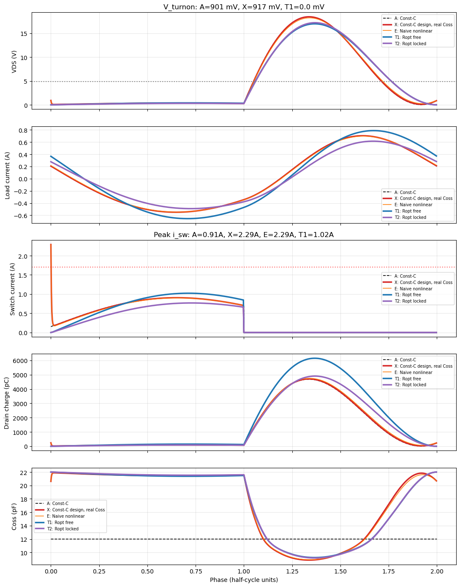
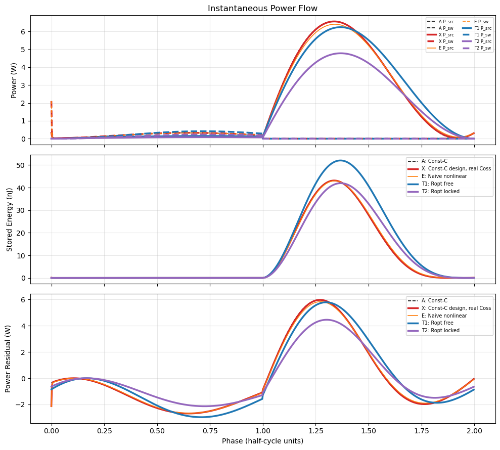
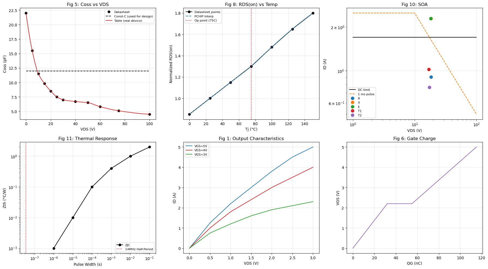

```python
# =============================================================================
# CONSOLIDATED EPC2037 GaN CLASS-E AMPLIFIER NOTEBOOK
# Corrected: Raw digitized Kennlinien, no artificial calibration
# =============================================================================
import numpy as np
import matplotlib.pyplot as plt
from scipy.integrate import solve_ivp, cumulative_trapezoid
from scipy.optimize import brentq, minimize
from scipy.interpolate import PchipInterpolator
import pandas as pd
import warnings
import time

warnings.filterwarnings('ignore')
pd.set_option('display.max_rows', None)
pd.set_option('display.max_columns', None)
pd.set_option('display.width', 1000)

# =============================================================================
# Layer 1 — Datasheet Card & Analytical Design
# =============================================================================
VDD, POUT_TARGET, F0 = 4.85, 1.65, 14.0e6
W0, T, TH = 2*np.pi*F0, 1/F0, 1/(2*F0)
VDS_MAX, ID_MAX = 100.0, 1.7
RON_25, RON_MAX_25 = 0.400, 0.550
QG, VG = 115e-12, 5.0
PGATE = QG*VG*F0
COSS_50, QOSS_50, COSS_TR = 6.5e-12, 600e-12, 12e-12
COSS_ER, COSS_50_MAX = 9.5e-12, 10e-12
QOSS_50_MAX = 900e-12
EOSS_ER_50 = 0.5*COSS_ER*50**2
QGS, QGD, RG = 32e-12, 25e-12, 0.5
CISS, CRSS = 14e-12, 0.1e-12

print("EPC2037 DATASHEET CARD")
print("-"*60)
print(f"V_DS_max = {VDS_MAX:.1f} V, I_D_max = {ID_MAX:.2f} A")
print(f"R_on,typ = {RON_25*1e3:.0f} mΩ, R_on,max = {RON_MAX_25*1e3:.0f} mΩ")
print(f"Q_G = {QG*1e12:.0f} pC, Q_GS = {QGS*1e12:.0f} pC, Q_GD = {QGD*1e12:.0f} pC, R_G = {RG} Ω")
print(f"C_ISS = {CISS*1e12:.1f} pF, C_RSS = {CRSS*1e12:.2f} pF")
print(f"C_OSS(50V) = {COSS_50*1e12:.1f} pF, C_OSS(ER) = {COSS_ER*1e12:.1f} pF, C_OSS(TR) = {COSS_TR*1e12:.1f} pF")
print(f"Q_OSS(50V) = {QOSS_50*1e12:.0f} pC (max {QOSS_50_MAX*1e12:.0f} pC)")
print(f"C_OSS(50V) max = {COSS_50_MAX*1e12:.1f} pF")
print(f"E_OSS(ER, 50V) = {EOSS_ER_50*1e9:.4f} nJ")
print(f"P_gate = {PGATE*1e3:.3f} mW")

# Analytical Design
a = 2/np.sqrt(np.pi**2 + 4)
phi = np.pi - np.arctan(2/np.pi)
KR, KC = 2*a**2, 2*a**2/np.pi
Ropt_ana = KR*VDD**2/POUT_TARGET
Csh_ideal = KC/(W0*Ropt_ana)

IR_norm = np.sqrt(2/KR)
IDC_norm = a*IR_norm
C_norm = KC/KR
th = np.linspace(0, 2*np.pi, 200001)
vd_norm = np.zeros_like(th)
off = th >= np.pi
vd_norm[off] = (IDC_norm*(th[off]-np.pi) + IR_norm*(np.cos(th[off]+phi)-np.cos(np.pi+phi)))/C_norm
V1 = np.trapezoid(vd_norm*np.exp(-1j*th), th)/np.pi
I1 = IR_norm*np.exp(1j*(phi-np.pi/2))
KL = (V1/I1).imag/(V1/I1).real
L1_ana = KL*Ropt_ana/W0
L2_ana = 3.0*Ropt_ana/W0
C2_ana = 1/(W0**2*L2_ana)
LT_ana = L1_ana + L2_ana
IDC_sk = POUT_TARGET/VDD
IR_sk = np.sqrt(2*POUT_TARGET/Ropt_ana)
Cext_const = Csh_ideal - COSS_TR

print("\nANALYTICAL CLASS-E DESIGN")
print("-"*60)
print(f"KR = {KR:.6f}, KC = {KC:.6f}, KL = {KL:.6f}, phi = {np.degrees(phi):.3f}°")
print(f"Ropt = {Ropt_ana:.4f} Ω, Csh = {Csh_ideal*1e12:.3f} pF")
print(f"L1 = {L1_ana*1e9:.3f} nH, L2 = {L2_ana*1e9:.3f} nH, C2 = {C2_ana*1e12:.3f} pF")
print(f"Cext (from const 12 pF assumption) = {Cext_const*1e12:.3f} pF")
print(f"IDC Sokal = {IDC_sk*1e3:.3f} mA, IR Sokal = {IR_sk*1e3:.3f} mA, P_gate = {PGATE*1e3:.3f} mW")


# =============================================================================
# Layer 2 — Corrected Temperature & Coss Models (No Calibration)
# =============================================================================
DS_FIG8_TJ = np.array([0, 25, 50, 75, 100, 125, 150.])
DS_FIG8_RDS_NORM = np.array([0.85, 1.00, 1.15, 1.30, 1.48, 1.65, 1.80])
_rds_curve = PchipInterpolator(DS_FIG8_TJ, DS_FIG8_RDS_NORM, extrapolate=False)
def temperature_factor(Tj): return float(_rds_curve(Tj))
RON_TYP_75 = RON_25 * temperature_factor(75.0)
RON_MAX_75 = RON_MAX_25 * temperature_factor(75.0)

print("\nTEMPERATURE MODEL (Fig 8)")
print("-"*60)
print(f"RON typical @ 75°C = {RON_TYP_75:.4f} Ω, RON maximum @ 75°C = {RON_MAX_75:.4f} Ω")
print(f"Model equiv C_ER = {2*EOSS_ER_50/50**2*1e12:.3f} pF")

# Fig 5: RAW Digitized Coss (NO calibration)
DS_FIG5_VDS = np.array([0, 5, 10, 15, 20, 25, 30, 40, 50, 60, 75, 100.])
DS_FIG5_COSS = 1e-12*np.array([22.0, 15.5, 11.5, 9.8, 8.5, 7.5, 7.0, 6.7, 6.5, 5.8, 5.1, 4.5])
DS_FIG5_CRSS = 1e-12*np.array([2.0, 0.7, 0.2, 0.15, 0.1, 0.1, 0.1, 0.1, 0.1, 0.1, 0.08, 0.05])
_coss_dig = PchipInterpolator(DS_FIG5_VDS, DS_FIG5_COSS, extrapolate=False)

V_GRID = np.linspace(0, 150, 150001)
C_GRID = _coss_dig(np.clip(V_GRID, 0, 100))
Q_GRID = cumulative_trapezoid(C_GRID, V_GRID, initial=0)
E_GRID = cumulative_trapezoid(V_GRID*C_GRID, V_GRID, initial=0)

Q_RAW_50 = Q_GRID[np.argmin(np.abs(V_GRID-50))]

_coss_tab, _qoss_tab, _eoss_tab = PchipInterpolator(V_GRID, C_GRID), PchipInterpolator(V_GRID, Q_GRID), PchipInterpolator(V_GRID, E_GRID)

def coss_const(v): return np.full_like(np.asarray(v, float), COSS_TR)
def qoss_const(v): return COSS_TR*np.abs(np.asarray(v, float))
def eoss_const(v): return 0.5*COSS_TR*np.asarray(v, float)**2

def coss_tab(v): return _coss_tab(np.clip(np.abs(v), 0, 150))
def qoss_tab(v): return np.sign(v)*_qoss_tab(np.abs(v))
def eoss_tab(v): return _eoss_tab(np.abs(v))

print("\nCOSS MODEL SUMMARY (Raw Kennlinie)")
print("-"*60)
print(f"Integrated Qoss(50 V) from curve = {Q_RAW_50*1e12:.2f} pC")
print(f"Datasheet nominal Qoss(50 V) = {QOSS_50*1e12:.2f} pC")
print(f"Coss at 50 V (from curve) = {coss_tab(50)*1e12:.2f} pF")
print(f"Model Eoss(50 V) = {eoss_tab(50)*1e9:.4f} nJ")


# =============================================================================
# Layer 3 — Simulation Engine
# =============================================================================
class DeviceModel:
    def __init__(self, coss_f, qoss_f, eoss_f, Cext, Ron, kind="nonlin"):
        self.coss_f, self.qoss_f, self.eoss_f = coss_f, qoss_f, eoss_f
        self.Cext, self.Ron, self.kind = float(Cext), float(Ron), kind
        self._vg = np.linspace(0, 150, 150001)
        self._qg = self.Cext*self._vg + np.asarray(self.qoss_f(self._vg), float)
    def v_from_q(self, q):
        q = float(q)
        if abs(q) < 1e-30: return 0.0
        return np.sign(q)*float(np.interp(abs(q), self._qg, self._vg))
    def e_total(self, v): return 0.5*self.Cext*np.asarray(v, float)**2 + np.asarray(self.eoss_f(v), float)

def cycle_const(IDC, Ron, LT_val, C2_val, Ropt_val, Csh_val, warmup=500, samples=1000):
    def f_on(t, y):
        iL, vC2 = y
        return [(Ron*(IDC-iL) - vC2 - Ropt_val*iL)/LT_val, iL/C2_val]
    def f_off(t, y):
        vD, iL, vC2 = y
        return [(IDC-iL)/Csh_val, (vD-vC2-Ropt_val*iL)/LT_val, iL/C2_val]
    iL, vC2 = 0.0, 0.0
    for _ in range(warmup):
        s1 = solve_ivp(f_on, [0, TH], [iL, vC2], method="LSODA", rtol=1e-10, atol=1e-13, max_step=TH/20)
        iL, vC2 = s1.y[0, -1], s1.y[1, -1]
        s2 = solve_ivp(f_off, [0, TH], [Ron*(IDC-iL), iL, vC2], method="LSODA", rtol=1e-10, atol=1e-13, dense_output=True, max_step=TH/20)
        iL, vC2 = s2.y[1, -1], s2.y[2, -1]
    s1 = solve_ivp(f_on, [0, TH], [iL, vC2], method="LSODA", rtol=1e-10, atol=1e-13, dense_output=True, max_step=TH/20)
    iL_on, vC2_on = s1.y[0, -1], s1.y[1, -1]
    s2 = solve_ivp(f_off, [0, TH], [Ron*(IDC-iL_on), iL_on, vC2_on], method="LSODA", rtol=1e-10, atol=1e-13, dense_output=True, max_step=TH/20)
    t_on, t_off = np.linspace(0, TH, samples+1), np.linspace(0, TH, samples+1)
    y_on, y_off = s1.sol(t_on), s2.sol(t_off)
    t = np.concatenate([t_on, TH+t_off[1:]])
    vD = np.concatenate([Ron*(IDC-y_on[0]) if Ron > 0 else np.zeros_like(t_on), y_off[0][1:]])
    iL_f = np.concatenate([y_on[0], y_off[1][1:]])
    i_sw = np.concatenate([IDC-y_on[0], np.zeros_like(y_off[1][1:])])
    q = Csh_val * vD
    coss = np.full_like(vD, COSS_TR)
    return {"t": t, "v_D": vD, "i_L": iL_f, "i_sw": i_sw, "q": q, "Coss": coss, "v_avg": np.trapezoid(vD, t)/T,
            "v_peak": vD.max(), "v_min": vD.min(), "v_turnon": float(s2.sol(TH)[0]),
            "i_turnon": float(s2.sol(TH)[1])}

def cycle_nonlin(IDC, dev, LT_val, C2_val, Ropt_val, warmup=100, samples=400):
    def f_on(t, y):
        q, iL, v2 = y
        vD = dev.v_from_q(q)
        return [IDC-iL-vD/dev.Ron, (vD-v2-Ropt_val*iL)/LT_val, iL/C2_val]
    def f_off(t, y):
        q, iL, v2 = y
        vD = dev.v_from_q(q)
        return [IDC-iL, (vD-v2-Ropt_val*iL)/LT_val, iL/C2_val]
    y = np.zeros(3)
    for _ in range(warmup):
        s1 = solve_ivp(f_on, (0, TH), y, method="LSODA", rtol=2e-8, atol=1e-12, max_step=TH/20)
        s2 = solve_ivp(f_off, (0, TH), s1.y[:, -1], method="LSODA", rtol=2e-8, atol=1e-12, max_step=TH/20)
        y = s2.y[:, -1]
    s1 = solve_ivp(f_on, (0, TH), y, method="LSODA", rtol=2e-8, atol=1e-12, dense_output=True, max_step=TH/20)
    s2 = solve_ivp(f_off, (0, TH), s1.y[:, -1], method="LSODA", rtol=2e-8, atol=1e-12, dense_output=True, max_step=TH/20)
    t1, t2 = np.linspace(0, TH, samples, endpoint=False), np.linspace(0, TH, samples, endpoint=False)
    y1, y2 = s1.sol(t1), s2.sol(t2)
    q = np.r_[y1[0], y2[0]]; iL = np.r_[y1[1], y2[1]]
    t = np.r_[t1, TH+t2]
    vD = np.array([dev.v_from_q(z) for z in q])
    iSW = np.r_[vD[:samples]/dev.Ron, np.zeros(samples)]
    coss_wave = np.array([dev.coss_f(v) for v in vD])
    return {"t": t, "q": q, "v_D": vD, "i_L": iL, "i_sw": iSW, "Coss": coss_wave, "v_avg": np.trapezoid(vD, t)/T,
            "v_peak": np.max(vD), "v_min": np.min(vD), "v_turnon": float(dev.v_from_q(s2.y[0, -1])),
            "i_turnon": float(s2.y[1, -1])}

def solve_const(Ron, LT_val, C2_val, Ropt_val, Csh_val):
    def resid(I): return cycle_const(I, Ron, LT_val, C2_val, Ropt_val, Csh_val, warmup=200)["v_avg"] - VDD
    I = brentq(resid, 0.7*IDC_sk, 1.3*IDC_sk, xtol=1e-7)
    return cycle_const(I, Ron, LT_val, C2_val, Ropt_val, Csh_val, warmup=500), I

def solve_nonlin(dev, LT_val, C2_val, Ropt_val, warmup=50, samples=200):
    def resid(I): return cycle_nonlin(I, dev, LT_val, C2_val, Ropt_val, warmup=warmup, samples=samples)["v_avg"] - VDD
    I = brentq(resid, 0.05*POUT_TARGET/VDD, 3.0*POUT_TARGET/VDD, xtol=1e-8)
    return cycle_nonlin(I, dev, LT_val, C2_val, Ropt_val, warmup=warmup*2, samples=samples*2), I

def run_point(kind, Ron, L1_val, L2_val, C2_val, Ropt_val, Cext, label=""):
    LT_val = L1_val + L2_val
    if kind == "const":
        dev = DeviceModel(coss_const, qoss_const, eoss_const, Cext, Ron, kind="const")
        h, I = solve_const(Ron, LT_val, C2_val, Ropt_val, Cext + COSS_TR)
        P_load = np.trapezoid(Ropt_val*h["i_L"]**2, h["t"])/T
        P_Ron = Ron*np.trapezoid(h["i_sw"]**2, h["t"])/T
        P_ZVS = 0.5*(Cext + COSS_TR)*h["v_turnon"]**2*F0
        E_turn = 0.5*(Cext + COSS_TR)*h["v_turnon"]**2
        Ecap = 0.5*(Cext + COSS_TR)*h["v_D"]**2
    else:
        dev = DeviceModel(coss_tab, qoss_tab, eoss_tab, Cext, Ron, kind="nonlin")
        h, I = solve_nonlin(dev, LT_val, C2_val, Ropt_val)
        P_load = np.trapezoid(Ropt_val*h["i_L"]**2, h["t"])/T
        P_Ron = Ron*np.trapezoid(h["i_sw"]**2, h["t"])/T
        P_ZVS = 0.0
        E_turn = float(dev.e_total(h["v_turnon"]))
        Ecap = dev.e_total(h["v_D"])
    return {
        "h": h, "I": I, "P_load": P_load, "P_Ron": P_Ron, "P_ZVS": P_ZVS,
        "E_turn": E_turn, "E_cap_avg": np.trapezoid(Ecap, h["t"])/T, "E_cap_delta": Ecap[-1]-Ecap[0],
        "eta_system": P_load/(VDD*I + PGATE), "dev": dev,
        "L1_used": L1_val, "L2_used": L2_val, "C2_used": C2_val,
        "Ropt_used": Ropt_val, "Cext_used": Cext, "label": label,
    }

print("\nRunning baseline cases A, X, E...")
res = {}
res["A"] = run_point("const", RON_25, L1_ana, L2_ana, C2_ana, Ropt_ana, Cext_const, "A: Const-C")
res["X"] = run_point("tab",   RON_25, L1_ana, L2_ana, C2_ana, Ropt_ana, Cext_const, "X: Const-C design, real Coss")
res["E"] = run_point("tab",   RON_25, L1_ana, L2_ana, C2_ana, Ropt_ana, Csh_ideal - COSS_50, "E: Naive nonlinear")

for k in ["A", "X", "E"]:
    h = res[k]["h"]; p = res[k]
    print(f"\n--- Case {k} ({p['label']}) ---")
    print(f"  I_DC = {p['I']*1e3:.4f} mA | Avg drain V = {h['v_avg']:.5f} V")
    print(f"  V_pk = {h['v_peak']:.4f} V | V_min = {h['v_min']:.4f} V | V_turnon = {h['v_turnon']*1e3:.2f} mV")
    print(f"  i_turnon = {h['i_turnon']:.4f} A | i_sw_pk = {np.max(h['i_sw']):.4f} A")
    print(f"  P_load = {p['P_load']*1e3:.4f} mW | P_Ron = {p['P_Ron']*1e3:.4f} mW | eta_sys = {p['eta_system']*100:.2f}%")
    print(f"  E_cap_avg = {p['E_cap_avg']*1e9:.5f} nJ | E_cap_delta = {p['E_cap_delta']*1e9:+.3e} nJ")


# =============================================================================
# Layer 4 — Verbose Optimization (Heartbeat dots only)
# =============================================================================
global eval_count
eval_count = 0

def make_eval(fixed_ropt):
    global eval_count
    cache = {}
    def ev(x):
        global eval_count
        key = tuple(np.round(x, 5))
        if key in cache: return cache[key]
        eval_count += 1
        if eval_count % 10 == 0:
            print(".", end="", flush=True)
        if fixed_ropt is None:
            Cext, L1v, L2v, C2v, Roptv = x[0]*1e-12, x[1]*1e-9, x[2]*1e-9, x[3]*1e-12, x[4]
        else:
            Cext, L1v, L2v, C2v = x[0]*1e-12, x[1]*1e-9, x[2]*1e-9, x[3]*1e-12
            Roptv = fixed_ropt
        LTv = L1v + L2v
        dev = DeviceModel(coss_tab, qoss_tab, eoss_tab, Cext, RON_25, "nonlin")
        try:
            h, I = solve_nonlin(dev, LTv, C2v, Roptv, warmup=20, samples=100)
            P_load = np.trapezoid(Roptv*h["i_L"]**2, h["t"])/T
            eta = P_load/(VDD*I + PGATE)
            Csh_tot = Cext + dev.coss_f(h["v_turnon"])
            dVdt = (I - h["i_turnon"]) / Csh_tot
            r = (h["v_turnon"], dVdt, P_load, eta, np.max(h["i_sw"]))
        except Exception:
            r = (10.0, 10.0, 0.0, 0.0, 10.0)
        cache[key] = r
        return r
    return ev

# --- T1: Ropt Free, P=1.65W ---
print("\n" + "="*80)
print("T1: Ropt FREE, P = 1.65 W, maximize efficiency")
print("="*80)
print("Starting SLSQP... (dots = 10 function evaluations)")
eval_count = 0
ev1 = make_eval(None)
def obj1(x): return -ev1(x)[3]
cons1 = [
    {'type': 'eq', 'fun': lambda x: ev1(x)[0]},
    {'type': 'eq', 'fun': lambda x: ev1(x)[1]*1e-8},
    {'type': 'eq', 'fun': lambda x: ev1(x)[2] - POUT_TARGET},
]
x0_5 = [247.33, 107.73, 280.44, 460.83, Ropt_ana]
bnd_5 = [(100, 500), (50, 250), (150, 450), (200, 900), (3.0, 20.0)]
t0_T1 = time.time()
res1 = minimize(obj1, x0_5, method='SLSQP', bounds=bnd_5, constraints=cons1,
                options={'maxiter': 100, 'eps': 1e-4})
print(f"\nT1 finished in {time.time()-t0_T1:.1f}s. Status: {res1.message}")
Cext_1, L1_1, L2_1, C2_1, Ropt_1 = res1.x[0]*1e-12, res1.x[1]*1e-9, res1.x[2]*1e-9, res1.x[3]*1e-12, res1.x[4]
res["T1"] = run_point("tab", RON_25, L1_1, L2_1, C2_1, Ropt_1, Cext_1, "T1: Ropt free, P=1.65W")

# --- T2: Ropt Locked, P Free ---
print("\n" + "="*80)
print("T2: Ropt LOCKED at 8.223, P FREE, maximize efficiency")
print("="*80)
print("Starting SLSQP... (dots = 10 function evaluations)")
eval_count = 0
ev2 = make_eval(Ropt_ana)
def obj2(x): return -ev2(x)[3]
cons2 = [
    {'type': 'eq', 'fun': lambda x: ev2(x)[0]},
    {'type': 'eq', 'fun': lambda x: ev2(x)[1]*1e-8},
]
x0_4 = [247.33, 107.73, 280.44, 460.83]
bnd_4 = [(100, 500), (50, 250), (150, 450), (200, 900)]
t0_T2 = time.time()
res2 = minimize(obj2, x0_4, method='SLSQP', bounds=bnd_4, constraints=cons2,
                options={'maxiter': 100, 'eps': 1e-4})
print(f"\nT2 finished in {time.time()-t0_T2:.1f}s. Status: {res2.message}")
Cext_2, L1_2, L2_2, C2_2 = res2.x[0]*1e-12, res2.x[1]*1e-9, res2.x[2]*1e-9, res2.x[3]*1e-12
res["T2"] = run_point("tab", RON_25, L1_2, L2_2, C2_2, Ropt_ana, Cext_2, "T2: Ropt locked, P free")


# =============================================================================
# Layer 5 — Diagnostics, Tables, and Deltas
# =============================================================================
summary = pd.DataFrame([{
    "Tag": k,
    "L1 (nH)": res[k]["L1_used"]*1e9,
    "L2 (nH)": res[k]["L2_used"]*1e9,
    "C2 (pF)": res[k]["C2_used"]*1e12,
    "Cext (pF)": res[k]["Cext_used"]*1e12,
    "Ropt (Ω)": res[k]["Ropt_used"],
    "V_on (V)": res[k]["h"]["v_turnon"],
    "i_sw_pk (A)": np.max(res[k]["h"]["i_sw"]),
    "P_load (mW)": res[k]["P_load"]*1e3,
    "P_Ron (mW)": res[k]["P_Ron"]*1e3,
    "η_sys (%)": res[k]["eta_system"]*100,
} for k in ["A","X","E","T1","T2"]])

print("\n### FULL DIAGNOSTICS TABLE\n")
print(summary.round(3).to_string(index=False))

delta_rows = []
for k in ["T1", "T2"]:
    d = {}
    for fld, used_key, ana_val in [
        ("Cext", "Cext_used", Cext_const), ("L1", "L1_used", L1_ana),
        ("L2", "L2_used", L2_ana), ("C2", "C2_used", C2_ana),
        ("Ropt", "Ropt_used", Ropt_ana),
    ]:
        d[fld] = res[k][used_key] - ana_val
    d["Tag"] = k
    delta_rows.append(d)

delta_df = pd.DataFrame(delta_rows)[["Tag", "Cext", "L1", "L2", "C2", "Ropt"]]
for col, scale in [("Cext", 1e12), ("L1", 1e9), ("L2", 1e9), ("C2", 1e12), ("Ropt", 1)]:
    delta_df[col] = (delta_df[col] * scale).round(2)

print("\n### ABSOLUTE DELTAS FROM ANALYTICAL (T - A)\n")
print(delta_df.to_string(index=False))


# =============================================================================
# Layer 6 — Time-Domain Waveform Overlays (5 subplots)
# =============================================================================
sel = [("A", "A: Const-C", "k--"), ("X", "X: Const-C design, real Coss", "C3-"),
       ("E", "E: Naive nonlinear", "C1-"), ("T1", "T1: Ropt free", "C0-"),
       ("T2", "T2: Ropt locked", "C4-")]
fig, ax = plt.subplots(5, 1, figsize=(11, 14), sharex=True)
for key, lab, col in sel:
    h = res[key]["h"]; ph = h["t"]/TH
    lw = 2.5 if key in ("X", "T1", "T2") else 1.2
    ax[0].plot(ph, h["v_D"], col, lw=lw, label=lab)
    ax[1].plot(ph, h["i_L"], col, lw=lw, label=lab)
    ax[2].plot(ph, h["i_sw"], col, lw=lw, label=lab)
    ax[3].plot(ph, h["q"]*1e12, col, lw=lw, label=lab)
    ax[4].plot(ph, h["Coss"]*1e12, col, lw=lw, label=lab)
ax[0].axhline(VDD, color="gray", ls=":"); ax[0].set_ylabel("VDS (V)")
ax[0].set_title(f"V_turnon: A={res['A']['h']['v_turnon']*1e3:.0f} mV, X={res['X']['h']['v_turnon']*1e3:.0f} mV, T1={res['T1']['h']['v_turnon']*1e3:.1f} mV")
ax[0].legend(fontsize=7); ax[0].grid(alpha=0.3)
ax[1].set_ylabel("Load current (A)"); ax[1].legend(fontsize=7); ax[1].grid(alpha=0.3)
ax[2].axhline(ID_MAX, color="red", ls=":", alpha=0.6)
ax[2].set_ylabel("Switch current (A)"); ax[2].set_title(f"Peak i_sw: A={np.max(res['A']['h']['i_sw']):.2f}A, X={np.max(res['X']['h']['i_sw']):.2f}A, E={np.max(res['E']['h']['i_sw']):.2f}A, T1={np.max(res['T1']['h']['i_sw']):.2f}A")
ax[2].legend(fontsize=7); ax[2].grid(alpha=0.3)
ax[3].set_ylabel("Drain charge (pC)"); ax[3].legend(fontsize=7); ax[3].grid(alpha=0.3)
ax[4].set_ylabel("Coss (pF)"); ax[4].set_xlabel("Phase (half-cycle units)"); ax[4].legend(fontsize=7); ax[4].grid(alpha=0.3)
plt.tight_layout(); plt.show()


# =============================================================================
# Layer 7 — Power & Energy Overlays (3 subplots)
# =============================================================================
fig, ax = plt.subplots(3, 1, figsize=(10, 9), sharex=True)
for key, lab, col in sel:
    h = res[key]["h"]; ph = h["t"]/TH; dev = res[key]["dev"]; I = res[key]["I"]; Ropt_v = res[key]["Ropt_used"]
    P_src = I*h["v_D"]; P_sw = dev.Ron*h["i_sw"]**2; P_load = Ropt_v*h["i_L"]**2
    E_cap = dev.e_total(h["v_D"]) if dev.kind != "const" else 0.5*(res[key]["Cext_used"]+COSS_TR)*h["v_D"]**2
    lw = 2.5 if key in ("X", "T1", "T2") else 1.2
    ax[0].plot(ph, P_src, col, lw=lw, label=f"{key} P_src")
    ax[0].plot(ph, P_sw, col, lw=lw, ls="--", label=f"{key} P_sw")
    ax[1].plot(ph, E_cap*1e9, col, lw=lw, label=lab)
    ax[2].plot(ph, P_src - P_sw - P_load, col, lw=lw, label=lab)
ax[0].set_ylabel("Power (W)"); ax[0].legend(fontsize=6, ncol=2); ax[0].grid(alpha=0.3)
ax[0].set_title("Instantaneous Power Flow")
ax[1].set_ylabel("Stored Energy (nJ)"); ax[1].legend(fontsize=7); ax[1].grid(alpha=0.3)
ax[2].set_ylabel("Power Residual (W)"); ax[2].set_xlabel("Phase (half-cycle units)"); ax[2].legend(fontsize=7); ax[2].grid(alpha=0.3)
plt.tight_layout(); plt.show()


# =============================================================================
# Layer 8 — Datasheet Validation (Kennlinien) - CORRECTED
# =============================================================================
fig, ax = plt.subplots(2, 3, figsize=(18, 10))
Vp = np.linspace(0.1, 100, 800)
ax[0,0].plot(DS_FIG5_VDS, DS_FIG5_COSS*1e12, "ko", label="Datasheet")
ax[0,0].plot(Vp, coss_const(Vp)*1e12, "k--", label="Const-C (used for design)")
ax[0,0].plot(Vp, coss_tab(Vp)*1e12, "C3-", label="Table (real device)")
ax[0,0].set(xlabel="VDS (V)", ylabel="Coss (pF)", title="Fig 5: Coss vs VDS")
ax[0,0].legend(fontsize=8); ax[0,0].grid(alpha=0.3)

Tj = np.linspace(0, 150, 100)
ax[0,1].plot(DS_FIG8_TJ, DS_FIG8_RDS_NORM, "ko-", label="Datasheet points")
ax[0,1].plot(Tj, _rds_curve(Tj), "C0--", label="PCHIP Interp")
ax[0,1].axvline(75, color="red", ls=":", label="Op point (75C)")
ax[0,1].set(xlabel="Tj (°C)", ylabel="Normalized RDS(on)", title="Fig 8: RDS(on) vs Temp")
ax[0,1].legend(fontsize=8); ax[0,1].grid(alpha=0.3)

# Fig 10: Safe Operating Area
DS_FIG10_VDS = np.array([1, 10, 100]); DS_FIG10_ID_1MS = np.array([2.5, 2.5, 0.5])
ax[0,2].loglog(DS_FIG10_VDS, [1.7, 1.7, 1.7], "k-", label="DC limit")
ax[0,2].loglog(DS_FIG10_VDS, DS_FIG10_ID_1MS, "C1--", label="1 ms pulse")
for k in ["A", "X", "E", "T1", "T2"]:
    ax[0,2].plot(res[k]["h"]["v_peak"], np.max(res[k]["h"]["i_sw"]), "o", markersize=8, label=f"{k}")
ax[0,2].set(xlabel="VDS (V)", ylabel="ID (A)", title="Fig 10: SOA")
ax[0,2].legend(fontsize=8); ax[0,2].grid(alpha=0.3)

# Fig 11: Thermal Response (Exact points from datasheet image)
DS_FIG11_T = np.array([1e-6, 1e-5, 1e-4, 1e-3, 1e-2, 1e-1])
DS_FIG11_ZJC = np.array([0.001, 0.01, 0.1, 0.4, 1.0, 2.0]) 
ax[1,0].loglog(DS_FIG11_T, DS_FIG11_ZJC, "ko-", label="ZJC")
ax[1,0].axvline(T/2, color="red", ls=":", label="14MHz Half-Period")
ax[1,0].set(xlabel="Pulse Width (s)", ylabel="Zth (°C/W)", title="Fig 11: Thermal Response")
ax[1,0].legend(fontsize=8); ax[1,0].grid(alpha=0.3)

# Fig 1: Output Characteristics (Exact points from datasheet image)
DS_FIG1_VDS = np.array([0, 0.5, 1.0, 1.5, 2.0, 2.5, 3.0])
ax[1,1].plot(DS_FIG1_VDS, [0, 1.25, 2.2, 3.0, 3.8, 4.5, 5.0], "C0-", label="VGS=5V")
ax[1,1].plot(DS_FIG1_VDS, [0, 1.0, 1.8, 2.4, 3.0, 3.5, 4.0], "C3-", label="VGS=4V")
ax[1,1].plot(DS_FIG1_VDS, [0, 0.75, 1.2, 1.6, 1.9, 2.1, 2.3], "C2-", label="VGS=3V")
ax[1,1].set(xlabel="VDS (V)", ylabel="ID (A)", title="Fig 1: Output Characteristics")
ax[1,1].legend(fontsize=8); ax[1,1].grid(alpha=0.3)

DS_FIG6_QG = np.array([0, 0.032, 0.055, 0.115]); DS_FIG6_VGS = np.array([0, 2.2, 2.2, 5.0])
ax[1,2].plot(DS_FIG6_QG*1e3, DS_FIG6_VGS, "C4-")
ax[1,2].set(xlabel="QG (nC)", ylabel="VGS (V)", title="Fig 6: Gate Charge")
ax[1,2].grid(alpha=0.3)
plt.tight_layout(); plt.show()
```

    EPC2037 DATASHEET CARD
    ------------------------------------------------------------
    V_DS_max = 100.0 V, I_D_max = 1.70 A
    R_on,typ = 400 mΩ, R_on,max = 550 mΩ
    Q_G = 115 pC, Q_GS = 32 pC, Q_GD = 25 pC, R_G = 0.5 Ω
    C_ISS = 14.0 pF, C_RSS = 0.10 pF
    C_OSS(50V) = 6.5 pF, C_OSS(ER) = 9.5 pF, C_OSS(TR) = 12.0 pF
    Q_OSS(50V) = 600 pC (max 900 pC)
    C_OSS(50V) max = 10.0 pF
    E_OSS(ER, 50V) = 11.8750 nJ
    P_gate = 8.050 mW
    
    ANALYTICAL CLASS-E DESIGN
    ------------------------------------------------------------
    KR = 0.576801, KC = 0.183601, KL = 1.152494, phi = 147.518°
    Ropt = 8.2229 Ω, Csh = 253.830 pF
    L1 = 107.735 nH, L2 = 280.439 nH, C2 = 460.835 pF
    Cext (from const 12 pF assumption) = 241.830 pF
    IDC Sokal = 340.206 mA, IR Sokal = 633.497 mA, P_gate = 8.050 mW
    
    TEMPERATURE MODEL (Fig 8)
    ------------------------------------------------------------
    RON typical @ 75°C = 0.5200 Ω, RON maximum @ 75°C = 0.7150 Ω
    Model equiv C_ER = 9.500 pF
    
    COSS MODEL SUMMARY (Raw Kennlinie)
    ------------------------------------------------------------
    Integrated Qoss(50 V) from curve = 467.72 pC
    Datasheet nominal Qoss(50 V) = 600.00 pC
    Coss at 50 V (from curve) = 6.50 pF
    Model Eoss(50 V) = 9.4039 nJ
    
    Running baseline cases A, X, E...
    
    --- Case A (A: Const-C) ---
      I_DC = 355.9311 mA | Avg drain V = 4.85000 V
      V_pk = 18.4499 V | V_min = 0.0221 V | V_turnon = 900.76 mV
      i_turnon = 0.2036 A | i_sw_pk = 0.9063 A
      P_load = 1615.9313 mW | P_Ron = 109.0817 mW | eta_sys = 93.17%
      E_cap_avg = 8.43447 nJ | E_cap_delta = +1.025e-01 nJ
    
    --- Case X (X: Const-C design, real Coss) ---
      I_DC = 354.9128 mA | Avg drain V = 4.85090 V
      V_pk = 18.4675 V | V_min = 0.0726 V | V_turnon = 916.75 mV
      i_turnon = 0.2066 A | i_sw_pk = 2.2919 A
      P_load = 1611.6417 mW | P_Ron = 110.1410 mW | eta_sys = 93.19%
      E_cap_avg = 8.42535 nJ | E_cap_delta = -1.163e-02 nJ
    
    --- Case E (E: Naive nonlinear) ---
      I_DC = 350.7082 mA | Avg drain V = 4.85091 V
      V_pk = 18.2403 V | V_min = 0.0675 V | V_turnon = 917.47 mV
      i_turnon = 0.2157 A | i_sw_pk = 2.2937 A
      P_load = 1593.3232 mW | P_Ron = 108.0223 mW | eta_sys = 93.23%
      E_cap_avg = 8.49004 nJ | E_cap_delta = -1.061e-02 nJ
    
    ================================================================================
    T1: Ropt FREE, P = 1.65 W, maximize efficiency
    ================================================================================
    Starting SLSQP... (dots = 10 function evaluations)
    ...
    T1 finished in 19.4s. Status: Optimization terminated successfully
    
    ================================================================================
    T2: Ropt LOCKED at 8.223, P FREE, maximize efficiency
    ================================================================================
    Starting SLSQP... (dots = 10 function evaluations)
    ..
    T2 finished in 13.5s. Status: Optimization terminated successfully
    
    ### FULL DIAGNOSTICS TABLE
    
    Tag  L1 (nH)  L2 (nH)  C2 (pF)  Cext (pF)  Ropt (Ω)  V_on (V)  i_sw_pk (A)  P_load (mW)  P_Ron (mW)  η_sys (%)
      A  107.735  280.439  460.835    241.830     8.223     0.901        0.906     1615.931     109.082     93.174
      X  107.735  280.439  460.835    241.830     8.223     0.917        2.292     1611.642     110.141     93.192
      E  107.735  280.439  460.835    247.330     8.223     0.917        2.294     1593.323     108.022     93.232
     T1  106.226  278.943  446.155    348.555     6.292     0.000        1.022     1650.915     126.334     92.410
     T2  115.254  287.966  469.069    271.332     8.223     0.000        0.768     1271.283      72.048     94.011
    
    ### ABSOLUTE DELTAS FROM ANALYTICAL (T - A)
    
    Tag   Cext    L1    L2     C2  Ropt
     T1 106.72 -1.51 -1.50 -14.68 -1.93
     T2  29.50  7.52  7.53   8.23  0.00


    

    


    

    


    

    

