```python
import itertools
import time
import warnings
import numpy as np
import pandas as pd
import matplotlib.pyplot as plt
from scipy.integrate import solve_ivp
from scipy.interpolate import PchipInterpolator
from scipy.interpolate import make_interp_spline
from scipy.optimize import (
    brentq,
    differential_evolution,
    minimize,
    milp,
    LinearConstraint,
    Bounds,
)
from scipy.signal import firwin, freqz
from scipy.special import erfinv

warnings.filterwarnings("ignore")
pd.set_option("display.max_rows", None)
pd.set_option("display.max_columns", None)
pd.set_option("display.width", 1000)
F20 = 14175000.0
F40 = 7100000.0
BANDS = (
    {"name": "20m (14.175 MHz)", "f0": F20, "scale": 1.0, "q_l": 60.0},
    {"name": "40m (7.10 MHz)", "f0": F40, "scale": 2.0, "q_l": 45.0},
)
E24 = np.array(
    [
        1.0,
        1.1,
        1.2,
        1.3,
        1.5,
        1.6,
        1.8,
        2.0,
        2.2,
        2.4,
        2.7,
        3.0,
        3.3,
        3.6,
        3.9,
        4.3,
        4.7,
        5.1,
        5.6,
        6.2,
        6.8,
        7.5,
        8.2,
        9.1,
    ]
)
E12 = E24[::2]
E6 = E24[::4]
E3 = E24[::8]
E96 = np.round(10 ** (np.arange(96) / 96), 2)
E48 = E96[::2]
E192 = np.round(10 ** (np.arange(192) / 192), 2)
SERIES = {
    "E3": E3,
    "E6": E6,
    "E12": E12,
    "E24": E24,
    "E48": E48,
    "E96": E96,
    "E192": E192,
}


def expand_series(
    series_name: str,
    decades: tuple[float, ...],
    vmin: float = 0.0,
    vmax: float = np.inf,
) -> np.ndarray:
    arr = np.sort(np.concatenate([SERIES[series_name] * d for d in decades]))
    return arr[(arr >= vmin) & (arr <= vmax)]


PA_CAP_POOL = expand_series("E24", (1e-11, 1e-10, 1e-09), 4.7e-11, 1e-09)
PA_IND_POOL = expand_series("E12", (1e-08, 1e-07), 2.7e-08, 6.8e-07)
TRIM_PA_CEXT_MID = 1.8e-11
TRIM_LPF_C1_MID = 1.8e-11
C_BOARD_STRAY = 2.5e-12
T2_ROPT_LOCKED = 8.05


def fmt_eng(v: float, unit: str = "") -> str:
    match v:
        case x if x >= 1000000.0:
            return f"{x / 1000000.0:.4g}M{unit}"
        case x if x >= 1000.0:
            return f"{x / 1000.0:.4g}k{unit}"
        case x if x >= 1.0:
            return f"{x:.4g}{unit}"
        case x if x >= 0.001:
            return f"{x * 1000.0:.4g}m{unit}"
        case x if x >= 1e-06:
            return f"{x * 1000000.0:.4g}u{unit}"
        case x if x >= 1e-09:
            return f"{x * 1000000000.0:.4g}n{unit}"
        case _:
            return f"{v * 1000000000000.0:.4g}p{unit}"


def db(x: np.ndarray | float) -> np.ndarray | float:
    return 20.0 * np.log10(np.maximum(np.abs(x), 1e-15))


def section(title: str, width: int = 86) -> None:
    print("\n" + "=" * width)
    print(title)
    print("=" * width)


PA_SPEC = {
    "VDD": 4.85,
    "POUT_TARGET": 1.65,
    "F0": F20,
    "VDS_MAX": 100.0,
    "ID_MAX": 1.7,
    "RON_25": 0.4,
    "RON_MAX_25": 0.55,
    "QG": 1.15e-10,
    "VG": 5.0,
    "COSS_50": 6.5e-12,
    "QOSS_50": 6e-10,
    "COSS_TR": 1.2e-11,
    "COSS_ER": 9.5e-12,
    "COSS_50_MAX": 1e-11,
    "QOSS_50_MAX": 9e-10,
    "QGS": 3.2e-11,
    "QGD": 2.5e-11,
    "RG": 0.5,
    "CISS": 1.4e-11,
    "CRSS": 1e-13,
}
DS_FIG8_TJ = np.array([0.0, 25.0, 50.0, 75.0, 100.0, 125.0, 150.0])
DS_FIG8_RDS_NORM = np.array([0.85, 1.0, 1.15, 1.3, 1.48, 1.65, 1.8])
_RDS_CURVE = PchipInterpolator(DS_FIG8_TJ, DS_FIG8_RDS_NORM, extrapolate=False)
DS_FIG5_VDS = np.array(
    [0.0, 5.0, 10.0, 15.0, 20.0, 25.0, 30.0, 40.0, 50.0, 60.0, 75.0, 100.0]
)
DS_FIG5_COSS = 1e-12 * np.array(
    [22.0, 15.5, 11.5, 9.8, 8.5, 7.5, 7.0, 6.7, 6.5, 5.8, 5.1, 4.5]
)
DS_FIG5_CRSS = 1e-12 * np.array(
    [2.0, 0.7, 0.2, 0.15, 0.1, 0.1, 0.1, 0.1, 0.1, 0.1, 0.08, 0.05]
)
_V_EXT = np.append(DS_FIG5_VDS, 150.0)
_C_EXT = np.append(DS_FIG5_COSS, DS_FIG5_COSS[-1])
_COSS_TAB = PchipInterpolator(_V_EXT, _C_EXT, extrapolate=True)
_QOSS_TAB = _COSS_TAB.antiderivative()
_QOSS_DATAPOINTS = _QOSS_TAB(_V_EXT)
_EOSS_TAB = PchipInterpolator(
    _V_EXT, _V_EXT * _C_EXT, extrapolate=True
).antiderivative()
Q_RAW_50 = float(_QOSS_TAB(50.0))


def temperature_factor(tj: float) -> float:
    return float(_RDS_CURVE(tj))


def coss_const(v: np.ndarray | float) -> np.ndarray:
    return np.full_like(np.asarray(v, float), PA_SPEC["COSS_TR"])


def qoss_const(v: np.ndarray | float) -> np.ndarray:
    return PA_SPEC["COSS_TR"] * np.abs(np.asarray(v, float))


def eoss_const(v: np.ndarray | float) -> np.ndarray:
    return 0.5 * PA_SPEC["COSS_TR"] * np.asarray(v, float) ** 2


def coss_tab(v: np.ndarray | float) -> np.ndarray:
    return _COSS_TAB(np.clip(np.abs(v), 0.0, 150.0))


def qoss_tab(v: np.ndarray | float) -> np.ndarray:
    return np.sign(v) * _QOSS_TAB(np.abs(v))


def eoss_tab(v: np.ndarray | float) -> np.ndarray:
    return _EOSS_TAB(np.abs(v))


def analytical_class_e(vdd: float, pout: float, f0: float, coss_tr: float) -> dict:
    w0 = 2.0 * np.pi * f0
    a = 2.0 / np.sqrt(np.pi**2 + 4.0)
    phi = np.pi - np.arctan(2.0 / np.pi)
    kr = 2.0 * a**2
    kc = 2.0 * a**2 / np.pi
    ropt = kr * vdd**2 / pout
    csh = kc / (w0 * ropt)
    ir_norm = np.sqrt(2.0 / kr)
    idc_norm = a * ir_norm
    c_norm = kc / kr
    th = np.linspace(0.0, 2.0 * np.pi, 200001)
    vd_norm = np.zeros_like(th)
    off = th >= np.pi
    vd_norm[off] = (
        idc_norm * (th[off] - np.pi)
        + ir_norm * (np.cos(th[off] + phi) - np.cos(np.pi + phi))
    ) / c_norm
    v1 = np.trapezoid(vd_norm * np.exp(-1j * th), th) / np.pi
    i1 = ir_norm * np.exp(1j * (phi - np.pi / 2.0))
    kl = (v1 / i1).imag / (v1 / i1).real
    l1 = kl * ropt / w0
    l2 = 3.0 * ropt / w0
    c2 = 1.0 / (w0**2 * l2)
    return {
        "a": a,
        "phi": phi,
        "KR": kr,
        "KC": kc,
        "KL": kl,
        "Ropt": ropt,
        "Csh": csh,
        "L1": l1,
        "L2": l2,
        "C2": c2,
        "LT": l1 + l2,
        "Cext_const": csh - coss_tr,
        "IDC_sk": pout / vdd,
        "IR_sk": np.sqrt(2.0 * pout / ropt),
    }


def make_device_model(kind: str, c_ext: float, r_on: float) -> dict:
    match kind:
        case "const":
            coss_f, qoss_f, eoss_f = (coss_const, qoss_const, eoss_const)
        case "nonlin":
            coss_f, qoss_f, eoss_f = (coss_tab, qoss_tab, eoss_tab)
        case _:
            raise ValueError(f"Unknown device model kind: {kind}")
    q_knots = float(c_ext) * _V_EXT + _QOSS_DATAPOINTS
    pp = PchipInterpolator(q_knots, _V_EXT, extrapolate=True)
    return {
        "kind": kind,
        "Cext": float(c_ext),
        "Ron": float(r_on),
        "coss_f": coss_f,
        "qoss_f": qoss_f,
        "eoss_f": eoss_f,
        "q_knots": q_knots,
        "pp_c": pp.c,
    }


def dev_v_from_q(dev: dict, q: float) -> float:
    qf = float(q)
    aq = abs(qf)
    if aq < 1e-30:
        return 0.0
    qk = dev["q_knots"]
    c = dev["pp_c"]
    n_int = len(qk) - 1
    idx = int(np.searchsorted(qk, aq, side="right")) - 1
    if idx < 0:
        idx = 0
    elif idx >= n_int:
        idx = n_int - 1
    dq = aq - float(qk[idx])
    v = (
        (float(c[0, idx]) * dq + float(c[1, idx])) * dq + float(c[2, idx])
    ) * dq + float(c[3, idx])
    return v if qf >= 0.0 else -v


def dev_e_total(dev: dict, v: np.ndarray | float) -> np.ndarray:
    arr = np.asarray(v, float)
    return 0.5 * dev["Cext"] * arr**2 + np.asarray(dev["eoss_f"](arr), float)


def simulate_cycle(
    dev: dict,
    i_dc: float,
    lt_val: float,
    c2_val: float,
    ropt_val: float,
    f0: float,
    tank_esr: float = 0.0,
    warmup: int = 100,
    samples: int = 400,
) -> dict:
    t_per = 1.0 / f0
    th = 0.5 * t_per
    r_tot_tank = ropt_val + tank_esr
    match dev:
        case {"kind": "const", "Cext": c_ext, "Ron": r_on}:
            csh = c_ext + PA_SPEC["COSS_TR"]

            def f_on(_, y):
                i_l, v_c2 = y
                return [
                    (r_on * (i_dc - i_l) - v_c2 - r_tot_tank * i_l) / lt_val,
                    i_l / c2_val,
                ]

            def f_off(_, y):
                v_d, i_l, v_c2 = y
                return [
                    (i_dc - i_l) / csh,
                    (v_d - v_c2 - r_tot_tank * i_l) / lt_val,
                    i_l / c2_val,
                ]

            i_l, v_c2 = (0.0, 0.0)
            for _ in range(warmup):
                s1 = solve_ivp(
                    f_on,
                    [0.0, th],
                    [i_l, v_c2],
                    method="LSODA",
                    rtol=1e-10,
                    atol=1e-13,
                    max_step=th / 20.0,
                )
                i_l, v_c2 = (float(s1.y[0, -1]), float(s1.y[1, -1]))
                s2 = solve_ivp(
                    f_off,
                    [0.0, th],
                    [r_on * (i_dc - i_l), i_l, v_c2],
                    method="LSODA",
                    rtol=1e-10,
                    atol=1e-13,
                    max_step=th / 20.0,
                )
                i_l, v_c2 = (float(s2.y[1, -1]), float(s2.y[2, -1]))
            s1 = solve_ivp(
                f_on,
                [0.0, th],
                [i_l, v_c2],
                method="LSODA",
                rtol=1e-10,
                atol=1e-13,
                dense_output=True,
                max_step=th / 20.0,
            )
            i_l_on, v_c2_on = (float(s1.y[0, -1]), float(s1.y[1, -1]))
            s2 = solve_ivp(
                f_off,
                [0.0, th],
                [r_on * (i_dc - i_l_on), i_l_on, v_c2_on],
                method="LSODA",
                rtol=1e-10,
                atol=1e-13,
                dense_output=True,
                max_step=th / 20.0,
            )
            t_on = np.linspace(0.0, th, samples + 1)
            t_off = np.linspace(0.0, th, samples + 1)
            y_on, y_off = (s1.sol(t_on), s2.sol(t_off))
            t = np.concatenate([t_on, th + t_off[1:]])
            v_d = np.concatenate(
                [
                    r_on * (i_dc - y_on[0]) if r_on > 0 else np.zeros_like(t_on),
                    y_off[0][1:],
                ]
            )
            i_l_f = np.concatenate([y_on[0], y_off[1][1:]])
            i_sw = np.concatenate([i_dc - y_on[0], np.zeros_like(y_off[1][1:])])
            return {
                "t": t,
                "v_D": v_d,
                "i_L": i_l_f,
                "i_sw": i_sw,
                "q": csh * v_d,
                "Coss": np.full_like(v_d, PA_SPEC["COSS_TR"]),
                "v_avg": float(np.trapezoid(v_d, t) / t_per),
                "v_peak": float(np.max(v_d)),
                "v_min": float(np.min(v_d)),
                "v_turnon": float(s2.sol(th)[0]),
                "i_turnon": float(s2.sol(th)[1]),
            }
        case {"kind": "nonlin", "Ron": r_on}:

            def f_on(_, y):
                q, i_l, v_2 = y
                v_d = dev_v_from_q(dev, q)
                return [
                    i_dc - i_l - v_d / r_on,
                    (v_d - v_2 - r_tot_tank * i_l) / lt_val,
                    i_l / c2_val,
                ]

            def f_off(_, y):
                q, i_l, v_2 = y
                v_d = dev_v_from_q(dev, q)
                return [
                    i_dc - i_l,
                    (v_d - v_2 - r_tot_tank * i_l) / lt_val,
                    i_l / c2_val,
                ]

            y = np.zeros(3)
            for _ in range(warmup):
                s1 = solve_ivp(
                    f_on,
                    (0.0, th),
                    y,
                    method="LSODA",
                    rtol=2e-08,
                    atol=1e-12,
                    max_step=th / 20.0,
                )
                s2 = solve_ivp(
                    f_off,
                    (0.0, th),
                    s1.y[:, -1],
                    method="LSODA",
                    rtol=2e-08,
                    atol=1e-12,
                    max_step=th / 20.0,
                )
                y = s2.y[:, -1]
            s1 = solve_ivp(
                f_on,
                (0.0, th),
                y,
                method="LSODA",
                rtol=2e-08,
                atol=1e-12,
                dense_output=True,
                max_step=th / 20.0,
            )
            s2 = solve_ivp(
                f_off,
                (0.0, th),
                s1.y[:, -1],
                method="LSODA",
                rtol=2e-08,
                atol=1e-12,
                dense_output=True,
                max_step=th / 20.0,
            )
            t1 = np.linspace(0.0, th, samples, endpoint=False)
            t2 = np.linspace(0.0, th, samples, endpoint=False)
            y1, y2 = (s1.sol(t1), s2.sol(t2))
            q = np.r_[y1[0], y2[0]]
            i_l = np.r_[y1[1], y2[1]]
            t = np.r_[t1, th + t2]
            v_d = np.array([dev_v_from_q(dev, z) for z in q])
            i_sw = np.r_[v_d[:samples] / r_on, np.zeros(samples)]
            coss_wave = np.array([dev["coss_f"](v) for v in v_d])
            return {
                "t": t,
                "q": q,
                "v_D": v_d,
                "i_L": i_l,
                "i_sw": i_sw,
                "Coss": coss_wave,
                "v_avg": float(np.trapezoid(v_d, t) / t_per),
                "v_peak": float(np.max(v_d)),
                "v_min": float(np.min(v_d)),
                "v_turnon": float(dev_v_from_q(dev, s2.y[0, -1])),
                "i_turnon": float(s2.y[1, -1]),
            }
        case _:
            raise ValueError(f"Unsupported device model: {dev}")


def solve_dc_current(
    dev: dict,
    lt_val: float,
    c2_val: float,
    ropt_val: float,
    vdd: float,
    f0: float,
    idc_est: float,
    tank_esr: float = 0.0,
    warmup: int = 50,
    samples: int = 200,
) -> tuple[dict, float]:
    match dev["kind"]:
        case "const":
            lo, hi = (0.7 * idc_est, 1.3 * idc_est)
            w_solve, s_solve = (200, 500)
            w_final, s_final = (500, 1000)
        case "nonlin":
            lo, hi = (0.05 * idc_est, 3.0 * idc_est)
            w_solve, s_solve = (warmup, samples)
            w_final, s_final = (warmup * 2, samples * 2)
        case _:
            raise ValueError(f"Unknown device kind: {dev['kind']}")

    def resid(i_dc: float) -> float:
        return (
            simulate_cycle(
                dev,
                i_dc,
                lt_val,
                c2_val,
                ropt_val,
                f0,
                tank_esr=tank_esr,
                warmup=w_solve,
                samples=s_solve,
            )["v_avg"]
            - vdd
        )

    i_sol = float(brentq(resid, lo, hi, xtol=1e-08))
    return (
        simulate_cycle(
            dev,
            i_sol,
            lt_val,
            c2_val,
            ropt_val,
            f0,
            tank_esr=tank_esr,
            warmup=w_final,
            samples=s_final,
        ),
        i_sol,
    )


def run_pa_point(
    kind: str,
    r_on: float,
    l1_val: float,
    l2_val: float,
    c2_val: float,
    ropt_val: float,
    c_ext: float,
    vdd: float,
    f0: float,
    pgate: float,
    label: str = "",
) -> dict:
    t_per = 1.0 / f0
    w0 = 2.0 * np.pi * f0
    tank_esr = w0 * l1_val / 60.0 + w0 * l2_val / 45.0
    idc_est = PA_SPEC["POUT_TARGET"] / vdd
    dev = make_device_model(
        kind, c_ext + (C_BOARD_STRAY if kind == "nonlin" else 0.0), r_on
    )
    h, i_dc = solve_dc_current(
        dev, l1_val + l2_val, c2_val, ropt_val, vdd, f0, idc_est, tank_esr=tank_esr
    )
    p_load = float(np.trapezoid(ropt_val * h["i_L"] ** 2, h["t"]) / t_per)
    p_ron = float(r_on * np.trapezoid(h["i_sw"] ** 2, h["t"]) / t_per)
    e_cap = dev_e_total(dev, h["v_D"])
    p_zvs = (
        float(0.5 * (c_ext + PA_SPEC["COSS_TR"]) * h["v_turnon"] ** 2 * f0)
        if kind == "const"
        else 0.0
    )
    return {
        "h": h,
        "I": i_dc,
        "P_load": p_load,
        "P_Ron": p_ron,
        "P_ZVS": p_zvs,
        "E_turn": float(dev_e_total(dev, h["v_turnon"])),
        "E_cap_avg": float(np.trapezoid(e_cap, h["t"]) / t_per),
        "E_cap_delta": float(e_cap[-1] - e_cap[0]),
        "eta_system": float(p_load / (vdd * i_dc + pgate)),
        "dev": dev,
        "L1_used": l1_val,
        "L2_used": l2_val,
        "C2_used": c2_val,
        "Ropt_used": ropt_val,
        "Cext_used": c_ext,
        "label": label,
    }


def extract_pa_harmonics_dbc(pa_res: dict, n_harmonics: int = 5) -> tuple[float, ...]:
    """Extracts 2f0..Nf0 harmonic power in dBc relative to fundamental f0 via FFT of load current."""
    i_l = pa_res["h"]["i_L"]
    n_pts = len(i_l)
    sig = i_l[:-1] if np.isclose(i_l[0], i_l[-1], atol=1e-09) else i_l
    spec = np.abs(np.fft.rfft(sig)) / len(sig)
    p_fund = spec[1] ** 2
    return tuple(
        (
            float(10.0 * np.log10(spec[k] ** 2 / (p_fund + 1e-30) + 1e-18))
            for k in range(2, n_harmonics + 1)
        )
    )


def build_pa_cap_candidates(
    center: float, max_par: int = 1, window: float = 0.25
) -> list[tuple[float, str]]:
    lo, hi = (center * (1.0 - window), center * (1.0 + window))
    cands: list[tuple[float, str]] = [
        (float(c), fmt_eng(c, "F")) for c in PA_CAP_POOL if lo <= c <= hi
    ]
    if max_par >= 2:
        for i, c1 in enumerate(PA_CAP_POOL):
            for c2 in PA_CAP_POOL[i:]:
                csum = float(c1 + c2)
                if lo <= csum <= hi:
                    cands.append((csum, f"{fmt_eng(c1, 'F')}+{fmt_eng(c2, 'F')}"))
    return cands


def optimize_class_e_joint_discrete(
    mode: str,
    ana: dict,
    vdd: float,
    pout_target: float,
    f20: float = F20,
    f40: float = F40,
    r_on: float = PA_SPEC["RON_25"],
    pgate_20: float = 0.0,
    pgate_40: float = 0.0,
    max_cap_par: int = 1,
    share_ind_reel: bool = False,
    opt_dof: str = "A",
) -> dict:
    """
    2x2 Joint 20m/40m Class-E ZVS+ZDS Optimizer:
      - mode    : 'T1' (Ropt free) | 'T2' (Ropt locked = T2_ROPT_LOCKED)
      - opt_dof : 'A' (+2 DoF: +Cext_add, +C2_add; 2x L1, 2x L2)
                  'B' (+4 DoF: +Cext_add, +L1_add, +L2_add, +C2_add)
    """
    idc_est = 1.2 / vdd
    cache: dict[tuple[float, ...], dict] = {}
    tag_full = f"{mode}_{opt_dof}"

    def unpack_x(
        x: np.ndarray,
    ) -> tuple[float, float, float, float, float, float, float, float, float]:
        c_fix20 = float(x.item(0)) * 1e-12
        l1_20 = float(x.item(1)) * 1e-09
        l2_20 = float(x.item(2)) * 1e-09
        c2_20 = float(x.item(3)) * 1e-12
        c_add40 = float(x.item(4)) * 1e-12
        c2_add40 = float(x.item(5)) * 1e-12
        if opt_dof == "B":
            l1_add40 = float(x.item(6)) * 1e-09
            l2_add40 = float(x.item(7)) * 1e-09
            ropt_v = float(x.item(8)) if mode == "T1" else T2_ROPT_LOCKED
        else:
            l1_add40 = l1_20
            l2_add40 = l2_20
            ropt_v = float(x.item(6)) if mode == "T1" else T2_ROPT_LOCKED
        return (
            c_fix20,
            l1_20,
            l2_20,
            c2_20,
            c_add40,
            c2_add40,
            l1_add40,
            l2_add40,
            ropt_v,
        )

    def eval_both(x: np.ndarray, warmup: int = 15, samples: int = 80) -> dict:
        key = tuple(np.round(x, 5)) + (warmup, samples)
        if key in cache:
            return cache[key]
        c_fix20, l1_20, l2_20, c2_20, c_add40, c2_add40, l1_add40, l2_add40, ropt_v = (
            unpack_x(x)
        )
        c_ext_20 = c_fix20 + TRIM_PA_CEXT_MID + C_BOARD_STRAY
        c_ext_40 = c_fix20 + c_add40 + TRIM_PA_CEXT_MID + C_BOARD_STRAY
        l1_40 = l1_20 + l1_add40
        l2_40 = l2_20 + l2_add40
        c2_40 = c2_20 + c2_add40
        esr_20 = 2.0 * np.pi * f20 * (l1_20 / 60.0 + l2_20 / 45.0)
        esr_40 = 2.0 * np.pi * f40 * (l1_40 / 60.0 + l2_40 / 45.0)
        try:
            dev20 = make_device_model("nonlin", c_ext_20, r_on)
            h20, idc20 = solve_dc_current(
                dev20,
                l1_20 + l2_20,
                c2_20,
                ropt_v,
                vdd,
                f20,
                idc_est,
                tank_esr=esr_20,
                warmup=warmup,
                samples=samples,
            )
            p20 = float(np.trapezoid(ropt_v * h20["i_L"] ** 2, h20["t"]) * f20)
            eta20 = float(p20 / (vdd * idc20 + pgate_20))
            dvdt20 = float(
                (idc20 - h20["i_turnon"])
                / (c_ext_20 + float(dev20["coss_f"](h20["v_turnon"])))
            )
            dev40 = make_device_model("nonlin", c_ext_40, r_on)
            h40, idc40 = solve_dc_current(
                dev40,
                l1_40 + l2_40,
                c2_40,
                ropt_v,
                vdd,
                f40,
                idc_est,
                tank_esr=esr_40,
                warmup=warmup,
                samples=samples,
            )
            p40 = float(np.trapezoid(ropt_v * h40["i_L"] ** 2, h40["t"]) * f40)
            eta40 = float(p40 / (vdd * idc40 + pgate_40))
            dvdt40 = float(
                (idc40 - h40["i_turnon"])
                / (c_ext_40 + float(dev40["coss_f"](h40["v_turnon"])))
            )
            out = {
                "von20": float(h20["v_turnon"]),
                "dvdt20": dvdt20,
                "p20": p20,
                "eta20": eta20,
                "von40": float(h40["v_turnon"]),
                "dvdt40": dvdt40,
                "p40": p40,
                "eta40": eta40,
            }
        except Exception:
            out = {
                "von20": 10.0,
                "dvdt20": 1000000000.0,
                "p20": 0.0,
                "eta20": 0.0,
                "von40": 10.0,
                "dvdt40": 1000000000.0,
                "p40": 0.0,
                "eta40": 0.0,
            }
        cache[key] = out
        return out

    cext_init = max(
        68.0,
        (ana["Csh"] - PA_SPEC["COSS_50"] - TRIM_PA_CEXT_MID - C_BOARD_STRAY)
        * 1000000000000.0,
    )
    l1_init = ana["L1"] * 1000000000.0
    l2_init = ana["L2"] * 1000000000.0
    c2_init = ana["C2"] * 1000000000000.0
    x0_list = [cext_init, l1_init, l2_init, c2_init, cext_init, c2_init]
    bnds = [
        (47.0, 680.0),
        (27.0, 250.0),
        (100.0, 470.0),
        (150.0, 1000.0),
        (47.0, 1000.0),
        (150.0, 1000.0),
    ]
    if opt_dof == "B":
        x0_list += [l1_init, l2_init]
        bnds += [(27.0, 470.0), (100.0, 680.0)]
    if mode == "T1":
        x0_list += [6.8]
        bnds += [(6.5, 16.0)]
    x0 = np.array(x0_list)
    cons = [
        {"type": "eq", "fun": lambda x: eval_both(x)["von20"]},
        {"type": "eq", "fun": lambda x: eval_both(x)["von40"]},
    ]
    if mode == "T1":
        cons += [
            {"type": "ineq", "fun": lambda x: eval_both(x)["p20"] - 1.15},
            {"type": "ineq", "fun": lambda x: eval_both(x)["p40"] - 1.15},
        ]
    t0 = time.time()

    def nlp_obj(x: np.ndarray) -> float:
        r = eval_both(x)
        zds_pen = 0.05 * ((r["dvdt20"] * 1e-08) ** 2 + (r["dvdt40"] * 1e-08) ** 2)
        return -0.5 * (r["eta20"] + r["eta40"]) + zds_pen

    sol_nlp = minimize(
        nlp_obj,
        x0,
        method="SLSQP",
        bounds=bnds,
        constraints=cons,
        options={"maxiter": 80, "ftol": 0.0001, "eps": 0.002},
    )
    print(
        f"  [{tag_full} SLSQP] success={sol_nlp.success} | msg='{sol_nlp.message}' | x*={np.round(sol_nlp.x, 2)}"
    )
    x_star_raw = sol_nlp.x
    n_disc = 8 if opt_dof == "B" else 6
    ropt_v = float(x_star_raw.item(n_disc)) if mode == "T1" else T2_ROPT_LOCKED
    xd_star = np.array([float(x_star_raw.item(i)) for i in range(n_disc)])
    u_star = np.log(xd_star)
    base = eval_both(x_star_raw, warmup=40, samples=200)
    eps = 0.01
    j_von20, j_von40 = (np.zeros(n_disc), np.zeros(n_disc))
    j_dv20, j_dv40 = (np.zeros(n_disc), np.zeros(n_disc))
    for i in range(n_disc):
        du = np.zeros(n_disc)
        du[i] = eps
        xpd, xnd = (np.exp(u_star + du), np.exp(u_star - du))
        xp = np.append(xpd, ropt_v) if mode == "T1" else xpd
        xn = np.append(xnd, ropt_v) if mode == "T1" else xnd
        rp = eval_both(xp, warmup=40, samples=200)
        rn = eval_both(xn, warmup=40, samples=200)
        j_von20[i] = (rp["von20"] - rn["von20"]) / (2.0 * eps)
        j_von40[i] = (rp["von40"] - rn["von40"]) / (2.0 * eps)
        j_dv20[i] = (rp["dvdt20"] - rn["dvdt20"]) * 1e-08 / (2.0 * eps)
        j_dv40[i] = (rp["dvdt40"] - rn["dvdt40"]) * 1e-08 / (2.0 * eps)

    def ind_cands(center_nh: float, win: float = 0.45) -> list[tuple[float, str]]:
        return [
            (float(l) * 1000000000.0, fmt_eng(l, "H"))
            for l in PA_IND_POOL
            if (1.0 - win) * center_nh * 1e-09 <= l <= (1.0 + win) * center_nh * 1e-09
        ]

    def cap_cands(
        center_pf: float, win: float = 0.4, with_trim: bool = False
    ) -> list[tuple[float, str]]:
        raw = build_pa_cap_candidates(
            center_pf * 1e-12, max_par=max_cap_par, window=win
        )
        out = []
        for v, lbl in raw:
            full_lbl = (
                f"{lbl}+trim({fmt_eng(TRIM_PA_CEXT_MID, 'F')})"
                if with_trim and TRIM_PA_CEXT_MID > 0
                else lbl
            )
            out.append((v * 1000000000000.0, full_lbl))
        return out

    pools = [
        cap_cands(xd_star.item(0), 0.25, with_trim=True),
        ind_cands(xd_star.item(1), 0.35),
        ind_cands(xd_star.item(2), 0.35),
        cap_cands(xd_star.item(3), 0.25),
        cap_cands(xd_star.item(4), 0.3),
        cap_cands(xd_star.item(5), 0.3),
    ]
    if opt_dof == "B":
        pools += [ind_cands(xd_star.item(6), 0.35), ind_cands(xd_star.item(7), 0.35)]
    offsets, cur = ([], 0)
    for p in pools:
        offsets.append(cur)
        cur += len(p)
    idx_sv20, idx_sv40, idx_sdv20, idx_sdv40 = (cur, cur + 1, cur + 2, cur + 3)
    n_vars = cur + 4
    c_obj = np.zeros(n_vars)
    for i, p in enumerate(pools):
        vals_i = np.array([val for val, _ in p], dtype=float)
        par_pen = np.array([0.05 if "+" in lbl else 0.0 for _, lbl in p], dtype=float)
        c_obj[offsets[i] : offsets[i] + len(p)] = (
            np.abs(np.log(vals_i / xd_star.item(i))) + par_pen
        )
    c_obj[idx_sv20] = 30.0
    c_obj[idx_sv40] = 30.0
    c_obj[idx_sdv20] = 8.0
    c_obj[idx_sdv40] = 8.0
    rows, lb, ub = ([], [], [])
    for i, p in enumerate(pools):
        r = np.zeros(n_vars)
        r[offsets[i] : offsets[i] + len(p)] = 1.0
        rows.append(r)
        lb.append(1.0)
        ub.append(1.0)
    if share_ind_reel:
        for k1, (v1, _) in enumerate(pools[1]):
            for k2, (v2, _) in enumerate(pools[2]):
                if not np.isclose(v1, v2, rtol=1e-09):
                    r = np.zeros(n_vars)
                    r[offsets[1] + k1] = 1.0
                    r[offsets[2] + k2] = 1.0
                    rows.append(r)
                    lb.append(-np.inf)
                    ub.append(1.0)
    zvs_zds_terms = [
        (j_von20, base["von20"], idx_sv20),
        (j_von40, base["von40"], idx_sv40),
        (j_dv20, base["dvdt20"] * 1e-08, idx_sdv20),
        (j_dv40, base["dvdt40"] * 1e-08, idx_sdv40),
    ]
    for j_vec, ref_val, idx_s in zvs_zds_terms:
        r_pos, r_neg = (np.zeros(n_vars), np.zeros(n_vars))
        for i, p in enumerate(pools):
            du_vec = np.log(np.array([val for val, _ in p], dtype=float)) - u_star.item(
                i
            )
            r_pos[offsets[i] : offsets[i] + len(p)] = j_vec[i] * du_vec
            r_neg[offsets[i] : offsets[i] + len(p)] = -j_vec[i] * du_vec
        r_pos[idx_s] = -1.0
        r_neg[idx_s] = -1.0
        rows.append(r_pos)
        lb.append(-np.inf)
        ub.append(-ref_val)
        rows.append(r_neg)
        lb.append(-np.inf)
        ub.append(ref_val)
    integrality = np.ones(n_vars)
    integrality[idx_sv20:] = 0
    ub_vars = np.ones(n_vars)
    ub_vars[idx_sv20:] = np.inf
    sol_mip = milp(
        c=c_obj,
        integrality=integrality,
        bounds=Bounds(np.zeros(n_vars), ub_vars),
        constraints=LinearConstraint(np.array(rows), lb, ub),
    )
    assert sol_mip.success, f"PA MILP failed for {tag_full}: {sol_mip.message}"
    picks = [
        pools[i][int(np.argmax(sol_mip.x[offsets[i] : offsets[i] + len(pools[i])]))]
        for i in range(n_disc)
    ]
    c_v, c_lbl = (picks[0][0] * 1e-12, picks[0][1])
    l1_v, l1_lbl = (picks[1][0] * 1e-09, picks[1][1])
    l2_v, l2_lbl = (picks[2][0] * 1e-09, picks[2][1])
    c2_v, c2_lbl = (picks[3][0] * 1e-12, picks[3][1])
    c_add_v, c_add_lbl = (picks[4][0] * 1e-12, picks[4][1])
    c2_add_v, c2_add_lbl = (picks[5][0] * 1e-12, picks[5][1])
    if opt_dof == "B":
        l1_add_v, l1_add_lbl = (picks[6][0] * 1e-09, picks[6][1])
        l2_add_v, l2_add_lbl = (picks[7][0] * 1e-09, picks[7][1])
    else:
        l1_add_v, l1_add_lbl = (l1_v, l1_lbl)
        l2_add_v, l2_add_lbl = (l2_v, l2_lbl)
    print(
        f"  {tag_full} MILP Joint ZVS+ZDS in {time.time() - t0:.1f}s | 20m: Cext={c_lbl}, L1={l1_lbl}, L2={l2_lbl}, C2={c2_lbl}, Ropt={ropt_v:.2f}Ω | 40m add-on: +Cext={c_add_lbl}, +L1={l1_add_lbl}, +L2={l2_add_lbl}, +C2={c2_add_lbl}"
    )
    bom_20 = {"Cext": c_lbl, "L1": l1_lbl, "L2": l2_lbl, "C2": c2_lbl}
    bom_40_add = {
        "Cext": c_add_lbl,
        "L1": l1_add_lbl,
        "L2": l2_add_lbl,
        "C2": c2_add_lbl,
    }
    res_20 = run_pa_point(
        "nonlin",
        r_on,
        l1_v,
        l2_v,
        c2_v,
        ropt_v,
        c_v + TRIM_PA_CEXT_MID,
        vdd,
        f20,
        pgate_20,
        f"{tag_full} ZVS+ZDS [20m 1x]",
    )
    res_40 = run_pa_point(
        "nonlin",
        r_on,
        l1_v + l1_add_v,
        l2_v + l2_add_v,
        c2_v + c2_add_v,
        ropt_v,
        c_v + c_add_v + TRIM_PA_CEXT_MID,
        vdd,
        f40,
        pgate_40,
        f"{tag_full} ZVS+ZDS [40m +add]",
    )
    return {
        "20m": res_20,
        "40m": res_40,
        "bom_20": bom_20,
        "bom_40_add": bom_40_add,
        "cext_fixed": c_add_v,
        "ropt": ropt_v,
    }


def plot_pa_waveforms(pa_res: dict, f0: float) -> None:
    sel = [
        ("A", "A: Const-C (20m)", "k--"),
        ("X", "X: Const-C design, real Coss (20m)", "C3-"),
        ("T1_A_20m", "T1_A (+2DoF) [20m]", "C0-"),
        ("T1_A_40m", "T1_A (+2DoF) [40m]", "C0--"),
        ("T1_B_20m", "T1_B (+4DoF) [20m]", "C2-"),
        ("T1_B_40m", "T1_B (+4DoF) [40m]", "C2--"),
        ("T2_A_20m", "T2_A (+2DoF) [20m]", "C4-"),
        ("T2_A_40m", "T2_A (+2DoF) [40m]", "C4--"),
        ("T2_B_20m", "T2_B (+4DoF) [20m]", "C5-"),
        ("T2_B_40m", "T2_B (+4DoF) [40m]", "C5--"),
    ]
    fig, ax = plt.subplots(5, 1, figsize=(11, 14), sharex=True)
    for key, lab, col in sel:
        h = pa_res[key]["h"]
        ph = 2.0 * h["t"] / h["t"][-1]
        lw = (
            2.2 if key in ("X", "T1_A_20m", "T1_B_20m", "T2_A_20m", "T2_B_20m") else 1.3
        )
        ax[0].plot(ph, h["v_D"], col, lw=lw, label=lab)
        ax[1].plot(ph, h["i_L"], col, lw=lw, label=lab)
        ax[2].plot(ph, h["i_sw"], col, lw=lw, label=lab)
        ax[3].plot(ph, h["q"] * 1000000000000.0, col, lw=lw, label=lab)
        ax[4].plot(ph, h["Coss"] * 1000000000000.0, col, lw=lw, label=lab)
    ax[0].axhline(PA_SPEC["VDD"], color="gray", ls=":")
    ax[0].set_ylabel("VDS (V)")
    ax[0].set_title(
        "V_turnon: "
        + ", ".join(
            (
                f"{k}={pa_res[k]['h']['v_turnon'] * 1000.0:.0f}mV"
                for k in (
                    "T1_A_20m",
                    "T1_A_40m",
                    "T1_B_20m",
                    "T1_B_40m",
                    "T2_A_20m",
                    "T2_B_20m",
                )
            )
        )
    )
    ax[1].set_ylabel("Load current (A)")
    ax[2].axhline(PA_SPEC["ID_MAX"], color="red", ls=":", alpha=0.6)
    ax[2].set_ylabel("Switch current (A)")
    ax[2].set_title(
        "Peak i_sw: "
        + ", ".join(
            (
                f"{k}={np.max(pa_res[k]['h']['i_sw']):.2f}A"
                for k in ("T1_A_20m", "T1_B_20m", "T2_A_20m", "T2_B_20m")
            )
        )
    )
    ax[3].set_ylabel("Drain charge (pC)")
    ax[4].set_ylabel("Coss (pF)")
    ax[4].set_xlabel("Phase (half-cycle units)")
    for a_i in ax:
        a_i.legend(fontsize=7)
        a_i.grid(alpha=0.3)
    plt.tight_layout()
    plt.show()


def plot_pa_power(pa_res: dict, f0: float) -> None:
    sel = [
        ("A", "A: Const-C (20m)", "k--"),
        ("X", "X: Const-C design, real Coss (20m)", "C3-"),
        ("T1_A_20m", "T1_A (+2DoF) [20m]", "C0-"),
        ("T1_A_40m", "T1_A (+2DoF) [40m]", "C0--"),
        ("T1_B_20m", "T1_B (+4DoF) [20m]", "C2-"),
        ("T1_B_40m", "T1_B (+4DoF) [40m]", "C2--"),
        ("T2_A_20m", "T2_A (+2DoF) [20m]", "C4-"),
        ("T2_A_40m", "T2_A (+2DoF) [40m]", "C4--"),
        ("T2_B_20m", "T2_B (+4DoF) [20m]", "C5-"),
        ("T2_B_40m", "T2_B (+4DoF) [40m]", "C5--"),
    ]
    fig, ax = plt.subplots(3, 1, figsize=(10, 9), sharex=True)
    for key, lab, col in sel:
        h = pa_res[key]["h"]
        ph = 2.0 * h["t"] / h["t"][-1]
        dev = pa_res[key]["dev"]
        i_dc = pa_res[key]["I"]
        ropt_v = pa_res[key]["Ropt_used"]
        p_src = i_dc * h["v_D"]
        p_sw = dev["Ron"] * h["i_sw"] ** 2
        p_load = ropt_v * h["i_L"] ** 2
        e_cap = dev_e_total(dev, h["v_D"])
        lw = (
            2.2 if key in ("X", "T1_A_20m", "T1_B_20m", "T2_A_20m", "T2_B_20m") else 1.3
        )
        ax[0].plot(ph, p_src, col, lw=lw, label=f"{key} P_src")
        ax[0].plot(ph, p_sw, col, lw=lw, ls="--", label=f"{key} P_sw")
        ax[1].plot(ph, e_cap * 1000000000.0, col, lw=lw, label=lab)
        ax[2].plot(ph, p_src - p_sw - p_load, col, lw=lw, label=lab)
    ax[0].set_ylabel("Power (W)")
    ax[0].set_title("Instantaneous Power Flow")
    ax[0].legend(fontsize=6, ncol=2)
    ax[0].grid(alpha=0.3)
    ax[1].set_ylabel("Stored Energy (nJ)")
    ax[1].legend(fontsize=7)
    ax[1].grid(alpha=0.3)
    ax[2].set_ylabel("Power Residual (W)")
    ax[2].set_xlabel("Phase (half-cycle units)")
    ax[2].legend(fontsize=7)
    ax[2].grid(alpha=0.3)
    plt.tight_layout()
    plt.show()


def plot_pa_datasheet(pa_res: dict, f0: float) -> None:
    t_per = 1.0 / f0
    fig, ax = plt.subplots(2, 3, figsize=(18, 10))
    vp = np.linspace(0.1, 100.0, 800)
    ax[0, 0].plot(DS_FIG5_VDS, DS_FIG5_COSS * 1000000000000.0, "ko", label="Datasheet")
    ax[0, 0].plot(
        vp, coss_const(vp) * 1000000000000.0, "k--", label="Const-C (used for design)"
    )
    ax[0, 0].plot(
        vp, coss_tab(vp) * 1000000000000.0, "C3-", label="Table (real device)"
    )
    ax[0, 0].set(xlabel="VDS (V)", ylabel="Coss (pF)", title="Fig 5: Coss vs VDS")
    ax[0, 0].legend(fontsize=8)
    ax[0, 0].grid(alpha=0.3)
    tj = np.linspace(0.0, 150.0, 100)
    ax[0, 1].plot(DS_FIG8_TJ, DS_FIG8_RDS_NORM, "ko-", label="Datasheet points")
    ax[0, 1].plot(tj, _RDS_CURVE(tj), "C0--", label="PCHIP Interp")
    ax[0, 1].axvline(75.0, color="red", ls=":", label="Op point (75C)")
    ax[0, 1].set(
        xlabel="Tj (°C)", ylabel="Normalized RDS(on)", title="Fig 8: RDS(on) vs Temp"
    )
    ax[0, 1].legend(fontsize=8)
    ax[0, 1].grid(alpha=0.3)
    ds_fig10_vds = np.array([1.0, 10.0, 100.0])
    ds_fig10_id_1ms = np.array([2.5, 2.5, 0.5])
    ax[0, 2].loglog(ds_fig10_vds, [1.7, 1.7, 1.7], "k-", label="DC limit")
    ax[0, 2].loglog(ds_fig10_vds, ds_fig10_id_1ms, "C1--", label="1 ms pulse")
    for k in pa_res:
        ax[0, 2].plot(
            pa_res[k]["h"]["v_peak"],
            np.max(pa_res[k]["h"]["i_sw"]),
            "o",
            markersize=8,
            label=k,
        )
    ax[0, 2].set(xlabel="VDS (V)", ylabel="ID (A)", title="Fig 10: SOA")
    ax[0, 2].legend(fontsize=8)
    ax[0, 2].grid(alpha=0.3)
    ds_fig11_t = np.array([1e-06, 1e-05, 0.0001, 0.001, 0.01, 0.1])
    ds_fig11_zjc = np.array([0.001, 0.01, 0.1, 0.4, 1.0, 2.0])
    ax[1, 0].loglog(ds_fig11_t, ds_fig11_zjc, "ko-", label="ZJC")
    ax[1, 0].axvline(t_per / 2.0, color="red", ls=":", label="14MHz Half-Period")
    ax[1, 0].set(
        xlabel="Pulse Width (s)", ylabel="Zth (°C/W)", title="Fig 11: Thermal Response"
    )
    ax[1, 0].legend(fontsize=8)
    ax[1, 0].grid(alpha=0.3)
    ds_fig1_vds = np.array([0.0, 0.5, 1.0, 1.5, 2.0, 2.5, 3.0])
    ax[1, 1].plot(
        ds_fig1_vds, [0.0, 1.25, 2.2, 3.0, 3.8, 4.5, 5.0], "C0-", label="VGS=5V"
    )
    ax[1, 1].plot(
        ds_fig1_vds, [0.0, 1.0, 1.8, 2.4, 3.0, 3.5, 4.0], "C3-", label="VGS=4V"
    )
    ax[1, 1].plot(
        ds_fig1_vds, [0.0, 0.75, 1.2, 1.6, 1.9, 2.1, 2.3], "C2-", label="VGS=3V"
    )
    ax[1, 1].set(
        xlabel="VDS (V)", ylabel="ID (A)", title="Fig 1: Output Characteristics"
    )
    ax[1, 1].legend(fontsize=8)
    ax[1, 1].grid(alpha=0.3)
    ds_fig6_qg = np.array([0.0, 0.032, 0.055, 0.115])
    ds_fig6_vgs = np.array([0.0, 2.2, 2.2, 5.0])
    ax[1, 2].plot(ds_fig6_qg * 1000.0, ds_fig6_vgs, "C4-")
    ax[1, 2].set(xlabel="QG (nC)", ylabel="VGS (V)", title="Fig 6: Gate Charge")
    ax[1, 2].grid(alpha=0.3)
    plt.tight_layout()
    plt.show()


LPF_CAP_POOL = expand_series("E24", (1e-12, 1e-11, 1e-10, 1e-09), 4.7e-12, 4.7e-09)
LPF_IND_POOL = expand_series("E12", (1e-08, 1e-07, 1e-06), 2.2e-08, 2.2e-06)
TOPO_SPECS = {
    "LMatch_WB2CBA": {
        "names": ["Cm", "Lm", "C1", "L2", "C3", "L4", "C5"],
        "is_ind": [False, True, False, True, False, True, False],
        "seed_20m": [4.5e-10, 2.2e-07, 5.5e-10, 3.3e-07, 4.5e-10, 3.3e-07, 1.8e-10],
        "color": "#2563eb",
    },
    "JA2GQP": {
        "names": ["C1", "L1", "C2", "C3", "L2", "C4", "C5"],
        "is_ind": [False, True, False, False, True, False, False],
        "seed_20m": [2e-10, 3.9e-07, 8.2e-11, 3.6e-10, 3.9e-07, 3.3e-11, 1.5e-10],
        "color": "#059669",
    },
    "4Element": {
        "names": ["C1", "L2", "C2", "C3"],
        "is_ind": [False, True, False, False],
        "seed_20m": [2.7e-10, 5.6e-07, 5.6e-11, 2.7e-10],
        "color": "#d97706",
    },
}


def eval_abcd_vec(
    topo: str,
    x_mat: np.ndarray,
    freqs: np.ndarray,
    zs: float = 50.0,
    zl: float = 50.0,
    q_l: float = 60.0,
    q_c: float = 1000.0,
    ideal=False,
) -> tuple[np.ndarray, np.ndarray]:
    w = (2.0 * np.pi * freqs)[None, :]
    n_runs, n_freq = (x_mat.shape[0], freqs.shape[0])
    a_mat = np.ones((n_runs, n_freq), dtype=complex)
    b_mat = np.zeros((n_runs, n_freq), dtype=complex)
    c_mat = np.zeros((n_runs, n_freq), dtype=complex)
    d_mat = np.ones((n_runs, n_freq), dtype=complex)
    l_esl_trace = 0.0 if ideal else 8e-10 + 2e-09

    def ind_with_srf(l_val: np.ndarray) -> np.ndarray:
        f_srf = 220000000.0 * np.sqrt(1e-07 / np.maximum(l_val[:, None], 1e-12))
        c_par = 1.0 / ((2.0 * np.pi * f_srf) ** 2 * l_val[:, None])
        z_l = w * l_val[:, None] / q_l + 1j * w * l_val[:, None]
        return z_l if ideal else 1.0 / (1.0 / z_l + 1j * w * c_par)

    def sh_c(c_val: np.ndarray) -> None:
        nonlocal a_mat, b_mat, c_mat, d_mat
        r_esr = 1.0 / (w * c_val[:, None] * q_c)
        z_cap = r_esr + 1.0 / (1j * w * c_val[:, None]) + 1j * w * l_esl_trace
        y = 1.0 / z_cap
        a_mat = a_mat + b_mat * y
        c_mat = c_mat + d_mat * y

    def ser_l(l_val: np.ndarray) -> None:
        nonlocal a_mat, b_mat, c_mat, d_mat
        z = ind_with_srf(l_val)
        b_mat = a_mat * z + b_mat
        d_mat = c_mat * z + d_mat

    def notch_lc(l_val: np.ndarray, c_val: np.ndarray) -> None:
        nonlocal a_mat, b_mat, c_mat, d_mat
        z_l = ind_with_srf(l_val)
        r_esr = 1.0 / (w * c_val[:, None] * q_c)
        z_c = r_esr + 1.0 / (1j * w * c_val[:, None]) + 1j * w * l_esl_trace
        z = 1.0 / (1.0 / z_l + 1.0 / z_c)
        b_mat = a_mat * z + b_mat
        d_mat = c_mat * z + d_mat

    match topo:
        case "LMatch_WB2CBA":
            sh_c(x_mat[:, 0])
            ser_l(x_mat[:, 1])
            sh_c(x_mat[:, 2])
            ser_l(x_mat[:, 3])
            sh_c(x_mat[:, 4])
            ser_l(x_mat[:, 5])
            sh_c(x_mat[:, 6])
        case "JA2GQP":
            sh_c(x_mat[:, 0])
            notch_lc(x_mat[:, 1], x_mat[:, 2])
            sh_c(x_mat[:, 3])
            notch_lc(x_mat[:, 4], x_mat[:, 5])
            sh_c(x_mat[:, 6])
        case "4Element":
            sh_c(x_mat[:, 0])
            notch_lc(x_mat[:, 1], x_mat[:, 2])
            sh_c(x_mat[:, 3])
        case _:
            raise ValueError(f"Unknown LPF topology: {topo}")
    denom = a_mat * zl + b_mat + c_mat * zs * zl + d_mat * zs
    s21_db = 10.0 * np.log10(4.0 * zs * zl / np.abs(denom) ** 2 + 1e-18)
    z_in = (a_mat * zl + b_mat) / (c_mat * zl + d_mat)
    s11_db = 20.0 * np.log10(np.abs((z_in - zs) / (z_in + zs)) + 1e-18)
    return (s21_db, s11_db)


def eval_lpf_band(
    topo: str,
    x_vec: np.ndarray | list[float],
    f0: float,
    zs: float = 50.0,
    zl: float = 50.0,
    harm_dbc: tuple[float, ...] = (-17.6, -31.1, -43.0, -46.0),
    q_l: float = 60.0,
    fcc_limit: float = -43.0,
    ideal=False,
) -> tuple[float, float, float, float, float]:
    freqs = np.array(
        [f0, 0.94 * f0, 1.06 * f0] + [k * f0 for k in range(2, 2 + len(harm_dbc))]
    )
    s21, s11 = eval_abcd_vec(
        topo,
        np.asarray(x_vec, float)[None, :],
        freqs,
        zs=zs,
        zl=zl,
        q_l=q_l,
        ideal=ideal,
    )
    margins = [
        fcc_limit - (hl + float(s21[0, 3 + idx])) for idx, hl in enumerate(harm_dbc)
    ]
    return (
        float(s21[0, 0]),
        float(s11[0, 0]),
        float(s11[0, 1]),
        float(s11[0, 2]),
        float(min(margins)),
    )


def run_lpf_mc(
    topo: str,
    x_nom: np.ndarray | list[float],
    f0: float,
    zs: float = 50.0,
    zl: float = 50.0,
    harm_dbc: tuple[float, ...] = (-17.6, -31.1, -43.0, -46.0),
    q_l: float = 60.0,
    fcc_limit: float = -43.0,
    tol_c=0.02,
    tol_l=0.05,
    cap_cls="C0G2",
    ind_cls="C0G2",
    ideal=False,
    n_runs=5000,
) -> tuple[float, float, float]:
    rng = np.random.default_rng(42)
    x_arr = np.asarray(x_nom, dtype=float)
    tols = np.array(
        [tol(ind_cls) if ind else tol(cap_cls) for ind in TOPO_SPECS[topo]["is_ind"]]
    )
    x_mc = x_arr[None, :] * rng.uniform(
        1.0 - tols[None, :], 1.0 + tols[None, :], (n_runs, len(x_arr))
    )
    freqs = np.array([f0] + [k * f0 for k in range(2, 2 + len(harm_dbc))])
    s21_db, s11_db = eval_abcd_vec(
        topo, x_mc, freqs, zs=zs, zl=zl, q_l=q_l, ideal=ideal
    )
    margins = fcc_limit - (np.asarray(harm_dbc)[None, :] + s21_db[:, 1:])
    return (
        float(np.max(s11_db[:, 0])),
        float(np.min(s21_db[:, 0])),
        float(np.min(margins)),
    )


def solve_joint_lpf_mip(
    topo: str,
    f20: float = F20,
    f40: float = F40,
    zs_20: float = 50.0,
    zs_40: float = 50.0,
    zl: float = 50.0,
    harm_dbc: tuple[float, ...] = (-17.6, -31.1, -43.0, -46.0),
    q_l_20: float = 60.0,
    q_l_40: float = 45.0,
    fcc_limit: float = -43.0,
    max_caps_per_node: int = 1,
    max_reels: int | None = 1,
    reel_penalty: float = 0.35,
    conv_mode: str = "DBL_LC",
) -> dict | None:
    """
    Fixed discrete component selection for all 4 20m -> 40m conversion modes:
      - 'DBL_LC' : 20m base E24/E12 + identical E24/E12 add-on on 40m (2x L, 2x C_base)
      - 'DBL_C'  : 20m base E24/E12 + single E24 ~3x add-on cap on 40m (1x L, C_base + E24_addon)
      - 'OPT_LC' : Independent E24/E12 selection on 20m and 40m
      - 'OPT_C'  : Fixed 20m E12 inductors + independent E24 cap selection on 40m
    """
    spec = TOPO_SPECS[topo]
    is_ind = spec["is_ind"]
    n_comp = len(is_ind)
    ind_indices = [i for i, ind in enumerate(is_ind) if ind]
    match conv_mode:
        case "DBL_LC":
            l_scale, c_scale = (2.0, 2.0)
        case "DBL_C":
            l_scale, c_scale = (1.0, 4.0)
        case "OPT_LC" | "OPT_C":
            l_scale, c_scale = (1.0, 1.0)
        case _:
            raise ValueError(f"Unknown conv_mode: {conv_mode}")
    scale_vec = np.array([l_scale if ind else c_scale for ind in is_ind], dtype=float)
    cap_20_base = LPF_CAP_POOL[LPF_CAP_POOL <= LPF_CAP_POOL.max() / c_scale]
    ind_20_base = LPF_IND_POOL[LPF_IND_POOL <= LPF_IND_POOL.max() / l_scale]

    def snap_to_e24_addon(c20_total: float, target_total: float) -> tuple[float, str]:
        desired_addon = max(0.0, target_total - c20_total)
        if desired_addon <= 0.0:
            return (c20_total, "none")
        idx = int(np.argmin(np.abs(LPF_CAP_POOL - desired_addon)))
        c_add = float(LPF_CAP_POOL.item(idx))
        return (c20_total + c_add, fmt_eng(c_add, "F"))

    def build_pools_and_bounds(
        cap_base: np.ndarray,
        ind_base: np.ndarray,
        fixed_inds: list[float] | None = None,
    ):
        lo_arr = np.array(
            [
                (
                    (fixed_inds[i] if fixed_inds is not None else ind_base.min())
                    if ind
                    else cap_base.min() + (TRIM_LPF_C1_MID if i == 0 else 0.0)
                )
                for i, ind in enumerate(is_ind)
            ]
        )
        hi_arr = np.array(
            [
                (
                    (fixed_inds[i] if fixed_inds is not None else ind_base.max())
                    if ind
                    else max_caps_per_node * cap_base.max()
                    + (TRIM_LPF_C1_MID if i == 0 else 0.0)
                )
                for i, ind in enumerate(is_ind)
            ]
        )
        c_cands = list(cap_base)
        c_lbls = [fmt_eng(c, "F") for c in cap_base]
        if max_caps_per_node >= 2:
            for i1 in range(len(cap_base)):
                for i2 in range(i1, len(cap_base)):
                    csum = float(cap_base.item(i1) + cap_base.item(i2))
                    if csum <= max_caps_per_node * cap_base.max():
                        c_cands.append(csum)
                        c_lbls.append(
                            f"{fmt_eng(cap_base.item(i1), 'F')}+{fmt_eng(cap_base.item(i2), 'F')}"
                        )
        c_pool = np.array(c_cands)
        c1_pool = c_pool + TRIM_LPF_C1_MID
        c1_lbls = [
            (
                f"{lbl}+trim({fmt_eng(TRIM_LPF_C1_MID, 'F')})"
                if TRIM_LPF_C1_MID > 0
                else lbl
            )
            for lbl in c_lbls
        ]

        def get_pool(idx: int) -> tuple[np.ndarray, list[str]]:
            if is_ind[idx]:
                if fixed_inds is not None:
                    v_fix = fixed_inds[idx]
                    return (np.array([v_fix]), [fmt_eng(v_fix, "H")])
                return (ind_base, [fmt_eng(l, "H") for l in ind_base])
            if idx == 0:
                return (c1_pool, c1_lbls)
            return (c_pool, c_lbls)

        return (lo_arr, hi_arr, ind_base, get_pool)

    target_margin = 3.0

    def real_notch_freq(l_val, c_val):
        f_srf = 220000000.0 * np.sqrt(1e-07 / np.maximum(l_val, 1e-12))
        c_par = 1.0 / ((2.0 * np.pi * f_srf) ** 2 * l_val)
        l_eff = l_val + 2.8e-09
        c_eff = c_val + c_par
        return 1.0 / (2.0 * np.pi * np.sqrt(l_eff * c_eff))

    def band_penalty(
        x_band: np.ndarray, f_band: float, zs_band: float, q_l_band: float
    ) -> float:
        s21, s11, s11_lo, s11_hi, min_m = eval_lpf_band(
            topo, x_band, f_band, zs_band, zl, harm_dbc, q_l_band, fcc_limit
        )
        pen = (
            max(0.0, target_margin - min_m) ** 2 * 30.0
            + max(0.0, -0.55 - s21) ** 2 * 400.0
            + max(0.0, s11 + 26.0) ** 2 * 120.0
            + max(0.0, s11_lo + 22.0) ** 2 * 50.0
            + max(0.0, s11_hi + 22.0) ** 2 * 50.0
        )
        match topo:
            case "JA2GQP":
                fn1 = real_notch_freq(x_band.item(1), x_band.item(2))
                fn2 = real_notch_freq(x_band.item(4), x_band.item(5))
                pen += ((fn1 - 2.0 * f_band) / f_band) ** 2 * 4000.0 + (
                    (fn2 - 3.0 * f_band) / f_band
                ) ** 2 * 4000.0
            case "4Element":
                fn1 = real_notch_freq(x_band.item(1), x_band.item(2))
                pen += ((fn1 - 2.0 * f_band) / f_band) ** 2 * 4000.0
            case _:
                pass
        return float(2.0 * max(s11, -30.0) + pen)

    def solve_single_or_coupled_milp(
        f_a: float,
        zs_a: float,
        ql_a: float,
        f_b: float | None,
        zs_b: float | None,
        ql_b: float | None,
        sc_b: np.ndarray | None,
        cap_base: np.ndarray,
        ind_base: np.ndarray,
        fixed_inds: list[float] | None = None,
    ) -> tuple[list[float], list[str], int] | None:
        lo_b, hi_b, ind_pool_eff, get_pool = build_pools_and_bounds(
            cap_base, ind_base, fixed_inds
        )
        f_rat = F20 / f_a
        seed_sc = np.empty(n_comp, dtype=float)
        for i, (val, ind) in enumerate(zip(spec["seed_20m"], is_ind)):
            alpha = 1.0 - i / max(n_comp - 1, 1)
            z_local = max(zs_a, 1.0) ** alpha * zl ** (1.0 - alpha)
            z_rat_i = np.sqrt(z_local / 50.0)
            seed_sc[i] = val * f_rat * z_rat_i if ind else val * f_rat / z_rat_i
        if fixed_inds is not None:
            for i, ind in enumerate(is_ind):
                if ind:
                    seed_sc[i] = fixed_inds[i]
        x_init = np.clip(seed_sc, lo_b * 1.01, hi_b * 0.99)
        free_inds = [i for i in ind_indices if fixed_inds is None]
        use_1reel = max_reels == 1 and len(free_inds) > 1

        def unpack(u: np.ndarray) -> np.ndarray:
            x = np.empty(n_comp)
            if use_1reel:
                l_sh = float(np.exp(u.item(0)))
                ui = 1
                for i, ind in enumerate(is_ind):
                    if ind:
                        x[i] = l_sh
                    else:
                        x[i] = float(np.exp(u.item(ui)))
                        ui += 1
            else:
                ui = 0
                for i, ind in enumerate(is_ind):
                    if ind and fixed_inds is not None:
                        x[i] = fixed_inds[i]
                    else:
                        x[i] = float(np.exp(u.item(ui)))
                        ui += 1
            return x

        if use_1reel:
            l_g = float(
                np.prod([x_init.item(i) for i in free_inds]) ** (1.0 / len(free_inds))
            )
            u0 = np.log(
                [l_g] + [x_init.item(i) for i, ind in enumerate(is_ind) if not ind]
            )
        else:
            u0 = np.log(
                [
                    x_init.item(i)
                    for i, ind in enumerate(is_ind)
                    if not (ind and fixed_inds is not None)
                ]
            )

        def obj_nlp(u: np.ndarray) -> float:
            xa = unpack(u)
            bpen = (
                np.sum(
                    np.maximum(0.0, lo_b - xa) / lo_b
                    + np.maximum(0.0, xa - hi_b) / hi_b
                )
                ** 2
                * 5000.0
            )
            xa_c = np.clip(xa, lo_b, hi_b)
            _, s11_a0, _, _, _ = eval_lpf_band(
                topo, xa_c, f_a, zs_a, zl, harm_dbc, ql_a, fcc_limit
            )
            tot = (
                bpen
                + band_penalty(xa_c, f_a, zs_a, ql_a)
                + 3000.0 * 10.0 ** (s11_a0 / 10.0)
            )
            if (
                f_b is not None
                and sc_b is not None
                and (zs_b is not None)
                and (ql_b is not None)
            ):
                _, s11_b0, _, _, _ = eval_lpf_band(
                    topo, sc_b * xa_c, f_b, zs_b, zl, harm_dbc, ql_b, fcc_limit
                )
                tot += band_penalty(sc_b * xa_c, f_b, zs_b, ql_b) + 3000.0 * 10.0 ** (
                    s11_b0 / 10.0
                )
            return tot

        res_nlp = minimize(
            obj_nlp,
            u0,
            method="Nelder-Mead",
            options={"maxiter": 8000, "xatol": 1e-05, "fatol": 0.0001},
        )
        x_star = np.clip(unpack(res_nlp.x), lo_b, hi_b)
        u_star = np.log(x_star)
        _, s11_star_a, _, _, _ = eval_lpf_band(
            topo, x_star, f_a, zs_a, zl, harm_dbc, ql_a, fcc_limit
        )
        g0_a = 10.0 ** (s11_star_a / 10.0)
        g0_b = 0.0
        if (
            f_b is not None
            and sc_b is not None
            and (zs_b is not None)
            and (ql_b is not None)
        ):
            _, s11_star_b, _, _, _ = eval_lpf_band(
                topo, sc_b * x_star, f_b, zs_b, zl, harm_dbc, ql_b, fcc_limit
            )
            g0_b = 10.0 ** (s11_star_b / 10.0)
        h_gamma = np.zeros(n_comp)
        eps_h = 0.02
        for i in range(n_comp):
            if is_ind[i] and fixed_inds is not None:
                continue
            du = np.zeros(n_comp)
            du[i] = eps_h
            xp, xn = (np.exp(u_star + du), np.exp(u_star - du))
            _, sp, _, _, _ = eval_lpf_band(
                topo, xp, f_a, zs_a, zl, harm_dbc, ql_a, fcc_limit
            )
            _, sn, _, _, _ = eval_lpf_band(
                topo, xn, f_a, zs_a, zl, harm_dbc, ql_a, fcc_limit
            )
            d2_a = max(
                0.0, (10.0 ** (sp / 10.0) - 2.0 * g0_a + 10.0 ** (sn / 10.0)) / eps_h**2
            )
            d2_b = 0.0
            if (
                f_b is not None
                and sc_b is not None
                and (zs_b is not None)
                and (ql_b is not None)
            ):
                _, spb, _, _, _ = eval_lpf_band(
                    topo, sc_b * xp, f_b, zs_b, zl, harm_dbc, ql_b, fcc_limit
                )
                _, snb, _, _, _ = eval_lpf_band(
                    topo, sc_b * xn, f_b, zs_b, zl, harm_dbc, ql_b, fcc_limit
                )
                d2_b = max(
                    0.0,
                    (10.0 ** (spb / 10.0) - 2.0 * g0_b + 10.0 ** (snb / 10.0))
                    / eps_h**2,
                )
            h_gamma[i] = d2_a + d2_b
        offsets, cur = ([], 0)
        for i in range(n_comp):
            pi, _ = get_pool(i)
            offsets.append(cur)
            cur += len(pi)
        nl_eff = 1 if fixed_inds is not None else len(ind_pool_eff)
        idx_u = cur
        idx_s11_a = idx_u + nl_eff
        idx_sm_a = idx_s11_a + 1
        idx_s11_b = idx_sm_a + 1
        idx_sm_b = idx_s11_b + 1
        match topo:
            case "JA2GQP":
                notch_pairs = [(1, 2, 2.0 * f_a), (4, 5, 3.0 * f_a)]
            case "4Element":
                notch_pairs = [(1, 2, 2.0 * f_a)]
            case _:
                notch_pairs = []
        idx_ns = idx_sm_b + 1
        n_vars = idx_ns + len(notch_pairs)
        integrality = np.ones(n_vars)
        integrality[idx_s11_a:] = 0
        ub_vars = np.ones(n_vars)
        ub_vars[idx_s11_a:idx_ns] = np.inf
        ub_vars[idx_ns:] = 0.16

        def exact_discrete_score(x_cand: np.ndarray) -> float:
            s21_a, s11_a, s11_lo_a, s11_hi_a, m_a = eval_lpf_band(
                topo, x_cand, f_a, zs_a, zl, harm_dbc, ql_a, fcc_limit
            )
            _, _, _, _, m_a_id = eval_lpf_band(
                topo, x_cand, f_a, zs_a, zl, harm_dbc, ql_a, fcc_limit, ideal=True
            )
            sc = (
                max(s11_a, -35.0)
                + max(0.0, s11_a + 20.0) * 15.0
                + max(0.0, s11_lo_a + 18.0) * 5.0
                + max(0.0, s11_hi_a + 18.0) * 5.0
                + max(0.0, target_margin - m_a) * 25.0
                + max(0.0, -0.6 - s21_a) * 50.0
            )
            if (
                f_b is not None
                and sc_b is not None
                and (zs_b is not None)
                and (ql_b is not None)
            ):
                s21_b, s11_b, s11_lo_b, s11_hi_b, m_b = eval_lpf_band(
                    topo, sc_b * x_cand, f_b, zs_b, zl, harm_dbc, ql_b, fcc_limit
                )
                _, _, _, _, m_b_id = eval_lpf_band(
                    topo,
                    sc_b * x_cand,
                    f_b,
                    zs_b,
                    zl,
                    harm_dbc,
                    ql_b,
                    fcc_limit,
                    ideal=True,
                )
                sc += (
                    max(s11_b, -35.0)
                    + max(0.0, s11_b + 20.0) * 15.0
                    + max(0.0, s11_lo_b + 18.0) * 5.0
                    + max(0.0, s11_hi_b + 18.0) * 5.0
                    + max(0.0, target_margin - m_b) * 25.0
                    + max(0.0, -0.6 - s21_b) * 50.0
                )
            for idx_l, idx_c, f_n in notch_pairs:
                fn_d = real_notch_freq(x_cand[idx_l], x_cand[idx_c])
                sc += abs(fn_d - f_n) / f_n * 200.0
            return float(sc)

        x_lin = x_star.copy()
        trust_radii = [np.inf, 0.45, 0.28, 0.18]
        best_res: tuple[list[float], list[str], int] | None = None
        best_score = np.inf
        for tr_rad in trust_radii:
            u_lin = np.log(x_lin)
            _, s11_a, _, _, m_a = eval_lpf_band(
                topo, x_lin, f_a, zs_a, zl, harm_dbc, ql_a, fcc_limit
            )
            j_s11_a, j_m_a = (np.zeros(n_comp), np.zeros(n_comp))
            j_s11_b, j_m_b = (np.zeros(n_comp), np.zeros(n_comp))
            s11_b, m_b = (-30.0, 10.0)
            if (
                f_b is not None
                and sc_b is not None
                and (zs_b is not None)
                and (ql_b is not None)
            ):
                _, s11_b, _, _, m_b = eval_lpf_band(
                    topo, sc_b * x_lin, f_b, zs_b, zl, harm_dbc, ql_b, fcc_limit
                )
            eps = 0.001
            for i in range(n_comp):
                if is_ind[i] and fixed_inds is not None:
                    continue
                du = np.zeros(n_comp)
                du[i] = eps
                xp, xn = (np.exp(u_lin + du), np.exp(u_lin - du))
                _, sp, _, _, mp = eval_lpf_band(
                    topo, xp, f_a, zs_a, zl, harm_dbc, ql_a, fcc_limit
                )
                _, sn, _, _, mn = eval_lpf_band(
                    topo, xn, f_a, zs_a, zl, harm_dbc, ql_a, fcc_limit
                )
                j_s11_a[i] = (sp - sn) / (2.0 * eps)
                j_m_a[i] = (mp - mn) / (2.0 * eps)
                if (
                    f_b is not None
                    and sc_b is not None
                    and (zs_b is not None)
                    and (ql_b is not None)
                ):
                    _, spb, _, _, mpb = eval_lpf_band(
                        topo, sc_b * xp, f_b, zs_b, zl, harm_dbc, ql_b, fcc_limit
                    )
                    _, snb, _, _, mnb = eval_lpf_band(
                        topo, sc_b * xn, f_b, zs_b, zl, harm_dbc, ql_b, fcc_limit
                    )
                    j_s11_b[i] = (spb - snb) / (2.0 * eps)
                    j_m_b[i] = (mpb - mnb) / (2.0 * eps)
            c_obj = np.zeros(n_vars)
            for i, (ind, tgt) in enumerate(zip(is_ind, x_star)):
                pool, lbls = get_pool(i)
                du_star = np.log(pool / tgt)
                par_pen = np.array(
                    [
                        0.0 if ind else 0.04 if "+" in lbls[k] else 0.0
                        for k in range(len(pool))
                    ]
                )
                quad_s11_pen = 1500.0 * h_gamma[i] * du_star**2
                c_obj[offsets[i] : offsets[i] + len(pool)] = (
                    (0.5 if ind else 0.3) * np.abs(du_star) + quad_s11_pen + par_pen
                )
            c_obj[idx_u : idx_u + nl_eff] = reel_penalty
            c_obj[idx_s11_a] = 120.0
            c_obj[idx_sm_a] = 15.0
            c_obj[idx_s11_b] = 120.0 if f_b is not None else 0.0
            c_obj[idx_sm_b] = 15.0 if f_b is not None else 0.0
            for j in range(len(notch_pairs)):
                c_obj[idx_ns + j] = 1500.0
            ub_iter = ub_vars.copy()
            if np.isfinite(tr_rad):
                for i in range(n_comp):
                    if is_ind[i] and fixed_inds is not None:
                        continue
                    pool, _ = get_pool(i)
                    in_tr = np.abs(np.log(pool) - u_lin[i]) <= tr_rad
                    if np.any(in_tr):
                        ub_iter[offsets[i] : offsets[i] + len(pool)] = in_tr.astype(
                            float
                        )
            rows, lb, ub = ([], [], [])
            for i in range(n_comp):
                pool, _ = get_pool(i)
                r = np.zeros(n_vars)
                r[offsets[i] : offsets[i] + len(pool)] = 1.0
                rows.append(r)
                lb.append(1.0)
                ub.append(1.0)
            if fixed_inds is None:
                for i, ind in enumerate(is_ind):
                    if ind:
                        for k in range(nl_eff):
                            r = np.zeros(n_vars)
                            r[offsets[i] + k] = 1.0
                            r[idx_u + k] = -1.0
                            rows.append(r)
                            lb.append(-np.inf)
                            ub.append(0.0)
                if max_reels is not None:
                    r = np.zeros(n_vars)
                    r[idx_u : idx_u + nl_eff] = 1.0
                    rows.append(r)
                    lb.append(1.0)
                    ub.append(float(max_reels))
            for j, (idx_l, idx_c, f_n) in enumerate(notch_pairs):
                log_lc = -2.0 * np.log(2.0 * np.pi * f_n)
                pl, _ = get_pool(idx_l)
                pc, _ = get_pool(idx_c)
                pl_eff = pl + 2.8e-09
                c_par_avg = float(
                    np.mean(
                        1.0
                        / ((2.0 * np.pi * 220000000.0 * np.sqrt(1e-07 / pl)) ** 2 * pl)
                    )
                )
                pc_eff = pc + c_par_avg
                r1, r2 = (np.zeros(n_vars), np.zeros(n_vars))
                r1[offsets[idx_l] : offsets[idx_l] + len(pl)] = np.log(pl_eff)
                r1[offsets[idx_c] : offsets[idx_c] + len(pc)] = np.log(pc_eff)
                r1[idx_ns + j] = -1.0
                rows.append(r1)
                lb.append(-np.inf)
                ub.append(log_lc)
                r2[offsets[idx_l] : offsets[idx_l] + len(pl)] = -np.log(pl_eff)
                r2[offsets[idx_c] : offsets[idx_c] + len(pc)] = -np.log(pc_eff)
                r2[idx_ns + j] = -1.0
                rows.append(r2)
                lb.append(-np.inf)
                ub.append(-log_lc)
            bands_lin = [(j_s11_a, s11_a, idx_s11_a, j_m_a, m_a, idx_sm_a)]
            if f_b is not None:
                bands_lin.append((j_s11_b, s11_b, idx_s11_b, j_m_b, m_b, idx_sm_b))
            for js, sref, is_sl, jm, mref, im_sl in bands_lin:
                rs, rm = (np.zeros(n_vars), np.zeros(n_vars))
                for i, u0_i in enumerate(u_lin):
                    pool, _ = get_pool(i)
                    rs[offsets[i] : offsets[i] + len(pool)] = js[i] * (
                        np.log(pool) - u0_i
                    )
                    rm[offsets[i] : offsets[i] + len(pool)] = jm[i] * (
                        np.log(pool) - u0_i
                    )
                rs[is_sl] = -1.0
                rm[im_sl] = 1.0
                rows.append(rs)
                lb.append(-np.inf)
                ub.append(-26.0 - sref)
                rows.append(rm)
                lb.append(target_margin - mref)
                ub.append(np.inf)
            sol = milp(
                c=c_obj,
                integrality=integrality,
                bounds=Bounds(np.zeros(n_vars), ub_iter),
                constraints=LinearConstraint(np.array(rows), lb, ub),
            )
            if not sol.success:
                break
            v = np.round(sol.x[:idx_s11_a]).astype(int)
            x_d, lbl_d = ([], [])
            for i in range(n_comp):
                pool, lbls = get_pool(i)
                ks = int(np.argmax(v[offsets[i] : offsets[i] + len(pool)]))
                x_d.append(float(pool.item(ks)))
                lbl_d.append(lbls[ks])
            reels = len(set((x_d[i] for i in ind_indices)))
            sc_cur = exact_discrete_score(np.array(x_d))
            if sc_cur < best_score:
                best_score = sc_cur
                best_res = (x_d, lbl_d, reels)
            if np.allclose(x_d, x_lin, rtol=1e-09):
                break
            x_lin = np.array(x_d)
        return best_res

    if conv_mode in ("DBL_LC", "DBL_C"):
        res20 = solve_single_or_coupled_milp(
            f20, zs_20, q_l_20, f40, zs_40, q_l_40, scale_vec, cap_20_base, ind_20_base
        )
        if res20 is None:
            return None
        x20_disc, labels_20, n_reels = res20
        x40_disc, labels_40 = ([], [])
        for i in range(n_comp):
            if is_ind[i]:
                if conv_mode == "DBL_LC":
                    x40_disc.append(float(2.0 * x20_disc[i]))
                    labels_40.append(f"{labels_20[i]}+{labels_20[i]}")
                else:
                    x40_disc.append(float(x20_disc[i]))
                    labels_40.append(labels_20[i])
            else:
                trim_off = TRIM_LPF_C1_MID if i == 0 else 0.0
                c20_fixed = x20_disc[i] - trim_off
                if conv_mode == "DBL_LC":
                    x40_disc.append(float(x20_disc[i] + c20_fixed))
                    base_lbl = labels_20[i].split("+trim")[0]
                    labels_40.append(f"{labels_20[i]} || +{base_lbl}")
                else:
                    target_tot = 4.0 * c20_fixed + trim_off
                    c40_tot, add_lbl = snap_to_e24_addon(x20_disc[i], target_tot)
                    x40_disc.append(c40_tot)
                    labels_40.append(f"{labels_20[i]} || +{add_lbl}")
    else:
        res20 = solve_single_or_coupled_milp(
            f20, zs_20, q_l_20, None, None, None, None, LPF_CAP_POOL, LPF_IND_POOL
        )
        if res20 is None:
            return None
        x20_disc, labels_20, _ = res20
        fixed_l = x20_disc if conv_mode == "OPT_C" else None
        res40 = solve_single_or_coupled_milp(
            f40,
            zs_40,
            q_l_40,
            None,
            None,
            None,
            None,
            LPF_CAP_POOL,
            LPF_IND_POOL,
            fixed_inds=fixed_l,
        )
        if res40 is None:
            return None
        x40_disc, labels_40, _ = res40
        n_reels = len(
            set((x20_disc[i] for i in ind_indices))
            | set((x40_disc[i] for i in ind_indices))
        )
    return {
        "topo": topo,
        "conv_mode": conv_mode,
        "cap_only": conv_mode in ("DBL_C", "OPT_C"),
        "x20": x20_disc,
        "x40": x40_disc,
        "labels_20": labels_20,
        "labels_40": labels_40,
        "n_reels": n_reels,
        "metrics_20": eval_lpf_band(
            topo, x20_disc, f20, zs_20, zl, harm_dbc, q_l_20, fcc_limit
        ),
        "mc_20": run_lpf_mc(
            topo, x20_disc, f20, zs_20, zl, harm_dbc, q_l_20, fcc_limit
        ),
        "metrics_40": eval_lpf_band(
            topo, x40_disc, f40, zs_40, zl, harm_dbc, q_l_40, fcc_limit
        ),
        "mc_40": run_lpf_mc(
            topo, x40_disc, f40, zs_40, zl, harm_dbc, q_l_40, fcc_limit
        ),
        "metrics_20_id": eval_lpf_band(
            topo, x20_disc, f20, zs_20, zl, harm_dbc, q_l_20, fcc_limit, ideal=True
        ),
        "metrics_40_id": eval_lpf_band(
            topo, x40_disc, f40, zs_40, zl, harm_dbc, q_l_40, fcc_limit, ideal=True
        ),
        "mc_20_id": run_lpf_mc(
            topo, x20_disc, f20, zs_20, zl, harm_dbc, q_l_20, fcc_limit, ideal=True
        ),
        "mc_40_id": run_lpf_mc(
            topo, x40_disc, f40, zs_40, zl, harm_dbc, q_l_40, fcc_limit, ideal=True
        ),
    }


def plot_joint_lpf_uq(
    results_by_key: dict[str, dict],
    zs_20: float = 50.0,
    zs_40: float = 50.0,
    zl: float = 50.0,
    harm_dbc: tuple[float, ...] = (-17.6, -31.1, -43.0, -46.0),
    fcc_limit: float = -43.0,
    q_l_20: float = 60.0,
    q_l_40: float = 45.0,
    tol_val: float = 0.05,
    n_runs: int = 2000,
) -> None:
    rng = np.random.default_rng(42)
    mode_styles = {"1R_1C": "-", "1R_2C": "--", "MR_1C": "-.", "MR_2C": ":"}
    first_item = next(iter(results_by_key.values()))
    conv_tag = "L fest, 4x C" if first_item.get("cap_only", False) else "2x L, 2x C"
    band_cfg = [
        (
            f"20m Base Build (14.175 MHz, Q=60, {zs_20:.2f}Ω → {zl:.0f}Ω)",
            F20,
            "x20",
            zs_20,
            q_l_20,
        ),
        (
            f"40m Converted [{conv_tag}] (7.10 MHz, Q=45, {zs_40:.2f}Ω → {zl:.0f}Ω)",
            F40,
            "x40",
            zs_40,
            q_l_40,
        ),
    ]
    for band_title, f0, x_key, zs_band, q_l_band in band_cfg:
        freqs = np.linspace(0.7 * f0, 5.5 * f0, 1800)
        f_mhz = freqs / 1000000.0
        fig, (ax1, ax2) = plt.subplots(2, 1, figsize=(14, 10.5))
        for label, item in results_by_key.items():
            topo = item["topo"]
            col = TOPO_SPECS[topo]["color"]
            ls_med = next(
                (st for tag, st in mode_styles.items() if label.endswith("_" + tag)),
                "-",
            )
            x_arr = np.asarray(item[x_key], dtype=float)
            x_mc = x_arr[None, :] * rng.uniform(
                1.0 - tol_val, 1.0 + tol_val, (n_runs, len(x_arr))
            )
            s21, s11 = eval_abcd_vec(topo, x_mc, freqs, zs=zs_band, zl=zl, q_l=q_l_band)
            s21_nom, s11_nom = eval_abcd_vec(
                topo, x_arr[None, :], freqs, zs=zs_band, zl=zl, q_l=q_l_band
            )
            p5_21, p50_21, p95_21 = np.percentile(s21, [5, 50, 95], axis=0)
            p5_11, p50_11, p95_11 = np.percentile(s11, [5, 50, 95], axis=0)
            lbl_base = f"{label} ({item['n_reels']}R, ${3 * item['n_reels']})"
            ax1.fill_between(f_mhz, p5_21, p95_21, alpha=0.14, color=col)
            ax1.plot(f_mhz, s21_nom[0], "--", color=col, lw=0.9)
            ax1.plot(f_mhz, p50_21, color=col, ls=ls_med, lw=1.9, label=lbl_base)
            ax2.fill_between(f_mhz, p5_11, p95_11, alpha=0.14, color=col)
            ax2.plot(f_mhz, s11_nom[0], "--", color=col, lw=0.9)
            ax2.plot(f_mhz, p50_11, color=col, ls=ls_med, lw=1.9, label=lbl_base)
        for n in range(1, 6):
            ax1.axvline(n * f0 / 1000000.0, color="grey", ls=":", alpha=0.5)
        harm_freqs = [k * f0 / 1000000.0 for k in range(2, 2 + len(harm_dbc))]
        req_atten = [fcc_limit - hl for hl in harm_dbc]
        ax1.scatter(
            harm_freqs,
            req_atten,
            color="#dc2626",
            marker="v",
            s=85,
            zorder=6,
            label="FCC -43 dBc Limit",
        )
        ax1.set(
            xlim=(0.7 * f0 / 1000000.0, 5.5 * f0 / 1000000.0),
            ylim=(-85, 3),
            xlabel="Frequency (MHz)",
            ylabel="S21 (dB)",
            title=f"{band_title} — S21 Harmonic Attenuation (±5% MC)",
        )
        ax1.grid(alpha=0.3)
        ax1.legend(loc="lower left", fontsize=8.0, ncol=2)
        ax2.axhline(-20.0, color="red", ls="--", lw=1.3, label="S11 Target (-20 dB)")
        ax2.axhline(-15.0, color="#64748b", ls=":", lw=1.2, label="S11 Limit (-15 dB)")
        ax2.axvline(f0 / 1000000.0, color="black", ls=":", alpha=0.6)
        ax2.set(
            xlim=(0.95 * f0 / 1000000.0, 1.05 * f0 / 1000000.0),
            ylim=(-55, 0),
            xlabel="Frequency (MHz)",
            ylabel="S11 (dB)",
            title=f"{band_title} — Passband Return Loss S11 (±5% MC)",
        )
        ax2.grid(alpha=0.3)
        ax2.legend(loc="lower right", fontsize=8.0, ncol=2)
        plt.tight_layout()
        plt.show()


FS, FS1, FS2, FSOUT = (192000.0, 48000.0, 24000.0, 8000.0)
SSB = 2700.0
FCRIT = FS - FSOUT / 2.0
FCRIT_HI = FS + FSOUT / 2.0
BLOCKER_DBFS = -30.0
ALIAS_BELOW_NOISE_DB = 10.0
ADC_SNR_TYP = 68.0
ADC_VREF, ADC_BITS = (3.1, 12)
ADC_LSB = ADC_VREF / 2**ADC_BITS
ADC_SNR_NOISE_DBFS = -ADC_SNR_TYP - 10.0 * np.log10(FS / SSB)
ALIAS_THRESHOLD_DBFS = ADC_SNR_NOISE_DBFS - ALIAS_BELOW_NOISE_DB
TARGET_ALIAS = -(BLOCKER_DBFS - ALIAS_THRESHOLD_DBFS)
MAX_PASS_LOSS_DB = 0.5
Q_MIN, Q_MAX = (0.6, 0.85)
R_ON_TAYLOE = 5.0
C_TAYLOE_20M = 2.2e-09
C_TAYLOE_40M = 2.0 * C_TAYLOE_20M
C_ADC, R_ADC_SWITCH, T_ACQ = (6e-12, 0.0, 2.6e-06)
R_KICK, C_KICK = (100.0, 1e-09)
R_ADC_LEAK = 1000000000000.0
SETTLE_LIMIT = 0.5 / 2**ADC_BITS
RC_CMAX = 1e-07
PASSIVE_MODEL = {
    "C0G": (0.05, 0.99),
    "C0G2": (0.02, 0.99),
    "C0G1": (0.01, 0.99),
    "X5R": (0.2, 0.95),
    "R1pct": (0.01, 0.99),
    "L10pct": (0.1, 0.95),
}
CAP_CLASSES = {"C0G": 0.0, "C0G2": 0.15, "C0G1": 0.5}
PAR_COST = 0.04


def tol(cls: str) -> float:
    return PASSIVE_MODEL[cls][0]


def draw_by_class(
    rng: np.random.Generator, cls: str, n: int, dist: str = "truncnorm"
) -> np.ndarray:
    t, y = PASSIVE_MODEL[cls]
    match dist:
        case "uniform":
            return rng.uniform(1.0 - t, 1.0 + t, n)
        case "worstcase":
            return rng.choice([1.0 - t, 1.0 + t], size=n)
        case "truncnorm":
            sigma = t / (np.sqrt(2.0) * erfinv(y))
            out, filled = (np.empty(n), 0)
            while filled < n:
                s = rng.normal(0.0, sigma, n - filled)
                s = s[np.abs(s) <= t]
                out[filled : filled + len(s)] = 1.0 + s
                filled += len(s)
            return out
        case _:
            raise ValueError(f"Unknown tolerance distribution: {dist}")


def wrap_freq(f: np.ndarray | float, fs: float) -> np.ndarray:
    return (np.asarray(f) + fs / 2.0) % fs - fs / 2.0


def tayloe_tf(
    f: np.ndarray | float, r_src_audio: float, c_tayloe: float = C_TAYLOE_20M
) -> np.ndarray:
    fc_t = 1.0 / (2.0 * np.pi * r_src_audio * c_tayloe)
    return 1.0 / (1.0 + 1j * np.asarray(f) / fc_t)


def arch_a_tf(
    f: np.ndarray | float,
    c_ac: float,
    r_in: float,
    r_fb: float,
    c_fb: float,
    ra: float,
    ca: float,
    cb: float,
    r_src_audio: float,
) -> np.ndarray:
    s = 2j * np.pi * np.asarray(f, float)
    r_tot = r_in + r_src_audio
    h_hp = s * r_tot * c_ac / (1.0 + s * r_tot * c_ac)
    h_p1 = 1.0 / (1.0 + s * r_fb * c_fb)
    w0 = 1.0 / (ra * np.sqrt(ca * cb))
    q_val = np.sqrt(ca / cb) / 2.0
    h_sk = w0**2 / (s**2 + s * w0 / q_val + w0**2)
    zf = r_fb / (1.0 + s * r_fb * c_fb)
    a_ol = 2.0 * np.pi * 20000000.0 / s
    h_stage1 = zf / r_tot / (1.0 + (1.0 + zf / r_tot) / a_ol) / (r_fb / r_tot)
    return h_hp * h_stage1 * h_sk


HB_FIR = firwin(63, 12000.0, fs=FS1)
POLY_FIR = firwin(161, 3350.0, fs=FS2)


def cic_tf(f: np.ndarray | float) -> np.ndarray:
    arr = np.asarray(f, float)
    den = 4.0 * np.sin(np.pi * arr / FS)
    num = np.sin(4.0 * np.pi * arr / FS)
    ratio = np.ones_like(arr)
    mask = np.abs(den) > 1e-12
    ratio[mask] = num[mask] / den[mask]
    return np.abs(ratio) ** 4


def fir_tf(f: np.ndarray | float, coeff: np.ndarray, fs: float) -> np.ndarray:
    _, h = freqz(coeff, worN=2.0 * np.pi * np.asarray(f) / fs)
    return np.abs(h)


def digital_chain_tf(f: np.ndarray | float) -> np.ndarray:
    arr = np.asarray(f, float)
    return (
        cic_tf(wrap_freq(arr, FS))
        * fir_tf(wrap_freq(arr, FS1), HB_FIR, FS1)
        * fir_tf(wrap_freq(arr, FS2), POLY_FIR, FS2)
    )


def passive_rc2_tf(
    f: np.ndarray | float,
    R1: float,
    R2: float,
    C1: float,
    C2: float,
    r_src_audio: float,
) -> np.ndarray:
    s = 2j * np.pi * np.asarray(f, float)
    g1, g2, gl = (1.0 / (r_src_audio + R1), 1.0 / R2, 1.0 / R_ADC_LEAK)
    det = (g1 + g2 + s * C1) * (g2 + gl + s * C2) - g2**2
    return g1 * g2 / det


def adc_settle_error(
    r_rec: np.ndarray | float,
    c_hold: np.ndarray | float,
    t_acq: float = T_ACQ,
    c_adc: float = C_ADC,
) -> tuple[np.ndarray | float, np.ndarray | float, np.ndarray | float]:
    e0 = c_adc / (c_hold + c_adc)
    tau = (r_rec + R_ADC_SWITCH) * (c_hold + c_adc)
    return (e0 * np.exp(-t_acq / tau), e0, tau)


RX_NAMES = ["c_ac", "r_in", "r_fb", "c_fb", "ra", "ca", "cb"]
RX_OPT = ["c_fb", "ra", "ca", "cb"]
RX_CAPS = {"c_ac", "c_fb", "ca", "cb"}
RX_SIGNS = np.array(list(itertools.product((-1, 1), repeat=len(RX_NAMES))))
RX_ROLE = {
    "c_ac": "AC-coupling capacitor",
    "r_in": "Diff-amp input resistor",
    "r_fb": "Diff-amp feedback resistor",
    "c_fb": "Diff-amp feedback cap (pole 1)",
    "ra": "Sallen-Key R (both resistors)",
    "ca": "Sallen-Key Ca (feedback cap)",
    "cb": "Sallen-Key Cb (cap to ground)",
}
VAL0 = {
    "c_ac": 1e-05,
    "r_in": 301.0,
    "r_fb": 50000.0,
    "c_fb": 2.2e-10,
    "ra": 10000.0,
    "ca": 1.5e-09,
    "cb": 7.5e-10,
}
CLS0 = {
    "c_ac": "X5R",
    "r_in": "R1pct",
    "r_fb": "R1pct",
    "c_fb": "C0G",
    "ra": "R1pct",
    "ca": "C0G",
    "cb": "C0G",
}
LBL0 = {n: fmt_eng(VAL0[n], "F" if n in RX_CAPS else "") for n in RX_NAMES}
F_A = np.linspace(FCRIT, FCRIT_HI, 401)
F_P = np.linspace(300.0, SSB, 120)
F_FC = np.logspace(3.0, 5.0, 1500)
RX_CAP_POOL = expand_series("E24", (1e-12, 1e-11, 1e-10, 1e-09), 4.7e-11, 1e-08)
RX_R_POOL = expand_series("E96", (1000.0, 10000.0), 4000.0, 30000.0)
RC_NAMES = ["R1", "R2", "C1", "C2"]
RC_SIGNS = np.array(list(itertools.product((-1, 1), repeat=4)))
RC_R_POOL = expand_series(
    "E96", (1.0, 10.0, 100.0, 1000.0, 10000.0, 100000.0), 10.0, 100000.0
)
RC_C_POOL = expand_series(
    "E24", (1e-12, 1e-11, 1e-10, 1e-09, 1e-08, 1e-07), 1e-10, RC_CMAX
)


def _fc_from(h_db: np.ndarray) -> np.ndarray:
    below = h_db <= -3.0103
    has = below.any(axis=1)
    idx = np.clip(below.argmax(axis=1), 1, None)[:, None]
    h0 = np.take_along_axis(h_db, idx - 1, 1)[:, 0]
    h1 = np.take_along_axis(h_db, idx, 1)[:, 0]
    l0, l1 = (np.log(F_FC[idx[:, 0] - 1]), np.log(F_FC[idx[:, 0]]))
    fc = np.exp(l0 + (-3.0103 - h0) / (h1 - h0 + 1e-30) * (l1 - l0))
    return np.where(has, fc, 0.0)


def rx_metrics_vec(
    x: dict[str, np.ndarray | list[float]],
    r_src_audio: float,
    c_tayloe: float = C_TAYLOE_20M,
    chunk: int = 1000,
) -> tuple[np.ndarray, np.ndarray, np.ndarray]:
    da = tayloe_tf(F_A, r_src_audio, c_tayloe) * digital_chain_tf(F_A)
    dp = tayloe_tf(F_P, r_src_audio, c_tayloe) * digital_chain_tf(F_P)
    n = len(next(iter(x.values())))
    out = []
    for i in range(0, n, chunk):
        xc = {k: np.asarray(v, float)[i : i + chunk, None] for k, v in x.items()}
        alias = db(da * arch_a_tf(F_A, **xc, r_src_audio=r_src_audio)).max(axis=1)
        pas = np.abs(db(dp * arch_a_tf(F_P, **xc, r_src_audio=r_src_audio))).max(axis=1)
        h_db = db(arch_a_tf(F_FC, **xc, r_src_audio=r_src_audio)) - db(
            arch_a_tf(np.array([100.0]), **xc, r_src_audio=r_src_audio)
        )
        out.append(np.column_stack([alias, pas, _fc_from(h_db)]))
    stacked = np.vstack(out)
    return (stacked[:, 0], stacked[:, 1], stacked[:, 2])


def rx_metrics_nom(
    val: dict[str, float], r_src_audio: float, c_tayloe: float = C_TAYLOE_20M
) -> np.ndarray:
    a, p, fc = rx_metrics_vec(
        {n: [val[n]] for n in RX_NAMES}, r_src_audio, c_tayloe=c_tayloe
    )
    return np.array([float(a[0]), float(p[0]), float(fc[0]) / 1000.0])


def rx_worst_case(
    val: dict[str, float],
    cls: dict[str, str],
    r_src_audio: float,
    c_tayloe: float = C_TAYLOE_20M,
) -> tuple[float, float, float, float, float]:
    t = np.array([tol(cls[n]) for n in RX_NAMES])
    v = np.array([val[n] for n in RX_NAMES])
    x_mat = v * (1.0 + RX_SIGNS * t)
    x = {n: x_mat[:, i] for i, n in enumerate(RX_NAMES)}
    a, p, fc = rx_metrics_vec(x, r_src_audio, c_tayloe=c_tayloe)
    q = np.sqrt(x["ca"] / x["cb"]) / 2.0
    return (
        float(a.max()),
        float(p.max()),
        float(fc.min()),
        float(q.min()),
        float(q.max()),
    )


def rx_verify(
    val: dict[str, float],
    cls: dict[str, str],
    r_src_audio: float,
    c_tayloe: float = C_TAYLOE_20M,
) -> tuple[float, float, float, float]:
    a, p, fc, qlo, qhi = rx_worst_case(val, cls, r_src_audio, c_tayloe=c_tayloe)
    viol = (
        max(0.0, a - TARGET_ALIAS)
        + max(0.0, p - MAX_PASS_LOSS_DB)
        + max(0.0, Q_MIN - qlo)
        + max(0.0, qhi - Q_MAX)
    )
    return (viol, fc, a, p)


def rx_monte_carlo(
    val: dict[str, float],
    cls: dict[str, str],
    r_src_audio: float,
    c_tayloe: float = C_TAYLOE_20M,
    runs: int = 5000,
    seed: int = 1,
    dist: str = "truncnorm",
) -> tuple[np.ndarray, np.ndarray, np.ndarray]:
    rng = np.random.default_rng(seed)
    x = {n: val[n] * draw_by_class(rng, cls[n], runs, dist) for n in RX_NAMES}
    return rx_metrics_vec(x, r_src_audio, c_tayloe=c_tayloe)


def rx_build_candidates(
    name: str,
    center: float,
    window: float = 0.35,
    max_par: int = 2,
    cap_classes: dict[str, float] | None = None,
) -> list[dict]:
    lo, hi = (center * (1.0 - window), center * (1.0 + window))
    match name:
        case "ra":
            combos = [(float(v), fmt_eng(v), 1) for v in RX_R_POOL if lo <= v <= hi]
            classes = {"R1pct": 0.0}
        case _:
            combos = [
                (float(v), fmt_eng(v, "F"), 1) for v in RX_CAP_POOL if lo <= v <= hi
            ]
            if max_par >= 2:
                for i, a in enumerate(RX_CAP_POOL):
                    for b in RX_CAP_POOL[i:]:
                        if lo <= a + b <= hi:
                            combos.append(
                                (
                                    float(a + b),
                                    f"{fmt_eng(a, 'F')}+{fmt_eng(b, 'F')}",
                                    2,
                                )
                            )
            classes = cap_classes or CAP_CLASSES
    return [
        {"v": v, "label": lbl, "cls": c, "tol": tol(c), "cost": k + PAR_COST * (n - 1)}
        for v, lbl, n in combos
        for c, k in classes.items()
    ]


def rx_jacobian(
    val: dict[str, float], r_src_audio: float, eps: float = 0.001
) -> np.ndarray:
    k = len(RX_NAMES)
    x_mat = {n: np.full(2 * k, val[n], float) for n in RX_NAMES}
    for i, n in enumerate(RX_NAMES):
        x_mat[n][i] *= np.exp(eps)
        x_mat[n][k + i] *= np.exp(-eps)
    a, p, fc = rx_metrics_vec(x_mat, r_src_audio, c_tayloe=C_TAYLOE_20M)
    m = np.column_stack([a, p, fc / 1000.0])
    return (m[:k] - m[k:]) / (2.0 * eps)


def rx_solve_step(
    val: dict[str, float],
    cls: dict[str, str],
    cands: dict[str, list[dict]],
    delta: float,
    margin: float,
    r_src_audio: float,
    cost_w: float = 0.02,
    slack_w: float = 1000.0,
) -> dict[str, dict] | None:
    j_mat = rx_jacobian(val, r_src_audio=r_src_audio)
    m0 = rx_metrics_nom(val, r_src_audio, C_TAYLOE_20M)
    ix = {n: i for i, n in enumerate(RX_NAMES)}
    sel = {
        n: [c for c in cands[n] if abs(np.log(c["v"] / val[n])) <= delta]
        for n in RX_OPT
    }
    if any((not sel[n] for n in RX_OPT)):
        return None
    off, cur = ({}, 0)
    for n in RX_OPT:
        off[n] = cur
        cur += len(sel[n])
    nv = cur + 2
    i_sa, i_sp = (cur, cur + 1)
    c = np.zeros(nv)
    c[[i_sa, i_sp]] = slack_w
    for n in RX_OPT:
        for k, cd in enumerate(sel[n]):
            dx = np.log(cd["v"] / val[n])
            c[off[n] + k] = (
                -(j_mat[ix[n], 2] * dx - abs(j_mat[ix[n], 2]) * cd["tol"])
                + cost_w * cd["cost"]
            )
    rows, lo, hi = ([], [], [])
    for n in RX_OPT:
        r = np.zeros(nv)
        r[off[n] : off[n] + len(sel[n])] = 1.0
        rows.append(r)
        lo.append(1.0)
        hi.append(1.0)
    fixed = [n for n in RX_NAMES if n not in RX_OPT]
    for mi, slack, limit in (
        (0, i_sa, TARGET_ALIAS - margin),
        (1, i_sp, MAX_PASS_LOSS_DB - 0.5 * margin),
    ):
        r = np.zeros(nv)
        for n in RX_OPT:
            for k, cd in enumerate(sel[n]):
                dx = np.log(cd["v"] / val[n])
                r[off[n] + k] = (
                    j_mat[ix[n], mi] * dx + abs(j_mat[ix[n], mi]) * cd["tol"]
                )
        r[slack] = -1.0
        const = sum((abs(j_mat[ix[n], mi]) * tol(cls[n]) for n in fixed))
        rows.append(r)
        lo.append(-np.inf)
        hi.append(limit - m0[mi] - const)
    r_lo, r_hi = (np.zeros(nv), np.zeros(nv))
    for k, cd in enumerate(sel["ca"]):
        r_lo[off["ca"] + k] = np.log(cd["v"]) + np.log(1.0 - cd["tol"])
        r_hi[off["ca"] + k] = np.log(cd["v"]) + np.log(1.0 + cd["tol"])
    for k, cd in enumerate(sel["cb"]):
        r_lo[off["cb"] + k] = -(np.log(cd["v"]) + np.log(1.0 + cd["tol"]))
        r_hi[off["cb"] + k] = -(np.log(cd["v"]) + np.log(1.0 - cd["tol"]))
    rows += [r_lo, r_hi]
    lo += [2.0 * np.log(2.0 * Q_MIN), -np.inf]
    hi += [np.inf, 2.0 * np.log(2.0 * Q_MAX)]
    sol = milp(
        c=c,
        integrality=np.r_[np.ones(cur), 0, 0],
        bounds=Bounds(np.zeros(nv), np.r_[np.ones(cur), np.inf, np.inf]),
        constraints=LinearConstraint(np.array(rows), lo, hi),
    )
    if not sol.success:
        return None
    return {
        n: sel[n][int(np.argmax(sol.x[off[n] : off[n] + len(sel[n])]))] for n in RX_OPT
    }


def optimize_rx_audio(
    val: dict[str, float],
    cls: dict[str, str],
    lbl: dict[str, str],
    r_src_audio: float,
    delta: float = 0.15,
    margin: float = 0.0,
    max_iter: int = 40,
    window: float = 0.35,
    max_par: int = 2,
    cap_classes: dict[str, float] | None = None,
) -> tuple[dict[str, float], dict[str, str], dict[str, str], bool]:
    cands = {
        n: rx_build_candidates(n, val[n], window, max_par, cap_classes) for n in RX_OPT
    }
    lbl_out = dict(lbl)
    viol, fc, _, _ = rx_verify(val, cls, r_src_audio, c_tayloe=C_TAYLOE_20M)
    for _ in range(max_iter):
        pick = rx_solve_step(val, cls, cands, delta, margin, r_src_audio=r_src_audio)
        if pick is None:
            delta *= 0.6
            if delta < 0.01:
                break
            continue
        v2 = {**val, **{n: pick[n]["v"] for n in RX_OPT}}
        c2 = {**cls, **{n: pick[n]["cls"] for n in RX_OPT}}
        if all(
            (np.isclose(v2[n], val[n], rtol=1e-09) and c2[n] == cls[n] for n in RX_OPT)
        ):
            break
        viol2, fc2, _, _ = rx_verify(v2, c2, r_src_audio, c_tayloe=C_TAYLOE_20M)
        if viol2 < viol - 1e-09 or (
            viol2 <= 1e-09 and viol <= 1e-09 and (fc2 > fc + 1.0)
        ):
            val, cls, viol, fc = (v2, c2, viol2, fc2)
            for n in RX_OPT:
                lbl_out[n] = pick[n]["label"]
        else:
            delta *= 0.6
            margin = min(margin + 0.1, 0.6)
            if delta < 0.01:
                break
    return (val, cls, lbl_out, viol <= 1e-09)


def design_passive_rc2(
    cap_cls: str, r_src_audio: float, seed: int = 0
) -> tuple[dict[str, float], dict[str, str], dict[str, float], bool]:
    cls = {"R1": "R1pct", "R2": "R1pct", "C1": cap_cls, "C2": cap_cls}
    da = tayloe_tf(F_A, r_src_audio, C_TAYLOE_20M) * digital_chain_tf(F_A)
    dp = tayloe_tf(F_P, r_src_audio, C_TAYLOE_20M) * digital_chain_tf(F_P)

    def decode(ix: np.ndarray) -> dict[str, float]:
        i = np.round(ix).astype(int)
        return {
            "R1": float(RC_R_POOL[i[0]]),
            "R2": float(RC_R_POOL[i[1]]),
            "C1": float(RC_C_POOL[i[2]]),
            "C2": float(RC_C_POOL[i[3]]),
        }

    def rc2_worst(v_dict: dict[str, float]) -> dict[str, float]:
        t = np.array([tol(cls[n]) for n in RC_NAMES])
        v = np.array([v_dict[n] for n in RC_NAMES])
        x_mat = v * (1.0 + RC_SIGNS * t)
        p = {n: x_mat[:, i][:, None] for i, n in enumerate(RC_NAMES)}
        alias = db(da * passive_rc2_tf(F_A, **p, r_src_audio=r_src_audio)).max(axis=1)
        pas = np.abs(db(dp * passive_rc2_tf(F_P, **p, r_src_audio=r_src_audio))).max(
            axis=1
        )
        h_db = db(passive_rc2_tf(F_FC, **p, r_src_audio=r_src_audio)) - db(
            passive_rc2_tf(np.array([100.0]), **p, r_src_audio=r_src_audio)
        )
        fc = _fc_from(h_db)
        serr = adc_settle_error(x_mat[:, 1], x_mat[:, 3])
        return {
            "alias": float(alias.max()),
            "pas": float(pas.max()),
            "fc_min": float(fc.min()),
            "settle": float(np.max(serr)),
            "c_ratio": float((x_mat[:, 2] / x_mat[:, 3]).min()),
        }

    def rc2_viol(w: dict[str, float]) -> float:
        return (
            max(0.0, w["alias"] - TARGET_ALIAS)
            + max(0.0, w["pas"] - MAX_PASS_LOSS_DB)
            + max(0.0, np.log10(max(w["settle"], 1e-300) / SETTLE_LIMIT))
            + max(0.0, np.log10(5.0 / w["c_ratio"]))
        )

    bounds = [(0, len(RC_R_POOL) - 1)] * 2 + [(0, len(RC_C_POOL) - 1)] * 2
    res = differential_evolution(
        lambda ix: 1000.0 * rc2_viol(rc2_worst(decode(ix)))
        - rc2_worst(decode(ix))["fc_min"] / 1000.0,
        bounds,
        integrality=[True] * 4,
        seed=seed,
        popsize=40,
        maxiter=300,
        tol=1e-09,
        polish=False,
    )
    val = decode(res.x)
    w = rc2_worst(val)
    return (val, cls, w, rc2_viol(w) <= 1e-09)


def print_rx_bom(
    title: str, val: dict[str, float], cls: dict[str, str], lbl: dict[str, str]
) -> None:
    print(f"\n{title}")
    print("  " + "-" * 100)
    print(
        f"  {'Ref':<5} {'Role':<33} {'Value':>9} {'Build':<14} {'Class':<7} {'Tol':>5} {'Min':>9} {'Max':>9}  {'Exact [SI]':>14}"
    )
    print("  " + "-" * 100)
    for n in RX_NAMES:
        unit = "F" if n in RX_CAPS else ""
        t = tol(cls[n])
        print(
            f"  {n:<5} {RX_ROLE[n]:<33} {fmt_eng(val[n], unit):>9} {lbl[n]:<14} {cls[n]:<7} {t * 100:>4.0f}% {fmt_eng(val[n] * (1.0 - t), unit):>9} {fmt_eng(val[n] * (1.0 + t), unit):>9}  {val[n]:>14.6g}"
        )
    print("  " + "-" * 100)


def print_rx_derived(
    title: str, val: dict[str, float], cls: dict[str, str], r_src_audio: float
) -> None:
    r_tot = val["r_in"] + r_src_audio
    gain = val["r_fb"] / r_tot
    f_hp = 1.0 / (2.0 * np.pi * r_tot * val["c_ac"])
    f_p1 = 1.0 / (2.0 * np.pi * val["r_fb"] * val["c_fb"])
    f0 = 1.0 / (2.0 * np.pi * val["ra"] * np.sqrt(val["ca"] * val["cb"]))
    q_val = np.sqrt(val["ca"] / val["cb"]) / 2.0
    _, _, fc_min, qlo, qhi = rx_worst_case(val, cls, r_src_audio, c_tayloe=C_TAYLOE_20M)
    m = rx_metrics_nom(val, r_src_audio, C_TAYLOE_20M)
    print(f"\n{title}")
    print(
        f"  signal gain (r_fb / (r_in + R_src)) : {gain:.2f} V/V = {20.0 * np.log10(gain):.2f} dB (R_src = {r_src_audio:.2f} ohm)"
    )
    print(f"  AC-coupling HPF corner               : {f_hp:.2f} Hz")
    print(f"  diff-amp feedback pole (pole 1)      : {f_p1 / 1000.0:.3f} kHz")
    print(
        f"  Sallen-Key f0 / Q                    : {f0 / 1000.0:.3f} kHz / {q_val:.4f}"
    )
    print(
        f"  cascade -3 dB corner (nominal)       : {m[2]:.3f} kHz | worst-corner fc_min: {fc_min / 1000.0:.3f} kHz"
    )
    print(
        f"  Q over tolerance corners             : {qlo:.4f} .. {qhi:.4f} (allowed {Q_MIN}..{Q_MAX})"
    )
    print(
        f"  nominal alias / passband dev         : {m[0]:+.2f} dB (limit {TARGET_ALIAS:+.2f}) / {m[1]:.3f} dB (limit {MAX_PASS_LOSS_DB})"
    )


def plot_rx_uq(
    val: dict[str, float],
    cls: dict[str, str],
    name: str,
    r_src_audio: float,
    ref_val: dict[str, float] | None = None,
    runs: int = 5000,
) -> None:
    f = np.union1d(np.linspace(0.0, 1.5 * FS, 3000), F_A)
    mask = (f >= FCRIT) & (f <= FCRIT_HI)
    rng = np.random.default_rng(1)
    fac = {n: draw_by_class(rng, cls[n], runs) for n in RX_NAMES}
    base = tayloe_tf(f, r_src_audio, C_TAYLOE_20M) * digital_chain_tf(f)
    mc = np.empty((runs, len(f)), np.float32)
    for i in range(0, runs, 500):
        x = {n: (val[n] * fac[n][i : i + 500])[:, None] for n in RX_NAMES}
        mc[i : i + 500] = db(base * arch_a_tf(f, **x, r_src_audio=r_src_audio))
    worst = mc[:, mask].max(axis=1)
    print_rx_quantile_table(name, worst)
    p2_5, p5, p50, p95, p97_5, p99 = np.percentile(
        mc, [2.5, 5, 50, 95, 97.5, 99], axis=0
    )
    nom = db(base * arch_a_tf(f, **val, r_src_audio=r_src_audio))
    ref = (
        None
        if ref_val is None
        else db(base * arch_a_tf(f, **ref_val, r_src_audio=r_src_audio))
    )
    fk = f / 1000.0
    fig, axes = plt.subplots(2, 1, figsize=(13, 8.5))
    for ax, color in zip(axes, ("steelblue", "darkorange")):
        ax.fill_between(
            fk, p2_5, p97_5, alpha=0.14, color=color, label="95% tolerance interval"
        )
        ax.fill_between(
            fk, p5, p95, alpha=0.28, color=color, label="90% tolerance interval"
        )
        if ref is not None:
            ax.plot(
                fk,
                ref,
                color="gray",
                ls="--",
                lw=1.3,
                label="Original design (nominal)",
            )
        ax.plot(fk, nom, "k-", lw=1.4, label=f"{name} (nominal)")
        ax.plot(fk, p50, color=color, lw=1.5, label="Median (MC)")
        ax.plot(fk, p99, ":", color="navy", lw=1.3, label="p99 (MC)")
        ax.set_ylabel("Magnitude (dB)")
        ax.grid(True, which="both", alpha=0.3)
    ax1, ax2 = axes
    ax1.axvspan(
        FCRIT / 1000.0,
        FCRIT_HI / 1000.0,
        color="orange",
        alpha=0.15,
        label="1st alias zone",
    )
    ax1.axhline(
        TARGET_ALIAS,
        color="red",
        ls="--",
        lw=1.2,
        label=f"Alias target ({TARGET_ALIAS:.2f} dB)",
    )
    ax1.set(
        xlim=(0.01, 250.0),
        ylim=(-165.0, 5.0),
        xlabel="Frequency (kHz)",
        title=f"{name} — Complete RX Chain UQ",
    )
    ax1.legend(loc="lower left", fontsize=8.5)
    ax2.axvspan(
        0.3, SSB / 1000.0, color="green", alpha=0.12, label="SSB voice passband"
    )
    ax2.axhline(
        -MAX_PASS_LOSS_DB,
        color="red",
        ls="--",
        lw=1.1,
        label=f"Max droop (-{MAX_PASS_LOSS_DB} dB)",
    )
    ax2.set_xscale("log")
    ax2.set(
        xlim=(0.01, 6.0),
        ylim=(-10.0, 1.0),
        xlabel="Frequency (kHz, log)",
        title="Decoder Passband & AC-Coupling HPF UQ",
    )
    ax2.legend(loc="lower right", fontsize=8.5)
    plt.tight_layout()
    plt.show()


def plot_ra_sweep(
    design: dict, r_src_audio: float, lo: float = 6800.0, hi: float = 14000.0
) -> None:
    ras = RX_R_POOL[(RX_R_POOL >= lo) & (RX_R_POOL <= hi)]
    rows = []
    for ra in ras:
        val = {**design["val"], "ra": float(ra)}
        a, p, fc_min, qlo, qhi = rx_worst_case(
            val, design["cls"], r_src_audio, c_tayloe=C_TAYLOE_20M
        )
        if (
            a <= TARGET_ALIAS
            and p <= MAX_PASS_LOSS_DB
            and (Q_MIN <= qlo)
            and (qhi <= Q_MAX)
        ):
            rows.append((ra, fc_min, a))
    print(
        f"  {design['name']}: {len(rows)} feasible / {len(ras)} E96 values of ra in {lo / 1000.0:.1f}–{hi / 1000.0:.1f} kOhm"
    )
    if not rows:
        return
    r = np.array(rows)
    fig, ax1 = plt.subplots(figsize=(11, 5.5))
    ax1.plot(
        r[:, 0] / 1000.0,
        r[:, 1] / 1000.0,
        "o-",
        color="steelblue",
        label="Worst-corner -3 dB corner",
    )
    ax1.axvline(
        design["val"]["ra"] / 1000.0,
        color="gray",
        ls=":",
        label=f"chosen ra = {fmt_eng(design['val']['ra'])}",
    )
    ax1.set(xlabel="Sallen-Key RA (kΩ)", ylabel="Worst-corner -3 dB corner (kHz)")
    ax1.grid(alpha=0.3)
    ax2 = ax1.twinx()
    ax2.plot(
        r[:, 0] / 1000.0,
        r[:, 2],
        "s-",
        color="darkorange",
        label="Worst-corner alias response",
    )
    ax2.axhline(
        TARGET_ALIAS, color="red", ls="--", label=f"Alias limit ({TARGET_ALIAS:.2f} dB)"
    )
    ax2.set_ylabel("Worst-corner alias response (dB)")
    h1, l1 = ax1.get_legend_handles_labels()
    h2, l2 = ax2.get_legend_handles_labels()
    ax1.legend(h1 + h2, l1 + l2, loc="best")
    plt.title(
        f"Bandwidth vs Alias Rejection (Feasible E96 RA Values) — {design['name']}"
    )
    plt.tight_layout()
    plt.show()


def plot_rx_analog_compare(
    designs: list[dict],
    rc2_designs: list[dict],
    r_src_audio: float,
    fmax: float = 24000.0,
) -> None:
    f = np.linspace(1.0, fmax, 6000)
    f_ref = np.array([100.0])
    fig, (ax1, ax2) = plt.subplots(2, 1, figsize=(12, 9))
    for ax in (ax1, ax2):
        for d in designs:
            h = arch_a_tf(f, **d["val"], r_src_audio=r_src_audio)
            h0 = abs(arch_a_tf(f_ref, **d["val"], r_src_audio=r_src_audio))
            fc_nom = float(rx_metrics_nom(d["val"], r_src_audio)[2])
            ax.plot(
                f / 1000.0,
                db(h / h0),
                lw=2.0,
                color=d["color"],
                label=f"{d['name']} (fc {fc_nom:.2f} kHz)",
            )
        for d in rc2_designs:
            h = passive_rc2_tf(f, **d["val"], r_src_audio=r_src_audio)
            h0 = abs(passive_rc2_tf(f_ref, **d["val"], r_src_audio=r_src_audio))
            hr = db(h / h0)
            fc = f[np.argmax(hr <= -3.0103)] if (hr <= -3.0103).any() else np.nan
            ax.plot(
                f / 1000.0,
                hr,
                lw=2.0,
                ls="--",
                color=d["color"],
                label=f"{d['name']} ({('feasible' if d['ok'] else 'infeasible')}; fc {fc / 1000.0:.2f} kHz)",
            )
        ax.axvspan(
            0.3, SSB / 1000.0, color="green", alpha=0.1, label="SSB voice passband"
        )
        ax.axhline(-3.0103, color="red", ls=":", lw=1.1, label="-3 dB")
        ax.axvline(
            FSOUT / 2000.0, color="gray", ls=":", lw=1.1, label="Output Nyquist (4 kHz)"
        )
        ax.grid(True, which="both", alpha=0.3)
        ax.set_ylabel("Normalized magnitude (dB)")
    ax1.set(
        xlim=(0.0, fmax / 1000.0),
        ylim=(-60.0, 3.0),
        xlabel="Frequency (kHz)",
        title=f"Analog Filter Responses, 0–{fmax / 1000.0:.0f} kHz",
    )
    ax1.legend(loc="lower left", fontsize=8.0)
    ax2.axhline(
        -MAX_PASS_LOSS_DB,
        color="red",
        ls="--",
        lw=1.1,
        label=f"Max droop (-{MAX_PASS_LOSS_DB} dB)",
    )
    ax2.set(
        xlim=(0.0, 6.0),
        ylim=(-4.0, 1.0),
        xlabel="Frequency (kHz)",
        title="Passband Detail",
    )
    ax2.legend(loc="lower left", fontsize=8.0)
    plt.tight_layout()
    plt.show()


def print_pa_full_report(
    ana: dict, pa_res: dict, r_on_25: float, pgate_20: float, pgate_40: float
) -> None:
    """Restores full EPC2037 Datasheet Card, Case details, and (T - A) Delta table."""
    print("\nEPC2037 DATASHEET CARD & COSS MODEL SUMMARY")
    print("-" * 72)
    print(
        f"  V_DS_max = {PA_SPEC['VDS_MAX']:.1f} V, I_D_max = {PA_SPEC['ID_MAX']:.2f} A"
    )
    print(
        f"  R_on,typ = {PA_SPEC['RON_25'] * 1000.0:.0f} mΩ (@75°C: {r_on_25 * temperature_factor(75.0):.4f} Ω), R_on,max = {PA_SPEC['RON_MAX_25'] * 1000.0:.0f} mΩ"
    )
    print(
        f"  Q_G = {PA_SPEC['QG'] * 1000000000000.0:.0f} pC, Q_GS = {PA_SPEC['QGS'] * 1000000000000.0:.0f} pC, Q_GD = {PA_SPEC['QGD'] * 1000000000000.0:.0f} pC, R_G = {PA_SPEC['RG']} Ω"
    )
    print(
        f"  C_ISS = {PA_SPEC['CISS'] * 1000000000000.0:.1f} pF, C_RSS = {PA_SPEC['CRSS'] * 1000000000000.0:.2f} pF"
    )
    print(
        f"  C_OSS(50V) = {PA_SPEC['COSS_50'] * 1000000000000.0:.1f} pF (max {PA_SPEC['COSS_50_MAX'] * 1000000000000.0:.1f} pF), C_OSS(ER) = {PA_SPEC['COSS_ER'] * 1000000000000.0:.1f} pF, C_OSS(TR) = {PA_SPEC['COSS_TR'] * 1000000000000.0:.1f} pF"
    )
    print(
        f"  Integrated Qoss(50V) = {Q_RAW_50 * 1000000000000.0:.2f} pC (Datasheet nom {PA_SPEC['QOSS_50'] * 1000000000000.0:.0f} pC) | Model Eoss(50V) = {eoss_tab(50.0) * 1000000000.0:.4f} nJ"
    )
    print(
        f"  Analytical Sokal: KR={ana['KR']:.5f}, KC={ana['KC']:.5f}, KL={ana['KL']:.5f}, phi={np.degrees(ana['phi']):.2f}°"
    )
    print(
        f"  IDC Sokal = {ana['IDC_sk'] * 1000.0:.2f} mA, IR Sokal = {ana['IR_sk'] * 1000.0:.2f} mA | P_gate(20m) = {pgate_20 * 1000.0:.3f} mW, P_gate(40m) = {pgate_40 * 1000.0:.3f} mW"
    )
    for k, p in pa_res.items():
        h = p["h"]
        print(f"\n--- Case {k} ({p['label']}) ---")
        print(
            f"  I_DC = {p['I'] * 1000.0:.3f} mA | Avg drain V = {h['v_avg']:.5f} V | V_pk = {h['v_peak']:.3f} V | V_min = {h['v_min']:.3f} V"
        )
        print(
            f"  V_turnon = {h['v_turnon'] * 1000.0:+.1f} mV | i_turnon = {h['i_turnon']:+.4f} A | i_sw_pk = {np.max(h['i_sw']):.4f} A"
        )
        print(
            f"  P_load = {p['P_load'] * 1000.0:.2f} mW | P_Ron = {p['P_Ron'] * 1000.0:.2f} mW | eta_sys = {p['eta_system'] * 100:.2f}%"
        )
        print(
            f"  E_cap_avg = {p['E_cap_avg'] * 1000000000.0:.4f} nJ | E_cap_delta = {p['E_cap_delta'] * 1000000000.0:+.3e} nJ"
        )
    delta_rows = []
    for k in ["T1_A_20m", "T1_B_20m", "T2_A_20m", "T2_B_20m"]:
        if k not in pa_res:
            continue
        delta_rows.append(
            {
                "Tag": k,
                "ΔCext (pF)": round(
                    (pa_res[k]["Cext_used"] - ana["Cext_const"]) * 1000000000000.0, 2
                ),
                "ΔL1 (nH)": round((pa_res[k]["L1_used"] - ana["L1"]) * 1000000000.0, 2),
                "ΔL2 (nH)": round((pa_res[k]["L2_used"] - ana["L2"]) * 1000000000.0, 2),
                "ΔC2 (pF)": round(
                    (pa_res[k]["C2_used"] - ana["C2"]) * 1000000000000.0, 2
                ),
                "ΔRopt (Ω)": round(pa_res[k]["Ropt_used"] - ana["Ropt"], 3),
            }
        )
    if delta_rows:
        print("\n### ABSOLUTE DELTAS FROM ANALYTICAL 20m SOKAL DESIGN (T_20m - A)\n")
        print(pd.DataFrame(delta_rows).to_string(index=False))


def print_rx_quantile_table(name: str, worst_alias: np.ndarray) -> None:
    """Restores the 6-level sigma/quantile alias rejection table from AudioOpt."""
    print(f"\n{name} - alias rejection statistics")
    print("-" * 68)
    print(
        f"{'Level':<10} {'Quantile':>11} {'Response':>13} {'Margin':>12} {'Verdict':>9}"
    )
    levels = [
        ("Median", 50.0),
        ("1 sigma", 84.1345),
        ("2 sigma", 97.725),
        ("3 sigma", 99.865),
        ("4 sigma", 99.99683),
        ("Maximum", 100.0),
    ]
    for label, q in levels:
        v = float(np.percentile(worst_alias, q))
        print(
            f"{label:<10} {q:>10.5f}% {v:>+12.2f} dB {TARGET_ALIAS - v:>+10.2f} dB {('PASS' if TARGET_ALIAS - v >= 0 else 'FAIL'):>9}"
        )
    print("-" * 68)


def print_rx_full_comparison(
    rx_designs: list[dict],
    rc2_designs: list[dict],
    settle_a_lsb: float,
    r_src_audio: float,
) -> None:
    """Restores Sections 9, 9b, and Consolidated 2x2 Comparison Tables from AudioOpt."""
    section("3B. FINAL COMPARISON — ARCH A DESIGNS & PASSIVE RC2")
    w_col = 20
    hdr = f"{'':<36}" + "".join((f"{d['name']:>{w_col}}" for d in rx_designs))
    print(
        f"Alias zone {FCRIT / 1000.0:.1f}–{FCRIT_HI / 1000.0:.1f} kHz | Target {TARGET_ALIAS:+.2f} dB\n"
    )
    print("Components (value [class]); a+b = two caps in parallel")
    print(hdr)
    print("-" * len(hdr))
    for n in RX_NAMES:
        print(
            f"{n + ' ' + RX_ROLE[n][:30]:<36}"
            + "".join(
                (
                    f"{d['lbl'][n] + ' [' + d['cls'][n] + ']':>{w_col}}"
                    for d in rx_designs
                )
            )
        )

    def row(label: str, vals: list[str]) -> None:
        print(f"{label:<36}" + "".join((f"{v:>{w_col}}" for v in vals)))

    def design_cost(d: dict) -> float:
        return sum(
            (
                CAP_CLASSES.get(d["cls"][n], 0.0) + PAR_COST * ("+" in d["lbl"][n])
                for n in RX_OPT
                if n in RX_CAPS
            )
        )

    nom = [rx_metrics_nom(d["val"], r_src_audio, C_TAYLOE_20M) for d in rx_designs]
    wc20 = [
        rx_worst_case(d["val"], d["cls"], r_src_audio, c_tayloe=C_TAYLOE_20M)
        for d in rx_designs
    ]
    wc40 = [
        rx_worst_case(d["val"], d["cls"], r_src_audio, c_tayloe=C_TAYLOE_40M)
        for d in rx_designs
    ]
    gain_db = 20.0 * np.log10(VAL0["r_fb"] / (VAL0["r_in"] + r_src_audio))
    settle_ok = settle_a_lsb <= 0.5
    fc0_wc = wc20[0][2]
    print("\nPerformance (20m Base & 40m 2x Tayloe)")
    print(hdr)
    print("-" * len(hdr))
    row("nominal fc [kHz]", [f"{m.item(2):.3f}" for m in nom])
    row("worst-corner fc [kHz]", [f"{fc_m / 1000.0:.3f}" for _, _, fc_m, _, _ in wc20])
    row(
        "worst-corner fc vs original",
        [f"{(fc_m / fc0_wc - 1.0) * 100:+.1f}%" for _, _, fc_m, _, _ in wc20],
    )
    row("nominal alias 20m [dB]", [f"{m.item(0):+.2f}" for m in nom])
    row("worst-corner alias 20m [dB]", [f"{a:+.2f}" for a, _, _, _, _ in wc20])
    row("worst-corner alias 40m (2x) [dB]", [f"{a:+.2f}" for a, _, _, _, _ in wc40])
    row(
        f"alias margin 20m vs {TARGET_ALIAS:+.2f} dB",
        [f"{TARGET_ALIAS - a:+.2f}" for a, _, _, _, _ in wc20],
    )
    row("worst-corner passband dev [dB]", [f"{pas:.3f}" for _, pas, _, _, _ in wc20])
    row("Q over corners", [f"{qlo:.3f}..{qhi:.3f}" for _, _, _, qlo, qhi in wc20])
    row("ADC residual [LSB] (limit 0.5)", [f"{settle_a_lsb:.3g}"] * len(rx_designs))
    row("signal gain [dB]", [f"{gain_db:.1f}"] * len(rx_designs))
    row(
        "# parallel-built caps",
        [str(sum((1 for n in RX_CAPS if "+" in d["lbl"][n]))) for d in rx_designs],
    )
    row(
        "# C0G1 (1%) caps",
        [str(sum((1 for n in RX_OPT if d["cls"][n] == "C0G1"))) for d in rx_designs],
    )
    row(
        "relative cap cost (model units)", [f"{design_cost(d):.2f}" for d in rx_designs]
    )
    row(
        "verdict (20m+40m corners+settle)",
        ["PASS" if d["ok"] and settle_ok else "FAIL" for d in rx_designs],
    )
    print("\nPASSIVE RC2 COMPARISON (Same Chain, Corners, Pools & Settling)")
    hdr2 = f"{'':<36}" + "".join((f"{d['name']:>{w_col}}" for d in rc2_designs))
    print(hdr2)
    print("-" * len(hdr2))
    for n in RC_NAMES:
        row(
            n,
            [
                f"{fmt_eng(d['val'][n], 'F' if n.startswith('C') else '')} [{d['cls'][n]}]"
                for d in rc2_designs
            ],
        )
    row("worst-corner alias [dB]", [f"{d['w']['alias']:+.2f}" for d in rc2_designs])
    row("worst-corner passband dev [dB]", [f"{d['w']['pas']:.3f}" for d in rc2_designs])
    row(
        "worst-corner fc [kHz]",
        [f"{d['w']['fc_min'] / 1000.0:.3f}" for d in rc2_designs],
    )
    row(
        "ADC residual [LSB] (limit 0.5)",
        [f"{d['w']['settle'] * 2 ** ADC_BITS:.3g}" for d in rc2_designs],
    )
    row("verdict", ["FEASIBLE" if d["ok"] else "INFEASIBLE" for d in rc2_designs])


def print_consolidated_bom_summary(
    pa_joint: dict,
    pa_label: str,
    lpf_combined_results: dict[str, dict],
    rx_designs: list[dict],
) -> None:
    """
    Prints consolidated JLCPCB 20m Base BOM + 40m Conversion BOM for all feasible designs
    across PA, all 4 TX Match+LPF conversion modes, and RX Audio.
    """
    section(
        "4. CONSOLIDATED 20m JLCPCB BASE BOM & 40m CONVERSION CHECKLIST (ALL FEASIBLE DESIGNS)"
    )
    bom_pa = pa_joint["bom_20"]
    add_pa = pa_joint["bom_40_add"]
    print(f"\n[STAGE 1: CLASS-E PA — {pa_label} (Ropt = {pa_joint['ropt']:.2f} Ω)]")
    print(
        f"  20m JLCPCB Base : Cext = {bom_pa['Cext']} | L1 = {bom_pa['L1']} | L2 = {bom_pa['L2']} | C2 = {bom_pa['C2']}"
    )
    print(
        f"  40m Hand Add-On : +{add_pa['Cext']} parallel on Cext DNP pad | +{add_pa['L1']} in series on L1 (remove 0R) | +{add_pa['L2']} in series on L2 (remove 0R) | +{add_pa['C2']} parallel on C2 DNP pad"
    )
    print("\n[STAGE 2: TX IMPEDANCE MATCH + HARMONIC LPF — ALL FEASIBLE DESIGNS]")
    feasible_lpf = []
    for full_key, item in lpf_combined_results.items():
        s21_20, s11_20, _, _, m_20 = item["metrics_20"]
        s21_40, s11_40, _, _, m_40 = item["metrics_40"]
        _, _, _, _, m_20_id = item.get("metrics_20_id", item["metrics_20"])
        _, _, _, _, m_40_id = item.get("metrics_40_id", item["metrics_40"])
        _, _, wcm_20 = item["mc_20"]
        _, _, wcm_40 = item["mc_40"]
        if (
            s11_20 <= -15.0
            and s11_40 <= -15.0
            and (m_20 >= 0.0)
            and (m_40 >= 0.0)
            and (m_20_id >= 0.0)
            and (m_40_id >= 0.0)
            and (wcm_20 >= 0.0)
            and (wcm_40 >= 0.0)
        ):
            feasible_lpf.append((full_key, item, m_20, m_20_id, m_40, m_40_id))
    if not feasible_lpf:
        print(
            "  No TX LPF design met all strict 20m+40m S11 & dual (parasitic+ideal) FCC limits."
        )
    else:
        for full_key, item, m20_p, m20_i, m40_p, m40_i in feasible_lpf:
            names = TOPO_SPECS[item["topo"]]["names"]
            base_20 = ", ".join(
                (f"{nm}={lbl}" for nm, lbl in zip(names, item["labels_20"]))
            )
            build_40 = ", ".join(
                (f"{nm}={lbl}" for nm, lbl in zip(names, item["labels_40"]))
            )
            print(
                f"\n  * {full_key:<26} [{item['n_reels']} Reel(s), ${3 * item['n_reels']:.2f} setup] | FCC Margin 20m: {m20_p:+.1f}dB (par) / {m20_i:+.1f}dB (ideal) | 40m: {m40_p:+.1f}dB (par) / {m40_i:+.1f}dB (ideal)"
            )
            print(f"    20m JLCPCB Base : {base_20}")
            print(f"    40m Target Build: {build_40}")
    print("\n[STAGE 3: RX TAYLOE MIXER + ACTIVE AUDIO FILTER — ALL FEASIBLE DESIGNS]")
    print("  20m JLCPCB Base (Tayloe) : 1x 2.2nF C0G per I/Q branch (4x total)")
    print(
        "  40m Hand Add-On (Tayloe) : +1x 2.2nF C0G parallel per I/Q branch (-> 4.4nF total)"
    )
    print(
        "  Active Audio Filter      : 100% IDENTICAL on 20m & 40m (zero rework required):"
    )
    for d in rx_designs:
        if d.get("ok", False):
            parts = ", ".join((f"{n}={d['lbl'][n]} [{d['cls'][n]}]" for n in RX_OPT))
            print(f"    * {d['name']:<22}: {parts}")


def run_unified_transceiver(pa_tag: str = "T1") -> None:
    section("1. CLASS-E EPC2037 GaN PA (BASELINE + ZVS OPTIMIZATION T1 & T2)")
    vdd, pout, f_pa = (PA_SPEC["VDD"], PA_SPEC["POUT_TARGET"], PA_SPEC["F0"])
    pgate = PA_SPEC["QG"] * PA_SPEC["VG"] * f_pa
    pgate_20 = PA_SPEC["QG"] * PA_SPEC["VG"] * F20
    pgate_40 = PA_SPEC["QG"] * PA_SPEC["VG"] * F40
    r_on_25 = PA_SPEC["RON_25"]
    ana = analytical_class_e(vdd, pout, f_pa, PA_SPEC["COSS_TR"])
    print(
        f"Analytical Class-E: Ropt={ana['Ropt']:.4f} Ω | Csh={ana['Csh'] * 1000000000000.0:.2f} pF | L1={ana['L1'] * 1000000000.0:.2f} nH | L2={ana['L2'] * 1000000000.0:.2f} nH | C2={ana['C2'] * 1000000000000.0:.2f} pF"
    )
    print(
        f"Thermal check (Fig 8): RON_typ @ 75°C = {r_on_25 * temperature_factor(75.0):.4f} Ω | Integrated Qoss(50V) = {Q_RAW_50 * 1000000000000.0:.2f} pC"
    )
    pa_joints = {
        "T1_A": optimize_class_e_joint_discrete(
            "T1",
            ana,
            vdd,
            pout,
            F20,
            F40,
            r_on_25,
            pgate_20,
            pgate_40,
            max_cap_par=1,
            opt_dof="A",
        ),
        "T1_B": optimize_class_e_joint_discrete(
            "T1",
            ana,
            vdd,
            pout,
            F20,
            F40,
            r_on_25,
            pgate_20,
            pgate_40,
            max_cap_par=1,
            opt_dof="B",
        ),
        "T2_A": optimize_class_e_joint_discrete(
            "T2",
            ana,
            vdd,
            pout,
            F20,
            F40,
            r_on_25,
            pgate_20,
            pgate_40,
            max_cap_par=1,
            opt_dof="A",
        ),
        "T2_B": optimize_class_e_joint_discrete(
            "T2",
            ana,
            vdd,
            pout,
            F20,
            F40,
            r_on_25,
            pgate_20,
            pgate_40,
            max_cap_par=1,
            opt_dof="B",
        ),
    }
    pa_res = {
        "A": run_pa_point(
            "const",
            r_on_25,
            ana["L1"],
            ana["L2"],
            ana["C2"],
            ana["Ropt"],
            ana["Cext_const"],
            vdd,
            f_pa,
            pgate,
            "A: Const-C",
        ),
        "X": run_pa_point(
            "nonlin",
            r_on_25,
            ana["L1"],
            ana["L2"],
            ana["C2"],
            ana["Ropt"],
            ana["Cext_const"],
            vdd,
            f_pa,
            pgate,
            "X: Const-C design, real Coss",
        ),
        "E": run_pa_point(
            "nonlin",
            r_on_25,
            ana["L1"],
            ana["L2"],
            ana["C2"],
            ana["Ropt"],
            ana["Csh"] - PA_SPEC["COSS_50"],
            vdd,
            f_pa,
            pgate,
            "E: Naive nonlinear",
        ),
    }
    for tag_k, j_res in pa_joints.items():
        pa_res[f"{tag_k}_20m"] = j_res["20m"]
        pa_res[f"{tag_k}_40m"] = j_res["40m"]
    summary_df = pd.DataFrame(
        [
            {
                "Tag": k,
                "L1 (nH)": pa_res[k]["L1_used"] * 1000000000.0,
                "L2 (nH)": pa_res[k]["L2_used"] * 1000000000.0,
                "C2 (pF)": pa_res[k]["C2_used"] * 1000000000000.0,
                "Cext (pF)": pa_res[k]["Cext_used"] * 1000000000000.0,
                "Ropt (Ω)": pa_res[k]["Ropt_used"],
                "V_on (V)": pa_res[k]["h"]["v_turnon"],
                "i_sw_pk (A)": float(np.max(pa_res[k]["h"]["i_sw"])),
                "P_load (mW)": pa_res[k]["P_load"] * 1000.0,
                "P_Ron (mW)": pa_res[k]["P_Ron"] * 1000.0,
                "η_sys (%)": pa_res[k]["eta_system"] * 100.0,
            }
            for k in pa_res
        ]
    )
    print("\n### CLASS-E PA FULL DIAGNOSTICS TABLE\n")
    print(summary_df.round(3).to_string(index=False))
    print_pa_full_report(ana, pa_res, r_on_25, pgate_20, pgate_40)

    def is_pa_feasible(joint_res: dict) -> bool:
        for b in ("20m", "40m"):
            h = joint_res[b]["h"]
            if (
                abs(h["v_turnon"]) > 0.15
                or float(np.max(h["i_sw"])) >= PA_SPEC["ID_MAX"]
            ):
                return False
        return True

    feas_map = {k: is_pa_feasible(v) for k, v in pa_joints.items()}
    print(
        "\nPA Feasibility Check (2x2): "
        + " | ".join(
            (f"{k}={('PASS' if ok else 'FAIL')}" for k, ok in feas_map.items())
        )
    )
    pref_order = (
        ["T1_A", "T1_B", "T2_A", "T2_B"]
        if pa_tag.startswith("T1")
        else ["T2_A", "T2_B", "T1_A", "T1_B"]
    )
    pa_tag = next((k for k in pref_order if feas_map[k]), pref_order[0])
    if not feas_map[pa_tag]:
        print(
            f"WARNING: No 2x2 candidate met strict Von<=150mV & Ipk<1.7A; defaulting to {pa_tag}."
        )
    pa_joint_sel = pa_joints[pa_tag]
    ropt_pa = float(pa_res[f"{pa_tag}_20m"]["Ropt_used"])
    pa_harm_20 = extract_pa_harmonics_dbc(pa_res[f"{pa_tag}_20m"], n_harmonics=5)
    pa_harm_40 = extract_pa_harmonics_dbc(pa_res[f"{pa_tag}_40m"], n_harmonics=5)
    pa_harm_wc = tuple((max(h20, h40) for h20, h40 in zip(pa_harm_20, pa_harm_40)))
    assert np.all(np.isfinite(pa_harm_wc)), f"Non-finite PA harmonics: {pa_harm_wc}"
    print(
        f"\nCoupled Class-E ({pa_tag}_20m) Harmonics (2f0..5f0): {[round(h, 2) for h in pa_harm_20]} dBc"
    )
    print(
        f"Coupled Class-E ({pa_tag}_40m) Harmonics (2f0..5f0): {[round(h, 2) for h in pa_harm_40]} dBc"
    )
    print(
        f"Coupled System Reference Impedance R_opt ({pa_tag}) : {ropt_pa:.4f} Ω (handed over to TX LPF & RX Tayloe)"
    )
    plot_pa_waveforms(pa_res, f_pa)
    plot_pa_power(pa_res, f_pa)
    plot_pa_datasheet(pa_res, f_pa)
    section(
        "2. JOINT 20m -> 40m TX HARMONIC LPF (2x DOUBLING, 2x2 MODES, BAND-SPECIFIC Q)"
    )
    conv_modes = [
        ("DBL_LC", "MILP Verdopplung L & C (2x L, 2x C)"),
        ("DBL_C", "MILP nur Vervierfachung C (1x L, 4x C)"),
        ("OPT_LC", "MILP Optimierung C + L frei auf 40m"),
        ("OPT_C", "MILP Optimierung nur C frei auf 40m (L fest)"),
    ]
    lpf_modes = [
        ("1R_1C", 1, 1),
        ("1R_2C", 1, 2),
        ("MR_1C", None, 1),
        ("MR_2C", None, 2),
    ]
    ropt_20 = ropt_pa
    ropt_40 = ropt_pa
    lpf_combined_results: dict[str, dict] = {}
    for c_code, c_desc in conv_modes:
        section(f"2. TX MATCH+LPF [{c_code}: {c_desc}] ({ropt_20:.2f}Ω -> 50Ω)")
        mode_results: dict[str, dict] = {}
        for topo in ["JA2GQP", "4Element", "LMatch_WB2CBA"]:
            for tag, m_reels, m_caps in lpf_modes:
                res = solve_joint_lpf_mip(
                    topo,
                    f20=F20,
                    f40=F40,
                    zs_20=ropt_20,
                    zs_40=ropt_40,
                    zl=50.0,
                    harm_dbc=pa_harm_wc,
                    q_l_20=60.0,
                    q_l_40=45.0,
                    max_caps_per_node=m_caps,
                    max_reels=m_reels,
                    conv_mode=c_code,
                )
                if res is None:
                    continue
                key = f"{topo}_{tag}"
                mode_results[key] = res
                lpf_combined_results[f"{c_code}_{key}"] = res
                s21_20, s11_20, _, _, m_20 = res["metrics_20"]
                wc11_20, _, wcm_20 = res["mc_20"]
                s21_40, s11_40, _, _, m_40 = res["metrics_40"]
                wc11_40, _, wcm_40 = res["mc_40"]
                parts_20 = ", ".join(
                    (
                        f"{nm}={lbl}"
                        for nm, lbl in zip(TOPO_SPECS[topo]["names"], res["labels_20"])
                    )
                )
                parts_40 = ", ".join(
                    (
                        f"{nm}={lbl}"
                        for nm, lbl in zip(TOPO_SPECS[topo]["names"], res["labels_40"])
                    )
                )
                print(
                    f"\n  {key:<20} | Reels: {res['n_reels']} (${3 * res['n_reels']:.2f})"
                )
                print(f"    20m BOM : {parts_20}")
                print(f"    40m BOM : {parts_40}")
                print(
                    f"    20m (14.175 MHz, Q=60) Nom: S11={s11_20:6.2f} dB, S21={s21_20:6.3f} dB, FCC=+{m_20:4.1f} dB | ±5% MC WC: S11={wc11_20:6.2f} dB, FCC=+{wcm_20:4.1f} dB"
                )
                print(
                    f"    40m ( 7.10 MHz, Q=45) Nom: S11={s11_40:6.2f} dB, S21={s21_40:6.3f} dB, FCC=+{m_40:4.1f} dB | ±5% MC WC: S11={wc11_40:6.2f} dB, FCC=+{wcm_40:4.1f} dB"
                )
        if mode_results:
            plot_joint_lpf_uq(
                mode_results,
                zs_20=ropt_20,
                zs_40=ropt_40,
                zl=50.0,
                harm_dbc=pa_harm_wc,
                q_l_20=60.0,
                q_l_40=45.0,
            )
    r_src_audio = 4.0 * (ropt_pa + R_ON_TAYLOE)
    section(
        f"3. RX AUDIO CHAIN (R_rf={ropt_pa:.2f}Ω, R_audio={r_src_audio:.2f}Ω + TAYLOE 2x)"
    )
    err, e0, tau = adc_settle_error(R_KICK, C_KICK)
    settle_a_lsb = float(err * 2**ADC_BITS)
    print(
        f"ADC Settling (R_kick={R_KICK:.0f} Ω, C_kick={C_KICK * 1000000000.0:.1f} nF): charge-share={e0 * 100:.3f}%, tau={tau * 1000000000.0:.1f} ns, residual={settle_a_lsb:.3g} LSB -> {('PASS' if err <= SETTLE_LIMIT else 'FAIL')}"
    )
    rc2_designs = []
    for name, ccls, color in [
        ("RC2 (C0G caps)", "C0G", "seagreen"),
        ("RC2 (C0G1 caps)", "C0G1", "teal"),
    ]:
        v_rc, c_rc, w_rc, ok_rc = design_passive_rc2(ccls, r_src_audio=r_src_audio)
        print(
            f"  {name:<18}: {('FEASIBLE' if ok_rc else 'INFEASIBLE')} | alias={w_rc['alias']:+.2f} dB, droop={w_rc['pas']:.3f} dB, fc_min={w_rc['fc_min'] / 1000.0:.2f} kHz, settle={w_rc['settle'] * 2 ** ADC_BITS:.2f} LSB"
        )
        rc2_designs.append(
            {
                "name": name,
                "val": v_rc,
                "cls": c_rc,
                "w": w_rc,
                "ok": ok_rc,
                "color": color,
            }
        )
    cls0_cog1 = {**CLS0, "c_fb": "C0G1", "ca": "C0G1", "cb": "C0G1"}
    rx_designs = [
        {
            "name": "Original design",
            "val": VAL0,
            "cls": CLS0,
            "lbl": LBL0,
            "color": "steelblue",
            "ok": rx_verify(VAL0, CLS0, r_src_audio, c_tayloe=C_TAYLOE_20M)[0] <= 1e-09,
        },
        {
            "name": "Original, C0G1",
            "val": VAL0,
            "cls": cls0_cog1,
            "lbl": LBL0,
            "color": "gray",
            "ok": rx_verify(VAL0, cls0_cog1, r_src_audio, c_tayloe=C_TAYLOE_20M)[0]
            <= 1e-09,
        },
    ]
    for d_orig in rx_designs:
        print_rx_bom(
            f"{d_orig['name']} — Component Table (Identical on 20m & 40m)",
            d_orig["val"],
            d_orig["cls"],
            d_orig["lbl"],
        )
        print_rx_derived(
            f"{d_orig['name']} — Derived Quantities",
            d_orig["val"],
            d_orig["cls"],
            r_src_audio=r_src_audio,
        )
        for band_lbl, c_tay in [
            ("20m (2.2 nF Tayloe)", C_TAYLOE_20M),
            ("40m (4.4 nF Tayloe = 2x)", C_TAYLOE_40M),
        ]:
            a, p, fc_min, qlo, qhi = rx_worst_case(
                d_orig["val"], d_orig["cls"], c_tayloe=c_tay, r_src_audio=r_src_audio
            )
            print(
                f"    [{band_lbl}] 128-Corner WC -> Alias: {a:+.2f} dB | Droop: {p:.3f} dB | fc_min: {fc_min / 1000.0:.2f} kHz | Q: {qlo:.3f}..{qhi:.3f}"
            )
        plot_rx_uq(
            d_orig["val"], d_orig["cls"], d_orig["name"], r_src_audio=r_src_audio
        )
    variants = [
        ("Opt. single (C0G)", 1, "seagreen", {"C0G": 0.0}),
        ("Opt. parallel (C0G)", 2, "olive", {"C0G": 0.0}),
        ("Opt. single (any)", 1, "darkorange", None),
        ("Opt. parallel (any)", 2, "crimson", None),
    ]
    for name, max_par, color, ccls in variants:
        v_opt, c_opt, l_opt, ok_opt = optimize_rx_audio(
            VAL0,
            CLS0,
            LBL0,
            margin=1.5,
            max_par=max_par,
            cap_classes=ccls,
            r_src_audio=r_src_audio,
        )
        print_rx_bom(
            f"{name} — Component Table (Identical on 20m & 40m)", v_opt, c_opt, l_opt
        )
        print_rx_derived(
            f"{name} — Derived Quantities", v_opt, c_opt, r_src_audio=r_src_audio
        )
        for band_lbl, c_tay in [
            ("20m (2.2 nF Tayloe)", C_TAYLOE_20M),
            ("40m (4.4 nF Tayloe = 2x)", C_TAYLOE_40M),
        ]:
            a, p, fc_min, qlo, qhi = rx_worst_case(
                v_opt, c_opt, c_tayloe=c_tay, r_src_audio=r_src_audio
            )
            print(
                f"    [{band_lbl}] 128-Corner WC -> Alias: {a:+.2f} dB | Droop: {p:.3f} dB | fc_min: {fc_min / 1000.0:.2f} kHz | Q: {qlo:.3f}..{qhi:.3f}"
            )
        plot_rx_uq(v_opt, c_opt, name, ref_val=VAL0, r_src_audio=r_src_audio)
        rx_designs.append(
            {
                "name": name,
                "val": v_opt,
                "cls": c_opt,
                "lbl": l_opt,
                "color": color,
                "ok": ok_opt,
            }
        )
    for d in rx_designs[2:]:
        plot_ra_sweep(d, r_src_audio=r_src_audio)
    plot_rx_analog_compare(rx_designs, rc2_designs, r_src_audio=r_src_audio)
    print_rx_full_comparison(
        rx_designs, rc2_designs, settle_a_lsb, r_src_audio=r_src_audio
    )
    print_consolidated_bom_summary(
        pa_joint_sel,
        f"{pa_tag} (Ropt = {ropt_pa:.2f} Ω)",
        lpf_combined_results,
        rx_designs,
    )


if __name__ == "__main__":
    run_unified_transceiver()

```

    
    ======================================================================================
    1. CLASS-E EPC2037 GaN PA (BASELINE + ZVS OPTIMIZATION T1 & T2)
    ======================================================================================
    Analytical Class-E: Ropt=8.2229 Ω | Csh=250.70 pF | L1=106.40 nH | L2=276.98 nH | C2=455.15 pF
    Thermal check (Fig 8): RON_typ @ 75°C = 0.5200 Ω | Integrated Qoss(50V) = 467.72 pC
      [T1_A SLSQP] success=True | msg='Optimization terminated successfully' | x*=[227.92 114.05 284.65 470.31 223.14 444.41   7.96]
      T1_A MILP Joint ZVS+ZDS in 165.0s | 20m: Cext=240pF+trim(18pF), L1=150nH, L2=220nH, C2=560pF, Ropt=7.96Ω | 40m add-on: +Cext=270pF, +L1=150nH, +L2=220nH, +C2=510pF
      [T1_B SLSQP] success=True | msg='Optimization terminated successfully' | x*=[249.58 122.06 279.89 456.5  279.18 455.58 112.63 283.73   7.44]
      T1_B MILP Joint ZVS+ZDS in 328.8s | 20m: Cext=240pF+trim(18pF), L1=120nH, L2=330nH, C2=390pF, Ropt=7.44Ω | 40m add-on: +Cext=300pF, +L1=82nH, +L2=270nH, +C2=560pF
      [T2_A SLSQP] success=True | msg='Optimization terminated successfully' | x*=[233.36 115.96 286.59 476.83 232.66 437.05]
      T2_A MILP Joint ZVS+ZDS in 195.3s | 20m: Cext=220pF+trim(18pF), L1=150nH, L2=330nH, C2=360pF, Ropt=8.05Ω | 40m add-on: +Cext=270pF, +L1=150nH, +L2=330nH, +C2=360pF
      [T2_B SLSQP] success=True | msg='Optimization terminated successfully' | x*=[232.18 119.81 290.35 462.44 227.3  456.82 109.63 280.23]
      T2_B MILP Joint ZVS+ZDS in 235.8s | 20m: Cext=220pF+trim(18pF), L1=100nH, L2=390nH, C2=360pF, Ropt=8.05Ω | 40m add-on: +Cext=270pF, +L1=120nH, +L2=330nH, +C2=390pF
    
    ### CLASS-E PA FULL DIAGNOSTICS TABLE
    
         Tag  L1 (nH)  L2 (nH)  C2 (pF)  Cext (pF)  Ropt (Ω)  V_on (V)  i_sw_pk (A)  P_load (mW)  P_Ron (mW)  η_sys (%)
           A  106.405  276.977  455.146    238.696     8.223     1.800        0.857     1422.626      97.573     85.902
           X  106.405  276.977  455.146    238.696     8.223     1.812        4.530     1413.762     103.772     85.941
           E  106.405  276.977  455.146    244.196     8.223     1.829        4.573     1399.881     102.338     85.958
    T1_A_20m  150.000  220.000  560.000    258.000     7.963    -0.167        0.671     1000.877      53.569     87.318
    T1_A_40m  300.000  440.000 1070.000    528.000     7.963    -0.015        0.714     1095.381      62.367     87.397
    T1_B_20m  120.000  330.000  390.000    258.000     7.439    -0.154        0.771     1140.183      72.243     84.522
    T1_B_40m  202.000  600.000  950.000    558.000     7.439    -0.181        0.711     1028.459      59.446     85.988
    T2_A_20m  150.000  330.000  360.000    238.000     8.050     0.108        0.748     1133.868      69.080     84.922
    T2_A_40m  300.000  660.000  720.000    508.000     8.050     0.240        0.733     1098.433      65.493     85.254
    T2_B_20m  100.000  390.000  360.000    238.000     8.050    -0.209        0.702     1031.459      59.447     84.690
    T2_B_40m  220.000  720.000  750.000    508.000     8.050     0.101        0.715     1062.905      61.795     85.344
    
    EPC2037 DATASHEET CARD & COSS MODEL SUMMARY
    ------------------------------------------------------------------------
      V_DS_max = 100.0 V, I_D_max = 1.70 A
      R_on,typ = 400 mΩ (@75°C: 0.5200 Ω), R_on,max = 550 mΩ
      Q_G = 115 pC, Q_GS = 32 pC, Q_GD = 25 pC, R_G = 0.5 Ω
      C_ISS = 14.0 pF, C_RSS = 0.10 pF
      C_OSS(50V) = 6.5 pF (max 10.0 pF), C_OSS(ER) = 9.5 pF, C_OSS(TR) = 12.0 pF
      Integrated Qoss(50V) = 467.72 pC (Datasheet nom 600 pC) | Model Eoss(50V) = 9.4095 nJ
      Analytical Sokal: KR=0.57680, KC=0.18360, KL=1.15249, phi=147.52°
      IDC Sokal = 340.21 mA, IR Sokal = 633.50 mA | P_gate(20m) = 8.151 mW, P_gate(40m) = 4.083 mW
    
    --- Case A (A: Const-C) ---
      I_DC = 339.783 mA | Avg drain V = 4.85001 V | V_pk = 17.727 V | V_min = 0.055 V
      V_turnon = +1799.9 mV | i_turnon = +0.2016 A | i_sw_pk = 0.8572 A
      P_load = 1422.63 mW | P_Ron = 97.57 mW | eta_sys = 85.90%
      E_cap_avg = 7.8870 nJ | E_cap_delta = +4.057e-01 nJ
    
    --- Case X (X: Const-C design, real Coss) ---
      I_DC = 337.502 mA | Avg drain V = 4.85180 V | V_pk = 17.653 V | V_min = 0.066 V
      V_turnon = +1812.1 mV | i_turnon = +0.2083 A | i_sw_pk = 4.5303 A
      P_load = 1413.76 mW | P_Ron = 103.77 mW | eta_sys = 85.94%
      E_cap_avg = 7.9252 nJ | E_cap_delta = -2.000e-02 nJ
    
    --- Case E (E: Naive nonlinear) ---
      I_DC = 334.105 mA | Avg drain V = 4.85184 V | V_pk = 17.447 V | V_min = 0.062 V
      V_turnon = +1829.2 mV | i_turnon = +0.2168 A | i_sw_pk = 4.5731 A
      P_load = 1399.88 mW | P_Ron = 102.34 mW | eta_sys = 85.96%
      E_cap_avg = 8.0016 nJ | E_cap_delta = -1.834e-02 nJ
    
    --- Case T1_A_20m (T1_A ZVS+ZDS [20m 1x]) ---
      I_DC = 234.659 mA | Avg drain V = 4.84991 V | V_pk = 17.087 V | V_min = -0.167 V
      V_turnon = -166.7 mV | i_turnon = +0.2692 A | i_sw_pk = 0.6710 A
      P_load = 1000.88 mW | P_Ron = 53.57 mW | eta_sys = 87.32%
      E_cap_avg = 8.4981 nJ | E_cap_delta = -5.138e-04 nJ
    
    --- Case T1_A_40m (T1_A ZVS+ZDS [40m +add]) ---
      I_DC = 257.580 mA | Avg drain V = 4.85005 V | V_pk = 17.234 V | V_min = -0.015 V
      V_turnon = -15.1 mV | i_turnon = +0.2605 A | i_sw_pk = 0.7141 A
      P_load = 1095.38 mW | P_Ron = 62.37 mW | eta_sys = 87.40%
      E_cap_avg = 17.0018 nJ | E_cap_delta = -1.224e-05 nJ
    
    --- Case T1_B_20m (T1_B ZVS+ZDS [20m 1x]) ---
      I_DC = 276.459 mA | Avg drain V = 4.84991 V | V_pk = 17.264 V | V_min = -0.154 V
      V_turnon = -154.1 mV | i_turnon = +0.2793 A | i_sw_pk = 0.7714 A
      P_load = 1140.18 mW | P_Ron = 72.24 mW | eta_sys = 84.52%
      E_cap_avg = 8.5658 nJ | E_cap_delta = -6.581e-05 nJ
    
    --- Case T1_B_40m (T1_B ZVS+ZDS [40m +add]) ---
      I_DC = 245.765 mA | Avg drain V = 4.84990 V | V_pk = 16.870 V | V_min = -0.181 V
      V_turnon = -181.5 mV | i_turnon = +0.2942 A | i_sw_pk = 0.7111 A
      P_load = 1028.46 mW | P_Ron = 59.45 mW | eta_sys = 85.99%
      E_cap_avg = 17.6316 nJ | E_cap_delta = -1.536e-03 nJ
    
    --- Case T2_A_20m (T2_A ZVS+ZDS [20m 1x]) ---
      I_DC = 273.617 mA | Avg drain V = 4.85016 V | V_pk = 17.376 V | V_min = 0.016 V
      V_turnon = +107.9 mV | i_turnon = +0.2535 A | i_sw_pk = 0.7484 A
      P_load = 1133.87 mW | P_Ron = 69.08 mW | eta_sys = 84.92%
      E_cap_avg = 7.9681 nJ | E_cap_delta = -1.670e-04 nJ
    
    --- Case T2_A_40m (T2_A ZVS+ZDS [40m +add]) ---
      I_DC = 264.814 mA | Avg drain V = 4.85031 V | V_pk = 17.014 V | V_min = 0.009 V
      V_turnon = +240.5 mV | i_turnon = +0.2656 A | i_sw_pk = 0.7334 A
      P_load = 1098.43 mW | P_Ron = 65.49 mW | eta_sys = 85.25%
      E_cap_avg = 16.1368 nJ | E_cap_delta = +1.136e-04 nJ
    
    --- Case T2_B_20m (T2_B ZVS+ZDS [20m 1x]) ---
      I_DC = 249.438 mA | Avg drain V = 4.84986 V | V_pk = 17.235 V | V_min = -0.209 V
      V_turnon = -209.3 mV | i_turnon = +0.2623 A | i_sw_pk = 0.7022 A
      P_load = 1031.46 mW | P_Ron = 59.45 mW | eta_sys = 84.69%
      E_cap_avg = 7.9455 nJ | E_cap_delta = -2.672e-04 nJ
    
    --- Case T2_B_40m (T2_B ZVS+ZDS [40m +add]) ---
      I_DC = 255.950 mA | Avg drain V = 4.85017 V | V_pk = 17.013 V | V_min = 0.003 V
      V_turnon = +100.6 mV | i_turnon = +0.2668 A | i_sw_pk = 0.7153 A
      P_load = 1062.91 mW | P_Ron = 61.80 mW | eta_sys = 85.34%
      E_cap_avg = 16.1691 nJ | E_cap_delta = +2.292e-04 nJ
    
    ### ABSOLUTE DELTAS FROM ANALYTICAL 20m SOKAL DESIGN (T_20m - A)
    
         Tag  ΔCext (pF)  ΔL1 (nH)  ΔL2 (nH)  ΔC2 (pF)  ΔRopt (Ω)
    T1_A_20m        19.3      43.6    -56.98    104.85     -0.260
    T1_B_20m        19.3      13.6     53.02    -65.15     -0.784
    T2_A_20m        -0.7      43.6     53.02    -95.15     -0.173
    T2_B_20m        -0.7      -6.4    113.02    -95.15     -0.173
    
    PA Feasibility Check (2x2): T1_A=FAIL | T1_B=FAIL | T2_A=FAIL | T2_B=FAIL
    WARNING: No 2x2 candidate met strict Von<=150mV & Ipk<1.7A; defaulting to T1_A.
    
    Coupled Class-E (T1_A_20m) Harmonics (2f0..5f0): [-16.78, -32.9, -40.54, -48.04] dBc
    Coupled Class-E (T1_A_40m) Harmonics (2f0..5f0): [-16.99, -32.64, -40.91, -47.64] dBc
    Coupled System Reference Impedance R_opt (T1_A) : 7.9629 Ω (handed over to TX LPF & RX Tayloe)


    
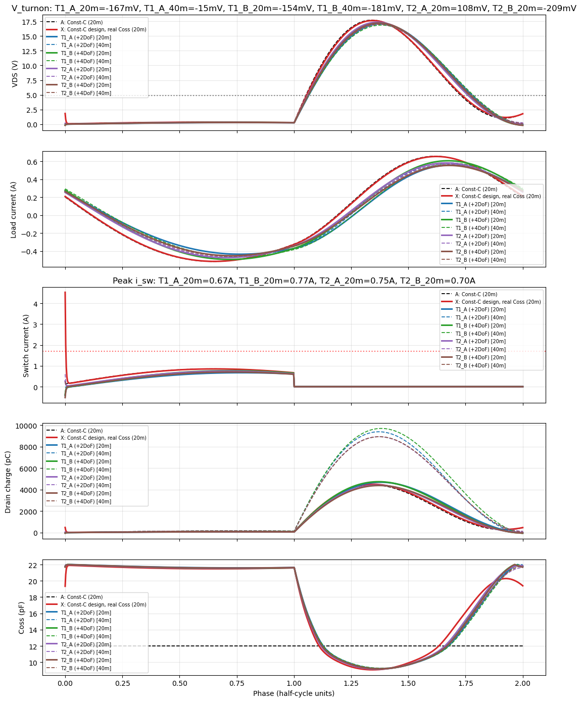
    


    
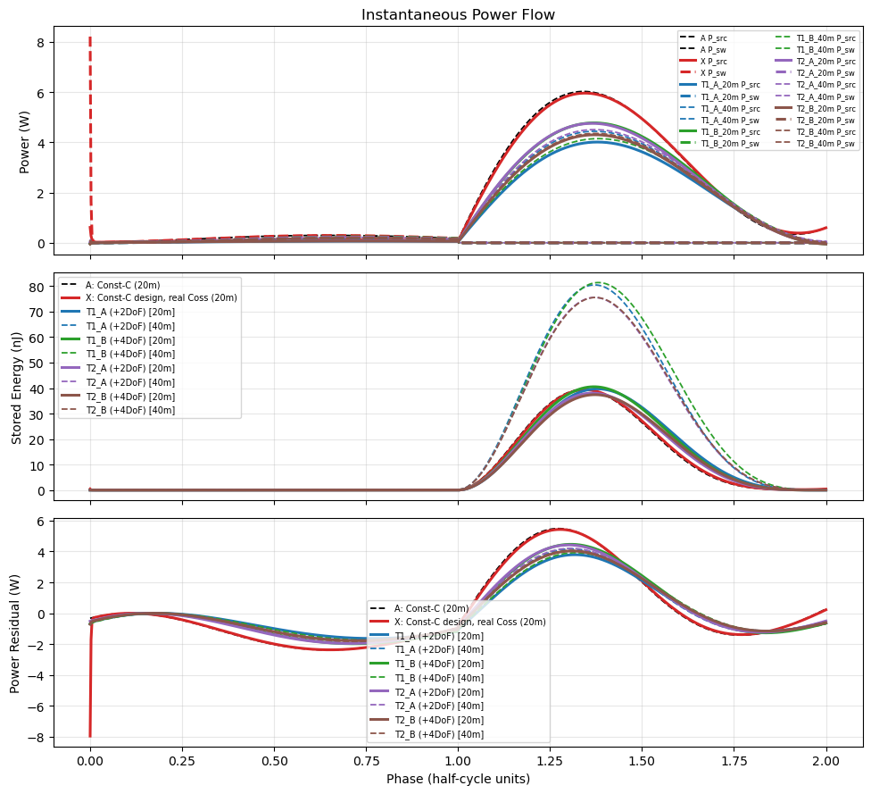
    


    
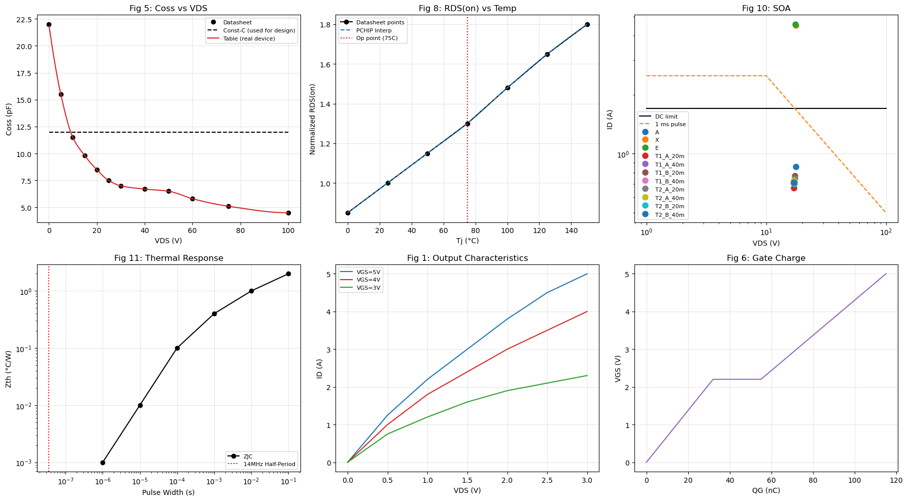
    


    
    ======================================================================================
    2. JOINT 20m -> 40m TX HARMONIC LPF (2x DOUBLING, 2x2 MODES, BAND-SPECIFIC Q)
    ======================================================================================
    
    ======================================================================================
    2. TX MATCH+LPF [DBL_LC: MILP Verdopplung L & C (2x L, 2x C)] (7.96Ω -> 50Ω)
    ======================================================================================
    
      JA2GQP_1R_1C         | Reels: 1 ($3.00)
        20m BOM : C1=4.7pF+trim(18pF), L1=120nH, C2=270pF, C3=430pF, L2=120nH, C4=110pF, C5=240pF
        40m BOM : C1=4.7pF+trim(18pF) || +4.7pF, L1=120nH+120nH, C2=270pF || +270pF, C3=430pF || +430pF, L2=120nH+120nH, C4=110pF || +110pF, C5=240pF || +240pF
        20m (14.175 MHz, Q=60) Nom: S11=-22.75 dB, S21=-0.261 dB, FCC=+-1.2 dB | ±5% MC WC: S11=-18.87 dB, FCC=+-5.2 dB
        40m ( 7.10 MHz, Q=45) Nom: S11=-22.86 dB, S21=-0.331 dB, FCC=+ 0.4 dB | ±5% MC WC: S11=-19.06 dB, FCC=+-4.0 dB
    
      JA2GQP_1R_2C         | Reels: 1 ($3.00)
        20m BOM : C1=4.7pF+trim(18pF), L1=120nH, C2=91pF+160pF, C3=36pF+390pF, L2=120nH, C4=47pF+62pF, C5=33pF+200pF
        40m BOM : C1=4.7pF+trim(18pF) || +4.7pF, L1=120nH+120nH, C2=91pF+160pF || +91pF+160pF, C3=36pF+390pF || +36pF+390pF, L2=120nH+120nH, C4=47pF+62pF || +47pF+62pF, C5=33pF+200pF || +33pF+200pF
        20m (14.175 MHz, Q=60) Nom: S11=-28.98 dB, S21=-0.229 dB, FCC=+10.4 dB | ±5% MC WC: S11=-22.76 dB, FCC=+ 1.3 dB
        40m ( 7.10 MHz, Q=45) Nom: S11=-28.42 dB, S21=-0.296 dB, FCC=+ 5.4 dB | ±5% MC WC: S11=-22.86 dB, FCC=+-1.8 dB
    
      JA2GQP_MR_1C         | Reels: 2 ($6.00)
        20m BOM : C1=220pF+trim(18pF), L1=68nH, C2=430pF, C3=1nF, L2=270nH, C4=47pF, C5=390pF
        40m BOM : C1=220pF+trim(18pF) || +220pF, L1=68nH+68nH, C2=430pF || +430pF, C3=1nF || +1nF, L2=270nH+270nH, C4=47pF || +47pF, C5=390pF || +390pF
        20m (14.175 MHz, Q=60) Nom: S11=-23.54 dB, S21=-0.305 dB, FCC=+28.5 dB | ±5% MC WC: S11=-19.42 dB, FCC=+20.9 dB
        40m ( 7.10 MHz, Q=45) Nom: S11=-23.69 dB, S21=-0.389 dB, FCC=+22.9 dB | ±5% MC WC: S11=-19.60 dB, FCC=+17.4 dB
    
      JA2GQP_MR_2C         | Reels: 2 ($6.00)
        20m BOM : C1=39pF+160pF+trim(18pF), L1=68nH, C2=220pF+220pF, C3=56pF+1nF, L2=270nH, C4=22pF+24pF, C5=82pF+330pF
        40m BOM : C1=39pF+160pF+trim(18pF) || +39pF+160pF, L1=68nH+68nH, C2=220pF+220pF || +220pF+220pF, C3=56pF+1nF || +56pF+1nF, L2=270nH+270nH, C4=22pF+24pF || +22pF+24pF, C5=82pF+330pF || +82pF+330pF
        20m (14.175 MHz, Q=60) Nom: S11=-25.82 dB, S21=-0.313 dB, FCC=+34.0 dB | ±5% MC WC: S11=-20.27 dB, FCC=+25.4 dB
        40m ( 7.10 MHz, Q=45) Nom: S11=-26.21 dB, S21=-0.401 dB, FCC=+27.7 dB | ±5% MC WC: S11=-20.59 dB, FCC=+20.8 dB
    
      4Element_1R_1C       | Reels: 1 ($3.00)
        20m BOM : C1=4.7pF+trim(18pF), L2=150nH, C2=200pF, C3=560pF
        40m BOM : C1=4.7pF+trim(18pF) || +4.7pF, L2=150nH+150nH, C2=200pF || +200pF, C3=560pF || +560pF
        20m (14.175 MHz, Q=60) Nom: S11=-24.50 dB, S21=-0.273 dB, FCC=+ 7.9 dB | ±5% MC WC: S11=-19.46 dB, FCC=+ 7.4 dB
        40m ( 7.10 MHz, Q=45) Nom: S11=-26.43 dB, S21=-0.341 dB, FCC=+ 7.8 dB | ±5% MC WC: S11=-20.39 dB, FCC=+ 7.3 dB
    
      4Element_1R_2C       | Reels: 1 ($3.00)
        20m BOM : C1=4.7pF+trim(18pF), L2=150nH, C2=91pF+110pF, C3=91pF+430pF
        40m BOM : C1=4.7pF+trim(18pF) || +4.7pF, L2=150nH+150nH, C2=91pF+110pF || +91pF+110pF, C3=91pF+430pF || +91pF+430pF
        20m (14.175 MHz, Q=60) Nom: S11=-31.30 dB, S21=-0.233 dB, FCC=+ 7.3 dB | ±5% MC WC: S11=-22.40 dB, FCC=+ 6.8 dB
        40m ( 7.10 MHz, Q=45) Nom: S11=-29.42 dB, S21=-0.300 dB, FCC=+ 7.2 dB | ±5% MC WC: S11=-21.88 dB, FCC=+ 6.7 dB
    
      4Element_MR_1C       | Reels: 1 ($3.00)
        20m BOM : C1=4.7pF+trim(18pF), L2=150nH, C2=200pF, C3=560pF
        40m BOM : C1=4.7pF+trim(18pF) || +4.7pF, L2=150nH+150nH, C2=200pF || +200pF, C3=560pF || +560pF
        20m (14.175 MHz, Q=60) Nom: S11=-24.50 dB, S21=-0.273 dB, FCC=+ 7.9 dB | ±5% MC WC: S11=-19.46 dB, FCC=+ 7.4 dB
        40m ( 7.10 MHz, Q=45) Nom: S11=-26.43 dB, S21=-0.341 dB, FCC=+ 7.8 dB | ±5% MC WC: S11=-20.39 dB, FCC=+ 7.3 dB
    
      4Element_MR_2C       | Reels: 1 ($3.00)
        20m BOM : C1=4.7pF+trim(18pF), L2=150nH, C2=91pF+110pF, C3=91pF+430pF
        40m BOM : C1=4.7pF+trim(18pF) || +4.7pF, L2=150nH+150nH, C2=91pF+110pF || +91pF+110pF, C3=91pF+430pF || +91pF+430pF
        20m (14.175 MHz, Q=60) Nom: S11=-31.30 dB, S21=-0.233 dB, FCC=+ 7.3 dB | ±5% MC WC: S11=-22.40 dB, FCC=+ 6.8 dB
        40m ( 7.10 MHz, Q=45) Nom: S11=-29.42 dB, S21=-0.300 dB, FCC=+ 7.2 dB | ±5% MC WC: S11=-21.88 dB, FCC=+ 6.7 dB
    
      LMatch_WB2CBA_1R_1C  | Reels: 1 ($3.00)
        20m BOM : Cm=1.2nF+trim(18pF), Lm=150nH, C1=1nF, L2=150nH, C3=4.7pF, L4=150nH, C5=240pF
        40m BOM : Cm=1.2nF+trim(18pF) || +1.2nF, Lm=150nH+150nH, C1=1nF || +1nF, L2=150nH+150nH, C3=4.7pF || +4.7pF, L4=150nH+150nH, C5=240pF || +240pF
        20m (14.175 MHz, Q=60) Nom: S11=-28.28 dB, S21=-0.323 dB, FCC=+-2.6 dB | ±5% MC WC: S11=-21.98 dB, FCC=+-3.5 dB
        40m ( 7.10 MHz, Q=45) Nom: S11=-29.02 dB, S21=-0.414 dB, FCC=+-4.0 dB | ±5% MC WC: S11=-23.01 dB, FCC=+-4.9 dB
    
      LMatch_WB2CBA_1R_2C  | Reels: 1 ($3.00)
        20m BOM : Cm=180pF+1.1nF+trim(18pF), Lm=150nH, C1=11pF+1nF, L2=150nH, C3=4.7pF, L4=150nH, C5=33pF+220pF
        40m BOM : Cm=180pF+1.1nF+trim(18pF) || +180pF+1.1nF, Lm=150nH+150nH, C1=11pF+1nF || +11pF+1nF, L2=150nH+150nH, C3=4.7pF || +4.7pF, L4=150nH+150nH, C5=33pF+220pF || +33pF+220pF
        20m (14.175 MHz, Q=60) Nom: S11=-21.38 dB, S21=-0.348 dB, FCC=+-1.4 dB | ±5% MC WC: S11=-18.28 dB, FCC=+-2.3 dB
        40m ( 7.10 MHz, Q=45) Nom: S11=-21.74 dB, S21=-0.437 dB, FCC=+-2.9 dB | ±5% MC WC: S11=-18.61 dB, FCC=+-3.8 dB
    
      LMatch_WB2CBA_MR_1C  | Reels: 2 ($6.00)
        20m BOM : Cm=910pF+trim(18pF), Lm=120nH, C1=1.5nF, L2=330nH, C3=510pF, L4=330nH, C5=27pF
        40m BOM : Cm=910pF+trim(18pF) || +910pF, Lm=120nH+120nH, C1=1.5nF || +1.5nF, L2=330nH+330nH, C3=510pF || +510pF, L4=330nH+330nH, C5=27pF || +27pF
        20m (14.175 MHz, Q=60) Nom: S11=-28.72 dB, S21=-0.447 dB, FCC=+ 9.2 dB | ±5% MC WC: S11=-19.67 dB, FCC=+ 8.2 dB
        40m ( 7.10 MHz, Q=45) Nom: S11=-30.63 dB, S21=-0.570 dB, FCC=+ 7.3 dB | ±5% MC WC: S11=-20.32 dB, FCC=+ 6.3 dB
    
      LMatch_WB2CBA_MR_2C  | Reels: 3 ($9.00)
        20m BOM : Cm=180pF+750pF+trim(18pF), Lm=120nH, C1=510pF+910pF, L2=330nH, C3=68pF+430pF, L4=270nH, C5=36pF
        40m BOM : Cm=180pF+750pF+trim(18pF) || +180pF+750pF, Lm=120nH+120nH, C1=510pF+910pF || +510pF+910pF, L2=330nH+330nH, C3=68pF+430pF || +68pF+430pF, L4=270nH+270nH, C5=36pF || +36pF
        20m (14.175 MHz, Q=60) Nom: S11=-19.32 dB, S21=-0.464 dB, FCC=+ 7.0 dB | ±5% MC WC: S11=-15.15 dB, FCC=+ 6.0 dB
        40m ( 7.10 MHz, Q=45) Nom: S11=-19.80 dB, S21=-0.577 dB, FCC=+ 5.1 dB | ±5% MC WC: S11=-15.53 dB, FCC=+ 4.2 dB


    
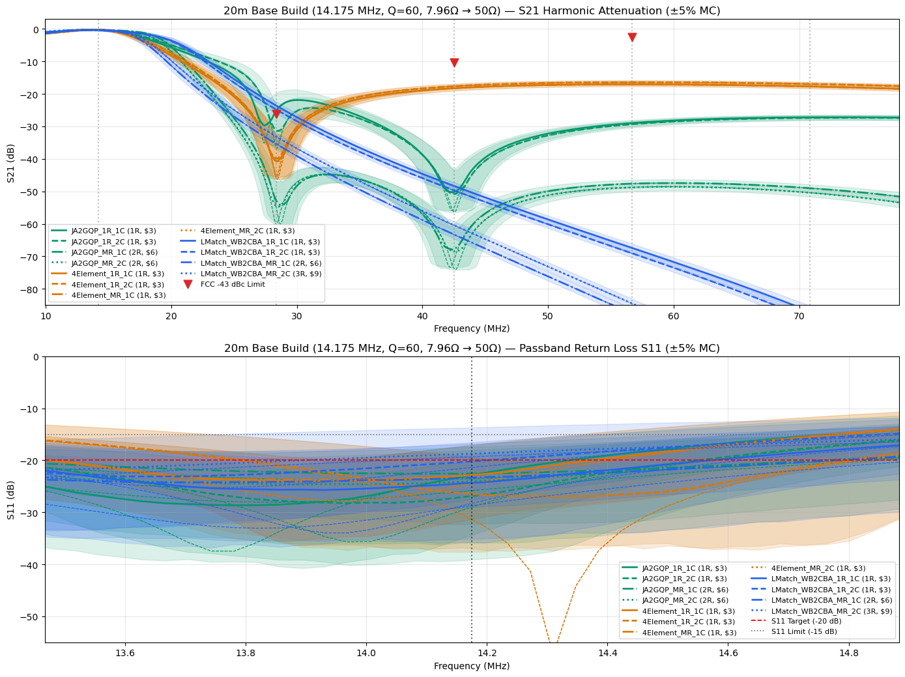
    


    

    


    
    ======================================================================================
    2. TX MATCH+LPF [DBL_C: MILP nur Vervierfachung C (1x L, 4x C)] (7.96Ω -> 50Ω)
    ======================================================================================
    
      JA2GQP_1R_1C         | Reels: 1 ($3.00)
        20m BOM : C1=1nF+trim(18pF), L1=220nH, C2=130pF, C3=560pF, L2=220nH, C4=56pF, C5=68pF
        40m BOM : C1=1nF+trim(18pF) || +3nF, L1=220nH, C2=130pF || +390pF, C3=560pF || +1.6nF, L2=220nH, C4=56pF || +160pF, C5=68pF || +200pF
        20m (14.175 MHz, Q=60) Nom: S11= -8.59 dB, S21=-1.002 dB, FCC=+21.6 dB | ±5% MC WC: S11= -7.49 dB, FCC=+16.1 dB
        40m ( 7.10 MHz, Q=45) Nom: S11=-42.41 dB, S21=-0.756 dB, FCC=+17.3 dB | ±5% MC WC: S11=-18.82 dB, FCC=+13.3 dB
    
      JA2GQP_1R_2C         | Reels: 1 ($3.00)
        20m BOM : C1=910pF+1nF+trim(18pF), L1=120nH, C2=8.2pF+220pF, C3=91pF+820pF, L2=120nH, C4=47pF+62pF, C5=12pF+240pF
        40m BOM : C1=910pF+1nF+trim(18pF) || +4.3nF, L1=120nH, C2=8.2pF+220pF || +680pF, C3=91pF+820pF || +2.7nF, L2=120nH, C4=47pF+62pF || +330pF, C5=12pF+240pF || +750pF
        20m (14.175 MHz, Q=60) Nom: S11=-12.94 dB, S21=-0.719 dB, FCC=+16.7 dB | ±5% MC WC: S11=-10.13 dB, FCC=+12.8 dB
        40m ( 7.10 MHz, Q=45) Nom: S11=-11.62 dB, S21=-1.442 dB, FCC=+15.5 dB | ±5% MC WC: S11= -8.76 dB, FCC=+11.6 dB
    
      JA2GQP_MR_1C         | Reels: 2 ($6.00)
        20m BOM : C1=510pF+trim(18pF), L1=150nH, C2=200pF, C3=910pF, L2=390nH, C4=30pF, C5=300pF
        40m BOM : C1=510pF+trim(18pF) || +1.5nF, L1=150nH, C2=200pF || +620pF, C3=910pF || +2.7nF, L2=390nH, C4=30pF || +91pF, C5=300pF || +910pF
        20m (14.175 MHz, Q=60) Nom: S11=-17.24 dB, S21=-0.496 dB, FCC=+41.5 dB | ±5% MC WC: S11=-14.25 dB, FCC=+32.5 dB
        40m ( 7.10 MHz, Q=45) Nom: S11=-18.46 dB, S21=-0.655 dB, FCC=+41.2 dB | ±5% MC WC: S11=-14.93 dB, FCC=+34.8 dB
    
      JA2GQP_MR_2C         | Reels: 2 ($6.00)
        20m BOM : C1=62pF+470pF+trim(18pF), L1=150nH, C2=91pF+110pF, C3=75pF+820pF, L2=470nH, C4=8.2pF+16pF, C5=68pF+220pF
        40m BOM : C1=62pF+470pF+trim(18pF) || +1.6nF, L1=150nH, C2=91pF+110pF || +620pF, C3=75pF+820pF || +2.7nF, L2=470nH, C4=8.2pF+16pF || +75pF, C5=68pF+220pF || +820pF
        20m (14.175 MHz, Q=60) Nom: S11=-25.63 dB, S21=-0.515 dB, FCC=+43.5 dB | ±5% MC WC: S11=-18.44 dB, FCC=+35.0 dB
        40m ( 7.10 MHz, Q=45) Nom: S11=-20.39 dB, S21=-0.634 dB, FCC=+42.5 dB | ±5% MC WC: S11=-15.71 dB, FCC=+36.0 dB
    
      4Element_1R_1C       | Reels: 1 ($3.00)
        20m BOM : C1=9.1pF+trim(18pF), L2=180nH, C2=160pF, C3=470pF
        40m BOM : C1=9.1pF+trim(18pF) || +27pF, L2=180nH, C2=160pF || +470pF, C3=470pF || +1.5nF
        20m (14.175 MHz, Q=60) Nom: S11=-17.85 dB, S21=-0.297 dB, FCC=+ 8.3 dB | ±5% MC WC: S11=-15.90 dB, FCC=+ 6.3 dB
        40m ( 7.10 MHz, Q=45) Nom: S11= -6.17 dB, S21=-1.733 dB, FCC=+ 7.0 dB | ±5% MC WC: S11= -5.91 dB, FCC=+ 3.5 dB
    
      4Element_1R_2C       | Reels: 1 ($3.00)
        20m BOM : C1=6.8pF+trim(18pF), L2=150nH, C2=91pF+110pF, C3=43pF+390pF
        40m BOM : C1=6.8pF+trim(18pF) || +20pF, L2=150nH, C2=91pF+110pF || +620pF, C3=43pF+390pF || +1.3nF
        20m (14.175 MHz, Q=60) Nom: S11=-13.61 dB, S21=-0.364 dB, FCC=+ 5.8 dB | ±5% MC WC: S11=-12.30 dB, FCC=+ 5.4 dB
        40m ( 7.10 MHz, Q=45) Nom: S11= -6.40 dB, S21=-1.505 dB, FCC=+ 6.3 dB | ±5% MC WC: S11= -6.12 dB, FCC=+ 5.9 dB
    
      4Element_MR_1C       | Reels: 1 ($3.00)
        20m BOM : C1=9.1pF+trim(18pF), L2=180nH, C2=160pF, C3=470pF
        40m BOM : C1=9.1pF+trim(18pF) || +27pF, L2=180nH, C2=160pF || +470pF, C3=470pF || +1.5nF
        20m (14.175 MHz, Q=60) Nom: S11=-17.85 dB, S21=-0.297 dB, FCC=+ 8.3 dB | ±5% MC WC: S11=-15.90 dB, FCC=+ 6.3 dB
        40m ( 7.10 MHz, Q=45) Nom: S11= -6.17 dB, S21=-1.733 dB, FCC=+ 7.0 dB | ±5% MC WC: S11= -5.91 dB, FCC=+ 3.5 dB
    
      4Element_MR_2C       | Reels: 1 ($3.00)
        20m BOM : C1=6.8pF+trim(18pF), L2=150nH, C2=91pF+110pF, C3=43pF+390pF
        40m BOM : C1=6.8pF+trim(18pF) || +20pF, L2=150nH, C2=91pF+110pF || +620pF, C3=43pF+390pF || +1.3nF
        20m (14.175 MHz, Q=60) Nom: S11=-13.61 dB, S21=-0.364 dB, FCC=+ 5.8 dB | ±5% MC WC: S11=-12.30 dB, FCC=+ 5.4 dB
        40m ( 7.10 MHz, Q=45) Nom: S11= -6.40 dB, S21=-1.505 dB, FCC=+ 6.3 dB | ±5% MC WC: S11= -6.12 dB, FCC=+ 5.9 dB
    
      LMatch_WB2CBA_1R_1C  | Reels: 1 ($3.00)
        20m BOM : Cm=43pF+trim(18pF), Lm=220nH, C1=910pF, L2=220nH, C3=5.6pF, L4=220nH, C5=470pF
        40m BOM : Cm=43pF+trim(18pF) || +130pF, Lm=220nH, C1=910pF || +2.7nF, L2=220nH, C3=5.6pF || +16pF, L4=220nH, C5=470pF || +1.5nF
        20m (14.175 MHz, Q=60) Nom: S11=-22.69 dB, S21=-0.516 dB, FCC=+ 6.7 dB | ±5% MC WC: S11=-16.92 dB, FCC=+ 6.0 dB
        40m ( 7.10 MHz, Q=45) Nom: S11=-12.67 dB, S21=-1.152 dB, FCC=+ 6.8 dB | ±5% MC WC: S11=-10.37 dB, FCC=+ 6.1 dB
    
      LMatch_WB2CBA_1R_2C  | Reels: 1 ($3.00)
        20m BOM : Cm=510pF+620pF+trim(18pF), Lm=180nH, C1=22pF+820pF, L2=180nH, C3=4.7pF, L4=180nH, C5=39pF+160pF
        40m BOM : Cm=510pF+620pF+trim(18pF) || +3.3nF, Lm=180nH, C1=22pF+820pF || +2.4nF, L2=180nH, C3=4.7pF || +15pF, L4=180nH, C5=39pF+160pF || +620pF
        20m (14.175 MHz, Q=60) Nom: S11=-17.44 dB, S21=-0.379 dB, FCC=+-2.1 dB | ±5% MC WC: S11=-15.55 dB, FCC=+-3.0 dB
        40m ( 7.10 MHz, Q=45) Nom: S11=-22.95 dB, S21=-0.557 dB, FCC=+-0.5 dB | ±5% MC WC: S11=-17.52 dB, FCC=+-1.5 dB
    
      LMatch_WB2CBA_MR_1C  | Reels: 3 ($9.00)
        20m BOM : Cm=620pF+trim(18pF), Lm=180nH, C1=910pF, L2=470nH, C3=240pF, L4=22nH, C5=33pF
        40m BOM : Cm=620pF+trim(18pF) || +1.8nF, Lm=180nH, C1=910pF || +2.7nF, L2=470nH, C3=240pF || +750pF, L4=22nH, C5=33pF || +100pF
        20m (14.175 MHz, Q=60) Nom: S11=-25.11 dB, S21=-0.369 dB, FCC=+ 1.8 dB | ±5% MC WC: S11=-18.56 dB, FCC=+ 0.9 dB
        40m ( 7.10 MHz, Q=45) Nom: S11=-22.66 dB, S21=-0.497 dB, FCC=+ 2.8 dB | ±5% MC WC: S11=-17.73 dB, FCC=+ 1.9 dB
    
      LMatch_WB2CBA_MR_2C  | Reels: 3 ($9.00)
        20m BOM : Cm=6.2pF+620pF+trim(18pF), Lm=180nH, C1=430pF+470pF, L2=470nH, C3=51pF+62pF, L4=22nH, C5=62pF+100pF
        40m BOM : Cm=6.2pF+620pF+trim(18pF) || +1.8nF, Lm=180nH, C1=430pF+470pF || +2.7nF, L2=470nH, C3=51pF+62pF || +330pF, L4=22nH, C5=62pF+100pF || +470pF
        20m (14.175 MHz, Q=60) Nom: S11=-20.87 dB, S21=-0.394 dB, FCC=+ 1.8 dB | ±5% MC WC: S11=-16.22 dB, FCC=+ 1.0 dB
        40m ( 7.10 MHz, Q=45) Nom: S11=-21.44 dB, S21=-0.498 dB, FCC=+ 2.3 dB | ±5% MC WC: S11=-17.65 dB, FCC=+ 1.4 dB


    
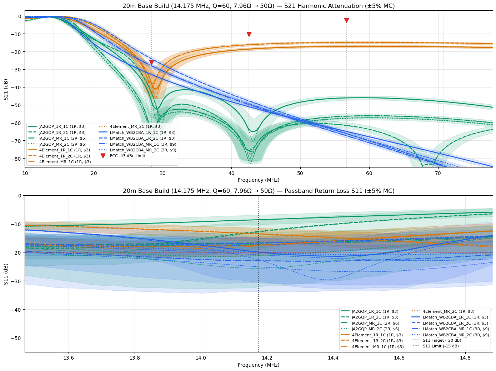
    


    
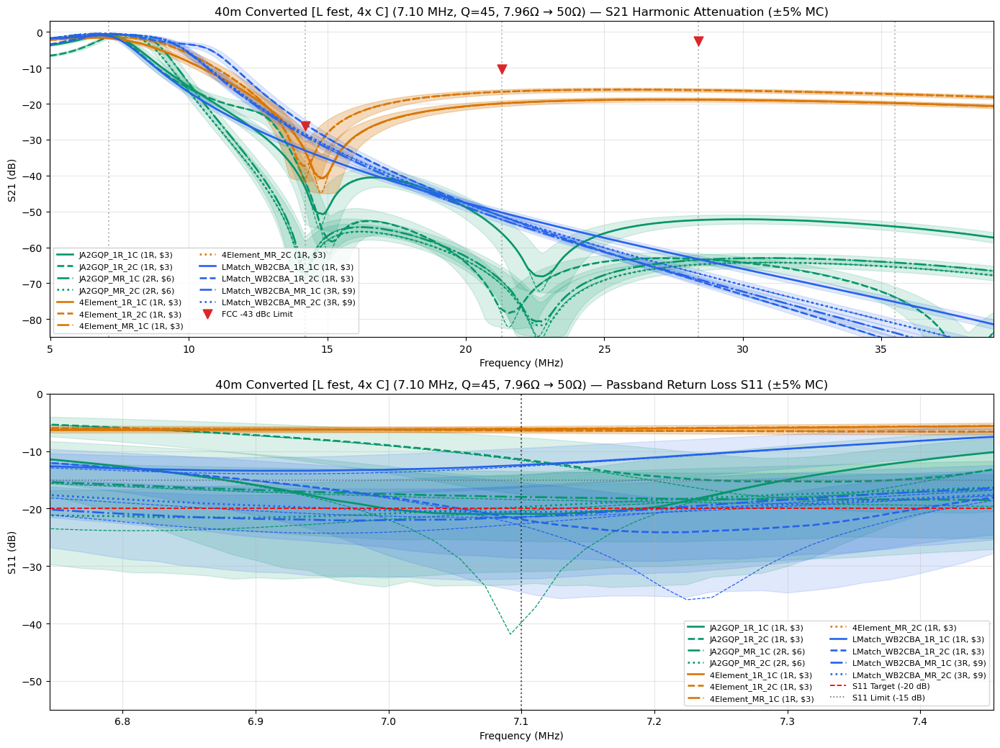
    


    
    ======================================================================================
    2. TX MATCH+LPF [OPT_LC: MILP Optimierung C + L frei auf 40m] (7.96Ω -> 50Ω)
    ======================================================================================
    
      JA2GQP_1R_1C         | Reels: 2 ($6.00)
        20m BOM : C1=4.7pF+trim(18pF), L1=120nH, C2=240pF, C3=470pF, L2=120nH, C4=110pF, C5=240pF
        40m BOM : C1=4.7pF+trim(18pF), L1=220nH, C2=560pF, C3=910pF, L2=220nH, C4=240pF, C5=470pF
        20m (14.175 MHz, Q=60) Nom: S11=-21.72 dB, S21=-0.270 dB, FCC=+ 2.8 dB | ±5% MC WC: S11=-18.24 dB, FCC=+-3.1 dB
        40m ( 7.10 MHz, Q=45) Nom: S11=-27.96 dB, S21=-0.302 dB, FCC=+ 7.0 dB | ±5% MC WC: S11=-23.56 dB, FCC=+ 0.9 dB
    
      JA2GQP_1R_2C         | Reels: 2 ($6.00)
        20m BOM : C1=4.7pF+trim(18pF), L1=120nH, C2=91pF+160pF, C3=91pF+330pF, L2=120nH, C4=47pF+62pF, C5=75pF+160pF
        40m BOM : C1=4.7pF+trim(18pF), L1=220nH, C2=560pF, C3=36pF+820pF, L2=220nH, C4=5.6pF+240pF, C5=470pF
        20m (14.175 MHz, Q=60) Nom: S11=-28.55 dB, S21=-0.228 dB, FCC=+10.2 dB | ±5% MC WC: S11=-22.70 dB, FCC=+ 1.1 dB
        40m ( 7.10 MHz, Q=45) Nom: S11=-28.59 dB, S21=-0.286 dB, FCC=+ 6.5 dB | ±5% MC WC: S11=-22.50 dB, FCC=+ 0.4 dB
    
      JA2GQP_MR_1C         | Reels: 4 ($12.00)
        20m BOM : C1=430pF+trim(18pF), L1=120nH, C2=240pF, C3=820pF, L2=330nH, C4=36pF, C5=240pF
        40m BOM : C1=180pF+trim(18pF), L1=220nH, C2=560pF, C3=1.6nF, L2=680nH, C4=75pF, C5=470pF
        20m (14.175 MHz, Q=60) Nom: S11=-32.72 dB, S21=-0.313 dB, FCC=+25.5 dB | ±5% MC WC: S11=-22.82 dB, FCC=+19.9 dB
        40m ( 7.10 MHz, Q=45) Nom: S11=-44.30 dB, S21=-0.386 dB, FCC=+29.5 dB | ±5% MC WC: S11=-25.21 dB, FCC=+23.3 dB
    
      JA2GQP_MR_2C         | Reels: 4 ($12.00)
        20m BOM : C1=9.1pF+430pF+trim(18pF), L1=120nH, C2=91pF+160pF, C3=360pF+510pF, L2=330nH, C4=6.8pF+30pF, C5=9.1pF+240pF
        40m BOM : C1=6.2pF+180pF+trim(18pF), L1=220nH, C2=560pF, C3=82pF+1.5nF, L2=680nH, C4=8.2pF+68pF, C5=91pF+360pF
        20m (14.175 MHz, Q=60) Nom: S11=-29.34 dB, S21=-0.340 dB, FCC=+35.6 dB | ±5% MC WC: S11=-20.86 dB, FCC=+26.8 dB
        40m ( 7.10 MHz, Q=45) Nom: S11=-39.48 dB, S21=-0.384 dB, FCC=+29.2 dB | ±5% MC WC: S11=-25.43 dB, FCC=+23.0 dB
    
      4Element_1R_1C       | Reels: 2 ($6.00)
        20m BOM : C1=4.7pF+trim(18pF), L2=150nH, C2=200pF, C3=560pF
        40m BOM : C1=4.7pF+trim(18pF), L2=270nH, C2=470pF, C3=1.1nF
        20m (14.175 MHz, Q=60) Nom: S11=-24.50 dB, S21=-0.273 dB, FCC=+ 7.9 dB | ±5% MC WC: S11=-19.46 dB, FCC=+ 7.4 dB
        40m ( 7.10 MHz, Q=45) Nom: S11=-21.36 dB, S21=-0.334 dB, FCC=+ 6.3 dB | ±5% MC WC: S11=-17.94 dB, FCC=+ 5.8 dB
    
      4Element_1R_2C       | Reels: 2 ($6.00)
        20m BOM : C1=4.7pF+trim(18pF), L2=150nH, C2=91pF+110pF, C3=7.5pF+510pF
        40m BOM : C1=7.5pF+9.1pF+trim(18pF), L2=330nH, C2=12pF+360pF, C3=51pF+910pF
        20m (14.175 MHz, Q=60) Nom: S11=-29.39 dB, S21=-0.232 dB, FCC=+ 7.2 dB | ±5% MC WC: S11=-21.71 dB, FCC=+ 6.7 dB
        40m ( 7.10 MHz, Q=45) Nom: S11=-21.03 dB, S21=-0.321 dB, FCC=+ 7.1 dB | ±5% MC WC: S11=-19.14 dB, FCC=+ 6.6 dB
    
      4Element_MR_1C       | Reels: 2 ($6.00)
        20m BOM : C1=4.7pF+trim(18pF), L2=150nH, C2=200pF, C3=560pF
        40m BOM : C1=4.7pF+trim(18pF), L2=270nH, C2=470pF, C3=1.1nF
        20m (14.175 MHz, Q=60) Nom: S11=-24.50 dB, S21=-0.273 dB, FCC=+ 7.9 dB | ±5% MC WC: S11=-19.46 dB, FCC=+ 7.4 dB
        40m ( 7.10 MHz, Q=45) Nom: S11=-21.36 dB, S21=-0.334 dB, FCC=+ 6.3 dB | ±5% MC WC: S11=-17.94 dB, FCC=+ 5.8 dB
    
      4Element_MR_2C       | Reels: 2 ($6.00)
        20m BOM : C1=4.7pF+trim(18pF), L2=150nH, C2=91pF+110pF, C3=7.5pF+510pF
        40m BOM : C1=7.5pF+9.1pF+trim(18pF), L2=330nH, C2=12pF+360pF, C3=51pF+910pF
        20m (14.175 MHz, Q=60) Nom: S11=-29.39 dB, S21=-0.232 dB, FCC=+ 7.2 dB | ±5% MC WC: S11=-21.71 dB, FCC=+ 6.7 dB
        40m ( 7.10 MHz, Q=45) Nom: S11=-21.03 dB, S21=-0.321 dB, FCC=+ 7.1 dB | ±5% MC WC: S11=-19.14 dB, FCC=+ 6.6 dB
    
      LMatch_WB2CBA_1R_1C  | Reels: 2 ($6.00)
        20m BOM : Cm=1.1nF+trim(18pF), Lm=150nH, C1=1.1nF, L2=150nH, C3=4.7pF, L4=150nH, C5=240pF
        40m BOM : Cm=2.7nF+trim(18pF), Lm=270nH, C1=2.2nF, L2=270nH, C3=4.7pF, L4=270nH, C5=620pF
        20m (14.175 MHz, Q=60) Nom: S11=-17.36 dB, S21=-0.436 dB, FCC=+-2.0 dB | ±5% MC WC: S11=-14.49 dB, FCC=+-2.9 dB
        40m ( 7.10 MHz, Q=45) Nom: S11=-20.81 dB, S21=-0.445 dB, FCC=+-2.1 dB | ±5% MC WC: S11=-17.79 dB, FCC=+-3.1 dB
    
      LMatch_WB2CBA_1R_2C  | Reels: 2 ($6.00)
        20m BOM : Cm=6.2pF+1.3nF+trim(18pF), Lm=150nH, C1=82pF+910pF, L2=150nH, C3=4.7pF, L4=150nH, C5=24pF+240pF
        40m BOM : Cm=560pF+2nF+trim(18pF), Lm=270nH, C1=390pF+1.8nF, L2=270nH, C3=4.7pF, L4=270nH, C5=56pF+560pF
        20m (14.175 MHz, Q=60) Nom: S11=-18.16 dB, S21=-0.373 dB, FCC=+-1.1 dB | ±5% MC WC: S11=-15.91 dB, FCC=+-2.0 dB
        40m ( 7.10 MHz, Q=45) Nom: S11=-23.27 dB, S21=-0.428 dB, FCC=+-2.7 dB | ±5% MC WC: S11=-19.48 dB, FCC=+-3.7 dB
    
      LMatch_WB2CBA_MR_1C  | Reels: 6 ($18.00)
        20m BOM : Cm=910pF+trim(18pF), Lm=100nH, C1=1.5nF, L2=270nH, C3=560pF, L4=330nH, C5=56pF
        40m BOM : Cm=510pF+trim(18pF), Lm=220nH, C1=2.4nF, L2=680nH, C3=1nF, L4=1uH, C5=180pF
        20m (14.175 MHz, Q=60) Nom: S11=-27.01 dB, S21=-0.403 dB, FCC=+ 4.5 dB | ±5% MC WC: S11=-19.08 dB, FCC=+ 3.4 dB
        40m ( 7.10 MHz, Q=45) Nom: S11=-25.67 dB, S21=-0.529 dB, FCC=+ 3.6 dB | ±5% MC WC: S11=-18.69 dB, FCC=+ 2.6 dB
    
      LMatch_WB2CBA_MR_2C  | Reels: 6 ($18.00)
        20m BOM : Cm=75pF+820pF+trim(18pF), Lm=100nH, C1=360pF+1.1nF, L2=270nH, C3=15pF+510pF, L4=330nH, C5=51pF
        40m BOM : Cm=240pF+270pF+trim(18pF), Lm=220nH, C1=11pF+2.4nF, L2=680nH, C3=27pF+1nF, L4=1uH, C5=7.5pF+160pF
        20m (14.175 MHz, Q=60) Nom: S11=-26.51 dB, S21=-0.394 dB, FCC=+ 3.3 dB | ±5% MC WC: S11=-20.01 dB, FCC=+ 2.2 dB
        40m ( 7.10 MHz, Q=45) Nom: S11=-29.40 dB, S21=-0.533 dB, FCC=+ 3.9 dB | ±5% MC WC: S11=-20.51 dB, FCC=+ 2.9 dB


    
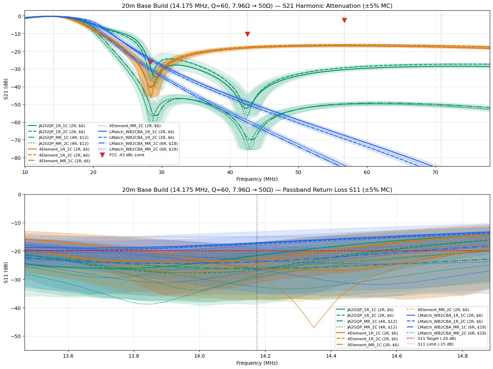
    


    
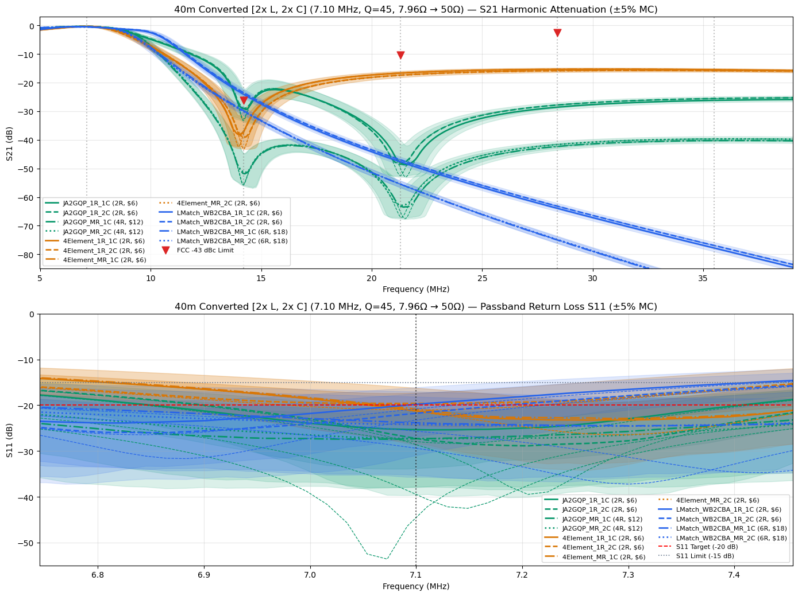
    


    
    ======================================================================================
    2. TX MATCH+LPF [OPT_C: MILP Optimierung nur C frei auf 40m (L fest)] (7.96Ω -> 50Ω)
    ======================================================================================
    
      JA2GQP_1R_1C         | Reels: 1 ($3.00)
        20m BOM : C1=4.7pF+trim(18pF), L1=120nH, C2=240pF, C3=470pF, L2=120nH, C4=110pF, C5=240pF
        40m BOM : C1=4.7pF+trim(18pF), L1=120nH, C2=1.1nF, C3=4.3nF, L2=120nH, C4=510pF, C5=2.2nF
        20m (14.175 MHz, Q=60) Nom: S11=-21.72 dB, S21=-0.270 dB, FCC=+ 2.8 dB | ±5% MC WC: S11=-18.24 dB, FCC=+-3.1 dB
        40m ( 7.10 MHz, Q=45) Nom: S11= -1.44 dB, S21=-7.084 dB, FCC=+19.9 dB | ±5% MC WC: S11= -1.37 dB, FCC=+16.1 dB
    
      JA2GQP_1R_2C         | Reels: 1 ($3.00)
        20m BOM : C1=4.7pF+trim(18pF), L1=120nH, C2=91pF+160pF, C3=91pF+330pF, L2=120nH, C4=47pF+62pF, C5=75pF+160pF
        40m BOM : C1=4.7pF+trim(18pF), L1=120nH, C2=91pF+1.1nF, C3=910pF+1nF, L2=120nH, C4=180pF+270pF, C5=4.3nF+4.3nF
        20m (14.175 MHz, Q=60) Nom: S11=-28.55 dB, S21=-0.228 dB, FCC=+10.2 dB | ±5% MC WC: S11=-22.70 dB, FCC=+ 1.1 dB
        40m ( 7.10 MHz, Q=45) Nom: S11= -0.51 dB, S21=-14.609 dB, FCC=+19.2 dB | ±5% MC WC: S11= -0.49 dB, FCC=+16.9 dB
    
      JA2GQP_MR_1C         | Reels: 2 ($6.00)
        20m BOM : C1=430pF+trim(18pF), L1=120nH, C2=240pF, C3=820pF, L2=330nH, C4=36pF, C5=240pF
        40m BOM : C1=4.7pF+trim(18pF), L1=120nH, C2=1nF, C3=820pF, L2=330nH, C4=160pF, C5=820pF
        20m (14.175 MHz, Q=60) Nom: S11=-32.72 dB, S21=-0.313 dB, FCC=+25.5 dB | ±5% MC WC: S11=-22.82 dB, FCC=+19.9 dB
        40m ( 7.10 MHz, Q=45) Nom: S11=-34.41 dB, S21=-0.283 dB, FCC=+10.7 dB | ±5% MC WC: S11=-24.85 dB, FCC=+ 2.8 dB
    
      JA2GQP_MR_2C         | Reels: 2 ($6.00)
        20m BOM : C1=9.1pF+430pF+trim(18pF), L1=120nH, C2=91pF+160pF, C3=360pF+510pF, L2=330nH, C4=6.8pF+30pF, C5=9.1pF+240pF
        40m BOM : C1=4.7pF+trim(18pF), L1=120nH, C2=18pF+1nF, C3=43pF+820pF, L2=330nH, C4=43pF+120pF, C5=47pF+750pF
        20m (14.175 MHz, Q=60) Nom: S11=-29.34 dB, S21=-0.340 dB, FCC=+35.6 dB | ±5% MC WC: S11=-20.86 dB, FCC=+26.8 dB
        40m ( 7.10 MHz, Q=45) Nom: S11=-39.35 dB, S21=-0.279 dB, FCC=+13.5 dB | ±5% MC WC: S11=-26.51 dB, FCC=+ 6.3 dB
    
      4Element_1R_1C       | Reels: 1 ($3.00)
        20m BOM : C1=4.7pF+trim(18pF), L2=150nH, C2=200pF, C3=560pF
        40m BOM : C1=4.7pF+trim(18pF), L2=150nH, C2=910pF, C3=2.2nF
        20m (14.175 MHz, Q=60) Nom: S11=-24.50 dB, S21=-0.273 dB, FCC=+ 7.9 dB | ±5% MC WC: S11=-19.46 dB, FCC=+ 7.4 dB
        40m ( 7.10 MHz, Q=45) Nom: S11= -5.00 dB, S21=-2.264 dB, FCC=+ 3.7 dB | ±5% MC WC: S11= -4.79 dB, FCC=+ 1.2 dB
    
      4Element_1R_2C       | Reels: 1 ($3.00)
        20m BOM : C1=4.7pF+trim(18pF), L2=150nH, C2=91pF+110pF, C3=7.5pF+510pF
        40m BOM : C1=4.7pF+trim(18pF), L2=150nH, C2=47pF+910pF, C3=750pF+1.5nF
        20m (14.175 MHz, Q=60) Nom: S11=-29.39 dB, S21=-0.232 dB, FCC=+ 7.2 dB | ±5% MC WC: S11=-21.71 dB, FCC=+ 6.7 dB
        40m ( 7.10 MHz, Q=45) Nom: S11= -4.86 dB, S21=-2.382 dB, FCC=+ 0.6 dB | ±5% MC WC: S11= -4.66 dB, FCC=+-1.2 dB
    
      4Element_MR_1C       | Reels: 1 ($3.00)
        20m BOM : C1=4.7pF+trim(18pF), L2=150nH, C2=200pF, C3=560pF
        40m BOM : C1=4.7pF+trim(18pF), L2=150nH, C2=910pF, C3=2.2nF
        20m (14.175 MHz, Q=60) Nom: S11=-24.50 dB, S21=-0.273 dB, FCC=+ 7.9 dB | ±5% MC WC: S11=-19.46 dB, FCC=+ 7.4 dB
        40m ( 7.10 MHz, Q=45) Nom: S11= -5.00 dB, S21=-2.264 dB, FCC=+ 3.7 dB | ±5% MC WC: S11= -4.79 dB, FCC=+ 1.2 dB
    
      4Element_MR_2C       | Reels: 1 ($3.00)
        20m BOM : C1=4.7pF+trim(18pF), L2=150nH, C2=91pF+110pF, C3=7.5pF+510pF
        40m BOM : C1=4.7pF+trim(18pF), L2=150nH, C2=47pF+910pF, C3=750pF+1.5nF
        20m (14.175 MHz, Q=60) Nom: S11=-29.39 dB, S21=-0.232 dB, FCC=+ 7.2 dB | ±5% MC WC: S11=-21.71 dB, FCC=+ 6.7 dB
        40m ( 7.10 MHz, Q=45) Nom: S11= -4.86 dB, S21=-2.382 dB, FCC=+ 0.6 dB | ±5% MC WC: S11= -4.66 dB, FCC=+-1.2 dB
    
      LMatch_WB2CBA_1R_1C  | Reels: 1 ($3.00)
        20m BOM : Cm=1.1nF+trim(18pF), Lm=150nH, C1=1.1nF, L2=150nH, C3=4.7pF, L4=150nH, C5=240pF
        40m BOM : Cm=1.6nF+trim(18pF), Lm=150nH, C1=4.7pF, L2=150nH, C3=4.7pF, L4=150nH, C5=1.2nF
        20m (14.175 MHz, Q=60) Nom: S11=-17.36 dB, S21=-0.436 dB, FCC=+-2.0 dB | ±5% MC WC: S11=-14.49 dB, FCC=+-2.9 dB
        40m ( 7.10 MHz, Q=45) Nom: S11=-25.94 dB, S21=-0.336 dB, FCC=+-10.4 dB | ±5% MC WC: S11=-22.09 dB, FCC=+-10.9 dB
    
      LMatch_WB2CBA_1R_2C  | Reels: 1 ($3.00)
        20m BOM : Cm=6.2pF+1.3nF+trim(18pF), Lm=150nH, C1=82pF+910pF, L2=150nH, C3=4.7pF, L4=150nH, C5=24pF+240pF
        40m BOM : Cm=750pF+910pF+trim(18pF), Lm=150nH, C1=47pF, L2=150nH, C3=4.7pF, L4=150nH, C5=4.7pF+1.2nF
        20m (14.175 MHz, Q=60) Nom: S11=-18.16 dB, S21=-0.373 dB, FCC=+-1.1 dB | ±5% MC WC: S11=-15.91 dB, FCC=+-2.0 dB
        40m ( 7.10 MHz, Q=45) Nom: S11=-26.28 dB, S21=-0.338 dB, FCC=+-10.4 dB | ±5% MC WC: S11=-22.50 dB, FCC=+-10.9 dB
    
      LMatch_WB2CBA_MR_1C  | Reels: 3 ($9.00)
        20m BOM : Cm=910pF+trim(18pF), Lm=100nH, C1=1.5nF, L2=270nH, C3=560pF, L4=330nH, C5=56pF
        40m BOM : Cm=2.7nF+trim(18pF), Lm=100nH, C1=4.7pF, L2=270nH, C3=1.6nF, L4=330nH, C5=110pF
        20m (14.175 MHz, Q=60) Nom: S11=-27.01 dB, S21=-0.403 dB, FCC=+ 4.5 dB | ±5% MC WC: S11=-19.08 dB, FCC=+ 3.4 dB
        40m ( 7.10 MHz, Q=45) Nom: S11=-24.65 dB, S21=-0.460 dB, FCC=+-7.0 dB | ±5% MC WC: S11=-18.16 dB, FCC=+-7.6 dB
    
      LMatch_WB2CBA_MR_2C  | Reels: 3 ($9.00)
        20m BOM : Cm=75pF+820pF+trim(18pF), Lm=100nH, C1=360pF+1.1nF, L2=270nH, C3=15pF+510pF, L4=330nH, C5=51pF
        40m BOM : Cm=680pF+2.2nF+trim(18pF), Lm=100nH, C1=4.7pF, L2=270nH, C3=56pF+1.6nF, L4=330nH, C5=36pF+36pF
        20m (14.175 MHz, Q=60) Nom: S11=-26.51 dB, S21=-0.394 dB, FCC=+ 3.3 dB | ±5% MC WC: S11=-20.01 dB, FCC=+ 2.2 dB
        40m ( 7.10 MHz, Q=45) Nom: S11=-25.56 dB, S21=-0.484 dB, FCC=+-5.5 dB | ±5% MC WC: S11=-18.28 dB, FCC=+-6.1 dB


    

    


    
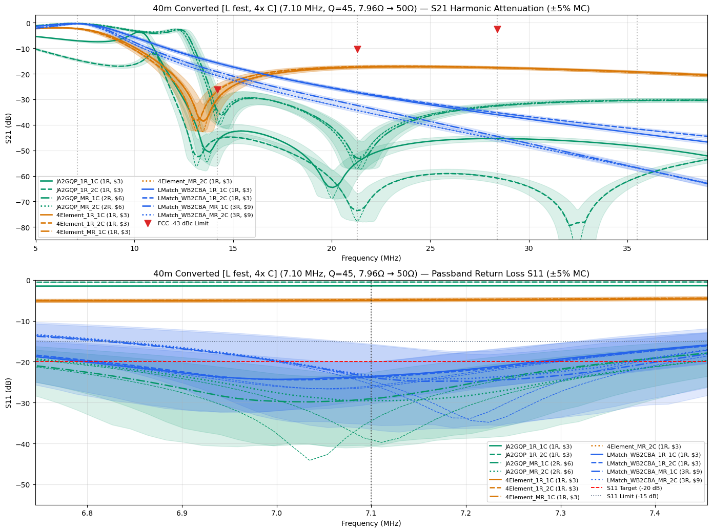
    


    
    ======================================================================================
    3. RX AUDIO CHAIN (R_rf=7.96Ω, R_audio=51.85Ω + TAYLOE 2x)
    ======================================================================================
    ADC Settling (R_kick=100 Ω, C_kick=1.0 nF): charge-share=0.596%, tau=100.6 ns, residual=1.46e-10 LSB -> PASS
      RC2 (C0G caps)    : INFEASIBLE | alias=-66.51 dB, droop=4.324 dB, fc_min=2.20 kHz, settle=2.15 LSB
      RC2 (C0G1 caps)   : INFEASIBLE | alias=-66.54 dB, droop=3.884 dB, fc_min=2.37 kHz, settle=1.91 LSB
    
    Original design — Component Table (Identical on 20m & 40m)
      ----------------------------------------------------------------------------------------------------
      Ref   Role                                  Value Build          Class     Tol       Min       Max      Exact [SI]
      ----------------------------------------------------------------------------------------------------
      c_ac  AC-coupling capacitor                  10uF 10uF           X5R       20%       8uF      12uF           1e-05
      r_in  Diff-amp input resistor                 301 301            R1pct      1%       298       304             301
      r_fb  Diff-amp feedback resistor              50k 50k            R1pct      1%     49.5k     50.5k           50000
      c_fb  Diff-amp feedback cap (pole 1)        220pF 220pF          C0G        5%     209pF     231pF         2.2e-10
      ra    Sallen-Key R (both resistors)           10k 10k            R1pct      1%      9.9k     10.1k           10000
      ca    Sallen-Key Ca (feedback cap)          1.5nF 1.5nF          C0G        5%   1.425nF   1.575nF         1.5e-09
      cb    Sallen-Key Cb (cap to ground)         750pF 750pF          C0G        5%   712.5pF   787.5pF         7.5e-10
      ----------------------------------------------------------------------------------------------------
    
    Original design — Derived Quantities
      signal gain (r_fb / (r_in + R_src)) : 141.70 V/V = 43.03 dB (R_src = 51.85 ohm)
      AC-coupling HPF corner               : 45.11 Hz
      diff-amp feedback pole (pole 1)      : 14.469 kHz
      Sallen-Key f0 / Q                    : 15.005 kHz / 0.7071
      cascade -3 dB corner (nominal)       : 11.573 kHz | worst-corner fc_min: 10.395 kHz
      Q over tolerance corners             : 0.6726 .. 0.7434 (allowed 0.6..0.85)
      nominal alias / passband dev         : -67.47 dB (limit -66.52) / 0.354 dB (limit 0.5)
        [20m (2.2 nF Tayloe)] 128-Corner WC -> Alias: -65.91 dB | Droop: 0.405 dB | fc_min: 10.39 kHz | Q: 0.673..0.743
        [40m (4.4 nF Tayloe = 2x)] 128-Corner WC -> Alias: -66.14 dB | Droop: 0.406 dB | fc_min: 10.39 kHz | Q: 0.673..0.743
    
    Original design - alias rejection statistics
    --------------------------------------------------------------------
    Level         Quantile      Response       Margin   Verdict
    Median       50.00000%       -67.45 dB      +0.93 dB      PASS
    1 sigma      84.13450%       -67.17 dB      +0.65 dB      PASS
    2 sigma      97.72500%       -66.90 dB      +0.38 dB      PASS
    3 sigma      99.86500%       -66.63 dB      +0.11 dB      PASS
    4 sigma      99.99683%       -66.42 dB      -0.10 dB      FAIL
    Maximum     100.00000%       -66.41 dB      -0.11 dB      FAIL
    --------------------------------------------------------------------


    

    


    
    Original, C0G1 — Component Table (Identical on 20m & 40m)
      ----------------------------------------------------------------------------------------------------
      Ref   Role                                  Value Build          Class     Tol       Min       Max      Exact [SI]
      ----------------------------------------------------------------------------------------------------
      c_ac  AC-coupling capacitor                  10uF 10uF           X5R       20%       8uF      12uF           1e-05
      r_in  Diff-amp input resistor                 301 301            R1pct      1%       298       304             301
      r_fb  Diff-amp feedback resistor              50k 50k            R1pct      1%     49.5k     50.5k           50000
      c_fb  Diff-amp feedback cap (pole 1)        220pF 220pF          C0G1       1%   217.8pF   222.2pF         2.2e-10
      ra    Sallen-Key R (both resistors)           10k 10k            R1pct      1%      9.9k     10.1k           10000
      ca    Sallen-Key Ca (feedback cap)          1.5nF 1.5nF          C0G1       1%   1.485nF   1.515nF         1.5e-09
      cb    Sallen-Key Cb (cap to ground)         750pF 750pF          C0G1       1%   742.5pF   757.5pF         7.5e-10
      ----------------------------------------------------------------------------------------------------
    
    Original, C0G1 — Derived Quantities
      signal gain (r_fb / (r_in + R_src)) : 141.70 V/V = 43.03 dB (R_src = 51.85 ohm)
      AC-coupling HPF corner               : 45.11 Hz
      diff-amp feedback pole (pole 1)      : 14.469 kHz
      Sallen-Key f0 / Q                    : 15.005 kHz / 0.7071
      cascade -3 dB corner (nominal)       : 11.573 kHz | worst-corner fc_min: 10.977 kHz
      Q over tolerance corners             : 0.7001 .. 0.7142 (allowed 0.6..0.85)
      nominal alias / passband dev         : -67.47 dB (limit -66.52) / 0.354 dB (limit 0.5)
        [20m (2.2 nF Tayloe)] 128-Corner WC -> Alias: -66.95 dB | Droop: 0.368 dB | fc_min: 10.98 kHz | Q: 0.700..0.714
        [40m (4.4 nF Tayloe = 2x)] 128-Corner WC -> Alias: -67.18 dB | Droop: 0.368 dB | fc_min: 10.98 kHz | Q: 0.700..0.714
    
    Original, C0G1 - alias rejection statistics
    --------------------------------------------------------------------
    Level         Quantile      Response       Margin   Verdict
    Median       50.00000%       -67.47 dB      +0.95 dB      PASS
    1 sigma      84.13450%       -67.38 dB      +0.86 dB      PASS
    2 sigma      97.72500%       -67.29 dB      +0.77 dB      PASS
    3 sigma      99.86500%       -67.21 dB      +0.69 dB      PASS
    4 sigma      99.99683%       -67.14 dB      +0.62 dB      PASS
    Maximum     100.00000%       -67.14 dB      +0.62 dB      PASS
    --------------------------------------------------------------------


    
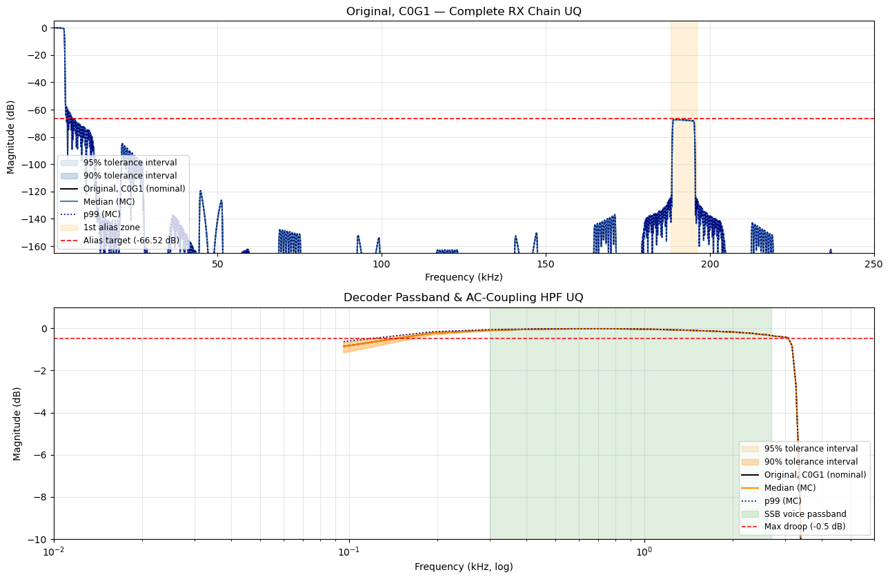
    


    
    Opt. single (C0G) — Component Table (Identical on 20m & 40m)
      ----------------------------------------------------------------------------------------------------
      Ref   Role                                  Value Build          Class     Tol       Min       Max      Exact [SI]
      ----------------------------------------------------------------------------------------------------
      c_ac  AC-coupling capacitor                  10uF 10uF           X5R       20%       8uF      12uF           1e-05
      r_in  Diff-amp input resistor                 301 301            R1pct      1%       298       304             301
      r_fb  Diff-amp feedback resistor              50k 50k            R1pct      1%     49.5k     50.5k           50000
      c_fb  Diff-amp feedback cap (pole 1)        200pF 200pF          C0G        5%     190pF     210pF           2e-10
      ra    Sallen-Key R (both resistors)         11.5k 11.5k          R1pct      1%    11.38k    11.62k           11500
      ca    Sallen-Key Ca (feedback cap)          1.6nF 1.6nF          C0G        5%    1.52nF    1.68nF         1.6e-09
      cb    Sallen-Key Cb (cap to ground)         750pF 750pF          C0G        5%   712.5pF   787.5pF         7.5e-10
      ----------------------------------------------------------------------------------------------------
    
    Opt. single (C0G) — Derived Quantities
      signal gain (r_fb / (r_in + R_src)) : 141.70 V/V = 43.03 dB (R_src = 51.85 ohm)
      AC-coupling HPF corner               : 45.11 Hz
      diff-amp feedback pole (pole 1)      : 15.915 kHz
      Sallen-Key f0 / Q                    : 12.634 kHz / 0.7303
      cascade -3 dB corner (nominal)       : 11.109 kHz | worst-corner fc_min: 10.083 kHz
      Q over tolerance corners             : 0.6947 .. 0.7678 (allowed 0.6..0.85)
      nominal alias / passband dev         : -69.71 dB (limit -66.52) / 0.306 dB (limit 0.5)
        [20m (2.2 nF Tayloe)] 128-Corner WC -> Alias: -68.15 dB | Droop: 0.364 dB | fc_min: 10.08 kHz | Q: 0.695..0.768
        [40m (4.4 nF Tayloe = 2x)] 128-Corner WC -> Alias: -68.38 dB | Droop: 0.364 dB | fc_min: 10.08 kHz | Q: 0.695..0.768
    
    Opt. single (C0G) - alias rejection statistics
    --------------------------------------------------------------------
    Level         Quantile      Response       Margin   Verdict
    Median       50.00000%       -69.69 dB      +3.17 dB      PASS
    1 sigma      84.13450%       -69.41 dB      +2.89 dB      PASS
    2 sigma      97.72500%       -69.14 dB      +2.62 dB      PASS
    3 sigma      99.86500%       -68.88 dB      +2.36 dB      PASS
    4 sigma      99.99683%       -68.67 dB      +2.15 dB      PASS
    Maximum     100.00000%       -68.65 dB      +2.13 dB      PASS
    --------------------------------------------------------------------


    

    


    
    Opt. parallel (C0G) — Component Table (Identical on 20m & 40m)
      ----------------------------------------------------------------------------------------------------
      Ref   Role                                  Value Build          Class     Tol       Min       Max      Exact [SI]
      ----------------------------------------------------------------------------------------------------
      c_ac  AC-coupling capacitor                  10uF 10uF           X5R       20%       8uF      12uF           1e-05
      r_in  Diff-amp input resistor                 301 301            R1pct      1%       298       304             301
      r_fb  Diff-amp feedback resistor              50k 50k            R1pct      1%     49.5k     50.5k           50000
      c_fb  Diff-amp feedback cap (pole 1)        185pF 75pF+110pF     C0G        5%   175.8pF   194.3pF        1.85e-10
      ra    Sallen-Key R (both resistors)         11.8k 11.8k          R1pct      1%    11.68k    11.92k           11800
      ca    Sallen-Key Ca (feedback cap)         1.78nF 680pF+1.1nF    C0G        5%   1.691nF   1.869nF        1.78e-09
      cb    Sallen-Key Cb (cap to ground)         688pF 68pF+620pF     C0G        5%   653.6pF   722.4pF        6.88e-10
      ----------------------------------------------------------------------------------------------------
    
    Opt. parallel (C0G) — Derived Quantities
      signal gain (r_fb / (r_in + R_src)) : 141.70 V/V = 43.03 dB (R_src = 51.85 ohm)
      AC-coupling HPF corner               : 45.11 Hz
      diff-amp feedback pole (pole 1)      : 17.206 kHz
      Sallen-Key f0 / Q                    : 12.188 kHz / 0.8042
      cascade -3 dB corner (nominal)       : 11.979 kHz | worst-corner fc_min: 11.012 kHz
      Q over tolerance corners             : 0.7650 .. 0.8455 (allowed 0.6..0.85)
      nominal alias / passband dev         : -69.73 dB (limit -66.52) / 0.215 dB (limit 0.5)
        [20m (2.2 nF Tayloe)] 128-Corner WC -> Alias: -68.17 dB | Droop: 0.267 dB | fc_min: 11.01 kHz | Q: 0.765..0.846
        [40m (4.4 nF Tayloe = 2x)] 128-Corner WC -> Alias: -68.40 dB | Droop: 0.267 dB | fc_min: 11.01 kHz | Q: 0.765..0.846
    
    Opt. parallel (C0G) - alias rejection statistics
    --------------------------------------------------------------------
    Level         Quantile      Response       Margin   Verdict
    Median       50.00000%       -69.71 dB      +3.19 dB      PASS
    1 sigma      84.13450%       -69.43 dB      +2.91 dB      PASS
    2 sigma      97.72500%       -69.16 dB      +2.64 dB      PASS
    3 sigma      99.86500%       -68.89 dB      +2.37 dB      PASS
    4 sigma      99.99683%       -68.68 dB      +2.16 dB      PASS
    Maximum     100.00000%       -68.67 dB      +2.15 dB      PASS
    --------------------------------------------------------------------


    
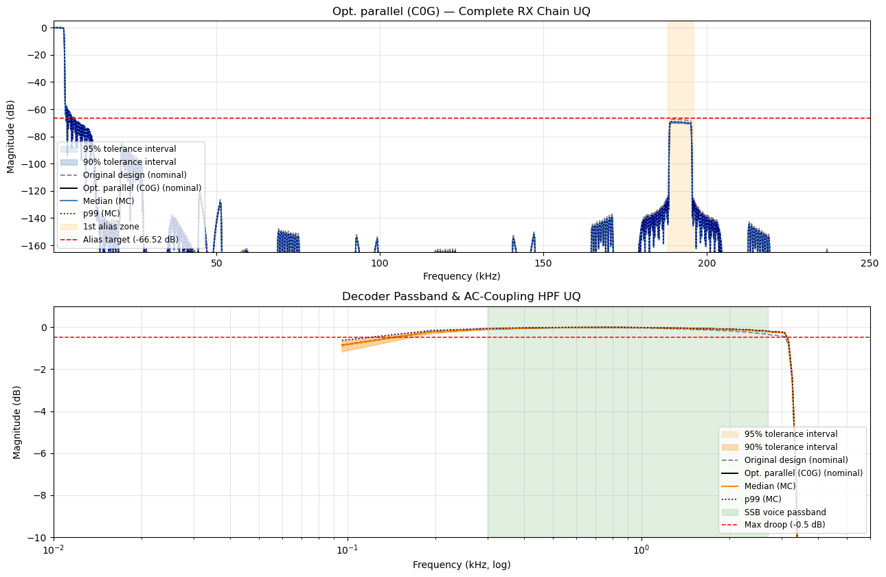
    


    
    Opt. single (any) — Component Table (Identical on 20m & 40m)
      ----------------------------------------------------------------------------------------------------
      Ref   Role                                  Value Build          Class     Tol       Min       Max      Exact [SI]
      ----------------------------------------------------------------------------------------------------
      c_ac  AC-coupling capacitor                  10uF 10uF           X5R       20%       8uF      12uF           1e-05
      r_in  Diff-amp input resistor                 301 301            R1pct      1%       298       304             301
      r_fb  Diff-amp feedback resistor              50k 50k            R1pct      1%     49.5k     50.5k           50000
      c_fb  Diff-amp feedback cap (pole 1)        200pF 200pF          C0G1       1%     198pF     202pF           2e-10
      ra    Sallen-Key R (both resistors)         11.3k 11.3k          R1pct      1%    11.19k    11.41k           11300
      ca    Sallen-Key Ca (feedback cap)          1.6nF 1.6nF          C0G1       1%   1.584nF   1.616nF         1.6e-09
      cb    Sallen-Key Cb (cap to ground)         680pF 680pF          C0G1       1%   673.2pF   686.8pF         6.8e-10
      ----------------------------------------------------------------------------------------------------
    
    Opt. single (any) — Derived Quantities
      signal gain (r_fb / (r_in + R_src)) : 141.70 V/V = 43.03 dB (R_src = 51.85 ohm)
      AC-coupling HPF corner               : 45.11 Hz
      diff-amp feedback pole (pole 1)      : 15.915 kHz
      Sallen-Key f0 / Q                    : 13.503 kHz / 0.7670
      cascade -3 dB corner (nominal)       : 12.096 kHz | worst-corner fc_min: 11.551 kHz
      Q over tolerance corners             : 0.7593 .. 0.7747 (allowed 0.6..0.85)
      nominal alias / passband dev         : -68.55 dB (limit -66.52) / 0.276 dB (limit 0.5)
        [20m (2.2 nF Tayloe)] 128-Corner WC -> Alias: -68.03 dB | Droop: 0.290 dB | fc_min: 11.55 kHz | Q: 0.759..0.775
        [40m (4.4 nF Tayloe = 2x)] 128-Corner WC -> Alias: -68.26 dB | Droop: 0.290 dB | fc_min: 11.55 kHz | Q: 0.759..0.775
    
    Opt. single (any) - alias rejection statistics
    --------------------------------------------------------------------
    Level         Quantile      Response       Margin   Verdict
    Median       50.00000%       -68.55 dB      +2.03 dB      PASS
    1 sigma      84.13450%       -68.46 dB      +1.94 dB      PASS
    2 sigma      97.72500%       -68.37 dB      +1.85 dB      PASS
    3 sigma      99.86500%       -68.29 dB      +1.77 dB      PASS
    4 sigma      99.99683%       -68.22 dB      +1.70 dB      PASS
    Maximum     100.00000%       -68.22 dB      +1.70 dB      PASS
    --------------------------------------------------------------------


    

    


    
    Opt. parallel (any) — Component Table (Identical on 20m & 40m)
      ----------------------------------------------------------------------------------------------------
      Ref   Role                                  Value Build          Class     Tol       Min       Max      Exact [SI]
      ----------------------------------------------------------------------------------------------------
      c_ac  AC-coupling capacitor                  10uF 10uF           X5R       20%       8uF      12uF           1e-05
      r_in  Diff-amp input resistor                 301 301            R1pct      1%       298       304             301
      r_fb  Diff-amp feedback resistor              50k 50k            R1pct      1%     49.5k     50.5k           50000
      c_fb  Diff-amp feedback cap (pole 1)        171pF 51pF+120pF     C0G1       1%   169.3pF   172.7pF        1.71e-10
      ra    Sallen-Key R (both resistors)         10.5k 10.5k          R1pct      1%    10.39k    10.61k           10500
      ca    Sallen-Key Ca (feedback cap)         1.92nF 820pF+1.1nF    C0G1       1%   1.901nF   1.939nF        1.92e-09
      cb    Sallen-Key Cb (cap to ground)         680pF 680pF          C0G1       1%   673.2pF   686.8pF         6.8e-10
      ----------------------------------------------------------------------------------------------------
    
    Opt. parallel (any) — Derived Quantities
      signal gain (r_fb / (r_in + R_src)) : 141.70 V/V = 43.03 dB (R_src = 51.85 ohm)
      AC-coupling HPF corner               : 45.11 Hz
      diff-amp feedback pole (pole 1)      : 18.615 kHz
      Sallen-Key f0 / Q                    : 13.266 kHz / 0.8402
      cascade -3 dB corner (nominal)       : 13.402 kHz | worst-corner fc_min: 12.885 kHz
      Q over tolerance corners             : 0.8318 .. 0.8486 (allowed 0.6..0.85)
      nominal alias / passband dev         : -67.65 dB (limit -66.52) / 0.186 dB (limit 0.5)
        [20m (2.2 nF Tayloe)] 128-Corner WC -> Alias: -67.13 dB | Droop: 0.199 dB | fc_min: 12.88 kHz | Q: 0.832..0.849
        [40m (4.4 nF Tayloe = 2x)] 128-Corner WC -> Alias: -67.36 dB | Droop: 0.199 dB | fc_min: 12.88 kHz | Q: 0.832..0.849
    
    Opt. parallel (any) - alias rejection statistics
    --------------------------------------------------------------------
    Level         Quantile      Response       Margin   Verdict
    Median       50.00000%       -67.65 dB      +1.13 dB      PASS
    1 sigma      84.13450%       -67.56 dB      +1.04 dB      PASS
    2 sigma      97.72500%       -67.47 dB      +0.95 dB      PASS
    3 sigma      99.86500%       -67.39 dB      +0.87 dB      PASS
    4 sigma      99.99683%       -67.32 dB      +0.80 dB      PASS
    Maximum     100.00000%       -67.32 dB      +0.80 dB      PASS
    --------------------------------------------------------------------


    
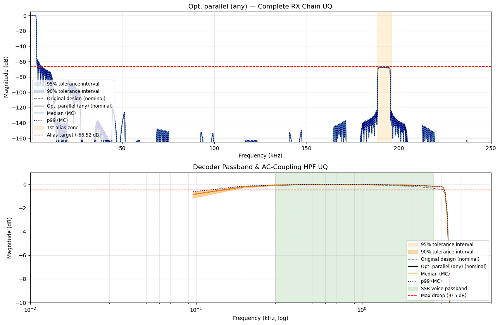
    


      Opt. single (C0G): 13 feasible / 31 E96 values of ra in 6.8–14.0 kOhm


    
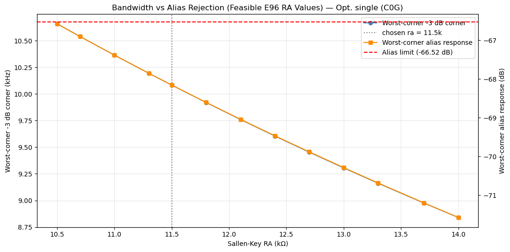
    


      Opt. parallel (C0G): 11 feasible / 31 E96 values of ra in 6.8–14.0 kOhm


    
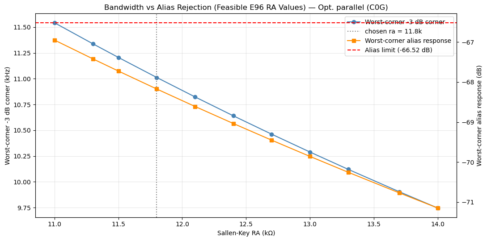
    


      Opt. single (any): 13 feasible / 31 E96 values of ra in 6.8–14.0 kOhm


    
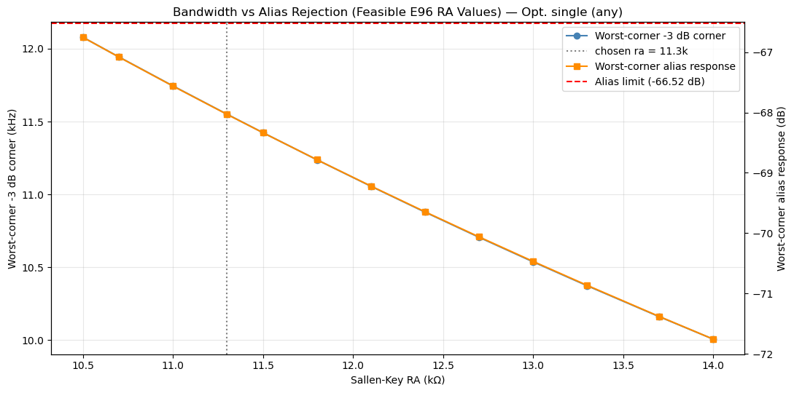
    


      Opt. parallel (any): 14 feasible / 31 E96 values of ra in 6.8–14.0 kOhm


    
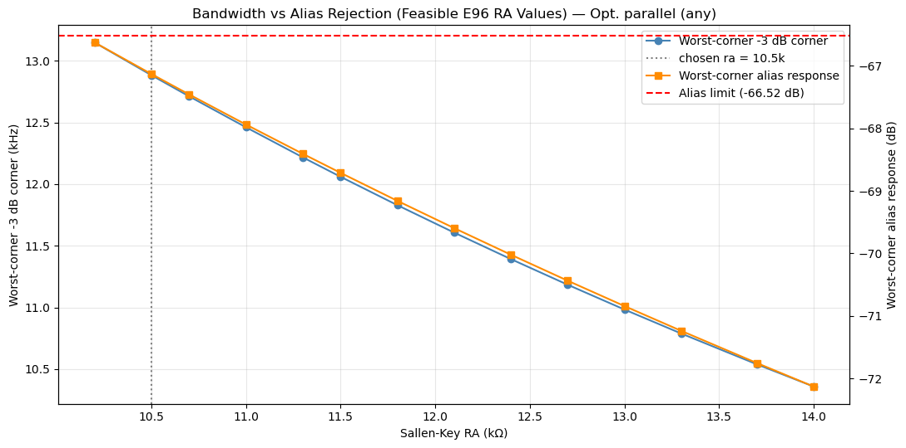
    


    
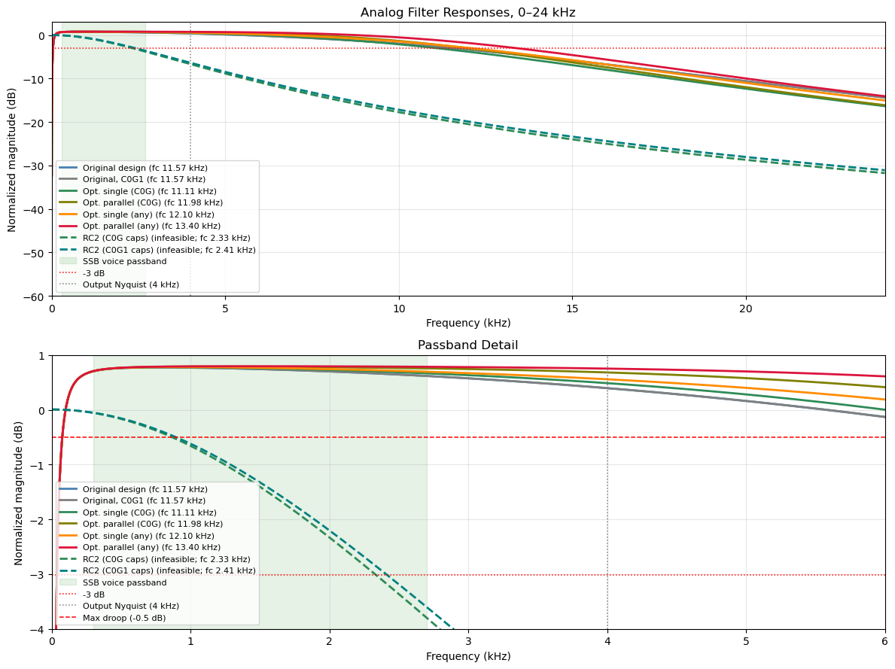
    


    
    ======================================================================================
    3B. FINAL COMPARISON — ARCH A DESIGNS & PASSIVE RC2
    ======================================================================================
    Alias zone 188.0–196.0 kHz | Target -66.52 dB
    
    Components (value [class]); a+b = two caps in parallel
                                             Original design      Original, C0G1   Opt. single (C0G) Opt. parallel (C0G)   Opt. single (any) Opt. parallel (any)
    ------------------------------------------------------------------------------------------------------------------------------------------------------------
    c_ac AC-coupling capacitor                    10uF [X5R]          10uF [X5R]          10uF [X5R]          10uF [X5R]          10uF [X5R]          10uF [X5R]
    r_in Diff-amp input resistor                 301 [R1pct]         301 [R1pct]         301 [R1pct]         301 [R1pct]         301 [R1pct]         301 [R1pct]
    r_fb Diff-amp feedback resistor              50k [R1pct]         50k [R1pct]         50k [R1pct]         50k [R1pct]         50k [R1pct]         50k [R1pct]
    c_fb Diff-amp feedback cap (pole 1)          220pF [C0G]        220pF [C0G1]         200pF [C0G]    75pF+110pF [C0G]        200pF [C0G1]   51pF+120pF [C0G1]
    ra Sallen-Key R (both resistors)             10k [R1pct]         10k [R1pct]       11.5k [R1pct]       11.8k [R1pct]       11.3k [R1pct]       10.5k [R1pct]
    ca Sallen-Key Ca (feedback cap)              1.5nF [C0G]        1.5nF [C0G1]         1.6nF [C0G]   680pF+1.1nF [C0G]        1.6nF [C0G1]  820pF+1.1nF [C0G1]
    cb Sallen-Key Cb (cap to ground)             750pF [C0G]        750pF [C0G1]         750pF [C0G]    68pF+620pF [C0G]        680pF [C0G1]        680pF [C0G1]
    
    Performance (20m Base & 40m 2x Tayloe)
                                             Original design      Original, C0G1   Opt. single (C0G) Opt. parallel (C0G)   Opt. single (any) Opt. parallel (any)
    ------------------------------------------------------------------------------------------------------------------------------------------------------------
    nominal fc [kHz]                                  11.573              11.573              11.109              11.979              12.096              13.402
    worst-corner fc [kHz]                             10.395              10.977              10.083              11.012              11.551              12.885
    worst-corner fc vs original                        +0.0%               +5.6%               -3.0%               +5.9%              +11.1%              +24.0%
    nominal alias 20m [dB]                            -67.47              -67.47              -69.71              -69.73              -68.55              -67.65
    worst-corner alias 20m [dB]                       -65.91              -66.95              -68.15              -68.17              -68.03              -67.13
    worst-corner alias 40m (2x) [dB]                  -66.14              -67.18              -68.38              -68.40              -68.26              -67.36
    alias margin 20m vs -66.52 dB                      -0.61               +0.43               +1.63               +1.65               +1.51               +0.61
    worst-corner passband dev [dB]                     0.405               0.368               0.364               0.267               0.290               0.199
    Q over corners                              0.673..0.743        0.700..0.714        0.695..0.768        0.765..0.846        0.759..0.775        0.832..0.849
    ADC residual [LSB] (limit 0.5)                  1.46e-10            1.46e-10            1.46e-10            1.46e-10            1.46e-10            1.46e-10
    signal gain [dB]                                    43.0                43.0                43.0                43.0                43.0                43.0
    # parallel-built caps                                  0                   0                   0                   3                   0                   2
    # C0G1 (1%) caps                                       0                   3                   0                   0                   3                   3
    relative cap cost (model units)                     0.00                1.50                0.00                0.12                1.50                1.58
    verdict (20m+40m corners+settle)                    FAIL                PASS                PASS                PASS                PASS                PASS
    
    PASSIVE RC2 COMPARISON (Same Chain, Corners, Pools & Settling)
                                              RC2 (C0G caps)     RC2 (C0G1 caps)
    ----------------------------------------------------------------------------
    R1                                           324 [R1pct]         309 [R1pct]
    R2                                         3.65k [R1pct]       3.24k [R1pct]
    C1                                           100nF [C0G]        100nF [C0G1]
    C2                                            12nF [C0G]         13nF [C0G1]
    worst-corner alias [dB]                           -66.51              -66.54
    worst-corner passband dev [dB]                     4.324               3.884
    worst-corner fc [kHz]                              2.202               2.367
    ADC residual [LSB] (limit 0.5)                      2.15                1.91
    verdict                                       INFEASIBLE          INFEASIBLE
    
    ======================================================================================
    4. CONSOLIDATED 20m JLCPCB BASE BOM & 40m CONVERSION CHECKLIST (ALL FEASIBLE DESIGNS)
    ======================================================================================
    
    [STAGE 1: CLASS-E PA — T1_A (Ropt = 7.96 Ω) (Ropt = 7.96 Ω)]
      20m JLCPCB Base : Cext = 240pF+trim(18pF) | L1 = 150nH | L2 = 220nH | C2 = 560pF
      40m Hand Add-On : +270pF parallel on Cext DNP pad | +150nH in series on L1 (remove 0R) | +220nH in series on L2 (remove 0R) | +510pF parallel on C2 DNP pad
    
    [STAGE 2: TX IMPEDANCE MATCH + HARMONIC LPF — ALL FEASIBLE DESIGNS]
    
      * DBL_LC_JA2GQP_MR_1C        [2 Reel(s), $6.00 setup] | FCC Margin 20m: +28.5dB (par) / +18.2dB (ideal) | 40m: +22.9dB (par) / +18.5dB (ideal)
        20m JLCPCB Base : C1=220pF+trim(18pF), L1=68nH, C2=430pF, C3=1nF, L2=270nH, C4=47pF, C5=390pF
        40m Target Build: C1=220pF+trim(18pF) || +220pF, L1=68nH+68nH, C2=430pF || +430pF, C3=1nF || +1nF, L2=270nH+270nH, C4=47pF || +47pF, C5=390pF || +390pF
    
      * DBL_LC_JA2GQP_MR_2C        [2 Reel(s), $6.00 setup] | FCC Margin 20m: +34.0dB (par) / +22.0dB (ideal) | 40m: +27.7dB (par) / +22.3dB (ideal)
        20m JLCPCB Base : C1=39pF+160pF+trim(18pF), L1=68nH, C2=220pF+220pF, C3=56pF+1nF, L2=270nH, C4=22pF+24pF, C5=82pF+330pF
        40m Target Build: C1=39pF+160pF+trim(18pF) || +39pF+160pF, L1=68nH+68nH, C2=220pF+220pF || +220pF+220pF, C3=56pF+1nF || +56pF+1nF, L2=270nH+270nH, C4=22pF+24pF || +22pF+24pF, C5=82pF+330pF || +82pF+330pF
    
      * DBL_LC_4Element_1R_1C      [1 Reel(s), $3.00 setup] | FCC Margin 20m: +7.9dB (par) / +7.9dB (ideal) | 40m: +7.8dB (par) / +7.8dB (ideal)
        20m JLCPCB Base : C1=4.7pF+trim(18pF), L2=150nH, C2=200pF, C3=560pF
        40m Target Build: C1=4.7pF+trim(18pF) || +4.7pF, L2=150nH+150nH, C2=200pF || +200pF, C3=560pF || +560pF
    
      * DBL_LC_4Element_1R_2C      [1 Reel(s), $3.00 setup] | FCC Margin 20m: +7.3dB (par) / +7.3dB (ideal) | 40m: +7.2dB (par) / +7.2dB (ideal)
        20m JLCPCB Base : C1=4.7pF+trim(18pF), L2=150nH, C2=91pF+110pF, C3=91pF+430pF
        40m Target Build: C1=4.7pF+trim(18pF) || +4.7pF, L2=150nH+150nH, C2=91pF+110pF || +91pF+110pF, C3=91pF+430pF || +91pF+430pF
    
      * DBL_LC_4Element_MR_1C      [1 Reel(s), $3.00 setup] | FCC Margin 20m: +7.9dB (par) / +7.9dB (ideal) | 40m: +7.8dB (par) / +7.8dB (ideal)
        20m JLCPCB Base : C1=4.7pF+trim(18pF), L2=150nH, C2=200pF, C3=560pF
        40m Target Build: C1=4.7pF+trim(18pF) || +4.7pF, L2=150nH+150nH, C2=200pF || +200pF, C3=560pF || +560pF
    
      * DBL_LC_4Element_MR_2C      [1 Reel(s), $3.00 setup] | FCC Margin 20m: +7.3dB (par) / +7.3dB (ideal) | 40m: +7.2dB (par) / +7.2dB (ideal)
        20m JLCPCB Base : C1=4.7pF+trim(18pF), L2=150nH, C2=91pF+110pF, C3=91pF+430pF
        40m Target Build: C1=4.7pF+trim(18pF) || +4.7pF, L2=150nH+150nH, C2=91pF+110pF || +91pF+110pF, C3=91pF+430pF || +91pF+430pF
    
      * DBL_LC_LMatch_WB2CBA_MR_1C [2 Reel(s), $6.00 setup] | FCC Margin 20m: +9.2dB (par) / +5.2dB (ideal) | 40m: +7.3dB (par) / +5.3dB (ideal)
        20m JLCPCB Base : Cm=910pF+trim(18pF), Lm=120nH, C1=1.5nF, L2=330nH, C3=510pF, L4=330nH, C5=27pF
        40m Target Build: Cm=910pF+trim(18pF) || +910pF, Lm=120nH+120nH, C1=1.5nF || +1.5nF, L2=330nH+330nH, C3=510pF || +510pF, L4=330nH+330nH, C5=27pF || +27pF
    
      * DBL_LC_LMatch_WB2CBA_MR_2C [3 Reel(s), $9.00 setup] | FCC Margin 20m: +7.0dB (par) / +3.2dB (ideal) | 40m: +5.1dB (par) / +3.3dB (ideal)
        20m JLCPCB Base : Cm=180pF+750pF+trim(18pF), Lm=120nH, C1=510pF+910pF, L2=330nH, C3=68pF+430pF, L4=270nH, C5=36pF
        40m Target Build: Cm=180pF+750pF+trim(18pF) || +180pF+750pF, Lm=120nH+120nH, C1=510pF+910pF || +510pF+910pF, L2=330nH+330nH, C3=68pF+430pF || +68pF+430pF, L4=270nH+270nH, C5=36pF || +36pF
    
      * DBL_C_JA2GQP_MR_1C         [2 Reel(s), $6.00 setup] | FCC Margin 20m: +41.5dB (par) / +30.2dB (ideal) | 40m: +41.2dB (par) / +37.1dB (ideal)
        20m JLCPCB Base : C1=510pF+trim(18pF), L1=150nH, C2=200pF, C3=910pF, L2=390nH, C4=30pF, C5=300pF
        40m Target Build: C1=510pF+trim(18pF) || +1.5nF, L1=150nH, C2=200pF || +620pF, C3=910pF || +2.7nF, L2=390nH, C4=30pF || +91pF, C5=300pF || +910pF
    
      * DBL_C_JA2GQP_MR_2C         [2 Reel(s), $6.00 setup] | FCC Margin 20m: +43.5dB (par) / +32.4dB (ideal) | 40m: +42.5dB (par) / +38.7dB (ideal)
        20m JLCPCB Base : C1=62pF+470pF+trim(18pF), L1=150nH, C2=91pF+110pF, C3=75pF+820pF, L2=470nH, C4=8.2pF+16pF, C5=68pF+220pF
        40m Target Build: C1=62pF+470pF+trim(18pF) || +1.6nF, L1=150nH, C2=91pF+110pF || +620pF, C3=75pF+820pF || +2.7nF, L2=470nH, C4=8.2pF+16pF || +75pF, C5=68pF+220pF || +820pF
    
      * OPT_LC_JA2GQP_1R_2C        [2 Reel(s), $6.00 setup] | FCC Margin 20m: +10.2dB (par) / +0.4dB (ideal) | 40m: +6.5dB (par) / +3.9dB (ideal)
        20m JLCPCB Base : C1=4.7pF+trim(18pF), L1=120nH, C2=91pF+160pF, C3=91pF+330pF, L2=120nH, C4=47pF+62pF, C5=75pF+160pF
        40m Target Build: C1=4.7pF+trim(18pF), L1=220nH, C2=560pF, C3=36pF+820pF, L2=220nH, C4=5.6pF+240pF, C5=470pF
    
      * OPT_LC_JA2GQP_MR_1C        [4 Reel(s), $12.00 setup] | FCC Margin 20m: +25.5dB (par) / +18.2dB (ideal) | 40m: +29.5dB (par) / +26.3dB (ideal)
        20m JLCPCB Base : C1=430pF+trim(18pF), L1=120nH, C2=240pF, C3=820pF, L2=330nH, C4=36pF, C5=240pF
        40m Target Build: C1=180pF+trim(18pF), L1=220nH, C2=560pF, C3=1.6nF, L2=680nH, C4=75pF, C5=470pF
    
      * OPT_LC_JA2GQP_MR_2C        [4 Reel(s), $12.00 setup] | FCC Margin 20m: +35.6dB (par) / +24.8dB (ideal) | 40m: +29.2dB (par) / +26.0dB (ideal)
        20m JLCPCB Base : C1=9.1pF+430pF+trim(18pF), L1=120nH, C2=91pF+160pF, C3=360pF+510pF, L2=330nH, C4=6.8pF+30pF, C5=9.1pF+240pF
        40m Target Build: C1=6.2pF+180pF+trim(18pF), L1=220nH, C2=560pF, C3=82pF+1.5nF, L2=680nH, C4=8.2pF+68pF, C5=91pF+360pF
    
      * OPT_LC_4Element_1R_1C      [2 Reel(s), $6.00 setup] | FCC Margin 20m: +7.9dB (par) / +7.9dB (ideal) | 40m: +6.3dB (par) / +6.3dB (ideal)
        20m JLCPCB Base : C1=4.7pF+trim(18pF), L2=150nH, C2=200pF, C3=560pF
        40m Target Build: C1=4.7pF+trim(18pF), L2=270nH, C2=470pF, C3=1.1nF
    
      * OPT_LC_4Element_1R_2C      [2 Reel(s), $6.00 setup] | FCC Margin 20m: +7.2dB (par) / +7.2dB (ideal) | 40m: +7.1dB (par) / +7.1dB (ideal)
        20m JLCPCB Base : C1=4.7pF+trim(18pF), L2=150nH, C2=91pF+110pF, C3=7.5pF+510pF
        40m Target Build: C1=7.5pF+9.1pF+trim(18pF), L2=330nH, C2=12pF+360pF, C3=51pF+910pF
    
      * OPT_LC_4Element_MR_1C      [2 Reel(s), $6.00 setup] | FCC Margin 20m: +7.9dB (par) / +7.9dB (ideal) | 40m: +6.3dB (par) / +6.3dB (ideal)
        20m JLCPCB Base : C1=4.7pF+trim(18pF), L2=150nH, C2=200pF, C3=560pF
        40m Target Build: C1=4.7pF+trim(18pF), L2=270nH, C2=470pF, C3=1.1nF
    
      * OPT_LC_4Element_MR_2C      [2 Reel(s), $6.00 setup] | FCC Margin 20m: +7.2dB (par) / +7.2dB (ideal) | 40m: +7.1dB (par) / +7.1dB (ideal)
        20m JLCPCB Base : C1=4.7pF+trim(18pF), L2=150nH, C2=91pF+110pF, C3=7.5pF+510pF
        40m Target Build: C1=7.5pF+9.1pF+trim(18pF), L2=330nH, C2=12pF+360pF, C3=51pF+910pF
    
      * OPT_LC_LMatch_WB2CBA_MR_1C [6 Reel(s), $18.00 setup] | FCC Margin 20m: +4.5dB (par) / +0.3dB (ideal) | 40m: +3.6dB (par) / +1.7dB (ideal)
        20m JLCPCB Base : Cm=910pF+trim(18pF), Lm=100nH, C1=1.5nF, L2=270nH, C3=560pF, L4=330nH, C5=56pF
        40m Target Build: Cm=510pF+trim(18pF), Lm=220nH, C1=2.4nF, L2=680nH, C3=1nF, L4=1uH, C5=180pF
    
      * OPT_C_JA2GQP_MR_1C         [2 Reel(s), $6.00 setup] | FCC Margin 20m: +25.5dB (par) / +18.2dB (ideal) | 40m: +10.7dB (par) / +4.6dB (ideal)
        20m JLCPCB Base : C1=430pF+trim(18pF), L1=120nH, C2=240pF, C3=820pF, L2=330nH, C4=36pF, C5=240pF
        40m Target Build: C1=4.7pF+trim(18pF), L1=120nH, C2=1nF, C3=820pF, L2=330nH, C4=160pF, C5=820pF
    
      * OPT_C_JA2GQP_MR_2C         [2 Reel(s), $6.00 setup] | FCC Margin 20m: +35.6dB (par) / +24.8dB (ideal) | 40m: +13.5dB (par) / +8.5dB (ideal)
        20m JLCPCB Base : C1=9.1pF+430pF+trim(18pF), L1=120nH, C2=91pF+160pF, C3=360pF+510pF, L2=330nH, C4=6.8pF+30pF, C5=9.1pF+240pF
        40m Target Build: C1=4.7pF+trim(18pF), L1=120nH, C2=18pF+1nF, C3=43pF+820pF, L2=330nH, C4=43pF+120pF, C5=47pF+750pF
    
    [STAGE 3: RX TAYLOE MIXER + ACTIVE AUDIO FILTER — ALL FEASIBLE DESIGNS]
      20m JLCPCB Base (Tayloe) : 1x 2.2nF C0G per I/Q branch (4x total)
      40m Hand Add-On (Tayloe) : +1x 2.2nF C0G parallel per I/Q branch (-> 4.4nF total)
      Active Audio Filter      : 100% IDENTICAL on 20m & 40m (zero rework required):
        * Original, C0G1        : c_fb=220pF [C0G1], ra=10k [R1pct], ca=1.5nF [C0G1], cb=750pF [C0G1]
        * Opt. single (C0G)     : c_fb=200pF [C0G], ra=11.5k [R1pct], ca=1.6nF [C0G], cb=750pF [C0G]
        * Opt. parallel (C0G)   : c_fb=75pF+110pF [C0G], ra=11.8k [R1pct], ca=680pF+1.1nF [C0G], cb=68pF+620pF [C0G]
        * Opt. single (any)     : c_fb=200pF [C0G1], ra=11.3k [R1pct], ca=1.6nF [C0G1], cb=680pF [C0G1]
        * Opt. parallel (any)   : c_fb=51pF+120pF [C0G1], ra=10.5k [R1pct], ca=820pF+1.1nF [C0G1], cb=680pF [C0G1]


```python

```
