```python
# ==============================================================================
# UNIFIED QRP TRANSCEIVER OPTIMIZER (20m JLCPCB Base -> 40m 2x Add-On)
# Pure Functional Architecture | Structural Pattern Matching (Python 3.10+)
# ==============================================================================
import itertools
import time
import warnings
import numpy as np
import pandas as pd
import matplotlib.pyplot as plt

from scipy.integrate import solve_ivp, cumulative_trapezoid
from scipy.interpolate import PchipInterpolator
from scipy.optimize import brentq, differential_evolution, minimize, milp, LinearConstraint, Bounds
from scipy.signal import firwin, freqz
from scipy.special import erfinv

warnings.filterwarnings("ignore")
pd.set_option("display.max_rows", None)
pd.set_option("display.max_columns", None)
pd.set_option("display.width", 1000)


# ==============================================================================
# LAYER 0: SHARED SYSTEM CONSTANTS, E-SERIES & PURE FORMATTERS
# ==============================================================================
F20 = 14.10e6
F40 = 7.05e6
BANDS = (
    {"name": "20m (14.10 MHz)", "f0": F20, "scale": 1.0, "q_l": 60.0},
    {"name": "40m (7.05 MHz)",  "f0": F40, "scale": 2.0, "q_l": 45.0},
)

E24 = np.array([
    1.0, 1.1, 1.2, 1.3, 1.5, 1.6, 1.8, 2.0, 2.2, 2.4, 2.7, 3.0,
    3.3, 3.6, 3.9, 4.3, 4.7, 5.1, 5.6, 6.2, 6.8, 7.5, 8.2, 9.1,
])
E12 = E24[::2]
E6 = E24[::4]
E3 = E24[::8]
E96 = np.round(10 ** (np.arange(96) / 96), 2)
E48 = E96[::2]
E192 = np.round(10 ** (np.arange(192) / 192), 2)

SERIES = {
    "E3": E3, "E6": E6, "E12": E12, "E24": E24,
    "E48": E48, "E96": E96, "E192": E192,
}


def expand_series(series_name: str, decades: tuple[float, ...], vmin: float = 0.0, vmax: float = np.inf) -> np.ndarray:
    arr = np.sort(np.concatenate([SERIES[series_name] * d for d in decades]))
    return arr[(arr >= vmin) & (arr <= vmax)]


def fmt_eng(v: float, unit: str = "") -> str:
    match v:
        case x if x >= 1e6:
            return f"{x / 1e6:.4g}M{unit}"
        case x if x >= 1e3:
            return f"{x / 1e3:.4g}k{unit}"
        case x if x >= 1.0:
            return f"{x:.4g}{unit}"
        case x if x >= 1e-3:
            return f"{x * 1e3:.4g}m{unit}"
        case x if x >= 1e-6:
            return f"{x * 1e6:.4g}u{unit}"
        case x if x >= 1e-9:
            return f"{x * 1e9:.4g}n{unit}"
        case _:
            return f"{v * 1e12:.4g}p{unit}"


def db(x: np.ndarray | float) -> np.ndarray | float:
    return 20.0 * np.log10(np.maximum(np.abs(x), 1e-15))


def section(title: str, width: int = 86) -> None:
    print("\n" + "=" * width)
    print(title)
    print("=" * width)


# ==============================================================================
# LAYER 1: CLASS-E EPC2037 GaN PA — DATASHEET, ANALYTICAL & COSS MODELS
# ==============================================================================
PA_SPEC = {
    "VDD": 4.85,
    "POUT_TARGET": 1.65,
    "F0": 14.0e6,
    "VDS_MAX": 100.0,
    "ID_MAX": 1.7,
    "RON_25": 0.400,
    "RON_MAX_25": 0.550,
    "QG": 115e-12,
    "VG": 5.0,
    "COSS_50": 6.5e-12,
    "QOSS_50": 600e-12,
    "COSS_TR": 12e-12,
    "COSS_ER": 9.5e-12,
    "COSS_50_MAX": 10e-12,
    "QOSS_50_MAX": 900e-12,
    "QGS": 32e-12,
    "QGD": 25e-12,
    "RG": 0.5,
    "CISS": 14e-12,
    "CRSS": 0.1e-12,
}

DS_FIG8_TJ = np.array([0.0, 25.0, 50.0, 75.0, 100.0, 125.0, 150.0])
DS_FIG8_RDS_NORM = np.array([0.85, 1.00, 1.15, 1.30, 1.48, 1.65, 1.80])
_RDS_CURVE = PchipInterpolator(DS_FIG8_TJ, DS_FIG8_RDS_NORM, extrapolate=False)

DS_FIG5_VDS = np.array([0.0, 5.0, 10.0, 15.0, 20.0, 25.0, 30.0, 40.0, 50.0, 60.0, 75.0, 100.0])
DS_FIG5_COSS = 1e-12 * np.array([22.0, 15.5, 11.5, 9.8, 8.5, 7.5, 7.0, 6.7, 6.5, 5.8, 5.1, 4.5])
DS_FIG5_CRSS = 1e-12 * np.array([2.0, 0.7, 0.2, 0.15, 0.1, 0.1, 0.1, 0.1, 0.1, 0.1, 0.08, 0.05])
_COSS_DIG = PchipInterpolator(DS_FIG5_VDS, DS_FIG5_COSS, extrapolate=False)

V_GRID = np.linspace(0.0, 150.0, 150001)
C_GRID = _COSS_DIG(np.clip(V_GRID, 0.0, 100.0))
Q_GRID = cumulative_trapezoid(C_GRID, V_GRID, initial=0.0)
E_GRID = cumulative_trapezoid(V_GRID * C_GRID, V_GRID, initial=0.0)
Q_RAW_50 = float(Q_GRID[np.argmin(np.abs(V_GRID - 50.0))])

_COSS_TAB = PchipInterpolator(V_GRID, C_GRID)
_QOSS_TAB = PchipInterpolator(V_GRID, Q_GRID)
_EOSS_TAB = PchipInterpolator(V_GRID, E_GRID)


def temperature_factor(tj: float) -> float:
    return float(_RDS_CURVE(tj))


def coss_const(v: np.ndarray | float) -> np.ndarray:
    return np.full_like(np.asarray(v, float), PA_SPEC["COSS_TR"])


def qoss_const(v: np.ndarray | float) -> np.ndarray:
    return PA_SPEC["COSS_TR"] * np.abs(np.asarray(v, float))


def eoss_const(v: np.ndarray | float) -> np.ndarray:
    return 0.5 * PA_SPEC["COSS_TR"] * np.asarray(v, float) ** 2


def coss_tab(v: np.ndarray | float) -> np.ndarray:
    return _COSS_TAB(np.clip(np.abs(v), 0.0, 150.0))


def qoss_tab(v: np.ndarray | float) -> np.ndarray:
    return np.sign(v) * _QOSS_TAB(np.abs(v))


def eoss_tab(v: np.ndarray | float) -> np.ndarray:
    return _EOSS_TAB(np.abs(v))


def analytical_class_e(vdd: float, pout: float, f0: float, coss_tr: float) -> dict:
    w0 = 2.0 * np.pi * f0
    a = 2.0 / np.sqrt(np.pi**2 + 4.0)
    phi = np.pi - np.arctan(2.0 / np.pi)
    kr = 2.0 * a**2
    kc = 2.0 * a**2 / np.pi
    ropt = kr * vdd**2 / pout
    csh = kc / (w0 * ropt)

    ir_norm = np.sqrt(2.0 / kr)
    idc_norm = a * ir_norm
    c_norm = kc / kr
    th = np.linspace(0.0, 2.0 * np.pi, 200001)
    vd_norm = np.zeros_like(th)
    off = th >= np.pi
    vd_norm[off] = (idc_norm * (th[off] - np.pi) + ir_norm * (np.cos(th[off] + phi) - np.cos(np.pi + phi))) / c_norm
    v1 = np.trapezoid(vd_norm * np.exp(-1j * th), th) / np.pi
    i1 = ir_norm * np.exp(1j * (phi - np.pi / 2.0))
    kl = (v1 / i1).imag / (v1 / i1).real

    l1 = kl * ropt / w0
    l2 = 3.0 * ropt / w0
    c2 = 1.0 / (w0**2 * l2)
    return {
        "a": a, "phi": phi, "KR": kr, "KC": kc, "KL": kl,
        "Ropt": ropt, "Csh": csh, "L1": l1, "L2": l2, "C2": c2,
        "LT": l1 + l2, "Cext_const": csh - coss_tr,
        "IDC_sk": pout / vdd, "IR_sk": np.sqrt(2.0 * pout / ropt),
    }


def make_device_model(kind: str, c_ext: float, r_on: float) -> dict:
    vg = np.linspace(0.0, 150.0, 150001)
    match kind:
        case "const":
            coss_f, qoss_f, eoss_f = coss_const, qoss_const, eoss_const
        case "nonlin":
            coss_f, qoss_f, eoss_f = coss_tab, qoss_tab, eoss_tab
        case _:
            raise ValueError(f"Unknown device model kind: {kind}")
    qg = float(c_ext) * vg + np.asarray(qoss_f(vg), float)
    return {
        "kind": kind,
        "Cext": float(c_ext),
        "Ron": float(r_on),
        "coss_f": coss_f,
        "qoss_f": qoss_f,
        "eoss_f": eoss_f,
        "vg": vg,
        "qg": qg,
    }


def dev_v_from_q(dev: dict, q: float) -> float:
    qf = float(q)
    if abs(qf) < 1e-30:
        return 0.0
    return float(np.sign(qf) * np.interp(abs(qf), dev["qg"], dev["vg"]))


def dev_e_total(dev: dict, v: np.ndarray | float) -> np.ndarray:
    arr = np.asarray(v, float)
    return 0.5 * dev["Cext"] * arr**2 + np.asarray(dev["eoss_f"](arr), float)


def simulate_cycle(dev: dict, i_dc: float, lt_val: float, c2_val: float, ropt_val: float, f0: float, warmup: int = 100, samples: int = 400) -> dict:
    t_per = 1.0 / f0
    th = 0.5 * t_per
    match dev:
        case {"kind": "const", "Cext": c_ext, "Ron": r_on}:
            csh = c_ext + PA_SPEC["COSS_TR"]

            def f_on(_, y):
                i_l, v_c2 = y
                return [(r_on * (i_dc - i_l) - v_c2 - ropt_val * i_l) / lt_val, i_l / c2_val]

            def f_off(_, y):
                v_d, i_l, v_c2 = y
                return [(i_dc - i_l) / csh, (v_d - v_c2 - ropt_val * i_l) / lt_val, i_l / c2_val]

            i_l, v_c2 = 0.0, 0.0
            for _ in range(warmup):
                s1 = solve_ivp(f_on, [0.0, th], [i_l, v_c2], method="LSODA", rtol=1e-10, atol=1e-13, max_step=th / 20.0)
                i_l, v_c2 = float(s1.y[0, -1]), float(s1.y[1, -1])
                s2 = solve_ivp(f_off, [0.0, th], [r_on * (i_dc - i_l), i_l, v_c2], method="LSODA", rtol=1e-10, atol=1e-13, max_step=th / 20.0)
                i_l, v_c2 = float(s2.y[1, -1]), float(s2.y[2, -1])

            s1 = solve_ivp(f_on, [0.0, th], [i_l, v_c2], method="LSODA", rtol=1e-10, atol=1e-13, dense_output=True, max_step=th / 20.0)
            i_l_on, v_c2_on = float(s1.y[0, -1]), float(s1.y[1, -1])
            s2 = solve_ivp(f_off, [0.0, th], [r_on * (i_dc - i_l_on), i_l_on, v_c2_on], method="LSODA", rtol=1e-10, atol=1e-13, dense_output=True, max_step=th / 20.0)

            t_on = np.linspace(0.0, th, samples + 1)
            t_off = np.linspace(0.0, th, samples + 1)
            y_on, y_off = s1.sol(t_on), s2.sol(t_off)
            t = np.concatenate([t_on, th + t_off[1:]])
            v_d = np.concatenate([r_on * (i_dc - y_on[0]) if r_on > 0 else np.zeros_like(t_on), y_off[0][1:]])
            i_l_f = np.concatenate([y_on[0], y_off[1][1:]])
            i_sw = np.concatenate([i_dc - y_on[0], np.zeros_like(y_off[1][1:])])
            return {
                "t": t, "v_D": v_d, "i_L": i_l_f, "i_sw": i_sw, "q": csh * v_d,
                "Coss": np.full_like(v_d, PA_SPEC["COSS_TR"]),
                "v_avg": float(np.trapezoid(v_d, t) / t_per),
                "v_peak": float(np.max(v_d)), "v_min": float(np.min(v_d)),
                "v_turnon": float(s2.sol(th)[0]), "i_turnon": float(s2.sol(th)[1]),
            }

        case {"kind": "nonlin", "Ron": r_on}:
            def f_on(_, y):
                q, i_l, v_2 = y
                v_d = dev_v_from_q(dev, q)
                return [i_dc - i_l - v_d / r_on, (v_d - v_2 - ropt_val * i_l) / lt_val, i_l / c2_val]

            def f_off(_, y):
                q, i_l, v_2 = y
                v_d = dev_v_from_q(dev, q)
                return [i_dc - i_l, (v_d - v_2 - ropt_val * i_l) / lt_val, i_l / c2_val]

            y = np.zeros(3)
            for _ in range(warmup):
                s1 = solve_ivp(f_on, (0.0, th), y, method="LSODA", rtol=2e-8, atol=1e-12, max_step=th / 20.0)
                s2 = solve_ivp(f_off, (0.0, th), s1.y[:, -1], method="LSODA", rtol=2e-8, atol=1e-12, max_step=th / 20.0)
                y = s2.y[:, -1]

            s1 = solve_ivp(f_on, (0.0, th), y, method="LSODA", rtol=2e-8, atol=1e-12, dense_output=True, max_step=th / 20.0)
            s2 = solve_ivp(f_off, (0.0, th), s1.y[:, -1], method="LSODA", rtol=2e-8, atol=1e-12, dense_output=True, max_step=th / 20.0)
            t1 = np.linspace(0.0, th, samples, endpoint=False)
            t2 = np.linspace(0.0, th, samples, endpoint=False)
            y1, y2 = s1.sol(t1), s2.sol(t2)
            q = np.r_[y1[0], y2[0]]
            i_l = np.r_[y1[1], y2[1]]
            t = np.r_[t1, th + t2]
            v_d = np.array([dev_v_from_q(dev, z) for z in q])
            i_sw = np.r_[v_d[:samples] / r_on, np.zeros(samples)]
            coss_wave = np.array([dev["coss_f"](v) for v in v_d])
            return {
                "t": t, "q": q, "v_D": v_d, "i_L": i_l, "i_sw": i_sw, "Coss": coss_wave,
                "v_avg": float(np.trapezoid(v_d, t) / t_per),
                "v_peak": float(np.max(v_d)), "v_min": float(np.min(v_d)),
                "v_turnon": float(dev_v_from_q(dev, s2.y[0, -1])),
                "i_turnon": float(s2.y[1, -1]),
            }

        case _:
            raise ValueError(f"Unsupported device model: {dev}")

def solve_dc_current(dev: dict, lt_val: float, c2_val: float, ropt_val: float, vdd: float, f0: float, idc_est: float, warmup: int = 50, samples: int = 200) -> tuple[dict, float]:
    match dev["kind"]:
        case "const":
            lo, hi = 0.7 * idc_est, 1.3 * idc_est
            w_solve, s_solve = 200, 500
            w_final, s_final = 500, 1000
        case "nonlin":
            lo, hi = 0.05 * idc_est, 3.0 * idc_est
            w_solve, s_solve = warmup, samples
            w_final, s_final = warmup * 2, samples * 2
        case _:
            raise ValueError(f"Unknown device kind: {dev['kind']}")

    def resid(i_dc: float) -> float:
        return simulate_cycle(dev, i_dc, lt_val, c2_val, ropt_val, f0, warmup=w_solve, samples=s_solve)["v_avg"] - vdd

    i_sol = float(brentq(resid, lo, hi, xtol=1e-8))
    return simulate_cycle(dev, i_sol, lt_val, c2_val, ropt_val, f0, warmup=w_final, samples=s_final), i_sol


def run_pa_point(kind: str, r_on: float, l1_val: float, l2_val: float, c2_val: float, ropt_val: float, c_ext: float, vdd: float, f0: float, pgate: float, label: str = "") -> dict:
    t_per = 1.0 / f0
    idc_est = PA_SPEC["POUT_TARGET"] / vdd
    dev = make_device_model(kind, c_ext, r_on)
    h, i_dc = solve_dc_current(dev, l1_val + l2_val, c2_val, ropt_val, vdd, f0, idc_est)

    p_load = float(np.trapezoid(ropt_val * h["i_L"] ** 2, h["t"]) / t_per)
    p_ron = float(r_on * np.trapezoid(h["i_sw"] ** 2, h["t"]) / t_per)
    e_cap = dev_e_total(dev, h["v_D"])
    p_zvs = float(0.5 * (c_ext + PA_SPEC["COSS_TR"]) * h["v_turnon"] ** 2 * f0) if kind == "const" else 0.0

    return {
        "h": h, "I": i_dc, "P_load": p_load, "P_Ron": p_ron, "P_ZVS": p_zvs,
        "E_turn": float(dev_e_total(dev, h["v_turnon"])),
        "E_cap_avg": float(np.trapezoid(e_cap, h["t"]) / t_per),
        "E_cap_delta": float(e_cap[-1] - e_cap[0]),
        "eta_system": float(p_load / (vdd * i_dc + pgate)),
        "dev": dev, "L1_used": l1_val, "L2_used": l2_val,
        "C2_used": c2_val, "Ropt_used": ropt_val, "Cext_used": c_ext, "label": label,
    }


def extract_pa_harmonics_dbc(pa_res: dict, n_harmonics: int = 5) -> tuple[float, ...]:
    """Extracts 2f0..Nf0 harmonic power in dBc relative to fundamental f0 via FFT of load current."""
    i_l = pa_res["h"]["i_L"]
    n_pts = len(i_l)
    # Periodic waveform over exact 1 cycle (drop duplicate endpoint if present)
    sig = i_l[:-1] if np.isclose(i_l[0], i_l[-1], atol=1e-9) else i_l
    spec = np.abs(np.fft.rfft(sig)) / len(sig)
    p_fund = spec[1] ** 2
    return tuple(float(10.0 * np.log10((spec[k] ** 2) / (p_fund + 1e-30) + 1e-18)) for k in range(2, n_harmonics + 1))


def optimize_class_e_zvs(mode: str, ana: dict, vdd: float, pout_target: float, f0: float, r_on: float, pgate: float) -> dict:
    """Pure functional SLSQP ZVS optimizer for EPC2037 Class-E PA (no global state)."""
    t_per = 1.0 / f0
    idc_est = pout_target / vdd
    cache: dict[tuple[float, ...], tuple[float, float, float, float, float]] = {}

    def eval_x(x: np.ndarray) -> tuple[float, float, float, float, float]:
        key = tuple(np.round(x, 5))
        if key in cache:
            return cache[key]
        match mode:
            case "T1":
                c_ext, l1_v, l2_v, c2_v, ropt_v = x[0] * 1e-12, x[1] * 1e-9, x[2] * 1e-9, x[3] * 1e-12, x[4]
            case "T2":
                c_ext, l1_v, l2_v, c2_v = x[0] * 1e-12, x[1] * 1e-9, x[2] * 1e-9, x[3] * 1e-12
                ropt_v = ana["Ropt"]
            case _:
                raise ValueError(f"Unknown Class-E optimization mode: {mode}")

        dev = make_device_model("nonlin", c_ext, r_on)
        try:
            h, i_dc = solve_dc_current(dev, l1_v + l2_v, c2_v, ropt_v, vdd, f0, idc_est, warmup=20, samples=100)
            p_load = float(np.trapezoid(ropt_v * h["i_L"] ** 2, h["t"]) / t_per)
            eta = float(p_load / (vdd * i_dc + pgate))
            csh_tot = c_ext + float(dev["coss_f"](h["v_turnon"]))
            dv_dt = float((i_dc - h["i_turnon"]) / csh_tot)
            out = (float(h["v_turnon"]), dv_dt, p_load, eta, float(np.max(h["i_sw"])))
        except Exception:
            out = (10.0, 10.0, 0.0, 0.0, 10.0)
        cache[key] = out
        return out

    match mode:
        case "T1":
            x0 = np.array([247.33, 107.73, 280.44, 460.83, ana["Ropt"]])
            bnds = [(100.0, 500.0), (50.0, 250.0), (150.0, 450.0), (200.0, 900.0), (3.0, 20.0)]
            cons = [
                {"type": "eq", "fun": lambda x: eval_x(x)[0]},
                {"type": "eq", "fun": lambda x: eval_x(x)[1] * 1e-8},
                {"type": "eq", "fun": lambda x: eval_x(x)[2] - pout_target},
            ]
            label = f"T1: Ropt free, P={pout_target:.2f}W"
        case "T2":
            x0 = np.array([247.33, 107.73, 280.44, 460.83])
            bnds = [(100.0, 500.0), (50.0, 250.0), (150.0, 450.0), (200.0, 900.0)]
            cons = [
                {"type": "eq", "fun": lambda x: eval_x(x)[0]},
                {"type": "eq", "fun": lambda x: eval_x(x)[1] * 1e-8},
            ]
            label = "T2: Ropt locked, P free"
        case _:
            raise ValueError(f"Unknown mode: {mode}")

    t_start = time.time()
    sol = minimize(lambda x: -eval_x(x)[3], x0, method="SLSQP", bounds=bnds, constraints=cons, options={"maxiter": 100, "eps": 1e-4})
    print(f"  {mode} finished in {time.time() - t_start:.1f}s ({len(cache)} unique evals) -> {sol.message}")

    c_ext = float(sol.x[0]) * 1e-12
    l1_v = float(sol.x[1]) * 1e-9
    l2_v = float(sol.x[2]) * 1e-9
    c2_v = float(sol.x[3]) * 1e-12
    ropt_v = float(sol.x[4]) if mode == "T1" else ana["Ropt"]
    return run_pa_point("nonlin", r_on, l1_v, l2_v, c2_v, ropt_v, c_ext, vdd, f0, pgate, label)


def plot_pa_waveforms(pa_res: dict, f0: float) -> None:
    th = 0.5 / f0
    sel = [
        ("A", "A: Const-C", "k--"),
        ("X", "X: Const-C design, real Coss", "C3-"),
        ("E", "E: Naive nonlinear", "C1-"),
        ("T1", "T1: Ropt free", "C0-"),
        ("T2", "T2: Ropt locked", "C4-"),
    ]
    fig, ax = plt.subplots(5, 1, figsize=(11, 14), sharex=True)
    for key, lab, col in sel:
        h = pa_res[key]["h"]
        ph = h["t"] / th
        lw = 2.5 if key in ("X", "T1", "T2") else 1.2
        ax[0].plot(ph, h["v_D"], col, lw=lw, label=lab)
        ax[1].plot(ph, h["i_L"], col, lw=lw, label=lab)
        ax[2].plot(ph, h["i_sw"], col, lw=lw, label=lab)
        ax[3].plot(ph, h["q"] * 1e12, col, lw=lw, label=lab)
        ax[4].plot(ph, h["Coss"] * 1e12, col, lw=lw, label=lab)

    ax[0].axhline(PA_SPEC["VDD"], color="gray", ls=":")
    ax[0].set_ylabel("VDS (V)")
    ax[0].set_title(
        f"V_turnon: A={pa_res['A']['h']['v_turnon']*1e3:.0f} mV, "
        f"X={pa_res['X']['h']['v_turnon']*1e3:.0f} mV, "
        f"T1={pa_res['T1']['h']['v_turnon']*1e3:.1f} mV"
    )
    ax[1].set_ylabel("Load current (A)")
    ax[2].axhline(PA_SPEC["ID_MAX"], color="red", ls=":", alpha=0.6)
    ax[2].set_ylabel("Switch current (A)")
    ax[2].set_title(
        f"Peak i_sw: A={np.max(pa_res['A']['h']['i_sw']):.2f}A, "
        f"X={np.max(pa_res['X']['h']['i_sw']):.2f}A, "
        f"E={np.max(pa_res['E']['h']['i_sw']):.2f}A, "
        f"T1={np.max(pa_res['T1']['h']['i_sw']):.2f}A"
    )
    ax[3].set_ylabel("Drain charge (pC)")
    ax[4].set_ylabel("Coss (pF)")
    ax[4].set_xlabel("Phase (half-cycle units)")
    for a_i in ax:
        a_i.legend(fontsize=7)
        a_i.grid(alpha=0.3)
    plt.tight_layout()
    plt.show()


def plot_pa_power(pa_res: dict, f0: float) -> None:
    th = 0.5 / f0
    sel = [
        ("A", "A: Const-C", "k--"),
        ("X", "X: Const-C design, real Coss", "C3-"),
        ("E", "E: Naive nonlinear", "C1-"),
        ("T1", "T1: Ropt free", "C0-"),
        ("T2", "T2: Ropt locked", "C4-"),
    ]
    fig, ax = plt.subplots(3, 1, figsize=(10, 9), sharex=True)
    for key, lab, col in sel:
        h = pa_res[key]["h"]
        ph = h["t"] / th
        dev = pa_res[key]["dev"]
        i_dc = pa_res[key]["I"]
        ropt_v = pa_res[key]["Ropt_used"]
        p_src = i_dc * h["v_D"]
        p_sw = dev["Ron"] * h["i_sw"] ** 2
        p_load = ropt_v * h["i_L"] ** 2
        e_cap = dev_e_total(dev, h["v_D"])
        lw = 2.5 if key in ("X", "T1", "T2") else 1.2
        ax[0].plot(ph, p_src, col, lw=lw, label=f"{key} P_src")
        ax[0].plot(ph, p_sw, col, lw=lw, ls="--", label=f"{key} P_sw")
        ax[1].plot(ph, e_cap * 1e9, col, lw=lw, label=lab)
        ax[2].plot(ph, p_src - p_sw - p_load, col, lw=lw, label=lab)

    ax[0].set_ylabel("Power (W)")
    ax[0].set_title("Instantaneous Power Flow")
    ax[0].legend(fontsize=6, ncol=2)
    ax[0].grid(alpha=0.3)
    ax[1].set_ylabel("Stored Energy (nJ)")
    ax[1].legend(fontsize=7)
    ax[1].grid(alpha=0.3)
    ax[2].set_ylabel("Power Residual (W)")
    ax[2].set_xlabel("Phase (half-cycle units)")
    ax[2].legend(fontsize=7)
    ax[2].grid(alpha=0.3)
    plt.tight_layout()
    plt.show()


def plot_pa_datasheet(pa_res: dict, f0: float) -> None:
    t_per = 1.0 / f0
    fig, ax = plt.subplots(2, 3, figsize=(18, 10))
    vp = np.linspace(0.1, 100.0, 800)

    ax[0, 0].plot(DS_FIG5_VDS, DS_FIG5_COSS * 1e12, "ko", label="Datasheet")
    ax[0, 0].plot(vp, coss_const(vp) * 1e12, "k--", label="Const-C (used for design)")
    ax[0, 0].plot(vp, coss_tab(vp) * 1e12, "C3-", label="Table (real device)")
    ax[0, 0].set(xlabel="VDS (V)", ylabel="Coss (pF)", title="Fig 5: Coss vs VDS")
    ax[0, 0].legend(fontsize=8)
    ax[0, 0].grid(alpha=0.3)

    tj = np.linspace(0.0, 150.0, 100)
    ax[0, 1].plot(DS_FIG8_TJ, DS_FIG8_RDS_NORM, "ko-", label="Datasheet points")
    ax[0, 1].plot(tj, _RDS_CURVE(tj), "C0--", label="PCHIP Interp")
    ax[0, 1].axvline(75.0, color="red", ls=":", label="Op point (75C)")
    ax[0, 1].set(xlabel="Tj (°C)", ylabel="Normalized RDS(on)", title="Fig 8: RDS(on) vs Temp")
    ax[0, 1].legend(fontsize=8)
    ax[0, 1].grid(alpha=0.3)

    ds_fig10_vds = np.array([1.0, 10.0, 100.0])
    ds_fig10_id_1ms = np.array([2.5, 2.5, 0.5])
    ax[0, 2].loglog(ds_fig10_vds, [1.7, 1.7, 1.7], "k-", label="DC limit")
    ax[0, 2].loglog(ds_fig10_vds, ds_fig10_id_1ms, "C1--", label="1 ms pulse")
    for k in ["A", "X", "E", "T1", "T2"]:
        ax[0, 2].plot(pa_res[k]["h"]["v_peak"], np.max(pa_res[k]["h"]["i_sw"]), "o", markersize=8, label=k)
    ax[0, 2].set(xlabel="VDS (V)", ylabel="ID (A)", title="Fig 10: SOA")
    ax[0, 2].legend(fontsize=8)
    ax[0, 2].grid(alpha=0.3)

    ds_fig11_t = np.array([1e-6, 1e-5, 1e-4, 1e-3, 1e-2, 1e-1])
    ds_fig11_zjc = np.array([0.001, 0.01, 0.1, 0.4, 1.0, 2.0])
    ax[1, 0].loglog(ds_fig11_t, ds_fig11_zjc, "ko-", label="ZJC")
    ax[1, 0].axvline(t_per / 2.0, color="red", ls=":", label="14MHz Half-Period")
    ax[1, 0].set(xlabel="Pulse Width (s)", ylabel="Zth (°C/W)", title="Fig 11: Thermal Response")
    ax[1, 0].legend(fontsize=8)
    ax[1, 0].grid(alpha=0.3)

    ds_fig1_vds = np.array([0.0, 0.5, 1.0, 1.5, 2.0, 2.5, 3.0])
    ax[1, 1].plot(ds_fig1_vds, [0.0, 1.25, 2.2, 3.0, 3.8, 4.5, 5.0], "C0-", label="VGS=5V")
    ax[1, 1].plot(ds_fig1_vds, [0.0, 1.0, 1.8, 2.4, 3.0, 3.5, 4.0], "C3-", label="VGS=4V")
    ax[1, 1].plot(ds_fig1_vds, [0.0, 0.75, 1.2, 1.6, 1.9, 2.1, 2.3], "C2-", label="VGS=3V")
    ax[1, 1].set(xlabel="VDS (V)", ylabel="ID (A)", title="Fig 1: Output Characteristics")
    ax[1, 1].legend(fontsize=8)
    ax[1, 1].grid(alpha=0.3)

    ds_fig6_qg = np.array([0.0, 0.032, 0.055, 0.115])
    ds_fig6_vgs = np.array([0.0, 2.2, 2.2, 5.0])
    ax[1, 2].plot(ds_fig6_qg * 1e3, ds_fig6_vgs, "C4-")
    ax[1, 2].set(xlabel="QG (nC)", ylabel="VGS (V)", title="Fig 6: Gate Charge")
    ax[1, 2].grid(alpha=0.3)

    plt.tight_layout()
    plt.show()


# ==============================================================================
# LAYER 2A: JOINT 20m -> 40m TX HARMONIC LPF — VECTORIZED ABCD ENGINE
# ==============================================================================
LPF_CAP_POOL = expand_series("E24", (1e-12, 10e-12, 100e-12, 1e-9), 4.7e-12, 3300e-12)
LPF_IND_POOL = expand_series("E12", (10e-9, 100e-9, 1e-6), 47e-9, 2200e-9)

TOPO_SPECS = {
    "LMatch_WB2CBA": {
        "names": ["Cm", "Lm", "C1", "L2", "C3", "L4", "C5"],
        "is_ind": [False, True, False, True, False, True, False],
        "seed_20m": [120e-12, 100e-9, 180e-12, 560e-9, 390e-12, 560e-9, 180e-12],
        "color": "#2563eb",
    },
    "JA2GQP": {
        "names": ["C1", "L1", "C2", "C3", "L2", "C4", "C5"],
        "is_ind": [False, True, False, False, True, False, False],
        "seed_20m": [200e-12, 390e-9, 82e-12, 360e-12, 390e-9, 33e-12, 150e-12],
        "color": "#059669",
    },
    "4Element": {
        "names": ["C1", "L2", "C2", "C3"],
        "is_ind": [False, True, False, False],
        "seed_20m": [270e-12, 560e-9, 56e-12, 270e-12],
        "color": "#d97706",
    },
}


def eval_abcd_vec(topo: str, x_mat: np.ndarray, freqs: np.ndarray, zs: float = 50.0, zl: float = 50.0, q_l: float = 60.0, q_c: float = 1000.0) -> tuple[np.ndarray, np.ndarray]:
    w = (2.0 * np.pi * freqs)[None, :]
    n_runs, n_freq = x_mat.shape[0], freqs.shape[0]
    a_mat = np.ones((n_runs, n_freq), dtype=complex)
    b_mat = np.zeros((n_runs, n_freq), dtype=complex)
    c_mat = np.zeros((n_runs, n_freq), dtype=complex)
    d_mat = np.ones((n_runs, n_freq), dtype=complex)

    def sh_c(c_val: np.ndarray) -> None:
        nonlocal a_mat, b_mat, c_mat, d_mat
        y = 1j * w * c_val[:, None] + (w * c_val[:, None] / q_c)
        a_mat = a_mat + b_mat * y
        c_mat = c_mat + d_mat * y

    def ser_l(l_val: np.ndarray) -> None:
        nonlocal a_mat, b_mat, c_mat, d_mat
        z = (w * l_val[:, None] / q_l) + 1j * w * l_val[:, None]
        b_mat = a_mat * z + b_mat
        d_mat = c_mat * z + d_mat

    def notch_lc(l_val: np.ndarray, c_val: np.ndarray) -> None:
        nonlocal a_mat, b_mat, c_mat, d_mat
        z_l = (w * l_val[:, None] / q_l) + 1j * w * l_val[:, None]
        z = 1.0 / (1.0 / z_l + 1j * w * c_val[:, None])
        b_mat = a_mat * z + b_mat
        d_mat = c_mat * z + d_mat

    match topo:
        case "LMatch_WB2CBA":
            sh_c(x_mat[:, 0]); ser_l(x_mat[:, 1])
            sh_c(x_mat[:, 2]); ser_l(x_mat[:, 3])
            sh_c(x_mat[:, 4]); ser_l(x_mat[:, 5])
            sh_c(x_mat[:, 6])
        case "JA2GQP":
            sh_c(x_mat[:, 0]); notch_lc(x_mat[:, 1], x_mat[:, 2])
            sh_c(x_mat[:, 3]); notch_lc(x_mat[:, 4], x_mat[:, 5])
            sh_c(x_mat[:, 6])
        case "4Element":
            sh_c(x_mat[:, 0]); notch_lc(x_mat[:, 1], x_mat[:, 2])
            sh_c(x_mat[:, 3])
        case _:
            raise ValueError(f"Unknown LPF topology: {topo}")

    denom = a_mat * zl + b_mat + c_mat * zs * zl + d_mat * zs
    s21_db = 10.0 * np.log10(4.0 * zs * zl / (np.abs(denom) ** 2) + 1e-18)
    z_in = (a_mat * zl + b_mat) / (c_mat * zl + d_mat)
    s11_db = 20.0 * np.log10(np.abs((z_in - zs) / (z_in + zs)) + 1e-18)
    return s21_db, s11_db

def eval_lpf_band(topo: str, x_vec: np.ndarray | list[float], f0: float, zs: float = 50.0, zl: float = 50.0, harm_dbc: tuple[float, ...] = (-17.6, -31.1, -43.0, -46.0), q_l: float = 60.0, fcc_limit: float = -43.0) -> tuple[float, float, float, float, float]:
    freqs = np.array([f0, 0.94 * f0, 1.06 * f0] + [k * f0 for k in range(2, 2 + len(harm_dbc))])
    s21, s11 = eval_abcd_vec(topo, np.asarray(x_vec, float)[None, :], freqs, zs=zs, zl=zl, q_l=q_l)
    margins = [fcc_limit - (hl + float(s21[0, 3 + idx])) for idx, hl in enumerate(harm_dbc)]
    return float(s21[0, 0]), float(s11[0, 0]), float(s11[0, 1]), float(s11[0, 2]), float(min(margins))


def run_lpf_mc(topo: str, x_nom: np.ndarray | list[float], f0: float, zs: float = 50.0, zl: float = 50.0, harm_dbc: tuple[float, ...] = (-17.6, -31.1, -43.0, -46.0), q_l: float = 60.0, fcc_limit: float = -43.0, tol_val: float = 0.05, n_runs: int = 5000) -> tuple[float, float, float]:
    rng = np.random.default_rng(42)
    x_arr = np.asarray(x_nom, dtype=float)
    x_mc = x_arr[None, :] * rng.uniform(1.0 - tol_val, 1.0 + tol_val, (n_runs, len(x_arr)))
    freqs = np.array([f0] + [k * f0 for k in range(2, 2 + len(harm_dbc))])
    s21_db, s11_db = eval_abcd_vec(topo, x_mc, freqs, zs=zs, zl=zl, q_l=q_l)
    margins = fcc_limit - (np.asarray(harm_dbc)[None, :] + s21_db[:, 1:])
    return float(np.max(s11_db[:, 0])), float(np.min(s21_db[:, 0])), float(np.min(margins))


def solve_joint_lpf_mip(
    topo: str,
    f20: float = F20,
    f40: float = F40,
    zs: float = 50.0,
    zl: float = 50.0,
    harm_dbc: tuple[float, ...] = (-17.6, -31.1, -43.0, -46.0),
    q_l_20: float = 60.0,
    q_l_40: float = 45.0,
    fcc_limit: float = -43.0,
    max_caps_per_node: int = 1,
    max_reels: int | None = 1,
    reel_penalty: float = 0.35,
) -> dict | None:
    """Co-optimizes 20m base values x20 so x20 passes at f20 and 2*x20 passes at f40."""
    spec = TOPO_SPECS[topo]
    names, is_ind = spec["names"], spec["is_ind"]
    n_comp = len(is_ind)
    ind_indices = [i for i, ind in enumerate(is_ind) if ind]

    cap_20_base = LPF_CAP_POOL[LPF_CAP_POOL <= LPF_CAP_POOL.max() / 2.0]
    ind_20_base = LPF_IND_POOL[LPF_IND_POOL <= LPF_IND_POOL.max() / 2.0]

    lo_b = np.array([ind_20_base.min() if ind else cap_20_base.min() for ind in is_ind])
    hi_b = np.array([ind_20_base.max() if ind else (max_caps_per_node * cap_20_base.max()) for ind in is_ind])
    x_init = np.clip(np.array(spec["seed_20m"]), lo_b * 1.05, hi_b * 0.95)
    target_margin = 3.0

    def unpack_u(u: np.ndarray) -> np.ndarray:
        if max_reels == 1 and len(ind_indices) > 1:
            x = np.empty(n_comp)
            l_shared = float(np.exp(u[0]))
            u_idx = 1
            for i, ind in enumerate(is_ind):
                if ind:
                    x[i] = l_shared
                else:
                    x[i] = float(np.exp(u[u_idx]))
                    u_idx += 1
            return x
        return np.exp(u)

    if max_reels == 1 and len(ind_indices) > 1:
        l_geom = float(np.prod([x_init[i] for i in ind_indices]) ** (1.0 / len(ind_indices)))
        u0 = np.log([l_geom] + [x_init[i] for i, ind in enumerate(is_ind) if not ind])
    else:
        u0 = np.log(x_init)

    def band_penalty(x_band: np.ndarray, f_band: float, q_l_band: float) -> float:
        s21, s11, s11_lo, s11_hi, min_m = eval_lpf_band(topo, x_band, f_band, zs, zl, harm_dbc, q_l_band, fcc_limit)
        pen = (
            max(0.0, target_margin - min_m) ** 2 * 40.0
            + max(0.0, -0.45 - s21) ** 2 * 300.0
            + max(0.0, s11 + 25.0) ** 2 * 30.0
            + max(0.0, s11_lo + 22.0) ** 2 * 15.0
            + max(0.0, s11_hi + 22.0) ** 2 * 15.0
        )
        match topo:
            case "JA2GQP":
                fn1 = 1.0 / (2.0 * np.pi * np.sqrt(x_band[1] * x_band[2]))
                fn2 = 1.0 / (2.0 * np.pi * np.sqrt(x_band[4] * x_band[5]))
                pen += ((fn1 - 2.0 * f_band) / f_band) ** 2 * 400.0 + ((fn2 - 3.0 * f_band) / f_band) ** 2 * 400.0
            case "4Element":
                fn1 = 1.0 / (2.0 * np.pi * np.sqrt(x_band[1] * x_band[2]))
                pen += ((fn1 - 2.0 * f_band) / f_band) ** 2 * 400.0
            case _:
                pass
        return float(2.0 * max(s11, -30.0) + pen)

    def obj_nlp_joint(u: np.ndarray) -> float:
        x20 = unpack_u(u)
        bound_pen = np.sum(np.maximum(0.0, lo_b - x20) / lo_b + np.maximum(0.0, x20 - hi_b) / hi_b) ** 2 * 5000.0
        x20_c = np.clip(x20, lo_b, hi_b)
        return bound_pen + band_penalty(x20_c, f20, q_l_20) + band_penalty(2.0 * x20_c, f40, q_l_40)

    res_nlp = minimize(obj_nlp_joint, u0, method="Nelder-Mead", options={"maxiter": 8000, "xatol": 1e-5, "fatol": 1e-4})
    x20_star = np.clip(unpack_u(res_nlp.x), lo_b, hi_b)

    _, s11_20_real, _, _, m_20_real = eval_lpf_band(topo, x20_star, f20, zs, zl, harm_dbc, q_l_20, fcc_limit)
    _, s11_40_real, _, _, m_40_real = eval_lpf_band(topo, 2.0 * x20_star, f40, zs, zl, harm_dbc, q_l_40, fcc_limit)

    u_star = np.log(x20_star)
    eps = 1e-3
    j_s11_20, j_m_20 = np.zeros(n_comp), np.zeros(n_comp)
    j_s11_40, j_m_40 = np.zeros(n_comp), np.zeros(n_comp)

    for i in range(n_comp):
        du = np.zeros(n_comp)
        du[i] = eps
        xp, xn = np.exp(u_star + du), np.exp(u_star - du)
        _, s11p20, _, _, mp20 = eval_lpf_band(topo, xp, f20, zs, zl, harm_dbc, q_l_20, fcc_limit)
        _, s11n20, _, _, mn20 = eval_lpf_band(topo, xn, f20, zs, zl, harm_dbc, q_l_20, fcc_limit)
        j_s11_20[i] = (s11p20 - s11n20) / (2.0 * eps)
        j_m_20[i] = (mp20 - mn20) / (2.0 * eps)

        _, s11p40, _, _, mp40 = eval_lpf_band(topo, 2.0 * xp, f40, zs, zl, harm_dbc, q_l_40, fcc_limit)
        _, s11n40, _, _, mn40 = eval_lpf_band(topo, 2.0 * xn, f40, zs, zl, harm_dbc, q_l_40, fcc_limit)
        j_s11_40[i] = (s11p40 - s11n40) / (2.0 * eps)
        j_m_40[i] = (mp40 - mn40) / (2.0 * eps)

    cap_cands = list(cap_20_base)
    cap_labels = [fmt_eng(c, "F") for c in cap_20_base]
    if max_caps_per_node >= 2:
        for i1 in range(len(cap_20_base)):
            for i2 in range(i1, len(cap_20_base)):
                c_sum = float(cap_20_base[i1] + cap_20_base[i2])
                if c_sum <= max_caps_per_node * cap_20_base.max():
                    cap_cands.append(c_sum)
                    cap_labels.append(f"{fmt_eng(cap_20_base[i1], 'F')}+{fmt_eng(cap_20_base[i2], 'F')}")
    cap_node_pool = np.array(cap_cands)

    nc, nl = len(cap_node_pool), len(ind_20_base)
    offsets, cur = [], 0
    for ind in is_ind:
        offsets.append(cur)
        cur += nl if ind else nc

    idx_u = cur
    idx_s11_20 = idx_u + nl
    idx_sm_20 = idx_s11_20 + 1
    idx_s11_40 = idx_sm_20 + 1
    idx_sm_40 = idx_s11_40 + 1

    match topo:
        case "JA2GQP":
            notch_pairs = [(1, 2, 2.0 * f20), (4, 5, 3.0 * f20)]
        case "4Element":
            notch_pairs = [(1, 2, 2.0 * f20)]
        case _:
            notch_pairs = []

    idx_notch_slack = idx_sm_40 + 1
    n_vars = idx_notch_slack + len(notch_pairs)

    integrality = np.ones(n_vars)
    integrality[idx_s11_20:] = 0
    lb_vars = np.zeros(n_vars)
    ub_vars = np.ones(n_vars)
    ub_vars[idx_s11_20:] = np.inf

    c_obj = np.zeros(n_vars)
    for i, (ind, target) in enumerate(zip(is_ind, x20_star)):
        pool = ind_20_base if ind else cap_node_pool
        par_pen = np.array([0.0 if ind else (0.04 if "+" in cap_labels[k] else 0.0) for k in range(len(pool))])
        w_dev = 1.5 if ind else 1.0
        c_obj[offsets[i] : offsets[i] + len(pool)] = w_dev * np.abs(np.log(pool / target)) + par_pen
    c_obj[idx_u : idx_u + nl] = reel_penalty
    c_obj[idx_s11_20] = 20.0
    c_obj[idx_sm_20] = 15.0
    c_obj[idx_s11_40] = 20.0
    c_obj[idx_sm_40] = 15.0
    for j in range(len(notch_pairs)):
        c_obj[idx_notch_slack + j] = 250.0

    rows, lb, ub = [], [], []
    for i, ind in enumerate(is_ind):
        pool = ind_20_base if ind else cap_node_pool
        r = np.zeros(n_vars)
        r[offsets[i] : offsets[i] + len(pool)] = 1.0
        rows.append(r); lb.append(1.0); ub.append(1.0)

    for i, ind in enumerate(is_ind):
        if ind:
            for k in range(nl):
                r = np.zeros(n_vars)
                r[offsets[i] + k] = 1.0
                r[idx_u + k] = -1.0
                rows.append(r); lb.append(-np.inf); ub.append(0.0)

    if max_reels is not None:
        r = np.zeros(n_vars)
        r[idx_u : idx_u + nl] = 1.0
        rows.append(r); lb.append(1.0); ub.append(float(max_reels))

    for j, (idx_l, idx_c, f_n) in enumerate(notch_pairs):
        log_lc_target = -2.0 * np.log(2.0 * np.pi * f_n)
        r1 = np.zeros(n_vars)
        r1[offsets[idx_l] : offsets[idx_l] + nl] = np.log(ind_20_base)
        r1[offsets[idx_c] : offsets[idx_c] + nc] = np.log(cap_node_pool)
        r1[idx_notch_slack + j] = -1.0
        rows.append(r1); lb.append(-np.inf); ub.append(log_lc_target)

        r2 = np.zeros(n_vars)
        r2[offsets[idx_l] : offsets[idx_l] + nl] = -np.log(ind_20_base)
        r2[offsets[idx_c] : offsets[idx_c] + nc] = -np.log(cap_node_pool)
        r2[idx_notch_slack + j] = -1.0
        rows.append(r2); lb.append(-np.inf); ub.append(-log_lc_target)

    for j_s11, s11_ref, idx_sl in [(j_s11_20, s11_20_real, idx_s11_20), (j_s11_40, s11_40_real, idx_s11_40)]:
        r_s11 = np.zeros(n_vars)
        for i, (ind, u0_i) in enumerate(zip(is_ind, u_star)):
            pool = ind_20_base if ind else cap_node_pool
            r_s11[offsets[i] : offsets[i] + len(pool)] = j_s11[i] * (np.log(pool) - u0_i)
        r_s11[idx_sl] = -1.0
        rows.append(r_s11); lb.append(-np.inf); ub.append(-22.0 - s11_ref)

    for j_m, m_ref, idx_sl in [(j_m_20, m_20_real, idx_sm_20), (j_m_40, m_40_real, idx_sm_40)]:
        r_m = np.zeros(n_vars)
        for i, (ind, u0_i) in enumerate(zip(is_ind, u_star)):
            pool = ind_20_base if ind else cap_node_pool
            r_m[offsets[i] : offsets[i] + len(pool)] = j_m[i] * (np.log(pool) - u0_i)
        r_m[idx_sl] = 1.0
        rows.append(r_m)
        lb.append(target_margin - m_ref)
        ub.append(np.inf)

    sol = milp(
        c=c_obj,
        integrality=integrality,
        bounds=Bounds(lb_vars, ub_vars),
        constraints=LinearConstraint(np.array(rows), lb, ub),
    )
    if not sol.success:
        return None

    v = np.round(sol.x[:idx_s11_20]).astype(int)
    x20_disc, labels_20 = [], []
    for i, ind in enumerate(is_ind):
        pool = ind_20_base if ind else cap_node_pool
        k_sel = int(np.argmax(v[offsets[i] : offsets[i] + len(pool)]))
        x20_disc.append(float(pool[k_sel]))
        labels_20.append(fmt_eng(pool[k_sel], "H") if ind else cap_labels[k_sel])

    x40_disc = [2.0 * val for val in x20_disc]
    n_reels = int(np.sum(v[idx_u : idx_u + nl]))
    return {
        "topo": topo,
        "x20": x20_disc,
        "x40": x40_disc,
        "labels_20": labels_20,
        "n_reels": n_reels,
        "metrics_20": eval_lpf_band(topo, x20_disc, f20, zs, zl, harm_dbc, q_l_20, fcc_limit),
        "mc_20": run_lpf_mc(topo, x20_disc, f20, zs, zl, harm_dbc, q_l_20, fcc_limit),
        "metrics_40": eval_lpf_band(topo, x40_disc, f40, zs, zl, harm_dbc, q_l_40, fcc_limit),
        "mc_40": run_lpf_mc(topo, x40_disc, f40, zs, zl, harm_dbc, q_l_40, fcc_limit),
    }


def plot_joint_lpf_uq(
    results_by_key: dict[str, dict],
    zs: float = 50.0,
    zl: float = 50.0,
    harm_dbc: tuple[float, ...] = (-17.6, -31.1, -43.0, -46.0),
    fcc_limit: float = -43.0,
    q_l_20: float = 60.0,
    q_l_40: float = 45.0,
    tol_val: float = 0.05,
    n_runs: int = 2000,
) -> None:
    rng = np.random.default_rng(42)
    mode_styles = {"1R_1C": "-", "1R_2C": "--", "MR_1C": "-.", "MR_2C": ":"}
    band_cfg = [
        ("20m Base Build (14.10 MHz, Q=60)", F20, "x20", q_l_20),
        ("40m 2x Converted (7.05 MHz, Q=45)", F40, "x40", q_l_40),
    ]

    for band_title, f0, x_key, q_l_band in band_cfg:
        freqs = np.linspace(0.7 * f0, 5.5 * f0, 1800)
        f_mhz = freqs / 1e6
        fig, (ax1, ax2) = plt.subplots(2, 1, figsize=(14, 10.5))

        for label, item in results_by_key.items():
            topo = item["topo"]
            col = TOPO_SPECS[topo]["color"]
            ls_med = next((st for tag, st in mode_styles.items() if label.endswith("_" + tag)), "-")
            x_arr = np.asarray(item[x_key], dtype=float)
            x_mc = x_arr[None, :] * rng.uniform(1.0 - tol_val, 1.0 + tol_val, (n_runs, len(x_arr)))
            s21, s11 = eval_abcd_vec(topo, x_mc, freqs, zs=zs, zl=zl, q_l=q_l_band)
            s21_nom, s11_nom = eval_abcd_vec(topo, x_arr[None, :], freqs, zs=zs, zl=zl, q_l=q_l_band)

            p5_21, p50_21, p95_21 = np.percentile(s21, [5, 50, 95], axis=0)
            p5_11, p50_11, p95_11 = np.percentile(s11, [5, 50, 95], axis=0)
            lbl_base = f"{label} ({item['n_reels']}R, ${3 * item['n_reels']})"

            ax1.fill_between(f_mhz, p5_21, p95_21, alpha=0.14, color=col)
            ax1.plot(f_mhz, s21_nom[0], "--", color=col, lw=0.9)
            ax1.plot(f_mhz, p50_21, color=col, ls=ls_med, lw=1.9, label=lbl_base)

            ax2.fill_between(f_mhz, p5_11, p95_11, alpha=0.14, color=col)
            ax2.plot(f_mhz, s11_nom[0], "--", color=col, lw=0.9)
            ax2.plot(f_mhz, p50_11, color=col, ls=ls_med, lw=1.9, label=lbl_base)

        for n in range(1, 6):
            ax1.axvline(n * f0 / 1e6, color="grey", ls=":", alpha=0.5)
        harm_freqs = [(k * f0) / 1e6 for k in range(2, 2 + len(harm_dbc))]
        req_atten = [fcc_limit - hl for hl in harm_dbc]
        ax1.scatter(harm_freqs, req_atten, color="#dc2626", marker="v", s=85, zorder=6, label="FCC -43 dBc Limit")
        ax1.set(
            xlim=(0.7 * f0 / 1e6, 5.5 * f0 / 1e6),
            ylim=(-85, 3),
            xlabel="Frequency (MHz)",
            ylabel="S21 (dB)",
            title=f"{band_title} — S21 Harmonic Attenuation (±5% MC)",
        )
        ax1.grid(alpha=0.3)
        ax1.legend(loc="lower left", fontsize=8.0, ncol=2)

        ax2.axhline(-20.0, color="red", ls="--", lw=1.3, label="S11 Target (-20 dB)")
        ax2.axhline(-15.0, color="#64748b", ls=":", lw=1.2, label="S11 Limit (-15 dB)")
        ax2.axvline(f0 / 1e6, color="black", ls=":", alpha=0.6)
        ax2.set(
            xlim=(0.95 * f0 / 1e6, 1.05 * f0 / 1e6),
            ylim=(-55, 0),
            xlabel="Frequency (MHz)",
            ylabel="S11 (dB)",
            title=f"{band_title} — Passband Return Loss S11 (±5% MC)",
        )
        ax2.grid(alpha=0.3)
        ax2.legend(loc="lower right", fontsize=8.0, ncol=2)

        plt.tight_layout()
        plt.show()

# ==============================================================================
# LAYER 3: RX AUDIO CHAIN (TAYLOE MIXER + ARCH A + ADC SETTLING + RC2 + CIC/FIR)
# ==============================================================================
FS, FS1, FS2, FSOUT = 192e3, 48e3, 24e3, 8e3
SSB = 2.7e3
FCRIT = FS - FSOUT / 2.0
FCRIT_HI = FS + FSOUT / 2.0

BLOCKER_DBFS = -30.0
ALIAS_BELOW_NOISE_DB = 10.0
ADC_SNR_TYP = 68.0
ADC_VREF, ADC_BITS = 3.10, 12
ADC_LSB = ADC_VREF / (2 ** ADC_BITS)
ADC_SNR_NOISE_DBFS = -ADC_SNR_TYP - 10.0 * np.log10(FS / SSB)
ALIAS_THRESHOLD_DBFS = ADC_SNR_NOISE_DBFS - ALIAS_BELOW_NOISE_DB
TARGET_ALIAS = -(BLOCKER_DBFS - ALIAS_THRESHOLD_DBFS)
MAX_PASS_LOSS_DB = 0.5
Q_MIN, Q_MAX = 0.60, 0.85

# Tayloe Mixer (20m = 1x 2.2 nF; 40m = 2x 2.2 nF parallel = 4.4 nF via DNP pad)
R_SOURCE_RF, R_ON_TAYLOE = 8.22, 5.0
R_SOURCE_AUDIO = 4.0 * (R_SOURCE_RF + R_ON_TAYLOE)
C_TAYLOE_20M = 2.2e-9
C_TAYLOE_40M = 2.0 * C_TAYLOE_20M

# ADC Kickback & Acquisition
C_ADC, R_ADC_SWITCH, T_ACQ = 6e-12, 0.0, 2600e-9
R_KICK, C_KICK = 100.0, 1e-9
R_ADC_LEAK = 1e12
SETTLE_LIMIT = 0.5 / (2 ** ADC_BITS)
RC_CMAX = 100e-9

PASSIVE_MODEL = {
    "C0G": (0.05, 0.99),
    "C0G2": (0.02, 0.99),
    "C0G1": (0.01, 0.99),
    "X5R": (0.20, 0.95),
    "R1pct": (0.01, 0.99),
    "L10pct": (0.10, 0.95),
}
CAP_CLASSES = {"C0G": 0.0, "C0G2": 0.15, "C0G1": 0.50}
PAR_COST = 0.04


def tol(cls: str) -> float:
    return PASSIVE_MODEL[cls][0]


def draw_by_class(rng: np.random.Generator, cls: str, n: int, dist: str = "truncnorm") -> np.ndarray:
    t, y = PASSIVE_MODEL[cls]
    match dist:
        case "uniform":
            return rng.uniform(1.0 - t, 1.0 + t, n)
        case "worstcase":
            return rng.choice([1.0 - t, 1.0 + t], size=n)
        case "truncnorm":
            sigma = t / (np.sqrt(2.0) * erfinv(y))
            out, filled = np.empty(n), 0
            while filled < n:
                s = rng.normal(0.0, sigma, n - filled)
                s = s[np.abs(s) <= t]
                out[filled : filled + len(s)] = 1.0 + s
                filled += len(s)
            return out
        case _:
            raise ValueError(f"Unknown tolerance distribution: {dist}")


def wrap_freq(f: np.ndarray | float, fs: float) -> np.ndarray:
    return (np.asarray(f) + fs / 2.0) % fs - fs / 2.0


def tayloe_tf(f: np.ndarray | float, c_tayloe: float = C_TAYLOE_20M) -> np.ndarray:
    fc_t = 1.0 / (2.0 * np.pi * R_SOURCE_AUDIO * c_tayloe)
    return 1.0 / (1.0 + 1j * np.asarray(f) / fc_t)


def arch_a_tf(f: np.ndarray | float, c_ac: float, r_in: float, r_fb: float, c_fb: float, ra: float, ca: float, cb: float) -> np.ndarray:
    s = 2j * np.pi * np.asarray(f, float)
    r_tot = r_in + R_SOURCE_AUDIO
    h_hp = s * r_tot * c_ac / (1.0 + s * r_tot * c_ac)
    h_p1 = 1.0 / (1.0 + s * r_fb * c_fb)
    w0 = 1.0 / (ra * np.sqrt(ca * cb))
    q_val = np.sqrt(ca / cb) / 2.0
    h_sk = w0 ** 2 / (s ** 2 + s * w0 / q_val + w0 ** 2)
    return h_hp * h_p1 * h_sk


HB_FIR = firwin(63, 12e3, fs=FS1)
POLY_FIR = firwin(161, 3.35e3, fs=FS2)


def cic_tf(f: np.ndarray | float) -> np.ndarray:
    arr = np.asarray(f, float)
    den = 4.0 * np.sin(np.pi * arr / FS)
    num = np.sin(4.0 * np.pi * arr / FS)
    ratio = np.ones_like(arr)
    mask = np.abs(den) > 1e-12
    ratio[mask] = num[mask] / den[mask]
    return np.abs(ratio) ** 4


def fir_tf(f: np.ndarray | float, coeff: np.ndarray, fs: float) -> np.ndarray:
    _, h = freqz(coeff, worN=2.0 * np.pi * np.asarray(f) / fs)
    return np.abs(h)


def digital_chain_tf(f: np.ndarray | float) -> np.ndarray:
    arr = np.asarray(f, float)
    return (
        cic_tf(wrap_freq(arr, FS))
        * fir_tf(wrap_freq(arr, FS1), HB_FIR, FS1)
        * fir_tf(wrap_freq(arr, FS2), POLY_FIR, FS2)
    )


def passive_rc2_tf(f: np.ndarray | float, R1: float, R2: float, C1: float, C2: float) -> np.ndarray:
    s = 2j * np.pi * np.asarray(f, float)
    g1, g2, gl = 1.0 / (R_SOURCE_AUDIO + R1), 1.0 / R2, 1.0 / R_ADC_LEAK
    det = (g1 + g2 + s * C1) * (g2 + gl + s * C2) - g2 ** 2
    return g1 * g2 / det


def adc_settle_error(r_rec: np.ndarray | float, c_hold: np.ndarray | float, t_acq: float = T_ACQ, c_adc: float = C_ADC) -> tuple[np.ndarray | float, np.ndarray | float, np.ndarray | float]:
    e0 = c_adc / (c_hold + c_adc)
    tau = (r_rec + R_ADC_SWITCH) * (c_hold + c_adc)
    return e0 * np.exp(-t_acq / tau), e0, tau


RX_NAMES = ["c_ac", "r_in", "r_fb", "c_fb", "ra", "ca", "cb"]
RX_OPT = ["c_fb", "ra", "ca", "cb"]
RX_CAPS = {"c_ac", "c_fb", "ca", "cb"}
RX_SIGNS = np.array(list(itertools.product((-1, 1), repeat=len(RX_NAMES))))

RX_ROLE = {
    "c_ac": "AC-coupling capacitor",
    "r_in": "Diff-amp input resistor",
    "r_fb": "Diff-amp feedback resistor",
    "c_fb": "Diff-amp feedback cap (pole 1)",
    "ra": "Sallen-Key R (both resistors)",
    "ca": "Sallen-Key Ca (feedback cap)",
    "cb": "Sallen-Key Cb (cap to ground)",
}

VAL0 = {"c_ac": 10e-6, "r_in": 1e3, "r_fb": 50e3, "c_fb": 220e-12, "ra": 10e3, "ca": 1.5e-9, "cb": 750e-12}
CLS0 = {"c_ac": "X5R", "r_in": "R1pct", "r_fb": "R1pct", "c_fb": "C0G", "ra": "R1pct", "ca": "C0G", "cb": "C0G"}
LBL0 = {n: fmt_eng(VAL0[n], "F" if n in RX_CAPS else "") for n in RX_NAMES}

F_A = np.linspace(FCRIT, FCRIT_HI, 401)
F_P = np.linspace(300.0, SSB, 120)
F_FC = np.logspace(3.0, 5.0, 1500)

RX_CAP_POOL = expand_series("E24", (1e-12, 10e-12, 100e-12, 1e-9), 47e-12, 10e-9)
RX_R_POOL = expand_series("E96", (1e3, 10e3), 4e3, 30e3)

RC_NAMES = ["R1", "R2", "C1", "C2"]
RC_SIGNS = np.array(list(itertools.product((-1, 1), repeat=4)))
RC_R_POOL = expand_series("E96", (1.0, 10.0, 100.0, 1e3, 1e4, 1e5), 10.0, 100e3)
RC_C_POOL = expand_series("E24", (1e-12, 10e-12, 100e-12, 1e-9, 10e-9, 100e-9), 100e-12, RC_CMAX)


def _fc_from(h_db: np.ndarray) -> np.ndarray:
    below = h_db <= -3.0103
    has = below.any(axis=1)
    idx = np.clip(below.argmax(axis=1), 1, None)[:, None]
    h0 = np.take_along_axis(h_db, idx - 1, 1)[:, 0]
    h1 = np.take_along_axis(h_db, idx, 1)[:, 0]
    l0, l1 = np.log(F_FC[idx[:, 0] - 1]), np.log(F_FC[idx[:, 0]])
    fc = np.exp(l0 + (-3.0103 - h0) / (h1 - h0 + 1e-30) * (l1 - l0))
    return np.where(has, fc, 0.0)


def rx_metrics_vec(x: dict[str, np.ndarray | list[float]], c_tayloe: float = C_TAYLOE_20M, chunk: int = 1000) -> tuple[np.ndarray, np.ndarray, np.ndarray]:
    da = tayloe_tf(F_A, c_tayloe) * digital_chain_tf(F_A)
    dp = tayloe_tf(F_P, c_tayloe) * digital_chain_tf(F_P)
    n = len(next(iter(x.values())))
    out = []
    for i in range(0, n, chunk):
        xc = {k: np.asarray(v, float)[i : i + chunk, None] for k, v in x.items()}
        alias = db(da * arch_a_tf(F_A, **xc)).max(axis=1)
        pas = np.abs(db(dp * arch_a_tf(F_P, **xc))).max(axis=1)
        h_db = db(arch_a_tf(F_FC, **xc)) - db(arch_a_tf(np.array([100.0]), **xc))
        out.append(np.column_stack([alias, pas, _fc_from(h_db)]))
    stacked = np.vstack(out)
    return stacked[:, 0], stacked[:, 1], stacked[:, 2]


def rx_metrics_nom(val: dict[str, float], c_tayloe: float = C_TAYLOE_20M) -> np.ndarray:
    a, p, fc = rx_metrics_vec({n: [val[n]] for n in RX_NAMES}, c_tayloe=c_tayloe)
    return np.array([float(a[0]), float(p[0]), float(fc[0]) / 1e3])


def rx_worst_case(val: dict[str, float], cls: dict[str, str], c_tayloe: float = C_TAYLOE_20M) -> tuple[float, float, float, float, float]:
    t = np.array([tol(cls[n]) for n in RX_NAMES])
    v = np.array([val[n] for n in RX_NAMES])
    x_mat = v * (1.0 + RX_SIGNS * t)
    x = {n: x_mat[:, i] for i, n in enumerate(RX_NAMES)}
    a, p, fc = rx_metrics_vec(x, c_tayloe=c_tayloe)
    q = np.sqrt(x["ca"] / x["cb"]) / 2.0
    return float(a.max()), float(p.max()), float(fc.min()), float(q.min()), float(q.max())


def rx_verify(val: dict[str, float], cls: dict[str, str], c_tayloe: float = C_TAYLOE_20M) -> tuple[float, float, float, float]:
    a, p, fc, qlo, qhi = rx_worst_case(val, cls, c_tayloe=c_tayloe)
    viol = (
        max(0.0, a - TARGET_ALIAS)
        + max(0.0, p - MAX_PASS_LOSS_DB)
        + max(0.0, Q_MIN - qlo)
        + max(0.0, qhi - Q_MAX)
    )
    return viol, fc, a, p


def rx_monte_carlo(val: dict[str, float], cls: dict[str, str], c_tayloe: float = C_TAYLOE_20M, runs: int = 5000, seed: int = 1, dist: str = "truncnorm") -> tuple[np.ndarray, np.ndarray, np.ndarray]:
    rng = np.random.default_rng(seed)
    x = {n: val[n] * draw_by_class(rng, cls[n], runs, dist) for n in RX_NAMES}
    return rx_metrics_vec(x, c_tayloe=c_tayloe)


def rx_build_candidates(name: str, center: float, window: float = 0.35, max_par: int = 2, cap_classes: dict[str, float] | None = None) -> list[dict]:
    lo, hi = center * (1.0 - window), center * (1.0 + window)
    match name:
        case "ra":
            combos = [(float(v), fmt_eng(v), 1) for v in RX_R_POOL if lo <= v <= hi]
            classes = {"R1pct": 0.0}
        case _:
            combos = [(float(v), fmt_eng(v, "F"), 1) for v in RX_CAP_POOL if lo <= v <= hi]
            if max_par >= 2:
                for i, a in enumerate(RX_CAP_POOL):
                    for b in RX_CAP_POOL[i:]:
                        if lo <= a + b <= hi:
                            combos.append((float(a + b), f"{fmt_eng(a, 'F')}+{fmt_eng(b, 'F')}", 2))
            classes = cap_classes or CAP_CLASSES
    return [
        {"v": v, "label": lbl, "cls": c, "tol": tol(c), "cost": k + PAR_COST * (n - 1)}
        for v, lbl, n in combos
        for c, k in classes.items()
    ]


def rx_jacobian(val: dict[str, float], eps: float = 1e-3) -> np.ndarray:
    k = len(RX_NAMES)
    x_mat = {n: np.full(2 * k, val[n], float) for n in RX_NAMES}
    for i, n in enumerate(RX_NAMES):
        x_mat[n][i] *= np.exp(eps)
        x_mat[n][k + i] *= np.exp(-eps)
    a, p, fc = rx_metrics_vec(x_mat, c_tayloe=C_TAYLOE_20M)
    m = np.column_stack([a, p, fc / 1e3])
    return (m[:k] - m[k:]) / (2.0 * eps)

def rx_solve_step(
    val: dict[str, float],
    cls: dict[str, str],
    cands: dict[str, list[dict]],
    delta: float,
    margin: float,
    cost_w: float = 0.02,
    slack_w: float = 1e3,
) -> dict[str, dict] | None:
    j_mat, m0 = rx_jacobian(val), rx_metrics_nom(val, C_TAYLOE_20M)
    ix = {n: i for i, n in enumerate(RX_NAMES)}
    sel = {
        n: [c for c in cands[n] if abs(np.log(c["v"] / val[n])) <= delta]
        for n in RX_OPT
    }
    if any(not sel[n] for n in RX_OPT):
        return None

    off, cur = {}, 0
    for n in RX_OPT:
        off[n] = cur
        cur += len(sel[n])
    nv = cur + 2
    i_sa, i_sp = cur, cur + 1

    c = np.zeros(nv)
    c[[i_sa, i_sp]] = slack_w
    for n in RX_OPT:
        for k, cd in enumerate(sel[n]):
            dx = np.log(cd["v"] / val[n])
            c[off[n] + k] = (
                -(j_mat[ix[n], 2] * dx - abs(j_mat[ix[n], 2]) * cd["tol"])
                + cost_w * cd["cost"]
            )

    rows, lo, hi = [], [], []
    for n in RX_OPT:
        r = np.zeros(nv)
        r[off[n] : off[n] + len(sel[n])] = 1.0
        rows.append(r)
        lo.append(1.0)
        hi.append(1.0)

    fixed = [n for n in RX_NAMES if n not in RX_OPT]
    for mi, slack, limit in (
        (0, i_sa, TARGET_ALIAS - margin),
        (1, i_sp, MAX_PASS_LOSS_DB - 0.5 * margin),
    ):
        r = np.zeros(nv)
        for n in RX_OPT:
            for k, cd in enumerate(sel[n]):
                dx = np.log(cd["v"] / val[n])
                r[off[n] + k] = j_mat[ix[n], mi] * dx + abs(j_mat[ix[n], mi]) * cd["tol"]
        r[slack] = -1.0
        const = sum(abs(j_mat[ix[n], mi]) * tol(cls[n]) for n in fixed)
        rows.append(r)
        lo.append(-np.inf)
        hi.append(limit - m0[mi] - const)

    r_lo, r_hi = np.zeros(nv), np.zeros(nv)
    for k, cd in enumerate(sel["ca"]):
        r_lo[off["ca"] + k] = np.log(cd["v"]) + np.log(1.0 - cd["tol"])
        r_hi[off["ca"] + k] = np.log(cd["v"]) + np.log(1.0 + cd["tol"])
    for k, cd in enumerate(sel["cb"]):
        r_lo[off["cb"] + k] = -(np.log(cd["v"]) + np.log(1.0 + cd["tol"]))
        r_hi[off["cb"] + k] = -(np.log(cd["v"]) + np.log(1.0 - cd["tol"]))
    rows += [r_lo, r_hi]
    lo += [2.0 * np.log(2.0 * Q_MIN), -np.inf]
    hi += [np.inf, 2.0 * np.log(2.0 * Q_MAX)]

    sol = milp(
        c=c,
        integrality=np.r_[np.ones(cur), 0, 0],
        bounds=Bounds(np.zeros(nv), np.r_[np.ones(cur), np.inf, np.inf]),
        constraints=LinearConstraint(np.array(rows), lo, hi),
    )
    if not sol.success:
        return None
    return {
        n: sel[n][int(np.argmax(sol.x[off[n] : off[n] + len(sel[n])]))] for n in RX_OPT
    }


def optimize_rx_audio(
    val: dict[str, float],
    cls: dict[str, str],
    lbl: dict[str, str],
    delta: float = 0.15,
    margin: float = 0.0,
    max_iter: int = 40,
    window: float = 0.35,
    max_par: int = 2,
    cap_classes: dict[str, float] | None = None,
) -> tuple[dict[str, float], dict[str, str], dict[str, str], bool]:
    cands = {n: rx_build_candidates(n, val[n], window, max_par, cap_classes) for n in RX_OPT}
    lbl_out = dict(lbl)
    viol, fc, _, _ = rx_verify(val, cls, C_TAYLOE_20M)

    for _ in range(max_iter):
        pick = rx_solve_step(val, cls, cands, delta, margin)
        if pick is None:
            delta *= 0.6
            if delta < 0.01:
                break
            continue

        v2 = {**val, **{n: pick[n]["v"] for n in RX_OPT}}
        c2 = {**cls, **{n: pick[n]["cls"] for n in RX_OPT}}
        if all(np.isclose(v2[n], val[n], rtol=1e-9) and c2[n] == cls[n] for n in RX_OPT):
            break

        viol2, fc2, _, _ = rx_verify(v2, c2, C_TAYLOE_20M)
        if (viol2 < viol - 1e-9) or (viol2 <= 1e-9 and viol <= 1e-9 and fc2 > fc + 1.0):
            val, cls, viol, fc = v2, c2, viol2, fc2
            for n in RX_OPT:
                lbl_out[n] = pick[n]["label"]
        else:
            delta *= 0.6
            margin = min(margin + 0.1, 0.6)
            if delta < 0.01:
                break

    return val, cls, lbl_out, viol <= 1e-9


def design_passive_rc2(
    cap_cls: str, seed: int = 0
) -> tuple[dict[str, float], dict[str, str], dict[str, float], bool]:
    cls = {"R1": "R1pct", "R2": "R1pct", "C1": cap_cls, "C2": cap_cls}
    da = tayloe_tf(F_A, C_TAYLOE_20M) * digital_chain_tf(F_A)
    dp = tayloe_tf(F_P, C_TAYLOE_20M) * digital_chain_tf(F_P)

    def decode(ix: np.ndarray) -> dict[str, float]:
        i = np.round(ix).astype(int)
        return {
            "R1": float(RC_R_POOL[i[0]]),
            "R2": float(RC_R_POOL[i[1]]),
            "C1": float(RC_C_POOL[i[2]]),
            "C2": float(RC_C_POOL[i[3]]),
        }

    def rc2_worst(v_dict: dict[str, float]) -> dict[str, float]:
        t = np.array([tol(cls[n]) for n in RC_NAMES])
        v = np.array([v_dict[n] for n in RC_NAMES])
        x_mat = v * (1.0 + RC_SIGNS * t)
        p = {n: x_mat[:, i][:, None] for i, n in enumerate(RC_NAMES)}
        alias = db(da * passive_rc2_tf(F_A, **p)).max(axis=1)
        pas = np.abs(db(dp * passive_rc2_tf(F_P, **p))).max(axis=1)
        h_db = db(passive_rc2_tf(F_FC, **p)) - db(passive_rc2_tf(np.array([100.0]), **p))
        fc = _fc_from(h_db)
        serr = adc_settle_error(x_mat[:, 1], x_mat[:, 3])
        return {
            "alias": float(alias.max()),
            "pas": float(pas.max()),
            "fc_min": float(fc.min()),
            "settle": float(np.max(serr)),
            "c_ratio": float((x_mat[:, 2] / x_mat[:, 3]).min()),
        }

    def rc2_viol(w: dict[str, float]) -> float:
        return (
            max(0.0, w["alias"] - TARGET_ALIAS)
            + max(0.0, w["pas"] - MAX_PASS_LOSS_DB)
            + max(0.0, np.log10(max(w["settle"], 1e-300) / SETTLE_LIMIT))
            + max(0.0, np.log10(5.0 / w["c_ratio"]))
        )

    bounds = [(0, len(RC_R_POOL) - 1)] * 2 + [(0, len(RC_C_POOL) - 1)] * 2
    res = differential_evolution(
        lambda ix: 1e3 * rc2_viol(rc2_worst(decode(ix))) - rc2_worst(decode(ix))["fc_min"] / 1e3,
        bounds,
        integrality=[True] * 4,
        seed=seed,
        popsize=40,
        maxiter=300,
        tol=1e-9,
        polish=False,
    )
    val = decode(res.x)
    w = rc2_worst(val)
    return val, cls, w, rc2_viol(w) <= 1e-9

def print_rx_bom(title: str, val: dict[str, float], cls: dict[str, str], lbl: dict[str, str]) -> None:
    print(f"\n{title}")
    print("  " + "-" * 100)
    print(
        f"  {'Ref':<5} {'Role':<33} {'Value':>9} {'Build':<14} {'Class':<7} "
        f"{'Tol':>5} {'Min':>9} {'Max':>9}  {'Exact [SI]':>14}"
    )
    print("  " + "-" * 100)
    for n in RX_NAMES:
        unit = "F" if n in RX_CAPS else ""
        t = tol(cls[n])
        print(
            f"  {n:<5} {RX_ROLE[n]:<33} {fmt_eng(val[n], unit):>9} {lbl[n]:<14} {cls[n]:<7} "
            f"{t * 100:>4.0f}% {fmt_eng(val[n] * (1.0 - t), unit):>9} {fmt_eng(val[n] * (1.0 + t), unit):>9}  "
            f"{val[n]:>14.6g}"
        )
    print("  " + "-" * 100)


def print_rx_derived(title: str, val: dict[str, float], cls: dict[str, str]) -> None:
    r_tot = val["r_in"] + R_SOURCE_AUDIO
    gain = val["r_fb"] / r_tot
    f_hp = 1.0 / (2.0 * np.pi * r_tot * val["c_ac"])
    f_p1 = 1.0 / (2.0 * np.pi * val["r_fb"] * val["c_fb"])
    f0 = 1.0 / (2.0 * np.pi * val["ra"] * np.sqrt(val["ca"] * val["cb"]))
    q_val = np.sqrt(val["ca"] / val["cb"]) / 2.0
    _, _, fc_min, qlo, qhi = rx_worst_case(val, cls, C_TAYLOE_20M)
    m = rx_metrics_nom(val, C_TAYLOE_20M)
    print(f"\n{title}")
    print(f"  signal gain (r_fb / (r_in + R_src)) : {gain:.2f} V/V = {20.0 * np.log10(gain):.2f} dB (R_src = {R_SOURCE_AUDIO:.2f} ohm)")
    print(f"  AC-coupling HPF corner               : {f_hp:.2f} Hz")
    print(f"  diff-amp feedback pole (pole 1)      : {f_p1 / 1e3:.3f} kHz")
    print(f"  Sallen-Key f0 / Q                    : {f0 / 1e3:.3f} kHz / {q_val:.4f}")
    print(f"  cascade -3 dB corner (nominal)       : {m[2]:.3f} kHz | worst-corner fc_min: {fc_min / 1e3:.3f} kHz")
    print(f"  Q over tolerance corners             : {qlo:.4f} .. {qhi:.4f} (allowed {Q_MIN}..{Q_MAX})")
    print(f"  nominal alias / passband dev         : {m[0]:+.2f} dB (limit {TARGET_ALIAS:+.2f}) / {m[1]:.3f} dB (limit {MAX_PASS_LOSS_DB})")


def plot_rx_uq(val: dict[str, float], cls: dict[str, str], name: str, ref_val: dict[str, float] | None = None, runs: int = 5000) -> None:
    f = np.union1d(np.linspace(0.0, 1.5 * FS, 3000), F_A)
    mask = (f >= FCRIT) & (f <= FCRIT_HI)
    rng = np.random.default_rng(1)
    fac = {n: draw_by_class(rng, cls[n], runs) for n in RX_NAMES}
    base = tayloe_tf(f, C_TAYLOE_20M) * digital_chain_tf(f)
    mc = np.empty((runs, len(f)), np.float32)
    for i in range(0, runs, 500):
        x = {n: (val[n] * fac[n][i : i + 500])[:, None] for n in RX_NAMES}
        mc[i : i + 500] = db(base * arch_a_tf(f, **x))

    worst = mc[:, mask].max(axis=1)
    print(f"\n{name} - alias rejection statistics (Max MC worst-alias: {worst.max():+.2f} dB, margin {TARGET_ALIAS - worst.max():+.2f} dB)")

    p2_5, p5, p50, p95, p97_5, p99 = np.percentile(mc, [2.5, 5, 50, 95, 97.5, 99], axis=0)
    nom = db(base * arch_a_tf(f, **val))
    ref = None if ref_val is None else db(base * arch_a_tf(f, **ref_val))
    fk = f / 1e3

    fig, axes = plt.subplots(2, 1, figsize=(13, 8.5))
    for ax, color in zip(axes, ("steelblue", "darkorange")):
        ax.fill_between(fk, p2_5, p97_5, alpha=0.14, color=color, label="95% tolerance interval")
        ax.fill_between(fk, p5, p95, alpha=0.28, color=color, label="90% tolerance interval")
        if ref is not None:
            ax.plot(fk, ref, color="gray", ls="--", lw=1.3, label="Original design (nominal)")
        ax.plot(fk, nom, "k-", lw=1.4, label=f"{name} (nominal)")
        ax.plot(fk, p50, color=color, lw=1.5, label="Median (MC)")
        ax.plot(fk, p99, ":", color="navy", lw=1.3, label="p99 (MC)")
        ax.set_ylabel("Magnitude (dB)")
        ax.grid(True, which="both", alpha=0.3)

    ax1, ax2 = axes
    ax1.axvspan(FCRIT / 1e3, FCRIT_HI / 1e3, color="orange", alpha=0.15, label="1st alias zone")
    ax1.axhline(TARGET_ALIAS, color="red", ls="--", lw=1.2, label=f"Alias target ({TARGET_ALIAS:.2f} dB)")
    ax1.set(xlim=(0.01, 250.0), ylim=(-165.0, 5.0), xlabel="Frequency (kHz)", title=f"{name} — Complete RX Chain UQ")
    ax1.legend(loc="lower left", fontsize=8.5)

    ax2.axvspan(0.3, SSB / 1e3, color="green", alpha=0.12, label="SSB voice passband")
    ax2.axhline(-MAX_PASS_LOSS_DB, color="red", ls="--", lw=1.1, label=f"Max droop (-{MAX_PASS_LOSS_DB} dB)")
    ax2.set_xscale("log")
    ax2.set(xlim=(0.01, 6.0), ylim=(-10.0, 1.0), xlabel="Frequency (kHz, log)", title="Decoder Passband & AC-Coupling HPF UQ")
    ax2.legend(loc="lower right", fontsize=8.5)
    plt.tight_layout()
    plt.show()


def plot_ra_sweep(design: dict, lo: float = 6.8e3, hi: float = 14e3) -> None:
    ras = RX_R_POOL[(RX_R_POOL >= lo) & (RX_R_POOL <= hi)]
    rows = []
    for ra in ras:
        val = {**design["val"], "ra": float(ra)}
        a, p, fc_min, qlo, qhi = rx_worst_case(val, design["cls"], C_TAYLOE_20M)
        if a <= TARGET_ALIAS and p <= MAX_PASS_LOSS_DB and Q_MIN <= qlo and qhi <= Q_MAX:
            rows.append((ra, fc_min, a))

    print(f"  {design['name']}: {len(rows)} feasible / {len(ras)} E96 values of ra in {lo / 1e3:.1f}–{hi / 1e3:.1f} kOhm")
    if not rows:
        return
    r = np.array(rows)
    fig, ax1 = plt.subplots(figsize=(11, 5.5))
    ax1.plot(r[:, 0] / 1e3, r[:, 1] / 1e3, "o-", color="steelblue", label="Worst-corner -3 dB corner")
    ax1.axvline(design["val"]["ra"] / 1e3, color="gray", ls=":", label=f"chosen ra = {fmt_eng(design['val']['ra'])}")
    ax1.set(xlabel="Sallen-Key RA (kΩ)", ylabel="Worst-corner -3 dB corner (kHz)")
    ax1.grid(alpha=0.3)

    ax2 = ax1.twinx()
    ax2.plot(r[:, 0] / 1e3, r[:, 2], "s-", color="darkorange", label="Worst-corner alias response")
    ax2.axhline(TARGET_ALIAS, color="red", ls="--", label=f"Alias limit ({TARGET_ALIAS:.2f} dB)")
    ax2.set_ylabel("Worst-corner alias response (dB)")
    h1, l1 = ax1.get_legend_handles_labels()
    h2, l2 = ax2.get_legend_handles_labels()
    ax1.legend(h1 + h2, l1 + l2, loc="best")
    plt.title(f"Bandwidth vs Alias Rejection (Feasible E96 RA Values) — {design['name']}")
    plt.tight_layout()
    plt.show()


def plot_rx_analog_compare(designs: list[dict], rc2_designs: list[dict], fmax: float = 24e3) -> None:
    f = np.linspace(1.0, fmax, 6000)
    f_ref = np.array([100.0])
    fig, (ax1, ax2) = plt.subplots(2, 1, figsize=(12, 9))
    for ax in (ax1, ax2):
        for d in designs:
            h = arch_a_tf(f, **d["val"])
            h0 = abs(arch_a_tf(f_ref, **d["val"]))
            ax.plot(f / 1e3, db(h / h0), lw=2.0, color=d["color"], label=f"{d['name']} (fc {rx_metrics_nom(d['val'])[2]:.2f} kHz)")
        for d in rc2_designs:
            h = passive_rc2_tf(f, **d["val"])
            h0 = abs(passive_rc2_tf(f_ref, **d["val"]))
            hr = db(h / h0)
            fc = f[np.argmax(hr <= -3.0103)] if (hr <= -3.0103).any() else np.nan
            ax.plot(f / 1e3, hr, lw=2.0, ls="--", color=d["color"], label=f"{d['name']} ({'feasible' if d['ok'] else 'infeasible'}; fc {fc / 1e3:.2f} kHz)")
        ax.axvspan(0.3, SSB / 1e3, color="green", alpha=0.10, label="SSB voice passband")
        ax.axhline(-3.0103, color="red", ls=":", lw=1.1, label="-3 dB")
        ax.axvline(FSOUT / 2e3, color="gray", ls=":", lw=1.1, label="Output Nyquist (4 kHz)")
        ax.grid(True, which="both", alpha=0.3)
        ax.set_ylabel("Normalized magnitude (dB)")

    ax1.set(xlim=(0.0, fmax / 1e3), ylim=(-60.0, 3.0), xlabel="Frequency (kHz)", title=f"Analog Filter Responses, 0–{fmax / 1e3:.0f} kHz")
    ax1.legend(loc="lower left", fontsize=8.0)
    ax2.axhline(-MAX_PASS_LOSS_DB, color="red", ls="--", lw=1.1, label=f"Max droop (-{MAX_PASS_LOSS_DB} dB)")
    ax2.set(xlim=(0.0, 6.0), ylim=(-4.0, 1.0), xlabel="Frequency (kHz)", title="Passband Detail")
    ax2.legend(loc="lower left", fontsize=8.0)
    plt.tight_layout()
    plt.show()


# ==============================================================================
# LAYER 4: UNIFIED SYSTEM PIPELINE (PA -> LPF -> RX)
# ==============================================================================
def run_unified_transceiver() -> None:
    # --------------------------------------------------------------------------
    # STEP 1: CLASS-E EPC2037 GaN PA (20m Design + Exact Harmonic Extraction)
    # --------------------------------------------------------------------------
    section("1. CLASS-E EPC2037 GaN PA (BASELINE + ZVS OPTIMIZATION T1 & T2)")
    vdd, pout, f_pa = PA_SPEC["VDD"], PA_SPEC["POUT_TARGET"], PA_SPEC["F0"]
    pgate = PA_SPEC["QG"] * PA_SPEC["VG"] * f_pa
    r_on_25 = PA_SPEC["RON_25"]
    ana = analytical_class_e(vdd, pout, f_pa, PA_SPEC["COSS_TR"])

    print(f"Analytical Class-E: Ropt={ana['Ropt']:.4f} Ω | Csh={ana['Csh']*1e12:.2f} pF | L1={ana['L1']*1e9:.2f} nH | L2={ana['L2']*1e9:.2f} nH | C2={ana['C2']*1e12:.2f} pF")
    print(f"Thermal check (Fig 8): RON_typ @ 75°C = {r_on_25 * temperature_factor(75.0):.4f} Ω | Integrated Qoss(50V) = {Q_RAW_50*1e12:.2f} pC")

    pa_res = {
        "A": run_pa_point("const", r_on_25, ana["L1"], ana["L2"], ana["C2"], ana["Ropt"], ana["Cext_const"], vdd, f_pa, pgate, "A: Const-C"),
        "X": run_pa_point("nonlin", r_on_25, ana["L1"], ana["L2"], ana["C2"], ana["Ropt"], ana["Cext_const"], vdd, f_pa, pgate, "X: Const-C design, real Coss"),
        "E": run_pa_point("nonlin", r_on_25, ana["L1"], ana["L2"], ana["C2"], ana["Ropt"], ana["Csh"] - PA_SPEC["COSS_50"], vdd, f_pa, pgate, "E: Naive nonlinear"),
        "T1": optimize_class_e_zvs("T1", ana, vdd, pout, f_pa, r_on_25, pgate),
        "T2": optimize_class_e_zvs("T2", ana, vdd, pout, f_pa, r_on_25, pgate),
    }

    summary_df = pd.DataFrame([
        {
            "Tag": k,
            "L1 (nH)": pa_res[k]["L1_used"] * 1e9,
            "L2 (nH)": pa_res[k]["L2_used"] * 1e9,
            "C2 (pF)": pa_res[k]["C2_used"] * 1e12,
            "Cext (pF)": pa_res[k]["Cext_used"] * 1e12,
            "Ropt (Ω)": pa_res[k]["Ropt_used"],
            "V_on (V)": pa_res[k]["h"]["v_turnon"],
            "i_sw_pk (A)": float(np.max(pa_res[k]["h"]["i_sw"])),
            "P_load (mW)": pa_res[k]["P_load"] * 1e3,
            "P_Ron (mW)": pa_res[k]["P_Ron"] * 1e3,
            "η_sys (%)": pa_res[k]["eta_system"] * 100.0,
        }
        for k in ["A", "X", "E", "T1", "T2"]
    ])
    print("\n### CLASS-E PA FULL DIAGNOSTICS TABLE\n")
    print(summary_df.round(3).to_string(index=False))

    pa_harm_dbc = extract_pa_harmonics_dbc(pa_res["T2"], n_harmonics=5)
    print(f"\nCoupled Class-E (T2) Load Current Harmonics (2f0..5f0): {[round(h, 2) for h in pa_harm_dbc]} dBc")
    print(f"Coupled System Reference Impedance R_opt (T2)           : {pa_res['T2']['Ropt_used']:.4f} Ω (matches RX R_SOURCE_RF = {R_SOURCE_RF} Ω)")

    plot_pa_waveforms(pa_res, f_pa)
    plot_pa_power(pa_res, f_pa)
    plot_pa_datasheet(pa_res, f_pa)

    # --------------------------------------------------------------------------
    # STEP 2: JOINT 20m -> 40m TX HARMONIC LPF (2x ADD-ON CONVERSION, 2x2 MODES)
    # --------------------------------------------------------------------------
    section("2. JOINT 20m -> 40m TX HARMONIC LPF (2x DOUBLING, 2x2 MODES, BAND-SPECIFIC Q)")
    lpf_modes = [
        ("1R_1C", 1, 1),
        ("1R_2C", 1, 2),
        ("MR_1C", None, 1),
        ("MR_2C", None, 2),
    ]
    lpf_all_results: dict[str, dict] = {}
    for topo in ["JA2GQP", "4Element", "LMatch_WB2CBA"]:
        for tag, m_reels, m_caps in lpf_modes:
            res = solve_joint_lpf_mip(
                topo,
                f20=F20,
                f40=F40,
                zs=50.0,
                zl=50.0,
                q_l_20=60.0,
                q_l_40=45.0,
                max_caps_per_node=m_caps,
                max_reels=m_reels,
            )
            if res is None:
                continue
            key = f"{topo}_{tag}"
            lpf_all_results[key] = res
            s21_20, s11_20, _, _, m_20 = res["metrics_20"]
            wc11_20, wc21_20, wcm_20 = res["mc_20"]
            s21_40, s11_40, _, _, m_40 = res["metrics_40"]
            wc11_40, wc21_40, wcm_40 = res["mc_40"]
            parts_str = ", ".join(
                f"{nm}={lbl}" for nm, lbl in zip(TOPO_SPECS[topo]["names"], res["labels_20"])
            )

            print(f"\n  {key:<20} | Reels: {res['n_reels']} (${3 * res['n_reels']:.2f}) | 20m Base BOM: {parts_str}")
            print(f"    20m (14.10 MHz, Q=60) Nom: S11={s11_20:6.2f} dB, S21={s21_20:6.3f} dB, FCC=+{m_20:4.1f} dB | ±5% MC WC: S11={wc11_20:6.2f} dB, FCC=+{wcm_20:4.1f} dB")
            print(f"    40m ( 7.05 MHz, Q=45) Nom: S11={s11_40:6.2f} dB, S21={s21_40:6.3f} dB, FCC=+{m_40:4.1f} dB | ±5% MC WC: S11={wc11_40:6.2f} dB, FCC=+{wcm_40:4.1f} dB")

    if lpf_all_results:
        plot_joint_lpf_uq(lpf_all_results, q_l_20=60.0, q_l_40=45.0)

    # --------------------------------------------------------------------------
    # STEP 3: RX AUDIO CHAIN (ADC SETTLING + RC2 + ARCH A 2x2 + 20m/40m TAYLOE)
    # --------------------------------------------------------------------------
    section("3. RX AUDIO CHAIN (SETTLING + PASSIVE RC2 + ARCH A 2x2 + 20m/40m TAYLOE 2x)")
    err, e0, tau = adc_settle_error(R_KICK, C_KICK)
    settle_a_lsb = float(err * (2 ** ADC_BITS))
    print(f"ADC Settling (R_kick={R_KICK:.0f} Ω, C_kick={C_KICK * 1e9:.1f} nF): charge-share={e0 * 100:.3f}%, tau={tau * 1e9:.1f} ns, residual={settle_a_lsb:.3g} LSB -> {'PASS' if err <= SETTLE_LIMIT else 'FAIL'}")

    rc2_designs = []
    for name, ccls, color in [("RC2 (C0G caps)", "C0G", "seagreen"), ("RC2 (C0G1 caps)", "C0G1", "teal")]:
        v_rc, c_rc, w_rc, ok_rc = design_passive_rc2(ccls)
        print(f"  {name:<18}: {'FEASIBLE' if ok_rc else 'INFEASIBLE'} | alias={w_rc['alias']:+.2f} dB, droop={w_rc['pas']:.3f} dB, fc_min={w_rc['fc_min']/1e3:.2f} kHz, settle={w_rc['settle']*2**ADC_BITS:.2f} LSB")
        rc2_designs.append({"name": name, "val": v_rc, "cls": c_rc, "w": w_rc, "ok": ok_rc, "color": color})

    cls0_cog1 = {**CLS0, "c_fb": "C0G1", "ca": "C0G1", "cb": "C0G1"}
    rx_designs = [
        {"name": "Original design", "val": VAL0, "cls": CLS0, "lbl": LBL0, "color": "steelblue", "ok": rx_verify(VAL0, CLS0, C_TAYLOE_20M)[0] <= 1e-9},
        {"name": "Original, C0G1", "val": VAL0, "cls": cls0_cog1, "lbl": LBL0, "color": "gray", "ok": rx_verify(VAL0, cls0_cog1, C_TAYLOE_20M)[0] <= 1e-9},
    ]
    variants = [
        ("Opt. single (C0G)", 1, "seagreen", {"C0G": 0.0}),
        ("Opt. parallel (C0G)", 2, "olive", {"C0G": 0.0}),
        ("Opt. single (any)", 1, "darkorange", None),
        ("Opt. parallel (any)", 2, "crimson", None),
    ]

    for name, max_par, color, ccls in variants:
        v_opt, c_opt, l_opt, ok_opt = optimize_rx_audio(VAL0, CLS0, LBL0, max_par=max_par, cap_classes=ccls)
        print_rx_bom(f"{name} — Component Table (Identical on 20m & 40m)", v_opt, c_opt, l_opt)
        print_rx_derived(f"{name} — Derived Quantities", v_opt, c_opt)
        for band_lbl, c_tay in [("20m (2.2 nF Tayloe)", C_TAYLOE_20M), ("40m (4.4 nF Tayloe = 2x)", C_TAYLOE_40M)]:
            a, p, fc_min, qlo, qhi = rx_worst_case(v_opt, c_opt, c_tayloe=c_tay)
            print(f"    [{band_lbl}] 128-Corner WC -> Alias: {a:+.2f} dB | Droop: {p:.3f} dB | fc_min: {fc_min/1e3:.2f} kHz | Q: {qlo:.3f}..{qhi:.3f}")
        plot_rx_uq(v_opt, c_opt, name, ref_val=VAL0)
        rx_designs.append({"name": name, "val": v_opt, "cls": c_opt, "lbl": l_opt, "color": color, "ok": ok_opt})

    for d in rx_designs[2:]:
        plot_ra_sweep(d)
    plot_rx_analog_compare(rx_designs, rc2_designs)


if __name__ == "__main__":
    run_unified_transceiver()

```

    
    ======================================================================================
    1. CLASS-E EPC2037 GaN PA (BASELINE + ZVS OPTIMIZATION T1 & T2)
    ======================================================================================
    Analytical Class-E: Ropt=8.2229 Ω | Csh=253.83 pF | L1=107.73 nH | L2=280.44 nH | C2=460.83 pF
    Thermal check (Fig 8): RON_typ @ 75°C = 0.5200 Ω | Integrated Qoss(50V) = 467.72 pC
      T1 finished in 19.3s (37 unique evals) -> Optimization terminated successfully
      T2 finished in 13.5s (26 unique evals) -> Optimization terminated successfully
    
    ### CLASS-E PA FULL DIAGNOSTICS TABLE
    
    Tag  L1 (nH)  L2 (nH)  C2 (pF)  Cext (pF)  Ropt (Ω)  V_on (V)  i_sw_pk (A)  P_load (mW)  P_Ron (mW)  η_sys (%)
      A  107.735  280.439  460.835    241.830     8.223     0.901        0.906     1615.938     109.082     93.174
      X  107.735  280.439  460.835    241.830     8.223     0.917        2.292     1611.642     110.141     93.192
      E  107.735  280.439  460.835    247.330     8.223     0.917        2.294     1593.323     108.022     93.232
     T1  106.226  278.943  446.155    348.555     6.292     0.000        1.022     1650.915     126.334     92.410
     T2  115.254  287.966  469.069    271.332     8.223     0.000        0.768     1271.283      72.048     94.011
    
    Coupled Class-E (T2) Load Current Harmonics (2f0..5f0): [-17.99, -33.66, -42.03, -48.68] dBc
    Coupled System Reference Impedance R_opt (T2)           : 8.2229 Ω (matches RX R_SOURCE_RF = 8.22 Ω)


    
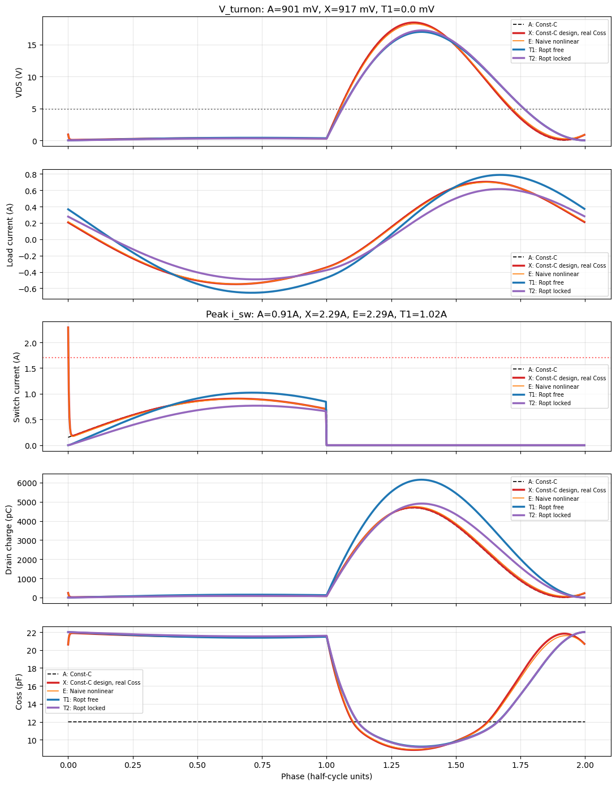
    


    
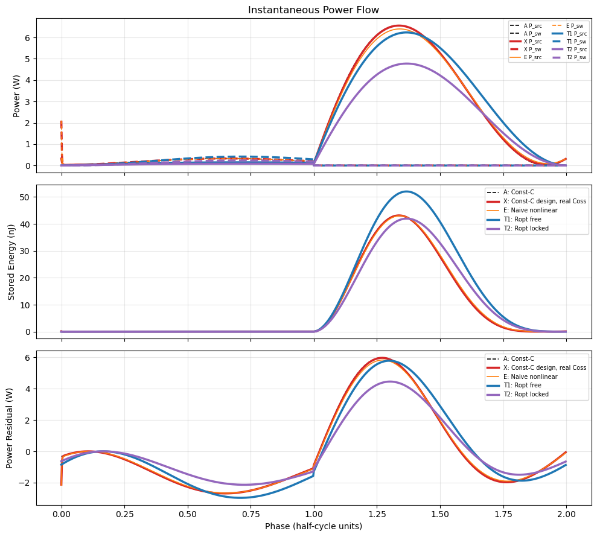
    


    
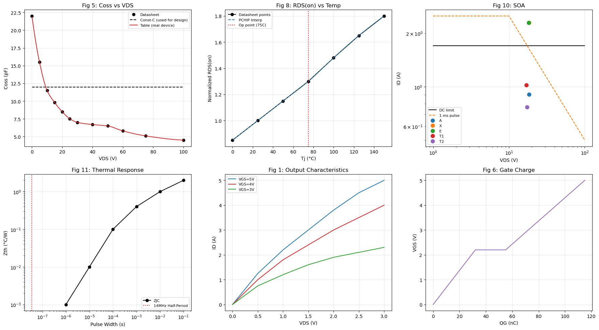
    


    
    ======================================================================================
    2. JOINT 20m -> 40m TX HARMONIC LPF (2x DOUBLING, 2x2 MODES, BAND-SPECIFIC Q)
    ======================================================================================
    
      JA2GQP_1R_1C         | Reels: 1 ($3.00) | 20m Base BOM: C1=180pF, L1=470nH, C2=68pF, C3=300pF, L2=470nH, C4=30pF, C5=120pF
        20m (14.10 MHz, Q=60) Nom: S11=-22.93 dB, S21=-0.292 dB, FCC=+32.5 dB | ±5% MC WC: S11=-15.61 dB, FCC=+15.3 dB
        40m ( 7.05 MHz, Q=45) Nom: S11=-22.82 dB, S21=-0.378 dB, FCC=+30.1 dB | ±5% MC WC: S11=-15.62 dB, FCC=+15.3 dB
    
      JA2GQP_1R_2C         | Reels: 1 ($3.00) | 20m Base BOM: C1=180pF, L1=390nH, C2=6.8pF+75pF, C3=43pF+270pF, L2=390nH, C4=6.2pF+30pF, C5=120pF
        20m (14.10 MHz, Q=60) Nom: S11=-25.54 dB, S21=-0.264 dB, FCC=+29.3 dB | ±5% MC WC: S11=-17.23 dB, FCC=+11.6 dB
        40m ( 7.05 MHz, Q=45) Nom: S11=-25.80 dB, S21=-0.343 dB, FCC=+26.8 dB | ±5% MC WC: S11=-17.27 dB, FCC=+11.6 dB
    
      JA2GQP_MR_1C         | Reels: 2 ($6.00) | 20m Base BOM: C1=200pF, L1=390nH, C2=82pF, C3=300pF, L2=330nH, C4=43pF, C5=120pF
        20m (14.10 MHz, Q=60) Nom: S11=-30.19 dB, S21=-0.256 dB, FCC=+27.2 dB | ±5% MC WC: S11=-18.90 dB, FCC=+ 9.9 dB
        40m ( 7.05 MHz, Q=45) Nom: S11=-31.79 dB, S21=-0.334 dB, FCC=+24.9 dB | ±5% MC WC: S11=-19.43 dB, FCC=+ 9.9 dB
    
      JA2GQP_MR_2C         | Reels: 1 ($3.00) | 20m Base BOM: C1=180pF, L1=390nH, C2=6.8pF+75pF, C3=300pF, L2=390nH, C4=6.2pF+30pF, C5=120pF
        20m (14.10 MHz, Q=60) Nom: S11=-29.71 dB, S21=-0.248 dB, FCC=+28.8 dB | ±5% MC WC: S11=-18.42 dB, FCC=+11.1 dB
        40m ( 7.05 MHz, Q=45) Nom: S11=-29.52 dB, S21=-0.325 dB, FCC=+26.4 dB | ±5% MC WC: S11=-18.40 dB, FCC=+11.1 dB
    
      4Element_1R_1C       | Reels: 1 ($3.00) | 20m Base BOM: C1=180pF, L2=470nH, C2=68pF, C3=200pF
        20m (14.10 MHz, Q=60) Nom: S11=-19.31 dB, S21=-0.247 dB, FCC=+ 8.0 dB | ±5% MC WC: S11=-14.53 dB, FCC=+ 4.1 dB
        40m ( 7.05 MHz, Q=45) Nom: S11=-19.47 dB, S21=-0.306 dB, FCC=+ 8.0 dB | ±5% MC WC: S11=-14.67 dB, FCC=+ 4.0 dB
    
      4Element_1R_2C       | Reels: 1 ($3.00) | 20m Base BOM: C1=180pF, L2=390nH, C2=6.8pF+75pF, C3=47pF+130pF
        20m (14.10 MHz, Q=60) Nom: S11=-26.61 dB, S21=-0.158 dB, FCC=+ 6.1 dB | ±5% MC WC: S11=-19.13 dB, FCC=+ 1.5 dB
        40m ( 7.05 MHz, Q=45) Nom: S11=-26.13 dB, S21=-0.205 dB, FCC=+ 6.1 dB | ±5% MC WC: S11=-19.02 dB, FCC=+ 1.4 dB
    
      4Element_MR_1C       | Reels: 1 ($3.00) | 20m Base BOM: C1=180pF, L2=470nH, C2=68pF, C3=200pF
        20m (14.10 MHz, Q=60) Nom: S11=-19.31 dB, S21=-0.247 dB, FCC=+ 8.0 dB | ±5% MC WC: S11=-14.53 dB, FCC=+ 4.1 dB
        40m ( 7.05 MHz, Q=45) Nom: S11=-19.47 dB, S21=-0.306 dB, FCC=+ 8.0 dB | ±5% MC WC: S11=-14.67 dB, FCC=+ 4.0 dB
    
      4Element_MR_2C       | Reels: 1 ($3.00) | 20m Base BOM: C1=180pF, L2=390nH, C2=6.8pF+75pF, C3=47pF+130pF
        20m (14.10 MHz, Q=60) Nom: S11=-26.61 dB, S21=-0.158 dB, FCC=+ 6.1 dB | ±5% MC WC: S11=-19.13 dB, FCC=+ 1.5 dB
        40m ( 7.05 MHz, Q=45) Nom: S11=-26.13 dB, S21=-0.205 dB, FCC=+ 6.1 dB | ±5% MC WC: S11=-19.02 dB, FCC=+ 1.4 dB
    
      LMatch_WB2CBA_1R_1C  | Reels: 1 ($3.00) | 20m Base BOM: Cm=910pF, Lm=150nH, C1=4.7pF, L2=150nH, C3=910pF, L4=150nH, C5=4.7pF
        20m (14.10 MHz, Q=60) Nom: S11= -8.57 dB, S21=-1.293 dB, FCC=+ 3.6 dB | ±5% MC WC: S11= -4.22 dB, FCC=+ 2.2 dB
        40m ( 7.05 MHz, Q=45) Nom: S11= -8.61 dB, S21=-1.472 dB, FCC=+ 3.7 dB | ±5% MC WC: S11= -4.31 dB, FCC=+ 2.3 dB
    
      LMatch_WB2CBA_1R_2C  | Reels: 1 ($3.00) | 20m Base BOM: Cm=910pF, Lm=150nH, C1=4.7pF, L2=150nH, C3=910pF, L4=150nH, C5=4.7pF
        20m (14.10 MHz, Q=60) Nom: S11= -8.57 dB, S21=-1.293 dB, FCC=+ 3.6 dB | ±5% MC WC: S11= -4.22 dB, FCC=+ 2.2 dB
        40m ( 7.05 MHz, Q=45) Nom: S11= -8.61 dB, S21=-1.472 dB, FCC=+ 3.7 dB | ±5% MC WC: S11= -4.31 dB, FCC=+ 2.3 dB
    
      LMatch_WB2CBA_MR_1C  | Reels: 2 ($6.00) | 20m Base BOM: Cm=4.7pF, Lm=47nH, C1=300pF, L2=560nH, C3=560pF, L4=560nH, C5=240pF
        20m (14.10 MHz, Q=60) Nom: S11=-21.57 dB, S21=-0.424 dB, FCC=+ 4.8 dB | ±5% MC WC: S11=-13.50 dB, FCC=+ 2.5 dB
        40m ( 7.05 MHz, Q=45) Nom: S11=-21.67 dB, S21=-0.547 dB, FCC=+ 4.8 dB | ±5% MC WC: S11=-13.60 dB, FCC=+ 2.5 dB
    
      LMatch_WB2CBA_MR_2C  | Reels: 2 ($6.00) | 20m Base BOM: Cm=4.7pF, Lm=47nH, C1=300pF, L2=560nH, C3=560pF, L4=560nH, C5=91pF+160pF
        20m (14.10 MHz, Q=60) Nom: S11=-24.11 dB, S21=-0.410 dB, FCC=+ 5.1 dB | ±5% MC WC: S11=-14.32 dB, FCC=+ 2.9 dB
        40m ( 7.05 MHz, Q=45) Nom: S11=-24.11 dB, S21=-0.533 dB, FCC=+ 5.2 dB | ±5% MC WC: S11=-14.40 dB, FCC=+ 2.9 dB


    
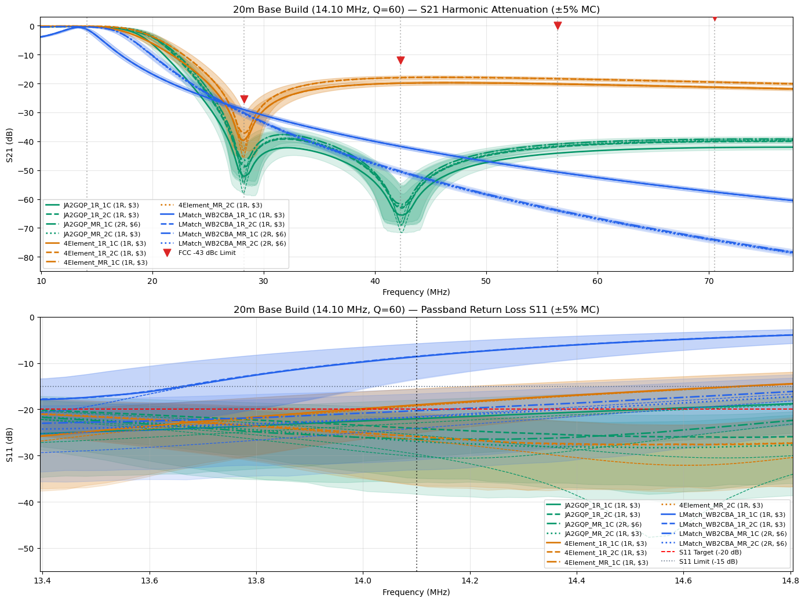
    


    
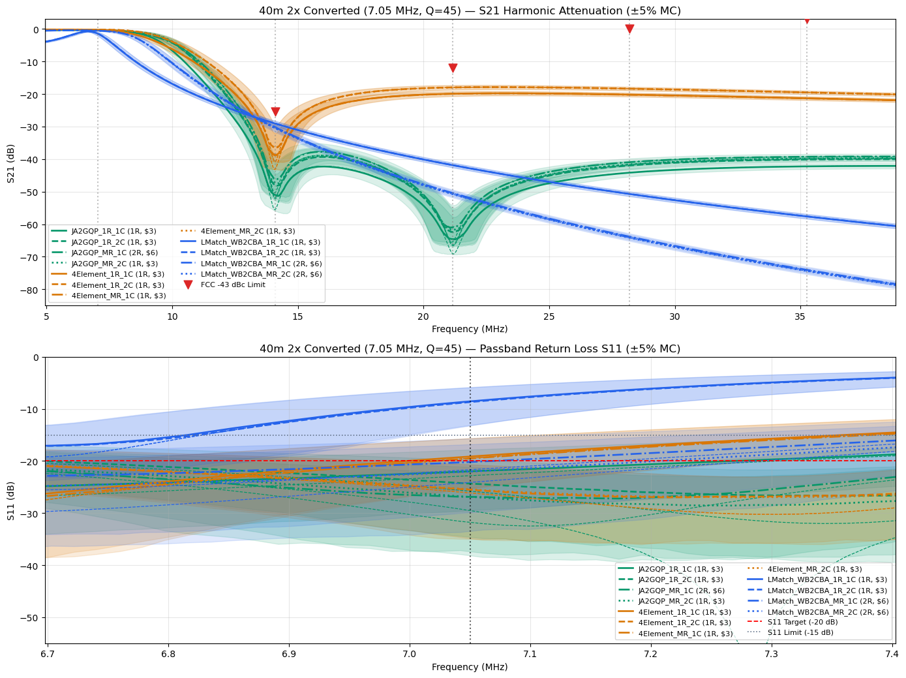
    


    
    ======================================================================================
    3. RX AUDIO CHAIN (SETTLING + PASSIVE RC2 + ARCH A 2x2 + 20m/40m TAYLOE 2x)
    ======================================================================================
    ADC Settling (R_kick=100 Ω, C_kick=1.0 nF): charge-share=0.596%, tau=100.6 ns, residual=1.46e-10 LSB -> PASS
      RC2 (C0G caps)    : INFEASIBLE | alias=-66.53 dB, droop=4.328 dB, fc_min=2.20 kHz, settle=2.15 LSB
      RC2 (C0G1 caps)   : INFEASIBLE | alias=-66.51 dB, droop=3.874 dB, fc_min=2.37 kHz, settle=1.91 LSB
    
    Opt. single (C0G) — Component Table (Identical on 20m & 40m)
      ----------------------------------------------------------------------------------------------------
      Ref   Role                                  Value Build          Class     Tol       Min       Max      Exact [SI]
      ----------------------------------------------------------------------------------------------------
      c_ac  AC-coupling capacitor                  10uF 10uF           X5R       20%       8uF      12uF           1e-05
      r_in  Diff-amp input resistor                  1k 1k             R1pct      1%       990     1.01k            1000
      r_fb  Diff-amp feedback resistor              50k 50k            R1pct      1%     49.5k     50.5k           50000
      c_fb  Diff-amp feedback cap (pole 1)        200pF 200pF          C0G        5%     190pF     210pF           2e-10
      ra    Sallen-Key R (both resistors)         12.4k 12.4k          R1pct      1%    12.28k    12.52k           12400
      ca    Sallen-Key Ca (feedback cap)          1.6nF 1.6nF          C0G        5%    1.52nF    1.68nF         1.6e-09
      cb    Sallen-Key Cb (cap to ground)         620pF 620pF          C0G        5%     589pF     651pF         6.2e-10
      ----------------------------------------------------------------------------------------------------
    
    Opt. single (C0G) — Derived Quantities
      signal gain (r_fb / (r_in + R_src)) : 47.49 V/V = 33.53 dB (R_src = 52.88 ohm)
      AC-coupling HPF corner               : 15.12 Hz
      diff-amp feedback pole (pole 1)      : 15.915 kHz
      Sallen-Key f0 / Q                    : 12.887 kHz / 0.8032
      cascade -3 dB corner (nominal)       : 11.778 kHz | worst-corner fc_min: 10.936 kHz
      Q over tolerance corners             : 0.7640 .. 0.8444 (allowed 0.6..0.85)
      nominal alias / passband dev         : -68.44 dB (limit -66.52) / 0.214 dB (limit 0.5)
        [20m (2.2 nF Tayloe)] 128-Corner WC -> Alias: -66.84 dB | Droop: 0.261 dB | fc_min: 10.94 kHz | Q: 0.764..0.844
        [40m (4.4 nF Tayloe = 2x)] 128-Corner WC -> Alias: -67.08 dB | Droop: 0.261 dB | fc_min: 10.94 kHz | Q: 0.764..0.844
    
    Opt. single (C0G) - alias rejection statistics (Max MC worst-alias: -67.35 dB, margin +0.83 dB)


    

    


    
    Opt. parallel (C0G) — Component Table (Identical on 20m & 40m)
      ----------------------------------------------------------------------------------------------------
      Ref   Role                                  Value Build          Class     Tol       Min       Max      Exact [SI]
      ----------------------------------------------------------------------------------------------------
      c_ac  AC-coupling capacitor                  10uF 10uF           X5R       20%       8uF      12uF           1e-05
      r_in  Diff-amp input resistor                  1k 1k             R1pct      1%       990     1.01k            1000
      r_fb  Diff-amp feedback resistor              50k 50k            R1pct      1%     49.5k     50.5k           50000
      c_fb  Diff-amp feedback cap (pole 1)        195pF 75pF+120pF     C0G        5%   185.2pF   204.8pF        1.95e-10
      ra    Sallen-Key R (both resistors)         12.1k 12.1k          R1pct      1%    11.98k    12.22k           12100
      ca    Sallen-Key Ca (feedback cap)        1.647nF 47pF+1.6nF     C0G        5%   1.565nF   1.729nF       1.647e-09
      cb    Sallen-Key Cb (cap to ground)         630pF 300pF+330pF    C0G        5%   598.5pF   661.5pF         6.3e-10
      ----------------------------------------------------------------------------------------------------
    
    Opt. parallel (C0G) — Derived Quantities
      signal gain (r_fb / (r_in + R_src)) : 47.49 V/V = 33.53 dB (R_src = 52.88 ohm)
      AC-coupling HPF corner               : 15.12 Hz
      diff-amp feedback pole (pole 1)      : 16.324 kHz
      Sallen-Key f0 / Q                    : 12.913 kHz / 0.8084
      cascade -3 dB corner (nominal)       : 11.953 kHz | worst-corner fc_min: 11.113 kHz
      Q over tolerance corners             : 0.7690 .. 0.8499 (allowed 0.6..0.85)
      nominal alias / passband dev         : -68.19 dB (limit -66.52) / 0.204 dB (limit 0.5)
        [20m (2.2 nF Tayloe)] 128-Corner WC -> Alias: -66.59 dB | Droop: 0.250 dB | fc_min: 11.11 kHz | Q: 0.769..0.850
        [40m (4.4 nF Tayloe = 2x)] 128-Corner WC -> Alias: -66.83 dB | Droop: 0.251 dB | fc_min: 11.11 kHz | Q: 0.769..0.850
    
    Opt. parallel (C0G) - alias rejection statistics (Max MC worst-alias: -67.09 dB, margin +0.57 dB)


    

    


    
    Opt. single (any) — Component Table (Identical on 20m & 40m)
      ----------------------------------------------------------------------------------------------------
      Ref   Role                                  Value Build          Class     Tol       Min       Max      Exact [SI]
      ----------------------------------------------------------------------------------------------------
      c_ac  AC-coupling capacitor                  10uF 10uF           X5R       20%       8uF      12uF           1e-05
      r_in  Diff-amp input resistor                  1k 1k             R1pct      1%       990     1.01k            1000
      r_fb  Diff-amp feedback resistor              50k 50k            R1pct      1%     49.5k     50.5k           50000
      c_fb  Diff-amp feedback cap (pole 1)        200pF 200pF          C0G1       1%     198pF     202pF           2e-10
      ra    Sallen-Key R (both resistors)           11k 11k            R1pct      1%    10.89k    11.11k           11000
      ca    Sallen-Key Ca (feedback cap)          1.6nF 1.6nF          C0G1       1%   1.584nF   1.616nF         1.6e-09
      cb    Sallen-Key Cb (cap to ground)         680pF 680pF          C0G1       1%   673.2pF   686.8pF         6.8e-10
      ----------------------------------------------------------------------------------------------------
    
    Opt. single (any) — Derived Quantities
      signal gain (r_fb / (r_in + R_src)) : 47.49 V/V = 33.53 dB (R_src = 52.88 ohm)
      AC-coupling HPF corner               : 15.12 Hz
      diff-amp feedback pole (pole 1)      : 15.915 kHz
      Sallen-Key f0 / Q                    : 13.871 kHz / 0.7670
      cascade -3 dB corner (nominal)       : 11.861 kHz | worst-corner fc_min: 11.549 kHz
      Q over tolerance corners             : 0.7593 .. 0.7747 (allowed 0.6..0.85)
      nominal alias / passband dev         : -67.16 dB (limit -66.52) / 0.248 dB (limit 0.5)
        [20m (2.2 nF Tayloe)] 128-Corner WC -> Alias: -66.64 dB | Droop: 0.260 dB | fc_min: 11.55 kHz | Q: 0.759..0.775
        [40m (4.4 nF Tayloe = 2x)] 128-Corner WC -> Alias: -66.88 dB | Droop: 0.260 dB | fc_min: 11.55 kHz | Q: 0.759..0.775
    
    Opt. single (any) - alias rejection statistics (Max MC worst-alias: -66.82 dB, margin +0.30 dB)


    
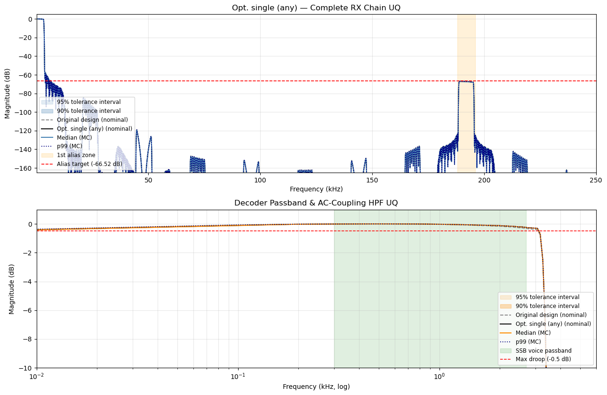
    


    
    Opt. parallel (any) — Component Table (Identical on 20m & 40m)
      ----------------------------------------------------------------------------------------------------
      Ref   Role                                  Value Build          Class     Tol       Min       Max      Exact [SI]
      ----------------------------------------------------------------------------------------------------
      c_ac  AC-coupling capacitor                  10uF 10uF           X5R       20%       8uF      12uF           1e-05
      r_in  Diff-amp input resistor                  1k 1k             R1pct      1%       990     1.01k            1000
      r_fb  Diff-amp feedback resistor              50k 50k            R1pct      1%     49.5k     50.5k           50000
      c_fb  Diff-amp feedback cap (pole 1)        192pF 82pF+110pF     C0G1       1%   190.1pF   193.9pF        1.92e-10
      ra    Sallen-Key R (both resistors)         12.1k 12.1k          R1pct      1%    11.98k    12.22k           12100
      ca    Sallen-Key Ca (feedback cap)         1.62nF 620pF+1nF      C0G1       1%   1.604nF   1.636nF        1.62e-09
      cb    Sallen-Key Cb (cap to ground)         572pF 62pF+510pF     C0G1       1%   566.3pF   577.7pF        5.72e-10
      ----------------------------------------------------------------------------------------------------
    
    Opt. parallel (any) — Derived Quantities
      signal gain (r_fb / (r_in + R_src)) : 47.49 V/V = 33.53 dB (R_src = 52.88 ohm)
      AC-coupling HPF corner               : 15.12 Hz
      diff-amp feedback pole (pole 1)      : 16.579 kHz
      Sallen-Key f0 / Q                    : 13.664 kHz / 0.8415
      cascade -3 dB corner (nominal)       : 12.915 kHz | worst-corner fc_min: 12.605 kHz
      Q over tolerance corners             : 0.8331 .. 0.8499 (allowed 0.6..0.85)
      nominal alias / passband dev         : -67.07 dB (limit -66.52) / 0.188 dB (limit 0.5)
        [20m (2.2 nF Tayloe)] 128-Corner WC -> Alias: -66.54 dB | Droop: 0.199 dB | fc_min: 12.61 kHz | Q: 0.833..0.850
        [40m (4.4 nF Tayloe = 2x)] 128-Corner WC -> Alias: -66.78 dB | Droop: 0.199 dB | fc_min: 12.61 kHz | Q: 0.833..0.850
    
    Opt. parallel (any) - alias rejection statistics (Max MC worst-alias: -66.73 dB, margin +0.21 dB)


    
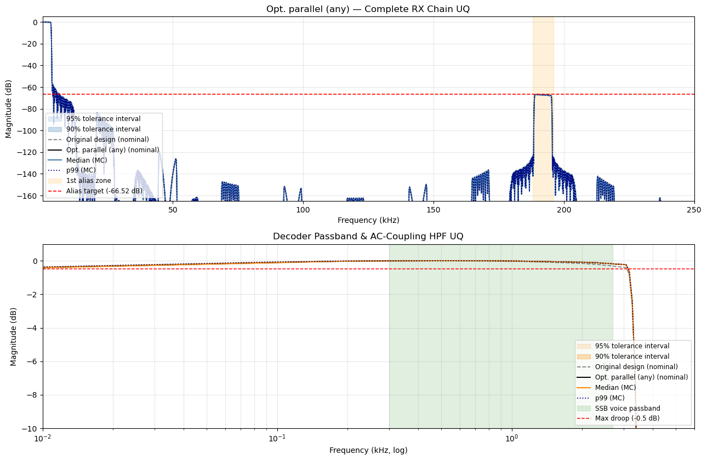
    


      Opt. single (C0G): 6 feasible / 31 E96 values of ra in 6.8–14.0 kOhm


    
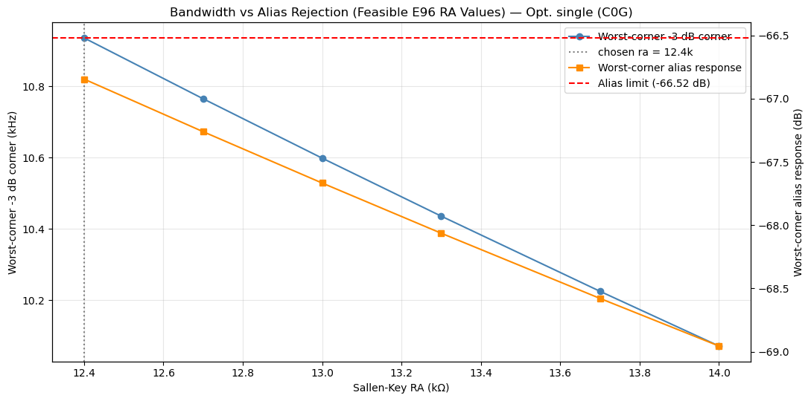
    


      Opt. parallel (C0G): 7 feasible / 31 E96 values of ra in 6.8–14.0 kOhm


    
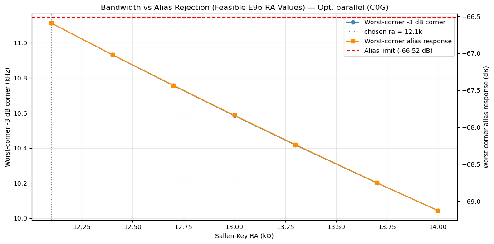
    


      Opt. single (any): 11 feasible / 31 E96 values of ra in 6.8–14.0 kOhm


    
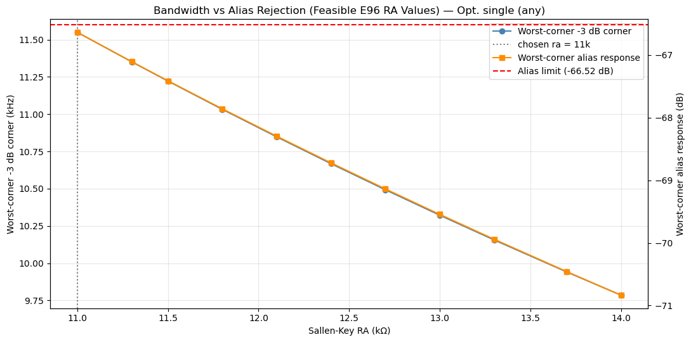
    


      Opt. parallel (any): 7 feasible / 31 E96 values of ra in 6.8–14.0 kOhm


    
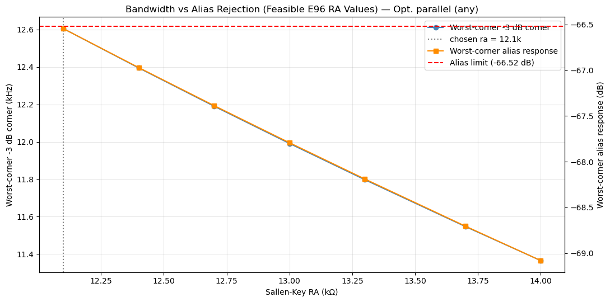
    


    

    


```python

```
